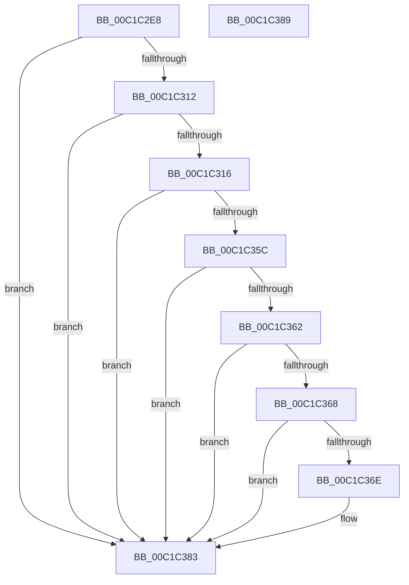

# InitializeDynamicPartitioningPolicy

- RVA: `0x00C1C2E8`–`0x00C1C38A` (길이 `162` bytes)
- VA: `0x0000000140C1C2E8`
- 실행 섹션: `INIT`
- PDB 이름 있음: `예`; PDB Function 태그: `아니요`
- unwind 정보 RVA: `0x000C36EC`
- 디코드: `43`개 명령, `162/162` bytes 표시
- 미해석 바이트: `0` (있으면 어셈블리에 `.byte`로 보존)

> 이 문서는 커널 이미지의 기계어와 PDB 기호를 분석해 생성했습니다. 4번과 5번은 함수 원형과 자료형을 바이너리 사용 방식에서 추정한 C 해석이며 원본 소스 복구 결과는 아닙니다.

## 1. Dependencies

- 직접 호출 지점: **3**; 고유 호출 대상: **3**
- 직접 호출자로 확인된 함수: **1**
- RIP 상대 이미지 참조: **5**

### Outgoing calls
- `0x00C1C316` → [HviIsAnyHypervisorPresent](../../text/4A/HviIsAnyHypervisorPresent_function_004ADC50.md) (function, `0x004ADC50`)
- `0x00C1C333` → [RtlInitUnicodeString](../../text/42/RtlInitUnicodeString_function_0042A780.md) (function, `0x0042A780`)
- `0x00C1C353` → [ZwQueryLicenseValue](../../text/6A/ZwQueryLicenseValue_function_006AFCF0.md) (function, `0x006AFCF0`)

### Direct callers
- [InitBootProcessor](InitBootProcessor_function_00C1B1C8.md) at `0x00C1B702`

### Static image references
- `0x00C1C304` → RVA `0x00FC6A90` (`ALMOSTRO`; read)
- `0x00C1C31D` → RVA `0x00C79430` (` ?? ::PBOPGDP::`string'`; read)
- `0x00C1C324` → RVA `0x00C793D0` (` ?? ::PBOPGDP::`string'`; read)
- `0x00C1C36E` → RVA `0x00FC5008` (`ALMOSTRO`; read)
- `0x00C1C375` → RVA `0x00FC6AA4` (`ALMOSTRO`; write)

## 2. Other-region calls and transfers

- 다른 실행 섹션으로 향하는 call: **3**
  - `0x00C1C316` → [HviIsAnyHypervisorPresent](../../text/4A/HviIsAnyHypervisorPresent_function_004ADC50.md) (`INIT` → `.text`)
  - `0x00C1C333` → [RtlInitUnicodeString](../../text/42/RtlInitUnicodeString_function_0042A780.md) (`INIT` → `.text`)
  - `0x00C1C353` → [ZwQueryLicenseValue](../../text/6A/ZwQueryLicenseValue_function_006AFCF0.md) (`INIT` → `.text`)
- 별도 외부 분기/꼬리 이동을 확인하지 못했습니다.

## 3. Assembly (complete function range)

```asm
00C1C2E8  48 89 4C 24 08                  mov qword ptr [rsp + 8], rcx
00C1C2ED  55                              push rbp
00C1C2EE  48 8B EC                        mov rbp, rsp
00C1C2F1  48 83 EC 40                     sub rsp, 0x40
00C1C2F5  83 65 10 00                     and dword ptr [rbp + 0x10], 0
00C1C2F9  0F 57 C0                        xorps xmm0, xmm0
00C1C2FC  83 65 18 00                     and dword ptr [rbp + 0x18], 0
00C1C300  83 65 20 00                     and dword ptr [rbp + 0x20], 0
00C1C304  8B 05 86 A7 3A 00               mov eax, dword ptr [rip + 0x3aa786]
00C1C30A  0F 11 45 F0                     movups xmmword ptr [rbp - 0x10], xmm0
00C1C30E  A8 02                           test al, 2
00C1C310  75 71                           jne 0x140c1c383
00C1C312  A8 04                           test al, 4
00C1C314  75 6D                           jne 0x140c1c383
00C1C316  E8 35 19 89 FF                  call 0x1404adc50
00C1C31B  84 C0                           test al, al
00C1C31D  48 8D 0D 0C D1 05 00            lea rcx, [rip + 0x5d10c]
00C1C324  48 8D 15 A5 D0 05 00            lea rdx, [rip + 0x5d0a5]
00C1C32B  48 0F 44 D1                     cmove rdx, rcx
00C1C32F  48 8D 4D F0                     lea rcx, [rbp - 0x10]
00C1C333  E8 48 E4 80 FF                  call 0x14042a780
00C1C338  48 8D 45 10                     lea rax, [rbp + 0x10]
00C1C33C  41 B9 04 00 00 00               mov r9d, 4
00C1C342  4C 8D 45 20                     lea r8, [rbp + 0x20]
00C1C346  48 89 44 24 20                  mov qword ptr [rsp + 0x20], rax
00C1C34B  48 8D 55 18                     lea rdx, [rbp + 0x18]
00C1C34F  48 8D 4D F0                     lea rcx, [rbp - 0x10]
00C1C353  E8 98 39 A9 FF                  call 0x1406afcf0
00C1C358  85 C0                           test eax, eax
00C1C35A  78 27                           js 0x140c1c383
00C1C35C  83 7D 10 04                     cmp dword ptr [rbp + 0x10], 4
00C1C360  75 21                           jne 0x140c1c383
00C1C362  83 7D 18 04                     cmp dword ptr [rbp + 0x18], 4
00C1C366  75 1B                           jne 0x140c1c383
00C1C368  83 7D 20 00                     cmp dword ptr [rbp + 0x20], 0
00C1C36C  74 15                           je 0x140c1c383
00C1C36E  48 8B 05 93 8C 3A 00            mov rax, qword ptr [rip + 0x3a8c93]
00C1C375  C6 05 28 A7 3A 00 01            mov byte ptr [rip + 0x3aa728], 1
00C1C37C  83 88 F0 02 00 00 20            or dword ptr [rax + 0x2f0], 0x20
00C1C383  48 83 C4 40                     add rsp, 0x40
00C1C387  5D                              pop rbp
00C1C388  C3                              ret
00C1C389  CC                              int3
```

## 4. C-style interpretation (structured pseudocode)

```c
__int64 __fastcall InitializeDynamicPartitioningPolicy(__int64 a1)
{
    __int64 result;
    __int64 v_rsp;
    unsigned __int64 v_stack_m18;
    unsigned __int64 v_stack_m28;
    unsigned int v_stack_p10;
    unsigned int v_stack_p18;
    unsigned __int64 v_stack_p8;

    v_stack_p8 = a1;
    v_rsp = (v_rsp) - (64);
    v_stack_m18 = v_xmm0;
    if ((((unsigned __int8)((unsigned int)(*(unsigned int *)(v_rip + 3843974)))) & (2)) != 0) goto loc_00C1C383;
    if ((((unsigned __int8)((unsigned int)(*(unsigned int *)(v_rip + 3843974)))) & (4)) != 0) goto loc_00C1C383;
    result = HviIsAnyHypervisorPresent(a1, a2, a3, a4);
    a2 = v_rip + 381093;
    if ((unsigned __int8)(result) == 0) { a2 = v_rip + 381196; }
    result = RtlInitUnicodeString(v_stack_m18, a2, a3, a4);
    v_stack_m28 = v_stack_p8;
    result = ZwQueryLicenseValue(v_stack_m18, v_stack_p10, v_stack_p18, 4);
    if (sign_flag) goto loc_00C1C383;
    if (v_stack_p8 != 4) goto loc_00C1C383;
    if (v_stack_p10 != 4) goto loc_00C1C383;
    if (v_stack_p18 != 0) {
        result = *(unsigned __int64 *)(v_rip + 3837075);
        *(unsigned __int8 *)(v_rip + 3843880) = 1;
    }
    v_rsp = (v_rsp) + (64);
    return result;
}
```

## 5. (Beta) C Style

```c
int64_t InitializeDynamicPartitioningPolicy(int64_t Arg1)
{
    int64_t result;
    int64_t local_rsp;
    uint64_t v_stack_m18;
    uint64_t v_stack_m28;
    uint32_t v_stack_p10;
    uint32_t v_stack_p18;
    uint64_t v_stack_p8;

    v_stack_p8 = Arg1;
    local_rsp = (local_rsp) - (64);
    v_stack_m18 = v_xmm0;
    if ((((uint8_t)((uint32_t)(*(uint32_t *)(v_rip + 0x3AA786)))) & (2)) != 0) goto loc_00C1C383;
    if ((((uint8_t)((uint32_t)(*(uint32_t *)(v_rip + 0x3AA786)))) & (4)) != 0) goto loc_00C1C383;
    result = HviIsAnyHypervisorPresent(Arg1, a2, a3, a4);
    a2 = v_rip + 381093;
    if ((uint8_t)(result) == 0) { a2 = v_rip + 381196; }
    result = RtlInitUnicodeString(v_stack_m18, a2, a3, a4);
    v_stack_m28 = v_stack_p8;
    result = ZwQueryLicenseValue(v_stack_m18, v_stack_p10, v_stack_p18, 4);
    if (sign_flag) goto loc_00C1C383;
    if (v_stack_p8 != 4) goto loc_00C1C383;
    if (v_stack_p10 != 4) goto loc_00C1C383;
    if (v_stack_p18 != 0) {
        result = *(uint64_t *)(v_rip + 0x3A8C93);
        *(uint8_t *)(v_rip + 0x3AA728) = 1;
    }
    local_rsp = (local_rsp) + (64);
    return result;
}
```

## 6. Execution-region graph

[열기: 2D/3D 그래프와 함수 탐색 컨트롤 패널](../../../control-panel.html?section=init&rva=0x00C1C2E8&view=graph)

- 2D 그래프는 위에서 아래로 흐르고, 3D 그래프는 빈 공간을 드래그해 회전합니다. Shift+드래그는 이동, 휠은 확대·축소, 함수 노드 선택은 대상 보고서 이동입니다.

### Static fallback


