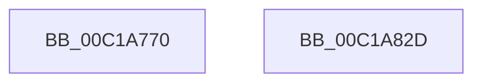

# KiDpcDispatch

- RVA: `0x00C1A770`–`0x00C1A838` (길이 `200` bytes)
- VA: `0x0000000140C1A770`
- 실행 섹션: `INIT`
- PDB 이름 있음: `예`; PDB Function 태그: `아니요`
- unwind 정보 RVA: `0x000C2FF8`
- 디코드: `51`개 명령, `200/200` bytes 표시
- 미해석 바이트: `0` (있으면 어셈블리에 `.byte`로 보존)

> 이 문서는 커널 이미지의 기계어와 PDB 기호를 분석해 생성했습니다. 4번과 5번은 함수 원형과 자료형을 바이너리 사용 방식에서 추정한 C 해석이며 원본 소스 복구 결과는 아닙니다.

## 1. Dependencies

- 직접 호출 지점: **0**; 고유 호출 대상: **0**
- 직접 호출자로 확인된 함수: **0**
- RIP 상대 이미지 참조: **0**

### Outgoing calls
- 직접 디코드된 call 명령이 없습니다.

### Direct callers
- 이 함수 시작 RVA로 연결되는 직접 call은 확인되지 않았습니다. 간접 호출은 완전히 역산할 수 없습니다.

### Static image references
- 디코드된 RIP-relative 메모리 참조가 없습니다.

## 2. Other-region calls and transfers

- 다른 실행 섹션으로 향하는 call: **0**
- 별도 외부 분기/꼬리 이동을 확인하지 못했습니다.

## 3. Assembly (complete function range)

```asm
00C1A770  48 31 51 48                     xor qword ptr [rcx + 0x48], rdx
00C1A774  48 31 51 50                     xor qword ptr [rcx + 0x50], rdx
00C1A778  48 83 C1 48                     add rcx, 0x48
00C1A77C  48 31 51 10                     xor qword ptr [rcx + 0x10], rdx
00C1A780  48 31 51 18                     xor qword ptr [rcx + 0x18], rdx
00C1A784  48 31 51 20                     xor qword ptr [rcx + 0x20], rdx
00C1A788  48 31 51 28                     xor qword ptr [rcx + 0x28], rdx
00C1A78C  48 31 51 30                     xor qword ptr [rcx + 0x30], rdx
00C1A790  48 31 51 38                     xor qword ptr [rcx + 0x38], rdx
00C1A794  48 31 51 40                     xor qword ptr [rcx + 0x40], rdx
00C1A798  48 31 51 48                     xor qword ptr [rcx + 0x48], rdx
00C1A79C  48 31 51 50                     xor qword ptr [rcx + 0x50], rdx
00C1A7A0  48 31 51 58                     xor qword ptr [rcx + 0x58], rdx
00C1A7A4  48 31 51 60                     xor qword ptr [rcx + 0x60], rdx
00C1A7A8  48 31 51 68                     xor qword ptr [rcx + 0x68], rdx
00C1A7AC  48 31 51 70                     xor qword ptr [rcx + 0x70], rdx
00C1A7B0  48 31 51 78                     xor qword ptr [rcx + 0x78], rdx
00C1A7B4  48 31 91 80 00 00 00            xor qword ptr [rcx + 0x80], rdx
00C1A7BB  48 31 91 88 00 00 00            xor qword ptr [rcx + 0x88], rdx
00C1A7C2  48 31 91 90 00 00 00            xor qword ptr [rcx + 0x90], rdx
00C1A7C9  48 31 91 98 00 00 00            xor qword ptr [rcx + 0x98], rdx
00C1A7D0  48 31 91 A0 00 00 00            xor qword ptr [rcx + 0xa0], rdx
00C1A7D7  48 31 91 A8 00 00 00            xor qword ptr [rcx + 0xa8], rdx
00C1A7DE  48 31 91 B0 00 00 00            xor qword ptr [rcx + 0xb0], rdx
00C1A7E5  48 31 91 B8 00 00 00            xor qword ptr [rcx + 0xb8], rdx
00C1A7EC  48 31 91 C0 00 00 00            xor qword ptr [rcx + 0xc0], rdx
00C1A7F3  31 11                           xor dword ptr [rcx], edx
00C1A7F5  48 83 E9 48                     sub rcx, 0x48
00C1A7F9  4C 8B 41 40                     mov r8, qword ptr [rcx + 0x40]
00C1A7FD  4D 8B 50 40                     mov r10, qword ptr [r8 + 0x40]
00C1A801  48 BA 00 00 00 00 00 80 FF FF   movabs rdx, 0xffff800000000000
00C1A80B  4D 8B 48 20                     mov r9, qword ptr [r8 + 0x20]
00C1A80F  4D 33 D1                        xor r10, r9
00C1A812  4C 0B D2                        or r10, rdx
00C1A815  48 BA 2E 48 31 11 48 31 51 08   movabs rdx, 0x85131481131482e
00C1A81F  48 8B CA                        mov rcx, rdx
00C1A822  49 33 12                        xor rdx, qword ptr [r10]
00C1A825  41 89 0A                        mov dword ptr [r10], ecx
00C1A828  49 8B CA                        mov rcx, r10
00C1A82B  FF E1                           jmp rcx
00C1A82D  90                              nop
00C1A82E  90                              nop
00C1A82F  90                              nop
00C1A830  90                              nop
00C1A831  90                              nop
00C1A832  90                              nop
00C1A833  90                              nop
00C1A834  90                              nop
00C1A835  90                              nop
00C1A836  90                              nop
00C1A837  90                              nop
```

## 4. C-style interpretation (structured pseudocode)

```c
void __fastcall KiDpcDispatch(__int64 a1, __int64 a2)
{
    __int64 v_r10;

    a1 = (a1) + (72);
    a1 = (a1) - (72);
    v_r10 = (*(unsigned __int64 *)(*(unsigned __int64 *)(a1 + 64) + 64)) ^ (*(unsigned __int64 *)(*(unsigned __int64 *)(a1 + 64) + 32));
    v_r10 = (v_r10) | (a2);
    a2 = (a2) ^ (*(unsigned __int64 *)(v_r10));
    *(unsigned int *)(v_r10) = (unsigned int)(a2);
}
```

## 5. (Beta) C Style

```c
void KiDpcDispatch(void *Arg1, int64_t Arg2)
{
    uint8_t *arg1 = (uint8_t *)Arg1;

    int64_t local_r10;

    Arg1 = (Arg1) + (72);
    Arg1 = (Arg1) - (72);
    local_r10 = (*(uint64_t *)(*(uint64_t *)(arg1 + 0x40) + 0x40)) ^ (*(uint64_t *)(*(uint64_t *)(arg1 + 0x40) + 0x20));
    local_r10 = (local_r10) | (Arg2);
    Arg2 = (Arg2) ^ (*(uint64_t *)(local_r10));
    *(uint32_t *)(local_r10) = (uint32_t)(Arg2);
}
```

### 관측된 메모리 오프셋

구조체 형식이 확인되지 않은 접근은 인자 기준의 오프셋으로만 기록했습니다.

| 기준 인자 | 오프셋 표현 | 폭 (bit) | 접근 |
|---|---:|---:|---|
| `Arg1` | `+ 0x0` | `32` | `R/W` |
| `Arg1` | `+ 0x10` | `64` | `R/W` |
| `Arg1` | `+ 0x18` | `64` | `R/W` |
| `Arg1` | `+ 0x20` | `64` | `R/W` |
| `Arg1` | `+ 0x28` | `64` | `R/W` |
| `Arg1` | `+ 0x30` | `64` | `R/W` |
| `Arg1` | `+ 0x38` | `64` | `R/W` |
| `Arg1` | `+ 0x40` | `64` | `R` |
| `Arg1` | `+ 0x40` | `64` | `R/W` |
| `Arg1` | `+ 0x48` | `64` | `R/W` |
| `Arg1` | `+ 0x50` | `64` | `R/W` |
| `Arg1` | `+ 0x58` | `64` | `R/W` |
| `Arg1` | `+ 0x60` | `64` | `R/W` |
| `Arg1` | `+ 0x68` | `64` | `R/W` |
| `Arg1` | `+ 0x70` | `64` | `R/W` |
| `Arg1` | `+ 0x78` | `64` | `R/W` |
| `Arg1` | `+ 0x80` | `64` | `R/W` |
| `Arg1` | `+ 0x88` | `64` | `R/W` |
| `Arg1` | `+ 0x90` | `64` | `R/W` |
| `Arg1` | `+ 0x98` | `64` | `R/W` |
| `Arg1` | `+ 0xA0` | `64` | `R/W` |
| `Arg1` | `+ 0xA8` | `64` | `R/W` |
| `Arg1` | `+ 0xB0` | `64` | `R/W` |
| `Arg1` | `+ 0xB8` | `64` | `R/W` |
| `Arg1` | `+ 0xC0` | `64` | `R/W` |

## 6. Execution-region graph

[열기: 2D/3D 그래프와 함수 탐색 컨트롤 패널](../../../control-panel.html?section=init&rva=0x00C1A770&view=graph)

- 2D 그래프는 위에서 아래로 흐르고, 3D 그래프는 빈 공간을 드래그해 회전합니다. Shift+드래그는 이동, 휠은 확대·축소, 함수 노드 선택은 대상 보고서 이동입니다.

### Static fallback


