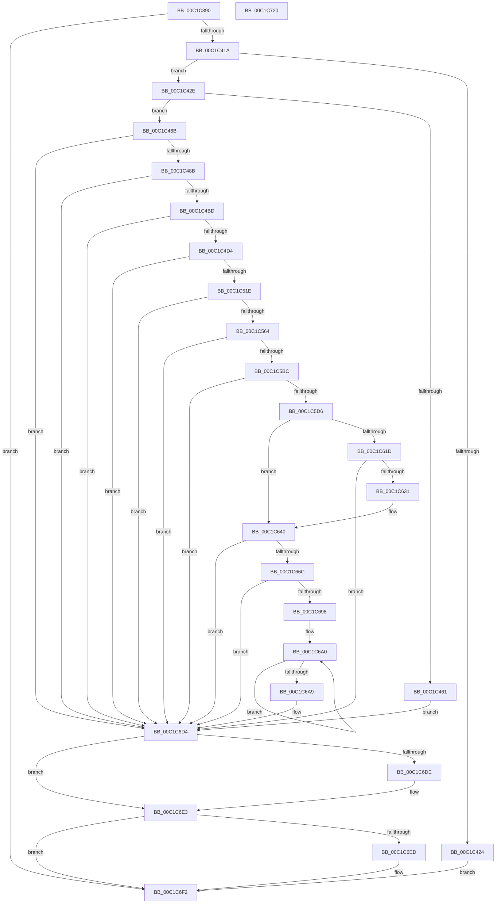

# MfgInitSystem

- RVA: `0x00C1C390`–`0x00C1C721` (길이 `913` bytes)
- VA: `0x0000000140C1C390`
- 실행 섹션: `INIT`
- PDB 이름 있음: `예`; PDB Function 태그: `아니요`
- unwind 정보 RVA: `0x000C37A4`
- 디코드: `207`개 명령, `913/913` bytes 표시
- 미해석 바이트: `0` (있으면 어셈블리에 `.byte`로 보존)

> 이 문서는 커널 이미지의 기계어와 PDB 기호를 분석해 생성했습니다. 4번과 5번은 함수 원형과 자료형을 바이너리 사용 방식에서 추정한 C 해석이며 원본 소스 복구 결과는 아닙니다.

## 1. Dependencies

- 직접 호출 지점: **19**; 고유 호출 대상: **11**
- 직접 호출자로 확인된 함수: **1**
- RIP 상대 이미지 참조: **16**

### Outgoing calls
- `0x00C1C450` → [ExAllocatePool2](../../poolcode/B8/ExAllocatePool2_function_00B820F0.md) (function, `0x00B820F0`)
- `0x00C1C47C` → [RtlStringCbCopyW](../../text/43/RtlStringCbCopyW_function_0043B910.md) (function, `0x0043B910`)
- `0x00C1C4AE` → [RtlStringCbPrintfW](../../text/40/RtlStringCbPrintfW_function_0040FB40.md) (function, `0x0040FB40`)
- `0x00C1C4C5` → [RtlInitUnicodeStringEx](../../text/46/RtlInitUnicodeStringEx_function_00463960.md) (function, `0x00463960`)
- `0x00C1C50F` → [ZwOpenKey](../../text/6A/ZwOpenKey_function_006AD310.md) (function, `0x006AD310`)
- `0x00C1C555` → [ZwOpenKey](../../text/6A/ZwOpenKey_function_006AD310.md) (function, `0x006AD310`)
- `0x00C1C568` → [ZwClose](../../text/6A/ZwClose_function_006AD2B0.md) (function, `0x006AD2B0`)
- `0x00C1C57F` → [RtlInitUnicodeStringEx](../../text/46/RtlInitUnicodeStringEx_function_00463960.md) (function, `0x00463960`)
- `0x00C1C5AD` → [ZwSetValueKey](../../text/6A/ZwSetValueKey_function_006ADCD0.md) (function, `0x006ADCD0`)
- `0x00C1C5C7` → [RtlInitUnicodeStringEx](../../text/46/RtlInitUnicodeStringEx_function_00463960.md) (function, `0x00463960`)
- `0x00C1C614` → [ZwOpenKeyEx](../../text/6A/ZwOpenKeyEx_function_006AF650.md) (function, `0x006AF650`)
- `0x00C1C622` → [ZwDeleteKey](../../text/6A/ZwDeleteKey_function_006AEC50.md) (function, `0x006AEC50`)
- `0x00C1C636` → [ZwClose](../../text/6A/ZwClose_function_006AD2B0.md) (function, `0x006AD2B0`)
- `0x00C1C661` → [ZwCreateKey](../../text/6A/ZwCreateKey_function_006AD470.md) (function, `0x006AD470`)
- `0x00C1C68D` → [RtlStringCbPrintfW](../../text/40/RtlStringCbPrintfW_function_0040FB40.md) (function, `0x0040FB40`)
- `0x00C1C6CD` → [ZwSetValueKey](../../text/6A/ZwSetValueKey_function_006ADCD0.md) (function, `0x006ADCD0`)
- `0x00C1C6DE` → [ZwClose](../../text/6A/ZwClose_function_006AD2B0.md) (function, `0x006AD2B0`)
- `0x00C1C6ED` → [ZwClose](../../text/6A/ZwClose_function_006AD2B0.md) (function, `0x006AD2B0`)
- `0x00C1C6FE` → [_security_check_cookie](../../text/6A/_security_check_cookie_function_006AC640.md) (function, `0x006AC640`)

### Direct callers
- [Phase1InitializationDiscard](Phase1InitializationDiscard_function_00C1C728.md) at `0x00C1D5AD`

### Static image references
- `0x00C1C3B2` → RVA `0x00E0A740` (`.data`; read)
- `0x00C1C3CA` → RVA `0x00EFF070` (`.data`; write)
- `0x00C1C3D1` → RVA `0x00EFF060` (`.data`; read)
- `0x00C1C42E` → RVA `0x00EFF068` (`.data`; write)
- `0x00C1C449` → RVA `0x00EFF06A` (`.data`; write)
- `0x00C1C46B` → RVA `0x00EFF06A` (`.data`; read)
- `0x00C1C48B` → RVA `0x00C78CC0` (` ?? ::PBOPGDP::`string'`; read)
- `0x00C1C497` → RVA `0x00C78D30` (` ?? ::PBOPGDP::`string'`; read)
- `0x00C1C4A3` → RVA `0x00C78D60` (` ?? ::PBOPGDP::`string'`; read)
- `0x00C1C53C` → RVA `0x00EFF068` (`.data`; read)
- `0x00C1C56D` → RVA `0x00EFF060` (`.data`; read/write)
- `0x00C1C574` → RVA `0x00C78D70` (` ?? ::PBOPGDP::`string'`; read)
- `0x00C1C5A1` → RVA `0x00EFF070` (`.data`; read)
- `0x00C1C5BC` → RVA `0x00C78D90` (` ?? ::PBOPGDP::`string'`; read)
- `0x00C1C678` → RVA `0x00C78DA0` (` ?? ::PBOPGDP::`string'`; read)
- `0x00C1C6AE` → RVA `0x00FD9C00` (`PAGEDATA`; read)

## 2. Other-region calls and transfers

- 다른 실행 섹션으로 향하는 call: **19**
  - `0x00C1C450` → [ExAllocatePool2](../../poolcode/B8/ExAllocatePool2_function_00B820F0.md) (`INIT` → `POOLCODE`)
  - `0x00C1C47C` → [RtlStringCbCopyW](../../text/43/RtlStringCbCopyW_function_0043B910.md) (`INIT` → `.text`)
  - `0x00C1C4AE` → [RtlStringCbPrintfW](../../text/40/RtlStringCbPrintfW_function_0040FB40.md) (`INIT` → `.text`)
  - `0x00C1C4C5` → [RtlInitUnicodeStringEx](../../text/46/RtlInitUnicodeStringEx_function_00463960.md) (`INIT` → `.text`)
  - `0x00C1C50F` → [ZwOpenKey](../../text/6A/ZwOpenKey_function_006AD310.md) (`INIT` → `.text`)
  - `0x00C1C555` → [ZwOpenKey](../../text/6A/ZwOpenKey_function_006AD310.md) (`INIT` → `.text`)
  - `0x00C1C568` → [ZwClose](../../text/6A/ZwClose_function_006AD2B0.md) (`INIT` → `.text`)
  - `0x00C1C57F` → [RtlInitUnicodeStringEx](../../text/46/RtlInitUnicodeStringEx_function_00463960.md) (`INIT` → `.text`)
  - `0x00C1C5AD` → [ZwSetValueKey](../../text/6A/ZwSetValueKey_function_006ADCD0.md) (`INIT` → `.text`)
  - `0x00C1C5C7` → [RtlInitUnicodeStringEx](../../text/46/RtlInitUnicodeStringEx_function_00463960.md) (`INIT` → `.text`)
  - `0x00C1C614` → [ZwOpenKeyEx](../../text/6A/ZwOpenKeyEx_function_006AF650.md) (`INIT` → `.text`)
  - `0x00C1C622` → [ZwDeleteKey](../../text/6A/ZwDeleteKey_function_006AEC50.md) (`INIT` → `.text`)
  - `0x00C1C636` → [ZwClose](../../text/6A/ZwClose_function_006AD2B0.md) (`INIT` → `.text`)
  - `0x00C1C661` → [ZwCreateKey](../../text/6A/ZwCreateKey_function_006AD470.md) (`INIT` → `.text`)
  - `0x00C1C68D` → [RtlStringCbPrintfW](../../text/40/RtlStringCbPrintfW_function_0040FB40.md) (`INIT` → `.text`)
  - `0x00C1C6CD` → [ZwSetValueKey](../../text/6A/ZwSetValueKey_function_006ADCD0.md) (`INIT` → `.text`)
  - `0x00C1C6DE` → [ZwClose](../../text/6A/ZwClose_function_006AD2B0.md) (`INIT` → `.text`)
  - `0x00C1C6ED` → [ZwClose](../../text/6A/ZwClose_function_006AD2B0.md) (`INIT` → `.text`)
  - `0x00C1C6FE` → [_security_check_cookie](../../text/6A/_security_check_cookie_function_006AC640.md) (`INIT` → `.text`)
- 별도 외부 분기/꼬리 이동을 확인하지 못했습니다.

## 3. Assembly (complete function range)

```asm
00C1C390  48 8B C4                        mov rax, rsp
00C1C393  48 89 58 10                     mov qword ptr [rax + 0x10], rbx
00C1C397  48 89 70 18                     mov qword ptr [rax + 0x18], rsi
00C1C39B  48 89 78 20                     mov qword ptr [rax + 0x20], rdi
00C1C39F  55                              push rbp
00C1C3A0  41 55                           push r13
00C1C3A2  41 57                           push r15
00C1C3A4  48 8D A8 28 FE FF FF            lea rbp, [rax - 0x1d8]
00C1C3AB  48 81 EC C0 02 00 00            sub rsp, 0x2c0
00C1C3B2  48 8B 05 87 E3 1E 00            mov rax, qword ptr [rip + 0x1ee387]
00C1C3B9  48 33 C4                        xor rax, rsp
00C1C3BC  48 89 85 B0 01 00 00            mov qword ptr [rbp + 0x1b0], rax
00C1C3C3  0F 57 C0                        xorps xmm0, xmm0
00C1C3C6  33 C0                           xor eax, eax
00C1C3C8  33 F6                           xor esi, esi
00C1C3CA  48 89 05 9F 2C 2E 00            mov qword ptr [rip + 0x2e2c9f], rax
00C1C3D1  0F 11 05 88 2C 2E 00            movups xmmword ptr [rip + 0x2e2c88], xmm0
00C1C3D8  48 8B B9 F0 00 00 00            mov rdi, qword ptr [rcx + 0xf0]
00C1C3DF  8B DE                           mov ebx, esi
00C1C3E1  0F 11 45 88                     movups xmmword ptr [rbp - 0x78], xmm0
00C1C3E5  48 89 75 80                     mov qword ptr [rbp - 0x80], rsi
00C1C3E9  0F 11 44 24 50                  movups xmmword ptr [rsp + 0x50], xmm0
00C1C3EE  48 89 44 24 70                  mov qword ptr [rsp + 0x70], rax
00C1C3F3  0F 11 44 24 60                  movups xmmword ptr [rsp + 0x60], xmm0
00C1C3F8  89 44 24 78                     mov dword ptr [rsp + 0x78], eax
00C1C3FC  0F 11 45 98                     movups xmmword ptr [rbp - 0x68], xmm0
00C1C400  48 89 74 24 40                  mov qword ptr [rsp + 0x40], rsi
00C1C405  48 89 74 24 48                  mov qword ptr [rsp + 0x48], rsi
00C1C40A  0F B7 87 18 0B 00 00            movzx eax, word ptr [rdi + 0xb18]
00C1C411  66 85 C0                        test ax, ax
00C1C414  0F 84 D8 02 00 00               je 0x140c1c6f2
00C1C41A  B9 80 00 00 00                  mov ecx, 0x80
00C1C41F  66 3B C1                        cmp ax, cx
00C1C422  72 0A                           jb 0x140c1c42e
00C1C424  BB 0D 00 00 C0                  mov ebx, 0xc000000d
00C1C429  E9 C4 02 00 00                  jmp 0x140c1c6f2
00C1C42E  66 89 05 33 2C 2E 00            mov word ptr [rip + 0x2e2c33], ax
00C1C435  B9 00 01 00 00                  mov ecx, 0x100
00C1C43A  0F B7 87 1A 0B 00 00            movzx eax, word ptr [rdi + 0xb1a]
00C1C441  41 B8 4D 66 67 50               mov r8d, 0x5067664d
00C1C447  8B D0                           mov edx, eax
00C1C449  66 89 05 1A 2C 2E 00            mov word ptr [rip + 0x2e2c1a], ax
00C1C450  E8 9B 5C F6 FF                  call 0x140b820f0
00C1C455  48 89 05 14 2C 2E 00            mov qword ptr [rip + 0x2e2c14], rax
00C1C45C  48 85 C0                        test rax, rax
00C1C45F  75 0A                           jne 0x140c1c46b
00C1C461  BB 9A 00 00 C0                  mov ebx, 0xc000009a
00C1C466  E9 69 02 00 00                  jmp 0x140c1c6d4
00C1C46B  0F B7 15 F8 2B 2E 00            movzx edx, word ptr [rip + 0x2e2bf8]
00C1C472  48 8B C8                        mov rcx, rax
00C1C475  4C 8B 87 20 0B 00 00            mov r8, qword ptr [rdi + 0xb20]
00C1C47C  E8 8F F4 81 FF                  call 0x14043b910
00C1C481  8B D8                           mov ebx, eax
00C1C483  85 C0                           test eax, eax
00C1C485  0F 88 49 02 00 00               js 0x140c1c6d4
00C1C48B  4C 8D 2D 2E C8 05 00            lea r13, [rip + 0x5c82e]
00C1C492  BA 00 02 00 00                  mov edx, 0x200
00C1C497  4C 8D 0D 92 C8 05 00            lea r9, [rip + 0x5c892]
00C1C49E  4C 89 6C 24 20                  mov qword ptr [rsp + 0x20], r13
00C1C4A3  4C 8D 05 B6 C8 05 00            lea r8, [rip + 0x5c8b6]
00C1C4AA  48 8D 4D B0                     lea rcx, [rbp - 0x50]
00C1C4AE  E8 8D 36 7F FF                  call 0x14040fb40
00C1C4B3  8B D8                           mov ebx, eax
00C1C4B5  85 C0                           test eax, eax
00C1C4B7  0F 88 17 02 00 00               js 0x140c1c6d4
00C1C4BD  48 8D 55 B0                     lea rdx, [rbp - 0x50]
00C1C4C1  48 8D 4D 88                     lea rcx, [rbp - 0x78]
00C1C4C5  E8 96 74 84 FF                  call 0x140463960
00C1C4CA  8B D8                           mov ebx, eax
00C1C4CC  85 C0                           test eax, eax
00C1C4CE  0F 88 00 02 00 00               js 0x140c1c6d4
00C1C4D4  48 8D 45 88                     lea rax, [rbp - 0x78]
00C1C4D8  C7 44 24 50 30 00 00 00         mov dword ptr [rsp + 0x50], 0x30
00C1C4E0  0F 57 C0                        xorps xmm0, xmm0
00C1C4E3  48 89 74 24 58                  mov qword ptr [rsp + 0x58], rsi
00C1C4E8  BF 3F 00 0F 00                  mov edi, 0xf003f
00C1C4ED  48 89 44 24 60                  mov qword ptr [rsp + 0x60], rax
00C1C4F2  41 BF 40 02 00 00               mov r15d, 0x240
00C1C4F8  4C 8D 44 24 50                  lea r8, [rsp + 0x50]
00C1C4FD  8B D7                           mov edx, edi
00C1C4FF  44 89 7C 24 68                  mov dword ptr [rsp + 0x68], r15d
00C1C504  48 8D 4C 24 48                  lea rcx, [rsp + 0x48]
00C1C509  F3 0F 7F 44 24 70               movdqu xmmword ptr [rsp + 0x70], xmm0
00C1C50F  E8 FC 0D A9 FF                  call 0x1406ad310
00C1C514  8B D8                           mov ebx, eax
00C1C516  85 C0                           test eax, eax
00C1C518  0F 88 B6 01 00 00               js 0x140c1c6d4
00C1C51E  48 8B 44 24 48                  mov rax, qword ptr [rsp + 0x48]
00C1C523  4C 8D 44 24 50                  lea r8, [rsp + 0x50]
00C1C528  44 89 7C 24 68                  mov dword ptr [rsp + 0x68], r15d
00C1C52D  48 8D 4D 80                     lea rcx, [rbp - 0x80]
00C1C531  0F 57 C0                        xorps xmm0, xmm0
00C1C534  C7 44 24 50 30 00 00 00         mov dword ptr [rsp + 0x50], 0x30
00C1C53C  4C 8D 3D 25 2B 2E 00            lea r15, [rip + 0x2e2b25]
00C1C543  48 89 44 24 58                  mov qword ptr [rsp + 0x58], rax
00C1C548  8B D7                           mov edx, edi
00C1C54A  4C 89 7C 24 60                  mov qword ptr [rsp + 0x60], r15
00C1C54F  F3 0F 7F 44 24 70               movdqu xmmword ptr [rsp + 0x70], xmm0
00C1C555  E8 B6 0D A9 FF                  call 0x1406ad310
00C1C55A  8B D8                           mov ebx, eax
00C1C55C  85 C0                           test eax, eax
00C1C55E  0F 88 70 01 00 00               js 0x140c1c6d4
00C1C564  48 8B 4D 80                     mov rcx, qword ptr [rbp - 0x80]
00C1C568  E8 43 0D A9 FF                  call 0x1406ad2b0
00C1C56D  83 0D EC 2A 2E 00 01            or dword ptr [rip + 0x2e2aec], 1
00C1C574  48 8D 15 F5 C7 05 00            lea rdx, [rip + 0x5c7f5]
00C1C57B  48 8D 4D 98                     lea rcx, [rbp - 0x68]
00C1C57F  E8 DC 73 84 FF                  call 0x140463960
00C1C584  0F B7 05 DF 2A 2E 00            movzx eax, word ptr [rip + 0x2e2adf]
00C1C58B  48 8D 55 98                     lea rdx, [rbp - 0x68]
00C1C58F  48 8B 4C 24 48                  mov rcx, qword ptr [rsp + 0x48]
00C1C594  41 B9 01 00 00 00               mov r9d, 1
00C1C59A  89 44 24 28                     mov dword ptr [rsp + 0x28], eax
00C1C59E  45 33 C0                        xor r8d, r8d
00C1C5A1  48 8B 05 C8 2A 2E 00            mov rax, qword ptr [rip + 0x2e2ac8]
00C1C5A8  48 89 44 24 20                  mov qword ptr [rsp + 0x20], rax
00C1C5AD  E8 1E 17 A9 FF                  call 0x1406adcd0
00C1C5B2  8B D8                           mov ebx, eax
00C1C5B4  85 C0                           test eax, eax
00C1C5B6  0F 88 18 01 00 00               js 0x140c1c6d4
00C1C5BC  48 8D 15 CD C7 05 00            lea rdx, [rip + 0x5c7cd]
00C1C5C3  48 8D 4D 88                     lea rcx, [rbp - 0x78]
00C1C5C7  E8 94 73 84 FF                  call 0x140463960
00C1C5CC  8B D8                           mov ebx, eax
00C1C5CE  85 C0                           test eax, eax
00C1C5D0  0F 88 FE 00 00 00               js 0x140c1c6d4
00C1C5D6  48 8B 44 24 48                  mov rax, qword ptr [rsp + 0x48]
00C1C5DB  4C 8D 44 24 50                  lea r8, [rsp + 0x50]
00C1C5E0  48 89 44 24 58                  mov qword ptr [rsp + 0x58], rax
00C1C5E5  48 8D 4C 24 40                  lea rcx, [rsp + 0x40]
00C1C5EA  48 8D 45 88                     lea rax, [rbp - 0x78]
00C1C5EE  C7 44 24 50 30 00 00 00         mov dword ptr [rsp + 0x50], 0x30
00C1C5F6  0F 57 C0                        xorps xmm0, xmm0
00C1C5F9  48 89 44 24 60                  mov qword ptr [rsp + 0x60], rax
00C1C5FE  41 B9 08 00 00 00               mov r9d, 8
00C1C604  C7 44 24 68 40 03 00 00         mov dword ptr [rsp + 0x68], 0x340
00C1C60C  8B D7                           mov edx, edi
00C1C60E  F3 0F 7F 44 24 70               movdqu xmmword ptr [rsp + 0x70], xmm0
00C1C614  E8 37 30 A9 FF                  call 0x1406af650
00C1C619  85 C0                           test eax, eax
00C1C61B  78 23                           js 0x140c1c640
00C1C61D  48 8B 4C 24 40                  mov rcx, qword ptr [rsp + 0x40]
00C1C622  E8 29 26 A9 FF                  call 0x1406aec50
00C1C627  8B D8                           mov ebx, eax
00C1C629  85 C0                           test eax, eax
00C1C62B  0F 88 A3 00 00 00               js 0x140c1c6d4
00C1C631  48 8B 4C 24 40                  mov rcx, qword ptr [rsp + 0x40]
00C1C636  E8 75 0C A9 FF                  call 0x1406ad2b0
00C1C63B  48 89 74 24 40                  mov qword ptr [rsp + 0x40], rsi
00C1C640  48 89 74 24 30                  mov qword ptr [rsp + 0x30], rsi
00C1C645  4C 8D 44 24 50                  lea r8, [rsp + 0x50]
00C1C64A  C7 44 24 28 03 00 00 00         mov dword ptr [rsp + 0x28], 3
00C1C652  48 8D 4C 24 40                  lea rcx, [rsp + 0x40]
00C1C657  45 33 C9                        xor r9d, r9d
00C1C65A  48 89 74 24 20                  mov qword ptr [rsp + 0x20], rsi
00C1C65F  8B D7                           mov edx, edi
00C1C661  E8 0A 0E A9 FF                  call 0x1406ad470
00C1C666  8B D8                           mov ebx, eax
00C1C668  85 C0                           test eax, eax
00C1C66A  78 68                           js 0x140c1c6d4
00C1C66C  4C 89 7C 24 28                  mov qword ptr [rsp + 0x28], r15
00C1C671  4C 8D 0D B8 C6 05 00            lea r9, [rip + 0x5c6b8]
00C1C678  4C 8D 05 21 C7 05 00            lea r8, [rip + 0x5c721]
00C1C67F  4C 89 6C 24 20                  mov qword ptr [rsp + 0x20], r13
00C1C684  BA 00 02 00 00                  mov edx, 0x200
00C1C689  48 8D 4D B0                     lea rcx, [rbp - 0x50]
00C1C68D  E8 AE 34 7F FF                  call 0x14040fb40
00C1C692  8B D8                           mov ebx, eax
00C1C694  85 C0                           test eax, eax
00C1C696  78 3C                           js 0x140c1c6d4
00C1C698  48 8D 4D B0                     lea rcx, [rbp - 0x50]
00C1C69C  48 83 C8 FF                     or rax, 0xffffffffffffffff
00C1C6A0  48 FF C0                        inc rax
00C1C6A3  66 39 34 41                     cmp word ptr [rcx + rax*2], si
00C1C6A7  75 F7                           jne 0x140c1c6a0
00C1C6A9  48 8B 4C 24 40                  mov rcx, qword ptr [rsp + 0x40]
00C1C6AE  48 8D 15 4B D5 3B 00            lea rdx, [rip + 0x3bd54b]
00C1C6B5  03 C0                           add eax, eax
00C1C6B7  41 B9 06 00 00 00               mov r9d, 6
00C1C6BD  89 44 24 28                     mov dword ptr [rsp + 0x28], eax
00C1C6C1  45 33 C0                        xor r8d, r8d
00C1C6C4  48 8D 45 B0                     lea rax, [rbp - 0x50]
00C1C6C8  48 89 44 24 20                  mov qword ptr [rsp + 0x20], rax
00C1C6CD  E8 FE 15 A9 FF                  call 0x1406adcd0
00C1C6D2  8B D8                           mov ebx, eax
00C1C6D4  48 8B 4C 24 40                  mov rcx, qword ptr [rsp + 0x40]
00C1C6D9  48 85 C9                        test rcx, rcx
00C1C6DC  74 05                           je 0x140c1c6e3
00C1C6DE  E8 CD 0B A9 FF                  call 0x1406ad2b0
00C1C6E3  48 8B 4C 24 48                  mov rcx, qword ptr [rsp + 0x48]
00C1C6E8  48 85 C9                        test rcx, rcx
00C1C6EB  74 05                           je 0x140c1c6f2
00C1C6ED  E8 BE 0B A9 FF                  call 0x1406ad2b0
00C1C6F2  8B C3                           mov eax, ebx
00C1C6F4  48 8B 8D B0 01 00 00            mov rcx, qword ptr [rbp + 0x1b0]
00C1C6FB  48 33 CC                        xor rcx, rsp
00C1C6FE  E8 3D FF A8 FF                  call 0x1406ac640
00C1C703  4C 8D 9C 24 C0 02 00 00         lea r11, [rsp + 0x2c0]
00C1C70B  49 8B 5B 28                     mov rbx, qword ptr [r11 + 0x28]
00C1C70F  49 8B 73 30                     mov rsi, qword ptr [r11 + 0x30]
00C1C713  49 8B 7B 38                     mov rdi, qword ptr [r11 + 0x38]
00C1C717  49 8B E3                        mov rsp, r11
00C1C71A  41 5F                           pop r15
00C1C71C  41 5D                           pop r13
00C1C71E  5D                              pop rbp
00C1C71F  C3                              ret
00C1C720  CC                              int3
```

## 4. C-style interpretation (structured pseudocode)

```c
__int64 __fastcall MfgInitSystem(__int64 a1)
{
    __int64 result;
    __int64 v_rsi;
    __int64 v_rsp;
    unsigned __int64 v_stack_m18;
    unsigned int v_stack_m260;
    unsigned __int64 v_stack_m268;
    unsigned int v_stack_m270;
    unsigned __int64 v_stack_m278;
    unsigned __int64 v_stack_m280;
    unsigned __int64 v_stack_m288;
    unsigned __int64 v_stack_m290;
    unsigned __int64 v_stack_m298;
    unsigned __int64 v_stack_m2A8;
    unsigned int v_stack_m2B0;
    unsigned __int64 v_stack_m2B8;

    *(unsigned __int64 *)(v_rsp + 16) = v_rbx;
    *(unsigned __int64 *)(v_rsp + 24) = v_rsi;
    *(unsigned __int64 *)(v_rsp + 32) = v_rdi;
    v_rsp = (v_rsp) - (704);
    result = (*(unsigned __int64 *)(v_rip + 2024327)) ^ (v_rsp);
    *(unsigned __int64 *)(v_rsp - 472 + 432) = result;
    result = 0;
    v_rsi = 0;
    *(unsigned __int64 *)(v_rip + 3026079) = 0;
    *(unsigned __int64 *)(v_rip + 3026056) = v_xmm0;
    *(unsigned __int64 *)(v_rsp - 472 - 120) = v_xmm0;
    *(unsigned __int64 *)(v_rsp - 472 - 128) = 0;
    v_stack_m288 = v_xmm0;
    v_stack_m268 = 0;
    v_stack_m278 = v_xmm0;
    v_stack_m260 = 0;
    *(unsigned __int64 *)(v_rsp - 472 - 104) = v_xmm0;
    v_stack_m298 = 0;
    v_stack_m290 = 0;
    if ((unsigned __int16)(*(unsigned __int16 *)(*(unsigned __int64 *)(a1 + 240) + 2840)) == 0) goto loc_00C1C6F2;
    if (((unsigned __int16)(*(unsigned __int16 *)(*(unsigned __int64 *)(a1 + 240) + 2840))) < 128) goto loc_00C1C42E;
    goto loc_00C1C6F2;
loc_00C1C42E:
    *(unsigned __int16 *)(v_rip + 3025971) = (unsigned __int16)(*(unsigned __int16 *)(*(unsigned __int64 *)(a1 + 240) + 2840));
    *(unsigned __int16 *)(v_rip + 3025946) = (unsigned __int16)(*(unsigned __int16 *)(*(unsigned __int64 *)(a1 + 240) + 2842));
    result = ExAllocatePool2(256, (unsigned int)((unsigned int)(*(unsigned __int16 *)(*(unsigned __int64 *)(a1 + 240) + 2842))), (unsigned int)(0x5067664DULL), a4);
    *(unsigned __int64 *)(v_rip + 3025940) = result;
    if (result != 0) goto loc_00C1C46B;
    goto loc_00C1C6D4;
loc_00C1C46B:
    result = RtlStringCbCopyW(result, *(unsigned __int16 *)(v_rip + 3025912), *(unsigned __int64 *)(*(unsigned __int64 *)(a1 + 240) + 2848), a4);
    if (sign_flag) goto loc_00C1C6D4;
    v_stack_m2B8 = v_rip + 378926;
    result = RtlStringCbPrintfW(v_rsp - 472 - 80, 512, v_rip + 379062, v_rip + 379026);
    if (sign_flag) goto loc_00C1C6D4;
    result = RtlInitUnicodeStringEx(v_rsp - 472 - 120, v_rsp - 472 - 80, v_rip + 379062, v_rip + 379026);
    if (sign_flag) goto loc_00C1C6D4;
    v_stack_m288 = 48;
    v_stack_m280 = 0;
    v_stack_m278 = v_rsp - 472 - 120;
    v_stack_m270 = 576;
    v_stack_m268 = v_xmm0;
    result = ZwOpenKey(v_stack_m290, (unsigned int)((unsigned int)((unsigned int)(0xF003FULL))), v_stack_m288, v_rip + 379026);
    if (sign_flag) goto loc_00C1C6D4;
    v_stack_m270 = 576;
    v_stack_m288 = 48;
    v_stack_m280 = v_stack_m290;
    v_stack_m278 = v_rip + 3025701;
    v_stack_m268 = v_xmm0;
    result = ZwOpenKey(v_rsp - 472 - 128, (unsigned int)((unsigned int)((unsigned int)(0xF003FULL))), v_stack_m288, v_rip + 379026);
    if (sign_flag) goto loc_00C1C6D4;
    result = ZwClose(*(unsigned __int64 *)(v_rsp - 472 - 128), (unsigned int)((unsigned int)((unsigned int)(0xF003FULL))), v_stack_m288, v_rip + 379026);
    result = RtlInitUnicodeStringEx(v_rsp - 472 - 104, v_rip + 378869, v_stack_m288, v_rip + 379026);
    v_stack_m2B0 = (unsigned int)(*(unsigned __int16 *)(v_rip + 3025631));
    a3 = 0;
    v_stack_m2B8 = *(unsigned __int64 *)(v_rip + 3025608);
    result = ZwSetValueKey(v_stack_m290, v_rsp - 472 - 104, a3, 1);
    if (sign_flag) goto loc_00C1C6D4;
    result = RtlInitUnicodeStringEx(v_rsp - 472 - 120, v_rip + 378829, a3, 1);
    if (sign_flag) goto loc_00C1C6D4;
    v_stack_m280 = v_stack_m290;
    v_stack_m288 = 48;
    v_stack_m278 = v_rsp - 472 - 120;
    v_stack_m270 = 832;
    v_stack_m268 = v_xmm0;
    result = ZwOpenKeyEx(v_stack_m298, (unsigned int)((unsigned int)((unsigned int)(0xF003FULL))), v_stack_m288, 8);
    if (sign_flag) goto loc_00C1C640;
    result = ZwDeleteKey(v_stack_m298, (unsigned int)((unsigned int)((unsigned int)(0xF003FULL))), v_stack_m288, 8);
    if (sign_flag) goto loc_00C1C6D4;
    result = ZwClose(v_stack_m298, (unsigned int)((unsigned int)((unsigned int)(0xF003FULL))), v_stack_m288, 8);
    v_stack_m298 = 0;
loc_00C1C640:
    v_stack_m2A8 = 0;
    v_stack_m2B0 = 3;
    a4 = 0;
    v_stack_m2B8 = 0;
    result = ZwCreateKey(v_stack_m298, (unsigned int)((unsigned int)((unsigned int)(0xF003FULL))), v_stack_m288, a4);
    if (sign_flag) goto loc_00C1C6D4;
    v_stack_m2B0 = v_rip + 3025701;
    v_stack_m2B8 = v_rip + 378926;
    result = RtlStringCbPrintfW(v_rsp - 472 - 80, 512, v_rip + 378657, v_rip + 378552);
    if (sign_flag) goto loc_00C1C6D4;
    result = (result) | (-1);
loc_00C1C6A0:
    result = (result) + 1;
    if ((*(unsigned __int16 *)(v_rsp - 472 - 80 + result * 2)) != 0) goto loc_00C1C6A0;
    result = (unsigned int)((result) + ((unsigned int)(result)));
    v_stack_m2B0 = (unsigned int)(result);
    a3 = 0;
    v_stack_m2B8 = v_rsp - 472 - 80;
    result = ZwSetValueKey(v_stack_m298, v_rip + 3921227, a3, 6);
loc_00C1C6D4:
    if (v_stack_m298 != 0) {
        result = ZwClose(v_stack_m298, v_rip + 3921227, a3, 6);
    }
    if (v_stack_m290 != 0) {
        result = ZwClose(v_stack_m290, v_rip + 3921227, a3, 6);
    }
    a1 = (*(unsigned __int64 *)(v_rsp - 472 + 432)) ^ (v_rsp);
    result = _security_check_cookie(a1, v_rip + 3921227, a3, 6);
    return result;
}
```

## 5. (Beta) C Style

```c
int64_t MfgInitSystem(void *Arg1)
{
    uint8_t *arg1 = (uint8_t *)Arg1;

    int64_t result;
    int64_t local_rsi;
    int64_t local_rsp;
    uint64_t v_stack_m18;
    uint32_t v_stack_m260;
    uint64_t v_stack_m268;
    uint32_t v_stack_m270;
    uint64_t v_stack_m278;
    uint64_t v_stack_m280;
    uint64_t v_stack_m288;
    uint64_t v_stack_m290;
    uint64_t v_stack_m298;
    uint64_t v_stack_m2A8;
    uint32_t v_stack_m2B0;
    uint64_t v_stack_m2B8;

    *(uint64_t *)(local_rsp + 0x10) = local_rbx;
    *(uint64_t *)(local_rsp + 0x18) = local_rsi;
    *(uint64_t *)(local_rsp + 0x20) = local_rdi;
    local_rsp = (local_rsp) - (704);
    result = (*(uint64_t *)(v_rip + 0x1EE387)) ^ (local_rsp);
    *(uint64_t *)(local_rsp - 0x1D8 + 0x1B0) = result;
    result = 0;
    local_rsi = 0;
    *(uint64_t *)(v_rip + 0x2E2C9F) = 0;
    *(uint64_t *)(v_rip + 0x2E2C88) = v_xmm0;
    *(uint64_t *)(local_rsp - 0x1D8 - 0x78) = v_xmm0;
    *(uint64_t *)(local_rsp - 0x1D8 - 0x80) = 0;
    v_stack_m288 = v_xmm0;
    v_stack_m268 = 0;
    v_stack_m278 = v_xmm0;
    v_stack_m260 = 0;
    *(uint64_t *)(local_rsp - 0x1D8 - 0x68) = v_xmm0;
    v_stack_m298 = 0;
    v_stack_m290 = 0;
    if ((uint16_t)(*(uint16_t *)(*(uint64_t *)(arg1 + 0xF0) + 0xB18)) == 0) goto loc_00C1C6F2;
    if (((uint16_t)(*(uint16_t *)(*(uint64_t *)(arg1 + 0xF0) + 0xB18))) < 128) goto loc_00C1C42E;
    goto loc_00C1C6F2;
loc_00C1C42E:
    *(uint16_t *)(v_rip + 0x2E2C33) = (uint16_t)(*(uint16_t *)(*(uint64_t *)(arg1 + 0xF0) + 0xB18));
    *(uint16_t *)(v_rip + 0x2E2C1A) = (uint16_t)(*(uint16_t *)(*(uint64_t *)(arg1 + 0xF0) + 0xB1A));
    result = ExAllocatePool2(256, (uint32_t)((uint32_t)(*(uint16_t *)(*(uint64_t *)(arg1 + 0xF0) + 0xB1A))), (uint32_t)(0x5067664DULL), a4);
    *(uint64_t *)(v_rip + 0x2E2C14) = result;
    if (result != 0) goto loc_00C1C46B;
    goto loc_00C1C6D4;
loc_00C1C46B:
    result = RtlStringCbCopyW(result, *(uint16_t *)(v_rip + 0x2E2BF8), *(uint64_t *)(*(uint64_t *)(arg1 + 0xF0) + 0xB20), a4);
    if (sign_flag) goto loc_00C1C6D4;
    v_stack_m2B8 = v_rip + 378926;
    result = RtlStringCbPrintfW(local_rsp - 472 - 80, 512, v_rip + 379062, v_rip + 379026);
    if (sign_flag) goto loc_00C1C6D4;
    result = RtlInitUnicodeStringEx(local_rsp - 472 - 120, local_rsp - 472 - 80, v_rip + 379062, v_rip + 379026);
    if (sign_flag) goto loc_00C1C6D4;
    v_stack_m288 = 48;
    v_stack_m280 = 0;
    v_stack_m278 = local_rsp - 472 - 120;
    v_stack_m270 = 576;
    v_stack_m268 = v_xmm0;
    result = ZwOpenKey(v_stack_m290, (uint32_t)((uint32_t)((uint32_t)(0xF003FULL))), v_stack_m288, v_rip + 379026);
    if (sign_flag) goto loc_00C1C6D4;
    v_stack_m270 = 576;
    v_stack_m288 = 48;
    v_stack_m280 = v_stack_m290;
    v_stack_m278 = v_rip + 3025701;
    v_stack_m268 = v_xmm0;
    result = ZwOpenKey(local_rsp - 472 - 128, (uint32_t)((uint32_t)((uint32_t)(0xF003FULL))), v_stack_m288, v_rip + 379026);
    if (sign_flag) goto loc_00C1C6D4;
    result = ZwClose(*(uint64_t *)(local_rsp - 0x1D8 - 0x80), (uint32_t)((uint32_t)((uint32_t)(0xF003FULL))), v_stack_m288, v_rip + 379026);
    result = RtlInitUnicodeStringEx(local_rsp - 472 - 104, v_rip + 378869, v_stack_m288, v_rip + 379026);
    v_stack_m2B0 = (uint32_t)(*(uint16_t *)(v_rip + 0x2E2ADF));
    a3 = 0;
    v_stack_m2B8 = *(uint64_t *)(v_rip + 0x2E2AC8);
    result = ZwSetValueKey(v_stack_m290, local_rsp - 472 - 104, a3, 1);
    if (sign_flag) goto loc_00C1C6D4;
    result = RtlInitUnicodeStringEx(local_rsp - 472 - 120, v_rip + 378829, a3, 1);
    if (sign_flag) goto loc_00C1C6D4;
    v_stack_m280 = v_stack_m290;
    v_stack_m288 = 48;
    v_stack_m278 = local_rsp - 472 - 120;
    v_stack_m270 = 832;
    v_stack_m268 = v_xmm0;
    result = ZwOpenKeyEx(v_stack_m298, (uint32_t)((uint32_t)((uint32_t)(0xF003FULL))), v_stack_m288, 8);
    if (sign_flag) goto loc_00C1C640;
    result = ZwDeleteKey(v_stack_m298, (uint32_t)((uint32_t)((uint32_t)(0xF003FULL))), v_stack_m288, 8);
    if (sign_flag) goto loc_00C1C6D4;
    result = ZwClose(v_stack_m298, (uint32_t)((uint32_t)((uint32_t)(0xF003FULL))), v_stack_m288, 8);
    v_stack_m298 = 0;
loc_00C1C640:
    v_stack_m2A8 = 0;
    v_stack_m2B0 = 3;
    a4 = 0;
    v_stack_m2B8 = 0;
    result = ZwCreateKey(v_stack_m298, (uint32_t)((uint32_t)((uint32_t)(0xF003FULL))), v_stack_m288, a4);
    if (sign_flag) goto loc_00C1C6D4;
    v_stack_m2B0 = v_rip + 3025701;
    v_stack_m2B8 = v_rip + 378926;
    result = RtlStringCbPrintfW(local_rsp - 472 - 80, 512, v_rip + 378657, v_rip + 378552);
    if (sign_flag) goto loc_00C1C6D4;
    result = (result) | (-1);
loc_00C1C6A0:
    result = (result) + 1;
    if ((*(uint16_t *)(local_rsp - 0x1D8 - 0x50 + result * 2)) != 0) goto loc_00C1C6A0;
    result = (uint32_t)((result) + ((uint32_t)(result)));
    v_stack_m2B0 = (uint32_t)(result);
    a3 = 0;
    v_stack_m2B8 = local_rsp - 472 - 80;
    result = ZwSetValueKey(v_stack_m298, v_rip + 3921227, a3, 6);
loc_00C1C6D4:
    if (v_stack_m298 != 0) {
        result = ZwClose(v_stack_m298, v_rip + 3921227, a3, 6);
    }
    if (v_stack_m290 != 0) {
        result = ZwClose(v_stack_m290, v_rip + 3921227, a3, 6);
    }
    Arg1 = (*(uint64_t *)(local_rsp - 0x1D8 + 0x1B0)) ^ (local_rsp);
    result = _security_check_cookie(Arg1, v_rip + 3921227, a3, 6);
    return result;
}
```

### 관측된 메모리 오프셋

구조체 형식이 확인되지 않은 접근은 인자 기준의 오프셋으로만 기록했습니다.

| 기준 인자 | 오프셋 표현 | 폭 (bit) | 접근 |
|---|---:|---:|---|
| `Arg1` | `+ 0xF0` | `64` | `R` |

## 6. Execution-region graph

[열기: 2D/3D 그래프와 함수 탐색 컨트롤 패널](../../../control-panel.html?section=init&rva=0x00C1C390&view=graph)

- 2D 그래프는 위에서 아래로 흐르고, 3D 그래프는 빈 공간을 드래그해 회전합니다. Shift+드래그는 이동, 휠은 확대·축소, 함수 노드 선택은 대상 보고서 이동입니다.

### Static fallback


