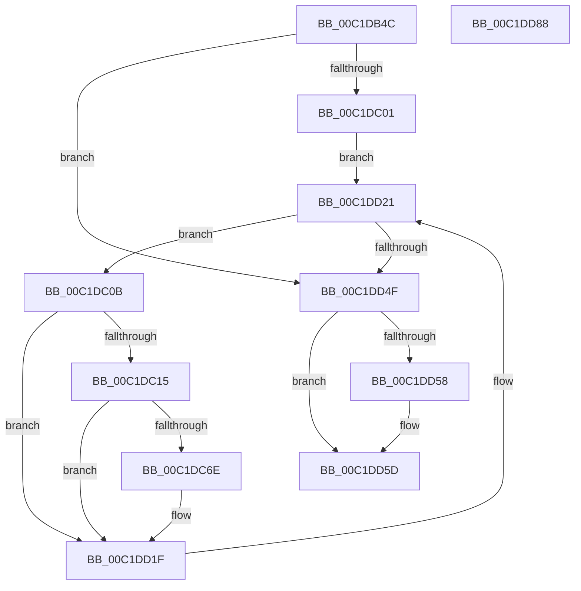

# RegistryOverwriteCentralProcessor

- RVA: `0x00C1DB4C`–`0x00C1DD89` (길이 `573` bytes)
- VA: `0x0000000140C1DB4C`
- 실행 섹션: `INIT`
- PDB 이름 있음: `예`; PDB Function 태그: `아니요`
- unwind 정보 RVA: `0x000C377C`
- 디코드: `136`개 명령, `573/573` bytes 표시
- 미해석 바이트: `0` (있으면 어셈블리에 `.byte`로 보존)

> 이 문서는 커널 이미지의 기계어와 PDB 기호를 분석해 생성했습니다. 4번과 5번은 함수 원형과 자료형을 바이너리 사용 방식에서 추정한 C 해석이며 원본 소스 복구 결과는 아닙니다.

## 1. Dependencies

- 직접 호출 지점: **15**; 고유 호출 대상: **6**
- 직접 호출자로 확인된 함수: **1**
- RIP 상대 이미지 참조: **6**

### Outgoing calls
- `0x00C1DBBF` → [RtlInitUnicodeString](../../text/42/RtlInitUnicodeString_function_0042A780.md) (function, `0x0042A780`)
- `0x00C1DBF2` → [ZwOpenKey](../../text/6A/ZwOpenKey_function_006AD310.md) (function, `0x006AD310`)
- `0x00C1DC29` → [RtlInitUnicodeString](../../text/42/RtlInitUnicodeString_function_0042A780.md) (function, `0x0042A780`)
- `0x00C1DC61` → [ZwOpenKey](../../text/6A/ZwOpenKey_function_006AD310.md) (function, `0x006AD310`)
- `0x00C1DC79` → [RtlInitUnicodeString](../../text/42/RtlInitUnicodeString_function_0042A780.md) (function, `0x0042A780`)
- `0x00C1DC89` → [RtlInitUnicodeString](../../text/42/RtlInitUnicodeString_function_0042A780.md) (function, `0x0042A780`)
- `0x00C1DCB3` → [ZwSetValueKey](../../text/6A/ZwSetValueKey_function_006ADCD0.md) (function, `0x006ADCD0`)
- `0x00C1DCC3` → [RtlInitUnicodeString](../../text/42/RtlInitUnicodeString_function_0042A780.md) (function, `0x0042A780`)
- `0x00C1DCE2` → [ZwSetValueKey](../../text/6A/ZwSetValueKey_function_006ADCD0.md) (function, `0x006ADCD0`)
- `0x00C1DCF2` → [RtlInitUnicodeString](../../text/42/RtlInitUnicodeString_function_0042A780.md) (function, `0x0042A780`)
- `0x00C1DD11` → [ZwSetValueKey](../../text/6A/ZwSetValueKey_function_006ADCD0.md) (function, `0x006ADCD0`)
- `0x00C1DD1A` → [ZwClose](../../text/6A/ZwClose_function_006AD2B0.md) (function, `0x006AD2B0`)
- `0x00C1DD3D` → [ZwEnumerateKey](../../text/6A/ZwEnumerateKey_function_006AD710.md) (function, `0x006AD710`)
- `0x00C1DD58` → [ZwClose](../../text/6A/ZwClose_function_006AD2B0.md) (function, `0x006AD2B0`)
- `0x00C1DD66` → [_security_check_cookie](../../text/6A/_security_check_cookie_function_006AC640.md) (function, `0x006AC640`)

### Direct callers
- [StartFirstUserProcess](../C7/StartFirstUserProcess_function_00C70848.md) at `0x00C7088B`

### Static image references
- `0x00C1DB6B` → RVA `0x00E0A740` (`.data`; read)
- `0x00C1DB7C` → RVA `0x00C78E60` (` ?? ::PBOPGDP::`string'`; read)
- `0x00C1DC6E` → RVA `0x00C78EE0` (` ?? ::PBOPGDP::`string'`; read)
- `0x00C1DC7E` → RVA `0x00C78F00` (` ?? ::PBOPGDP::`string'`; read)
- `0x00C1DCB8` → RVA `0x00C78F30` (` ?? ::PBOPGDP::`string'`; read)
- `0x00C1DCE7` → RVA `0x00C78F60` (` ?? ::PBOPGDP::`string'`; read)

## 2. Other-region calls and transfers

- 다른 실행 섹션으로 향하는 call: **15**
  - `0x00C1DBBF` → [RtlInitUnicodeString](../../text/42/RtlInitUnicodeString_function_0042A780.md) (`INIT` → `.text`)
  - `0x00C1DBF2` → [ZwOpenKey](../../text/6A/ZwOpenKey_function_006AD310.md) (`INIT` → `.text`)
  - `0x00C1DC29` → [RtlInitUnicodeString](../../text/42/RtlInitUnicodeString_function_0042A780.md) (`INIT` → `.text`)
  - `0x00C1DC61` → [ZwOpenKey](../../text/6A/ZwOpenKey_function_006AD310.md) (`INIT` → `.text`)
  - `0x00C1DC79` → [RtlInitUnicodeString](../../text/42/RtlInitUnicodeString_function_0042A780.md) (`INIT` → `.text`)
  - `0x00C1DC89` → [RtlInitUnicodeString](../../text/42/RtlInitUnicodeString_function_0042A780.md) (`INIT` → `.text`)
  - `0x00C1DCB3` → [ZwSetValueKey](../../text/6A/ZwSetValueKey_function_006ADCD0.md) (`INIT` → `.text`)
  - `0x00C1DCC3` → [RtlInitUnicodeString](../../text/42/RtlInitUnicodeString_function_0042A780.md) (`INIT` → `.text`)
  - `0x00C1DCE2` → [ZwSetValueKey](../../text/6A/ZwSetValueKey_function_006ADCD0.md) (`INIT` → `.text`)
  - `0x00C1DCF2` → [RtlInitUnicodeString](../../text/42/RtlInitUnicodeString_function_0042A780.md) (`INIT` → `.text`)
  - `0x00C1DD11` → [ZwSetValueKey](../../text/6A/ZwSetValueKey_function_006ADCD0.md) (`INIT` → `.text`)
  - `0x00C1DD1A` → [ZwClose](../../text/6A/ZwClose_function_006AD2B0.md) (`INIT` → `.text`)
  - `0x00C1DD3D` → [ZwEnumerateKey](../../text/6A/ZwEnumerateKey_function_006AD710.md) (`INIT` → `.text`)
  - `0x00C1DD58` → [ZwClose](../../text/6A/ZwClose_function_006AD2B0.md) (`INIT` → `.text`)
  - `0x00C1DD66` → [_security_check_cookie](../../text/6A/_security_check_cookie_function_006AC640.md) (`INIT` → `.text`)
- 별도 외부 분기/꼬리 이동을 확인하지 못했습니다.

## 3. Assembly (complete function range)

```asm
00C1DB4C  48 8B C4                        mov rax, rsp
00C1DB4F  48 89 58 08                     mov qword ptr [rax + 8], rbx
00C1DB53  48 89 70 10                     mov qword ptr [rax + 0x10], rsi
00C1DB57  48 89 78 18                     mov qword ptr [rax + 0x18], rdi
00C1DB5B  4C 89 70 20                     mov qword ptr [rax + 0x20], r14
00C1DB5F  55                              push rbp
00C1DB60  48 8D 68 A1                     lea rbp, [rax - 0x5f]
00C1DB64  48 81 EC F0 00 00 00            sub rsp, 0xf0
00C1DB6B  48 8B 05 CE CB 1E 00            mov rax, qword ptr [rip + 0x1ecbce]
00C1DB72  48 33 C4                        xor rax, rsp
00C1DB75  48 89 45 47                     mov qword ptr [rbp + 0x47], rax
00C1DB79  0F 57 C0                        xorps xmm0, xmm0
00C1DB7C  48 8D 15 DD B2 05 00            lea rdx, [rip + 0x5b2dd]
00C1DB83  45 33 F6                        xor r14d, r14d
00C1DB86  48 8D 4D FF                     lea rcx, [rbp - 1]
00C1DB8A  0F 57 C9                        xorps xmm1, xmm1
00C1DB8D  4C 89 75 A7                     mov qword ptr [rbp - 0x59], r14
00C1DB91  33 C0                           xor eax, eax
00C1DB93  44 89 75 C3                     mov dword ptr [rbp - 0x3d], r14d
00C1DB97  0F 11 45 FF                     movups xmmword ptr [rbp - 1], xmm0
00C1DB9B  44 89 75 DB                     mov dword ptr [rbp - 0x25], r14d
00C1DB9F  0F 11 4D 0F                     movups xmmword ptr [rbp + 0xf], xmm1
00C1DBA3  44 89 75 97                     mov dword ptr [rbp - 0x69], r14d
00C1DBA7  0F 11 45 AF                     movups xmmword ptr [rbp - 0x51], xmm0
00C1DBAB  48 89 45 3F                     mov qword ptr [rbp + 0x3f], rax
00C1DBAF  0F 11 45 1F                     movups xmmword ptr [rbp + 0x1f], xmm0
00C1DBB3  4C 89 75 9F                     mov qword ptr [rbp - 0x61], r14
00C1DBB7  0F 11 45 2F                     movups xmmword ptr [rbp + 0x2f], xmm0
00C1DBBB  0F 11 45 EF                     movups xmmword ptr [rbp - 0x11], xmm0
00C1DBBF  E8 BC CB 80 FF                  call 0x14042a780
00C1DBC4  48 8D 45 FF                     lea rax, [rbp - 1]
00C1DBC8  C7 45 BF 30 00 00 00            mov dword ptr [rbp - 0x41], 0x30
00C1DBCF  0F 57 C0                        xorps xmm0, xmm0
00C1DBD2  48 89 45 CF                     mov qword ptr [rbp - 0x31], rax
00C1DBD6  4C 8D 45 BF                     lea r8, [rbp - 0x41]
00C1DBDA  4C 89 75 C7                     mov qword ptr [rbp - 0x39], r14
00C1DBDE  41 8D 56 08                     lea edx, [r14 + 8]
00C1DBE2  C7 45 D7 40 02 00 00            mov dword ptr [rbp - 0x29], 0x240
00C1DBE9  48 8D 4D A7                     lea rcx, [rbp - 0x59]
00C1DBED  F3 0F 7F 45 DF                  movdqu xmmword ptr [rbp - 0x21], xmm0
00C1DBF2  E8 19 F7 A8 FF                  call 0x1406ad310
00C1DBF7  8B D8                           mov ebx, eax
00C1DBF9  85 C0                           test eax, eax
00C1DBFB  0F 88 4E 01 00 00               js 0x140c1dd4f
00C1DC01  41 8B F6                        mov esi, r14d
00C1DC04  33 D2                           xor edx, edx
00C1DC06  E9 16 01 00 00                  jmp 0x140c1dd21
00C1DC0B  FF C6                           inc esi
00C1DC0D  85 DB                           test ebx, ebx
00C1DC0F  0F 88 0A 01 00 00               js 0x140c1dd1f
00C1DC15  8B 45 2B                        mov eax, dword ptr [rbp + 0x2b]
00C1DC18  48 8D 55 2F                     lea rdx, [rbp + 0x2f]
00C1DC1C  48 D1 E8                        shr rax, 1
00C1DC1F  48 8D 4D 0F                     lea rcx, [rbp + 0xf]
00C1DC23  66 44 89 74 45 2F               mov word ptr [rbp + rax*2 + 0x2f], r14w
00C1DC29  E8 52 CB 80 FF                  call 0x14042a780
00C1DC2E  48 8B 45 A7                     mov rax, qword ptr [rbp - 0x59]
00C1DC32  4C 8D 45 BF                     lea r8, [rbp - 0x41]
00C1DC36  48 89 45 C7                     mov qword ptr [rbp - 0x39], rax
00C1DC3A  48 8D 4D 9F                     lea rcx, [rbp - 0x61]
00C1DC3E  48 8D 45 0F                     lea rax, [rbp + 0xf]
00C1DC42  C7 45 BF 30 00 00 00            mov dword ptr [rbp - 0x41], 0x30
00C1DC49  0F 57 C0                        xorps xmm0, xmm0
00C1DC4C  48 89 45 CF                     mov qword ptr [rbp - 0x31], rax
00C1DC50  BA 3F 00 0F 00                  mov edx, 0xf003f
00C1DC55  C7 45 D7 40 02 00 00            mov dword ptr [rbp - 0x29], 0x240
00C1DC5C  F3 0F 7F 45 DF                  movdqu xmmword ptr [rbp - 0x21], xmm0
00C1DC61  E8 AA F6 A8 FF                  call 0x1406ad310
00C1DC66  85 C0                           test eax, eax
00C1DC68  0F 88 B1 00 00 00               js 0x140c1dd1f
00C1DC6E  48 8D 15 6B B2 05 00            lea rdx, [rip + 0x5b26b]
00C1DC75  48 8D 4D EF                     lea rcx, [rbp - 0x11]
00C1DC79  E8 02 CB 80 FF                  call 0x14042a780
00C1DC7E  48 8D 15 7B B2 05 00            lea rdx, [rip + 0x5b27b]
00C1DC85  48 8D 4D AF                     lea rcx, [rbp - 0x51]
00C1DC89  E8 F2 CA 80 FF                  call 0x14042a780
00C1DC8E  0F B7 7D EF                     movzx edi, word ptr [rbp - 0x11]
00C1DC92  48 8D 55 AF                     lea rdx, [rbp - 0x51]
00C1DC96  48 8B 5D F7                     mov rbx, qword ptr [rbp - 9]
00C1DC9A  83 C7 02                        add edi, 2
00C1DC9D  48 8B 4D 9F                     mov rcx, qword ptr [rbp - 0x61]
00C1DCA1  41 B9 01 00 00 00               mov r9d, 1
00C1DCA7  89 7C 24 28                     mov dword ptr [rsp + 0x28], edi
00C1DCAB  45 33 C0                        xor r8d, r8d
00C1DCAE  48 89 5C 24 20                  mov qword ptr [rsp + 0x20], rbx
00C1DCB3  E8 18 00 A9 FF                  call 0x1406adcd0
00C1DCB8  48 8D 15 71 B2 05 00            lea rdx, [rip + 0x5b271]
00C1DCBF  48 8D 4D AF                     lea rcx, [rbp - 0x51]
00C1DCC3  E8 B8 CA 80 FF                  call 0x14042a780
00C1DCC8  48 8B 4D 9F                     mov rcx, qword ptr [rbp - 0x61]
00C1DCCC  48 8D 55 AF                     lea rdx, [rbp - 0x51]
00C1DCD0  41 B9 01 00 00 00               mov r9d, 1
00C1DCD6  89 7C 24 28                     mov dword ptr [rsp + 0x28], edi
00C1DCDA  45 33 C0                        xor r8d, r8d
00C1DCDD  48 89 5C 24 20                  mov qword ptr [rsp + 0x20], rbx
00C1DCE2  E8 E9 FF A8 FF                  call 0x1406adcd0
00C1DCE7  48 8D 15 72 B2 05 00            lea rdx, [rip + 0x5b272]
00C1DCEE  48 8D 4D AF                     lea rcx, [rbp - 0x51]
00C1DCF2  E8 89 CA 80 FF                  call 0x14042a780
00C1DCF7  48 8B 4D 9F                     mov rcx, qword ptr [rbp - 0x61]
00C1DCFB  48 8D 55 AF                     lea rdx, [rbp - 0x51]
00C1DCFF  41 B9 01 00 00 00               mov r9d, 1
00C1DD05  89 7C 24 28                     mov dword ptr [rsp + 0x28], edi
00C1DD09  45 33 C0                        xor r8d, r8d
00C1DD0C  48 89 5C 24 20                  mov qword ptr [rsp + 0x20], rbx
00C1DD11  E8 BA FF A8 FF                  call 0x1406adcd0
00C1DD16  48 8B 4D 9F                     mov rcx, qword ptr [rbp - 0x61]
00C1DD1A  E8 91 F5 A8 FF                  call 0x1406ad2b0
00C1DD1F  8B D6                           mov edx, esi
00C1DD21  48 8B 4D A7                     mov rcx, qword ptr [rbp - 0x59]
00C1DD25  48 8D 45 97                     lea rax, [rbp - 0x69]
00C1DD29  48 89 44 24 28                  mov qword ptr [rsp + 0x28], rax
00C1DD2E  4C 8D 4D 1F                     lea r9, [rbp + 0x1f]
00C1DD32  45 33 C0                        xor r8d, r8d
00C1DD35  C7 44 24 20 26 00 00 00         mov dword ptr [rsp + 0x20], 0x26
00C1DD3D  E8 CE F9 A8 FF                  call 0x1406ad710
00C1DD42  8B D8                           mov ebx, eax
00C1DD44  3D 1A 00 00 80                  cmp eax, 0x8000001a
00C1DD49  0F 85 BC FE FF FF               jne 0x140c1dc0b
00C1DD4F  48 8B 4D A7                     mov rcx, qword ptr [rbp - 0x59]
00C1DD53  48 85 C9                        test rcx, rcx
00C1DD56  74 05                           je 0x140c1dd5d
00C1DD58  E8 53 F5 A8 FF                  call 0x1406ad2b0
00C1DD5D  8B C3                           mov eax, ebx
00C1DD5F  48 8B 4D 47                     mov rcx, qword ptr [rbp + 0x47]
00C1DD63  48 33 CC                        xor rcx, rsp
00C1DD66  E8 D5 E8 A8 FF                  call 0x1406ac640
00C1DD6B  4C 8D 9C 24 F0 00 00 00         lea r11, [rsp + 0xf0]
00C1DD73  49 8B 5B 10                     mov rbx, qword ptr [r11 + 0x10]
00C1DD77  49 8B 73 18                     mov rsi, qword ptr [r11 + 0x18]
00C1DD7B  49 8B 7B 20                     mov rdi, qword ptr [r11 + 0x20]
00C1DD7F  4D 8B 73 28                     mov r14, qword ptr [r11 + 0x28]
00C1DD83  49 8B E3                        mov rsp, r11
00C1DD86  5D                              pop rbp
00C1DD87  C3                              ret
00C1DD88  CC                              int3
```

## 4. C-style interpretation (structured pseudocode)

```c
__int64 __fastcall RegistryOverwriteCentralProcessor(void)
{
    __int64 result;
    __int64 v_r14;
    __int64 v_rbx;
    __int64 v_rdi;
    __int64 v_rsi;
    __int64 v_rsp;
    unsigned __int64 v_stack_m8;
    unsigned int v_stack_mD0;
    unsigned __int64 v_stack_mD8;

    *(unsigned __int64 *)(v_rsp + 8) = v_rbx;
    *(unsigned __int64 *)(v_rsp + 16) = v_rsi;
    *(unsigned __int64 *)(v_rsp + 24) = v_rdi;
    *(unsigned __int64 *)(v_rsp + 32) = v_r14;
    v_rsp = (v_rsp) - (240);
    result = (*(unsigned __int64 *)(v_rip + 2018254)) ^ (v_rsp);
    *(unsigned __int64 *)(v_rsp - 95 + 71) = result;
    v_r14 = 0;
    *(unsigned __int64 *)(v_rsp - 95 - 89) = 0;
    result = 0;
    *(unsigned int *)(v_rsp - 95 - 61) = 0;
    *(unsigned __int64 *)(v_rsp - 95 - 1) = v_xmm0;
    *(unsigned int *)(v_rsp - 95 - 37) = 0;
    *(unsigned __int64 *)(v_rsp - 95 + 15) = v_xmm1;
    *(unsigned int *)(v_rsp - 95 - 105) = 0;
    *(unsigned __int64 *)(v_rsp - 95 - 81) = v_xmm0;
    *(unsigned __int64 *)(v_rsp - 95 + 63) = 0;
    *(unsigned __int64 *)(v_rsp - 95 + 31) = v_xmm0;
    *(unsigned __int64 *)(v_rsp - 95 - 97) = 0;
    *(unsigned __int64 *)(v_rsp - 95 + 47) = v_xmm0;
    *(unsigned __int64 *)(v_rsp - 95 - 17) = v_xmm0;
    result = RtlInitUnicodeString(v_rsp - 95 - 1, v_rip + 373469, a3, a4);
    *(unsigned int *)(v_rsp - 95 - 65) = 48;
    *(unsigned __int64 *)(v_rsp - 95 - 49) = v_rsp - 95 - 1;
    *(unsigned __int64 *)(v_rsp - 95 - 57) = 0;
    *(unsigned int *)(v_rsp - 95 - 41) = 576;
    *(unsigned __int64 *)(v_rsp - 95 - 33) = v_xmm0;
    result = ZwOpenKey(v_rsp - 95 - 89, v_r14 + 8, v_rsp - 95 - 65, a4);
    if (sign_flag) goto loc_00C1DD4F;
    a2 = 0;
    goto loc_00C1DD21;
loc_00C1DC0B:
    v_rsi = (unsigned int)((0) + 1);
    if (sign_flag) goto loc_00C1DD1F;
    result = ((unsigned int)(*(unsigned int *)(v_rsp - 95 + 43))) >> (1);
    *(unsigned __int16 *)(v_rsp - 95 + result * 2 + 47) = 0;
    result = RtlInitUnicodeString(v_rsp - 95 + 15, v_rsp - 95 + 47, v_rsp - 95 - 65, a4);
    *(unsigned __int64 *)(v_rsp - 95 - 57) = *(unsigned __int64 *)(v_rsp - 95 - 89);
    *(unsigned int *)(v_rsp - 95 - 65) = 48;
    *(unsigned __int64 *)(v_rsp - 95 - 49) = v_rsp - 95 + 15;
    *(unsigned int *)(v_rsp - 95 - 41) = 576;
    *(unsigned __int64 *)(v_rsp - 95 - 33) = v_xmm0;
    result = ZwOpenKey(v_rsp - 95 - 97, (unsigned int)(0xF003FULL), v_rsp - 95 - 65, a4);
    v_rbx = (unsigned int)((unsigned int)(result));
    if (!(sign_flag)) {
        a2 = v_rip + 373355;
        a1 = v_rsp - 95 - 17;
        result = RtlInitUnicodeString(a1, a2, v_rsp - 95 - 65, a4);
        a2 = v_rip + 373371;
        a1 = v_rsp - 95 - 81;
        result = RtlInitUnicodeString(a1, a2, v_rsp - 95 - 65, a4);
        v_rdi = *(unsigned __int16 *)(v_rsp - 95 - 17);
        a2 = v_rsp - 95 - 81;
        v_rbx = *(unsigned __int64 *)(v_rsp - 95 - 9);
        v_rdi = (unsigned int)((v_rdi) + (2));
        a1 = *(unsigned __int64 *)(v_rsp - 95 - 97);
        a4 = 1;
        v_stack_mD0 = (unsigned int)(v_rdi);
        a3 = 0;
        v_stack_mD8 = v_rbx;
        result = ZwSetValueKey(a1, a2, a3, a4);
        a2 = v_rip + 373361;
        a1 = v_rsp - 95 - 81;
        result = RtlInitUnicodeString(a1, a2, a3, a4);
        a1 = *(unsigned __int64 *)(v_rsp - 95 - 97);
        a2 = v_rsp - 95 - 81;
        a4 = 1;
        v_stack_mD0 = (unsigned int)(v_rdi);
        a3 = 0;
        v_stack_mD8 = v_rbx;
        result = ZwSetValueKey(a1, a2, a3, a4);
        a2 = v_rip + 373362;
        a1 = v_rsp - 95 - 81;
        result = RtlInitUnicodeString(a1, a2, a3, a4);
        a1 = *(unsigned __int64 *)(v_rsp - 95 - 97);
        a2 = v_rsp - 95 - 81;
        a4 = 1;
        v_stack_mD0 = (unsigned int)(v_rdi);
        a3 = 0;
        v_stack_mD8 = v_rbx;
        result = ZwSetValueKey(a1, a2, a3, a4);
        a1 = *(unsigned __int64 *)(v_rsp - 95 - 97);
        result = ZwClose(a1, a2, a3, a4);
    }
loc_00C1DD21:
    v_stack_mD0 = v_rsp - 95 - 105;
    a3 = 0;
    v_stack_mD8 = 38;
    result = ZwEnumerateKey(*(unsigned __int64 *)(v_rsp - 95 - 89), (unsigned int)((unsigned int)(v_rsi)), a3, v_rsp - 95 + 31);
    if (((unsigned int)(result)) != 0x8000001AULL) goto loc_00C1DC0B;
loc_00C1DD4F:
    if (*(unsigned __int64 *)(v_rsp - 95 - 89) != 0) {
        result = ZwClose(*(unsigned __int64 *)(v_rsp - 95 - 89), (unsigned int)((unsigned int)(v_rsi)), a3, v_rsp - 95 + 31);
    }
    a1 = (*(unsigned __int64 *)(v_rsp - 95 + 71)) ^ (v_rsp);
    result = _security_check_cookie(a1, (unsigned int)((unsigned int)(v_rsi)), a3, v_rsp - 95 + 31);
    return result;
}
```

## 5. (Beta) C Style

```c
void RegistryOverwriteCentralProcessor(void)
{
    int64_t result;
    int64_t local_r14;
    int64_t local_rbx;
    int64_t local_rdi;
    int64_t local_rsi;
    int64_t local_rsp;
    uint64_t v_stack_m8;
    uint32_t v_stack_mD0;
    uint64_t v_stack_mD8;

    *(uint64_t *)(local_rsp + 0x8) = local_rbx;
    *(uint64_t *)(local_rsp + 0x10) = local_rsi;
    *(uint64_t *)(local_rsp + 0x18) = local_rdi;
    *(uint64_t *)(local_rsp + 0x20) = local_r14;
    local_rsp = (local_rsp) - (240);
    result = (*(uint64_t *)(v_rip + 0x1ECBCE)) ^ (local_rsp);
    *(uint64_t *)(local_rsp - 0x5F + 0x47) = result;
    local_r14 = 0;
    *(uint64_t *)(local_rsp - 0x5F - 0x59) = 0;
    result = 0;
    *(uint32_t *)(local_rsp - 0x5F - 0x3D) = 0;
    *(uint64_t *)(local_rsp - 0x5F - 0x1) = v_xmm0;
    *(uint32_t *)(local_rsp - 0x5F - 0x25) = 0;
    *(uint64_t *)(local_rsp - 0x5F + 0xF) = v_xmm1;
    *(uint32_t *)(local_rsp - 0x5F - 0x69) = 0;
    *(uint64_t *)(local_rsp - 0x5F - 0x51) = v_xmm0;
    *(uint64_t *)(local_rsp - 0x5F + 0x3F) = 0;
    *(uint64_t *)(local_rsp - 0x5F + 0x1F) = v_xmm0;
    *(uint64_t *)(local_rsp - 0x5F - 0x61) = 0;
    *(uint64_t *)(local_rsp - 0x5F + 0x2F) = v_xmm0;
    *(uint64_t *)(local_rsp - 0x5F - 0x11) = v_xmm0;
    result = RtlInitUnicodeString(local_rsp - 95 - 1, v_rip + 373469, a3, a4);
    *(uint32_t *)(local_rsp - 0x5F - 0x41) = 48;
    *(uint64_t *)(local_rsp - 0x5F - 0x31) = local_rsp - 95 - 1;
    *(uint64_t *)(local_rsp - 0x5F - 0x39) = 0;
    *(uint32_t *)(local_rsp - 0x5F - 0x29) = 576;
    *(uint64_t *)(local_rsp - 0x5F - 0x21) = v_xmm0;
    result = ZwOpenKey(local_rsp - 95 - 89, local_r14 + 8, local_rsp - 95 - 65, a4);
    if (sign_flag) goto loc_00C1DD4F;
    a2 = 0;
    goto loc_00C1DD21;
loc_00C1DC0B:
    local_rsi = (uint32_t)((0) + 1);
    if (sign_flag) goto loc_00C1DD1F;
    result = ((uint32_t)(*(uint32_t *)(local_rsp - 0x5F + 0x2B))) >> (1);
    *(uint16_t *)(local_rsp - 0x5F + result * 2 + 0x2F) = 0;
    result = RtlInitUnicodeString(local_rsp - 95 + 15, local_rsp - 95 + 47, local_rsp - 95 - 65, a4);
    *(uint64_t *)(local_rsp - 0x5F - 0x39) = *(uint64_t *)(local_rsp - 0x5F - 0x59);
    *(uint32_t *)(local_rsp - 0x5F - 0x41) = 48;
    *(uint64_t *)(local_rsp - 0x5F - 0x31) = local_rsp - 95 + 15;
    *(uint32_t *)(local_rsp - 0x5F - 0x29) = 576;
    *(uint64_t *)(local_rsp - 0x5F - 0x21) = v_xmm0;
    result = ZwOpenKey(local_rsp - 95 - 97, (uint32_t)(0xF003FULL), local_rsp - 95 - 65, a4);
    local_rbx = (uint32_t)((uint32_t)(result));
    if (!(sign_flag)) {
        a2 = v_rip + 373355;
        a1 = local_rsp - 95 - 17;
        result = RtlInitUnicodeString(a1, a2, local_rsp - 95 - 65, a4);
        a2 = v_rip + 373371;
        a1 = local_rsp - 95 - 81;
        result = RtlInitUnicodeString(a1, a2, local_rsp - 95 - 65, a4);
        local_rdi = *(uint16_t *)(local_rsp - 0x5F - 0x11);
        a2 = local_rsp - 95 - 81;
        local_rbx = *(uint64_t *)(local_rsp - 0x5F - 0x9);
        local_rdi = (uint32_t)((local_rdi) + (2));
        a1 = *(uint64_t *)(local_rsp - 0x5F - 0x61);
        a4 = 1;
        v_stack_mD0 = (uint32_t)(local_rdi);
        a3 = 0;
        v_stack_mD8 = local_rbx;
        result = ZwSetValueKey(a1, a2, a3, a4);
        a2 = v_rip + 373361;
        a1 = local_rsp - 95 - 81;
        result = RtlInitUnicodeString(a1, a2, a3, a4);
        a1 = *(uint64_t *)(local_rsp - 0x5F - 0x61);
        a2 = local_rsp - 95 - 81;
        a4 = 1;
        v_stack_mD0 = (uint32_t)(local_rdi);
        a3 = 0;
        v_stack_mD8 = local_rbx;
        result = ZwSetValueKey(a1, a2, a3, a4);
        a2 = v_rip + 373362;
        a1 = local_rsp - 95 - 81;
        result = RtlInitUnicodeString(a1, a2, a3, a4);
        a1 = *(uint64_t *)(local_rsp - 0x5F - 0x61);
        a2 = local_rsp - 95 - 81;
        a4 = 1;
        v_stack_mD0 = (uint32_t)(local_rdi);
        a3 = 0;
        v_stack_mD8 = local_rbx;
        result = ZwSetValueKey(a1, a2, a3, a4);
        a1 = *(uint64_t *)(local_rsp - 0x5F - 0x61);
        result = ZwClose(a1, a2, a3, a4);
    }
loc_00C1DD21:
    v_stack_mD0 = local_rsp - 95 - 105;
    a3 = 0;
    v_stack_mD8 = 38;
    result = ZwEnumerateKey(*(uint64_t *)(local_rsp - 0x5F - 0x59), (uint32_t)((uint32_t)(local_rsi)), a3, local_rsp - 95 + 31);
    if (((uint32_t)(result)) != 0x8000001AULL) goto loc_00C1DC0B;
loc_00C1DD4F:
    if (*(uint64_t *)(local_rsp - 0x5F - 0x59) != 0) {
        result = ZwClose(*(uint64_t *)(local_rsp - 0x5F - 0x59), (uint32_t)((uint32_t)(local_rsi)), a3, local_rsp - 95 + 31);
    }
    a1 = (*(uint64_t *)(local_rsp - 0x5F + 0x47)) ^ (local_rsp);
    result = _security_check_cookie(a1, (uint32_t)((uint32_t)(local_rsi)), a3, local_rsp - 95 + 31);
    return result;
}
```

## 6. Execution-region graph

[열기: 2D/3D 그래프와 함수 탐색 컨트롤 패널](../../../control-panel.html?section=init&rva=0x00C1DB4C&view=graph)

- 2D 그래프는 위에서 아래로 흐르고, 3D 그래프는 빈 공간을 드래그해 회전합니다. Shift+드래그는 이동, 휠은 확대·축소, 함수 노드 선택은 대상 보고서 이동입니다.

### Static fallback


