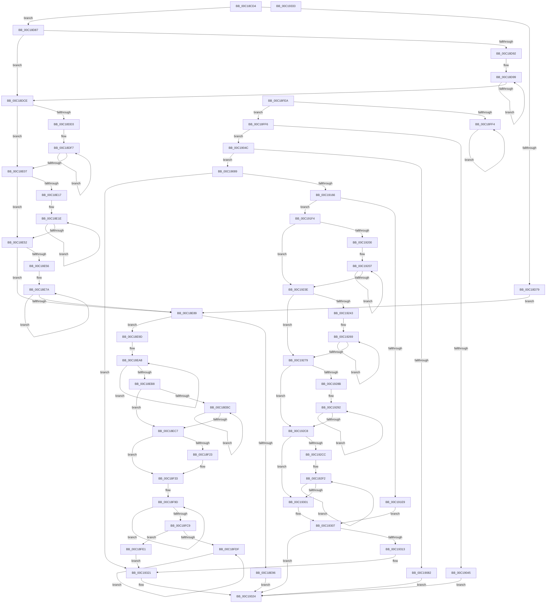

# sub_00C18CD4

- RVA: `0x00C18CD4`–`0x00C19334` (길이 `1,632` bytes)
- VA: `0x0000000140C18CD4`
- 실행 섹션: `INIT`
- PDB 이름 있음: `아니요`; PDB Function 태그: `아니요`
- unwind 정보 RVA: `0x000C2C6C`
- 디코드: `454`개 명령, `1,632/1,632` bytes 표시
- 미해석 바이트: `0` (있으면 어셈블리에 `.byte`로 보존)

> 이 문서는 커널 이미지의 기계어와 PDB 기호를 분석해 생성했습니다. 4번과 5번은 함수 원형과 자료형을 바이너리 사용 방식에서 추정한 C 해석이며 원본 소스 복구 결과는 아닙니다.

## 1. Dependencies

- 직접 호출 지점: **6**; 고유 호출 대상: **4**
- 직접 호출자로 확인된 함수: **1**
- RIP 상대 이미지 참조: **3**

### Outgoing calls
- `0x00C18D69` → [KeGuardDispatchICall](../../initkdbg/BE/KeGuardDispatchICall_function_00BEAA60.md) (function, `0x00BEAA60`)
- `0x00C18ED3` → [KeInitializeEvent](../../text/40/KeInitializeEvent_function_0040DD10.md) (function, `0x0040DD10`)
- `0x00C1903C` → [KeGuardDispatchICall](../../initkdbg/BE/KeGuardDispatchICall_function_00BEAA60.md) (function, `0x00BEAA60`)
- `0x00C19071` → [ObReferenceObjectByHandle](../../page/86/ObReferenceObjectByHandle_function_00868DB0.md) (function, `0x00868DB0`)
- `0x00C19091` → [NtClose](../../page/86/NtClose_function_00868870.md) (function, `0x00868870`)
- `0x00C191DC` → [KeGuardDispatchICall](../../initkdbg/BE/KeGuardDispatchICall_function_00BEAA60.md) (function, `0x00BEAA60`)

### Direct callers
- [sub_00BF16D0](../BF/Unknown_function_00BF16D0.md) at `0x00C1480D`

### Static image references
- `0x00C18FD6` → RVA `0x00F475DC` (`.data`; read)
- `0x00C190E6` → RVA `0x00C81E30` (`INIT`; read)
- `0x00C19313` → RVA `0x0051AD70` (`.text`; read)

## 2. Other-region calls and transfers

- 다른 실행 섹션으로 향하는 call: **6**
  - `0x00C18D69` → [KeGuardDispatchICall](../../initkdbg/BE/KeGuardDispatchICall_function_00BEAA60.md) (`INIT` → `INITKDBG`)
  - `0x00C18ED3` → [KeInitializeEvent](../../text/40/KeInitializeEvent_function_0040DD10.md) (`INIT` → `.text`)
  - `0x00C1903C` → [KeGuardDispatchICall](../../initkdbg/BE/KeGuardDispatchICall_function_00BEAA60.md) (`INIT` → `INITKDBG`)
  - `0x00C19071` → [ObReferenceObjectByHandle](../../page/86/ObReferenceObjectByHandle_function_00868DB0.md) (`INIT` → `PAGE`)
  - `0x00C19091` → [NtClose](../../page/86/NtClose_function_00868870.md) (`INIT` → `PAGE`)
  - `0x00C191DC` → [KeGuardDispatchICall](../../initkdbg/BE/KeGuardDispatchICall_function_00BEAA60.md) (`INIT` → `INITKDBG`)
- 별도 외부 분기/꼬리 이동을 확인하지 못했습니다.

## 3. Assembly (complete function range)

```asm
00C18CD4  4C 8B DC                        mov r11, rsp
00C18CD7  49 89 53 10                     mov qword ptr [r11 + 0x10], rdx
00C18CDB  49 89 4B 08                     mov qword ptr [r11 + 8], rcx
00C18CDF  53                              push rbx
00C18CE0  56                              push rsi
00C18CE1  57                              push rdi
00C18CE2  41 56                           push r14
00C18CE4  41 57                           push r15
00C18CE6  48 81 EC 80 00 00 00            sub rsp, 0x80
00C18CED  48 8B F1                        mov rsi, rcx
00C18CF0  0F 31                           rdtsc
00C18CF2  48 C1 E2 20                     shl rdx, 0x20
00C18CF6  48 0B C2                        or rax, rdx
00C18CF9  4C 8B C0                        mov r8, rax
00C18CFC  48 8B D0                        mov rdx, rax
00C18CFF  48 C1 CA 03                     ror rdx, 3
00C18D03  4C 33 C2                        xor r8, rdx
00C18D06  49 BF 01 20 00 04 80 00 10 70   movabs r15, 0x7010008004002001
00C18D10  49 8B C7                        mov rax, r15
00C18D13  49 F7 E0                        mul r8
00C18D16  49 89 53 98                     mov qword ptr [r11 - 0x68], rdx
00C18D1A  48 8B D8                        mov rbx, rax
00C18D1D  33 DA                           xor ebx, edx
00C18D1F  81 E3 FF 07 00 00               and ebx, 0x7ff
00C18D25  0F 31                           rdtsc
00C18D27  48 C1 E2 20                     shl rdx, 0x20
00C18D2B  48 0B C2                        or rax, rdx
00C18D2E  48 8B D0                        mov rdx, rax
00C18D31  48 8B C8                        mov rcx, rax
00C18D34  48 C1 C9 03                     ror rcx, 3
00C18D38  48 33 D1                        xor rdx, rcx
00C18D3B  49 8B C7                        mov rax, r15
00C18D3E  48 F7 E2                        mul rdx
00C18D41  49 89 53 A0                     mov qword ptr [r11 - 0x60], rdx
00C18D45  48 33 C2                        xor rax, rdx
00C18D48  8D 4B 01                        lea ecx, [rbx + 1]
00C18D4B  33 D2                           xor edx, edx
00C18D4D  48 F7 F1                        div rcx
00C18D50  48 8B FA                        mov rdi, rdx
00C18D53  8D 53 30                        lea edx, [rbx + 0x30]
00C18D56  48 8B 86 00 01 00 00            mov rax, qword ptr [rsi + 0x100]
00C18D5D  44 8B 86 30 08 00 00            mov r8d, dword ptr [rsi + 0x830]
00C18D64  B9 42 00 00 00                  mov ecx, 0x42
00C18D69  E8 F2 1C FD FF                  call 0x140beaa60
00C18D6E  4C 8B D8                        mov r11, rax
00C18D71  45 33 F6                        xor r14d, r14d
00C18D74  48 85 C0                        test rax, rax
00C18D77  75 0E                           jne 0x140c18d87
00C18D79  FF 86 60 0A 00 00               inc dword ptr [rsi + 0xa60]
00C18D7F  41 8B FE                        mov edi, r14d
00C18D82  E9 02 01 00 00                  jmp 0x140c18e89
00C18D87  44 8B CF                        mov r9d, edi
00C18D8A  4D 8B C3                        mov r8, r11
00C18D8D  83 FF 08                        cmp edi, 8
00C18D90  72 3C                           jb 0x140c18dce
00C18D92  44 8B D7                        mov r10d, edi
00C18D95  49 C1 EA 03                     shr r10, 3
00C18D99  0F 31                           rdtsc
00C18D9B  48 C1 E2 20                     shl rdx, 0x20
00C18D9F  48 0B C2                        or rax, rdx
00C18DA2  48 8B D0                        mov rdx, rax
00C18DA5  48 8B C8                        mov rcx, rax
00C18DA8  48 C1 C9 03                     ror rcx, 3
00C18DAC  48 33 D1                        xor rdx, rcx
00C18DAF  49 8B C7                        mov rax, r15
00C18DB2  48 F7 E2                        mul rdx
00C18DB5  48 89 54 24 50                  mov qword ptr [rsp + 0x50], rdx
00C18DBA  48 33 D0                        xor rdx, rax
00C18DBD  49 89 10                        mov qword ptr [r8], rdx
00C18DC0  49 83 C0 08                     add r8, 8
00C18DC4  41 83 C1 F8                     add r9d, -8
00C18DC8  49 83 EA 01                     sub r10, 1
00C18DCC  75 CB                           jne 0x140c18d99
00C18DCE  45 85 C9                        test r9d, r9d
00C18DD1  74 34                           je 0x140c18e07
00C18DD3  0F 31                           rdtsc
00C18DD5  48 C1 E2 20                     shl rdx, 0x20
00C18DD9  48 0B C2                        or rax, rdx
00C18DDC  48 8B D0                        mov rdx, rax
00C18DDF  48 8B C8                        mov rcx, rax
00C18DE2  48 C1 C9 03                     ror rcx, 3
00C18DE6  48 33 D1                        xor rdx, rcx
00C18DE9  49 8B C7                        mov rax, r15
00C18DEC  48 F7 E2                        mul rdx
00C18DEF  48 89 54 24 58                  mov qword ptr [rsp + 0x58], rdx
00C18DF4  48 33 D0                        xor rdx, rax
00C18DF7  41 88 10                        mov byte ptr [r8], dl
00C18DFA  49 FF C0                        inc r8
00C18DFD  48 C1 EA 08                     shr rdx, 8
00C18E01  41 83 C1 FF                     add r9d, -1
00C18E05  75 F0                           jne 0x140c18df7
00C18E07  2B DF                           sub ebx, edi
00C18E09  8B FF                           mov edi, edi
00C18E0B  49 03 FB                        add rdi, r11
00C18E0E  4C 8D 47 30                     lea r8, [rdi + 0x30]
00C18E12  83 FB 08                        cmp ebx, 8
00C18E15  72 3B                           jb 0x140c18e52
00C18E17  44 8B CB                        mov r9d, ebx
00C18E1A  49 C1 E9 03                     shr r9, 3
00C18E1E  0F 31                           rdtsc
00C18E20  48 C1 E2 20                     shl rdx, 0x20
00C18E24  48 0B C2                        or rax, rdx
00C18E27  48 8B D0                        mov rdx, rax
00C18E2A  48 8B C8                        mov rcx, rax
00C18E2D  48 C1 C9 03                     ror rcx, 3
00C18E31  48 33 D1                        xor rdx, rcx
00C18E34  49 8B C7                        mov rax, r15
00C18E37  48 F7 E2                        mul rdx
00C18E3A  48 89 54 24 60                  mov qword ptr [rsp + 0x60], rdx
00C18E3F  48 33 D0                        xor rdx, rax
00C18E42  49 89 10                        mov qword ptr [r8], rdx
00C18E45  49 83 C0 08                     add r8, 8
00C18E49  83 C3 F8                        add ebx, -8
00C18E4C  49 83 E9 01                     sub r9, 1
00C18E50  75 CC                           jne 0x140c18e1e
00C18E52  85 DB                           test ebx, ebx
00C18E54  74 33                           je 0x140c18e89
00C18E56  0F 31                           rdtsc
00C18E58  48 C1 E2 20                     shl rdx, 0x20
00C18E5C  48 0B C2                        or rax, rdx
00C18E5F  48 8B D0                        mov rdx, rax
00C18E62  48 8B C8                        mov rcx, rax
00C18E65  48 C1 C9 03                     ror rcx, 3
00C18E69  48 33 D1                        xor rdx, rcx
00C18E6C  49 8B C7                        mov rax, r15
00C18E6F  48 F7 E2                        mul rdx
00C18E72  48 89 54 24 68                  mov qword ptr [rsp + 0x68], rdx
00C18E77  48 33 D0                        xor rdx, rax
00C18E7A  41 88 10                        mov byte ptr [r8], dl
00C18E7D  49 FF C0                        inc r8
00C18E80  48 C1 EA 08                     shr rdx, 8
00C18E84  83 C3 FF                        add ebx, -1
00C18E87  75 F1                           jne 0x140c18e7a
00C18E89  48 89 BC 24 C8 00 00 00         mov qword ptr [rsp + 0xc8], rdi
00C18E91  48 85 FF                        test rdi, rdi
00C18E94  75 07                           jne 0x140c18e9d
00C18E96  33 C0                           xor eax, eax
00C18E98  E9 87 04 00 00                  jmp 0x140c19324
00C18E9D  B9 30 00 00 00                  mov ecx, 0x30
00C18EA2  48 8B C7                        mov rax, rdi
00C18EA5  8D 51 D6                        lea edx, [rcx - 0x2a]
00C18EA8  4C 89 30                        mov qword ptr [rax], r14
00C18EAB  48 83 C0 08                     add rax, 8
00C18EAF  83 C1 F8                        add ecx, -8
00C18EB2  48 83 EA 01                     sub rdx, 1
00C18EB6  75 F0                           jne 0x140c18ea8
00C18EB8  85 C9                           test ecx, ecx
00C18EBA  74 0B                           je 0x140c18ec7
00C18EBC  44 88 30                        mov byte ptr [rax], r14b
00C18EBF  48 FF C0                        inc rax
00C18EC2  83 C1 FF                        add ecx, -1
00C18EC5  75 F5                           jne 0x140c18ebc
00C18EC7  48 8D 5F 18                     lea rbx, [rdi + 0x18]
00C18ECB  45 33 C0                        xor r8d, r8d
00C18ECE  33 D2                           xor edx, edx
00C18ED0  48 8B CB                        mov rcx, rbx
00C18ED3  E8 38 4E 7F FF                  call 0x14040dd10
00C18ED8  48 89 1F                        mov qword ptr [rdi], rbx
00C18EDB  0F 31                           rdtsc
00C18EDD  48 C1 E2 20                     shl rdx, 0x20
00C18EE1  48 0B C2                        or rax, rdx
00C18EE4  48 8B D0                        mov rdx, rax
00C18EE7  48 8B C8                        mov rcx, rax
00C18EEA  48 C1 C9 03                     ror rcx, 3
00C18EEE  48 33 D1                        xor rdx, rcx
00C18EF1  49 8B C7                        mov rax, r15
00C18EF4  48 F7 E2                        mul rdx
00C18EF7  48 8B CA                        mov rcx, rdx
00C18EFA  48 89 54 24 70                  mov qword ptr [rsp + 0x70], rdx
00C18EFF  48 33 C8                        xor rcx, rax
00C18F02  48 B8 CD CC CC CC CC CC CC CC   movabs rax, 0xcccccccccccccccd
00C18F0C  48 F7 E1                        mul rcx
00C18F0F  48 C1 EA 03                     shr rdx, 3
00C18F13  48 8D 04 92                     lea rax, [rdx + rdx*4]
00C18F17  48 03 C0                        add rax, rax
00C18F1A  48 2B C8                        sub rcx, rax
00C18F1D  48 83 F9 01                     cmp rcx, 1
00C18F21  73 10                           jae 0x140c18f33
00C18F23  0F BA AE D8 09 00 00 18         bts dword ptr [rsi + 0x9d8], 0x18
00C18F2B  48 C7 47 08 01 00 00 00         mov qword ptr [rdi + 8], 1
00C18F33  F0 44 09 34 24                  lock or dword ptr [rsp], r14d
00C18F38  0F 31                           rdtsc
00C18F3A  48 C1 E2 20                     shl rdx, 0x20
00C18F3E  48 0B C2                        or rax, rdx
00C18F41  48 8B D0                        mov rdx, rax
00C18F44  48 8B C8                        mov rcx, rax
00C18F47  48 C1 C9 03                     ror rcx, 3
00C18F4B  48 33 D1                        xor rdx, rcx
00C18F4E  49 8B C7                        mov rax, r15
00C18F51  48 F7 E2                        mul rdx
00C18F54  4C 8B CA                        mov r9, rdx
00C18F57  4C 33 C8                        xor r9, rax
00C18F5A  4C 33 CE                        xor r9, rsi
00C18F5D  8A 86 40 09 00 00               mov al, byte ptr [rsi + 0x940]
00C18F63  FE C8                           dec al
00C18F65  44 0F B6 D0                     movzx r10d, al
00C18F69  41 BB 3F 00 00 00               mov r11d, 0x3f
00C18F6F  45 2B DA                        sub r11d, r10d
00C18F72  0F 31                           rdtsc
00C18F74  48 C1 E2 20                     shl rdx, 0x20
00C18F78  48 0B C2                        or rax, rdx
00C18F7B  48 8B D0                        mov rdx, rax
00C18F7E  48 8B C8                        mov rcx, rax
00C18F81  48 C1 C9 03                     ror rcx, 3
00C18F85  48 33 D1                        xor rdx, rcx
00C18F88  49 8B C7                        mov rax, r15
00C18F8B  48 F7 E2                        mul rdx
00C18F8E  48 33 C2                        xor rax, rdx
00C18F91  33 D2                           xor edx, edx
00C18F93  49 F7 F3                        div r11
00C18F96  48 8B DA                        mov rbx, rdx
00C18F99  41 8D 34 12                     lea esi, [r10 + rdx]
00C18F9D  0F 31                           rdtsc
00C18F9F  48 C1 E2 20                     shl rdx, 0x20
00C18FA3  48 0B C2                        or rax, rdx
00C18FA6  4C 8B C0                        mov r8, rax
00C18FA9  48 8B C8                        mov rcx, rax
00C18FAC  48 C1 C9 03                     ror rcx, 3
00C18FB0  4C 33 C1                        xor r8, rcx
00C18FB3  49 8B C7                        mov rax, r15
00C18FB6  49 F7 E0                        mul r8
00C18FB9  48 33 C2                        xor rax, rdx
00C18FBC  33 D2                           xor edx, edx
00C18FBE  49 F7 F3                        div r11
00C18FC1  41 8D 0C 12                     lea ecx, [r10 + rdx]
00C18FC5  3B D3                           cmp edx, ebx
00C18FC7  74 D4                           je 0x140c18f9d
00C18FC9  8B C6                           mov eax, esi
00C18FCB  49 0F AB C1                     bts r9, rax
00C18FCF  8B C1                           mov eax, ecx
00C18FD1  49 0F B3 C1                     btr r9, rax
00C18FD5  FA                              cli
00C18FD6  80 3D FF E5 32 00 00            cmp byte ptr [rip + 0x32e5ff], 0
00C18FDD  75 02                           jne 0x140c18fe1
00C18FDF  EB FE                           jmp 0x140c18fdf
00C18FE1  FB                              sti
00C18FE2  41 8B 01                        mov eax, dword ptr [r9]
00C18FE5  E9 37 03 00 00                  jmp 0x140c19321
00C18FEA  FA                              cli
00C18FEB  80 3D EA E5 32 00 00            cmp byte ptr [rip + 0x32e5ea], 0
00C18FF2  75 02                           jne 0x140c18ff6
00C18FF4  EB FE                           jmp 0x140c18ff4
00C18FF6  FB                              sti
00C18FF7  48 8B B4 24 B0 00 00 00         mov rsi, qword ptr [rsp + 0xb0]
00C18FFF  48 8B 86 D0 02 00 00            mov rax, qword ptr [rsi + 0x2d0]
00C19006  48 8B BC 24 C8 00 00 00         mov rdi, qword ptr [rsp + 0xc8]
00C1900E  48 89 7C 24 30                  mov qword ptr [rsp + 0x30], rdi
00C19013  48 8B 8C 24 B8 00 00 00         mov rcx, qword ptr [rsp + 0xb8]
00C1901B  48 8B 51 10                     mov rdx, qword ptr [rcx + 0x10]
00C1901F  48 89 54 24 28                  mov qword ptr [rsp + 0x28], rdx
00C19024  48 83 64 24 20 00               and qword ptr [rsp + 0x20], 0
00C1902A  45 33 C9                        xor r9d, r9d
00C1902D  45 33 C0                        xor r8d, r8d
00C19030  41 8D 51 10                     lea edx, [r9 + 0x10]
00C19034  48 8D 8C 24 C0 00 00 00         lea rcx, [rsp + 0xc0]
00C1903C  E8 1F 1A FD FF                  call 0x140beaa60
00C19041  85 C0                           test eax, eax
00C19043  79 07                           jns 0x140c1904c
00C19045  33 C0                           xor eax, eax
00C19047  E9 D8 02 00 00                  jmp 0x140c19324
00C1904C  48 83 64 24 28 00               and qword ptr [rsp + 0x28], 0
00C19052  48 8D 84 24 B0 00 00 00         lea rax, [rsp + 0xb0]
00C1905A  48 89 44 24 20                  mov qword ptr [rsp + 0x20], rax
00C1905F  45 33 C9                        xor r9d, r9d
00C19062  45 33 C0                        xor r8d, r8d
00C19065  41 8D 51 10                     lea edx, [r9 + 0x10]
00C19069  48 8B 8C 24 C0 00 00 00         mov rcx, qword ptr [rsp + 0xc0]
00C19071  E8 3A FD C4 FF                  call 0x140868db0
00C19076  48 8B 9C 24 B0 00 00 00         mov rbx, qword ptr [rsp + 0xb0]
00C1907E  85 C0                           test eax, eax
00C19080  79 07                           jns 0x140c19089
00C19082  33 C0                           xor eax, eax
00C19084  E9 9B 02 00 00                  jmp 0x140c19324
00C19089  48 8B 8C 24 C0 00 00 00         mov rcx, qword ptr [rsp + 0xc0]
00C19091  E8 DA F7 C4 FF                  call 0x140868870
00C19096  0F 31                           rdtsc
00C19098  48 C1 E2 20                     shl rdx, 0x20
00C1909C  48 0B C2                        or rax, rdx
00C1909F  48 8B D0                        mov rdx, rax
00C190A2  48 8B C8                        mov rcx, rax
00C190A5  48 C1 C9 03                     ror rcx, 3
00C190A9  48 33 D1                        xor rdx, rcx
00C190AC  48 B8 01 20 00 04 80 00 10 70   movabs rax, 0x7010008004002001
00C190B6  48 F7 E2                        mul rdx
00C190B9  8B C8                           mov ecx, eax
00C190BB  8B C2                           mov eax, edx
00C190BD  48 33 C8                        xor rcx, rax
00C190C0  48 B8 93 24 49 92 24 49 92 24   movabs rax, 0x2492492492492493
00C190CA  48 F7 E1                        mul rcx
00C190CD  48 8B C1                        mov rax, rcx
00C190D0  48 2B C2                        sub rax, rdx
00C190D3  48 D1 E8                        shr rax, 1
00C190D6  48 03 C2                        add rax, rdx
00C190D9  48 C1 E8 02                     shr rax, 2
00C190DD  48 6B C0 07                     imul rax, rax, 7
00C190E1  48 2B C8                        sub rcx, rax
00C190E4  8B C1                           mov eax, ecx
00C190E6  48 8D 0D 43 8D 06 00            lea rcx, [rip + 0x68d43]
00C190ED  48 8B 0C C1                     mov rcx, qword ptr [rcx + rax*8]
00C190F1  48 8B 86 A0 06 00 00            mov rax, qword ptr [rsi + 0x6a0]
00C190F8  48 89 0C 03                     mov qword ptr [rbx + rax], rcx
00C190FC  48 8B 86 B0 06 00 00            mov rax, qword ptr [rsi + 0x6b0]
00C19103  48 89 0C 03                     mov qword ptr [rbx + rax], rcx
00C19107  48 89 9E E0 09 00 00            mov qword ptr [rsi + 0x9e0], rbx
00C1910E  C7 86 7C 09 00 00 FF 68 80 2F   mov dword ptr [rsi + 0x97c], 0x2f8068ff
00C19118  0F 31                           rdtsc
00C1911A  48 C1 E2 20                     shl rdx, 0x20
00C1911E  48 0B C2                        or rax, rdx
00C19121  48 8B D0                        mov rdx, rax
00C19124  48 8B C8                        mov rcx, rax
00C19127  48 C1 C9 03                     ror rcx, 3
00C1912B  48 33 D1                        xor rdx, rcx
00C1912E  48 B8 01 20 00 04 80 00 10 70   movabs rax, 0x7010008004002001
00C19138  48 F7 E2                        mul rdx
00C1913B  48 8B CA                        mov rcx, rdx
00C1913E  48 33 C8                        xor rcx, rax
00C19141  48 B8 CD CC CC CC CC CC CC CC   movabs rax, 0xcccccccccccccccd
00C1914B  48 F7 E1                        mul rcx
00C1914E  48 C1 EA 03                     shr rdx, 3
00C19152  48 8D 04 92                     lea rax, [rdx + rdx*4]
00C19156  48 03 C0                        add rax, rax
00C19159  48 2B C8                        sub rcx, rax
00C1915C  48 83 F9 01                     cmp rcx, 1
00C19160  0F 83 BB 01 00 00               jae 0x140c19321
00C19166  0F 31                           rdtsc
00C19168  48 C1 E2 20                     shl rdx, 0x20
00C1916C  48 0B C2                        or rax, rdx
00C1916F  48 8B D0                        mov rdx, rax
00C19172  48 8B C8                        mov rcx, rax
00C19175  48 C1 C9 03                     ror rcx, 3
00C19179  48 33 D1                        xor rdx, rcx
00C1917C  48 B8 01 20 00 04 80 00 10 70   movabs rax, 0x7010008004002001
00C19186  48 F7 E2                        mul rdx
00C19189  48 8B DA                        mov rbx, rdx
00C1918C  33 D8                           xor ebx, eax
00C1918E  81 E3 FF 07 00 00               and ebx, 0x7ff
00C19194  0F 31                           rdtsc
00C19196  48 C1 E2 20                     shl rdx, 0x20
00C1919A  48 0B C2                        or rax, rdx
00C1919D  4C 8B C0                        mov r8, rax
00C191A0  48 8B C8                        mov rcx, rax
00C191A3  48 C1 C9 03                     ror rcx, 3
00C191A7  4C 33 C1                        xor r8, rcx
00C191AA  48 B8 01 20 00 04 80 00 10 70   movabs rax, 0x7010008004002001
00C191B4  49 F7 E0                        mul r8
00C191B7  44 8D 4B 01                     lea r9d, [rbx + 1]
00C191BB  48 33 C2                        xor rax, rdx
00C191BE  33 D2                           xor edx, edx
00C191C0  49 F7 F1                        div r9
00C191C3  4C 8B F2                        mov r14, rdx
00C191C6  8D 53 20                        lea edx, [rbx + 0x20]
00C191C9  48 8B 86 00 01 00 00            mov rax, qword ptr [rsi + 0x100]
00C191D0  44 8B 86 30 08 00 00            mov r8d, dword ptr [rsi + 0x830]
00C191D7  B9 42 00 00 00                  mov ecx, 0x42
00C191DC  E8 7F 18 FD FF                  call 0x140beaa60
00C191E1  4C 8B D8                        mov r11, rax
00C191E4  48 85 C0                        test rax, rax
00C191E7  75 0B                           jne 0x140c191f4
00C191E9  FF 86 60 0A 00 00               inc dword ptr [rsi + 0xa60]
00C191EF  E9 13 01 00 00                  jmp 0x140c19307
00C191F4  45 8B CE                        mov r9d, r14d
00C191F7  4D 8B C3                        mov r8, r11
00C191FA  41 83 FE 08                     cmp r14d, 8
00C191FE  72 3E                           jb 0x140c1923e
00C19200  45 8B D6                        mov r10d, r14d
00C19203  49 C1 EA 03                     shr r10, 3
00C19207  0F 31                           rdtsc
00C19209  48 C1 E2 20                     shl rdx, 0x20
00C1920D  48 0B C2                        or rax, rdx
00C19210  48 8B D0                        mov rdx, rax
00C19213  48 8B C8                        mov rcx, rax
00C19216  48 C1 C9 03                     ror rcx, 3
00C1921A  48 33 D1                        xor rdx, rcx
00C1921D  48 B8 01 20 00 04 80 00 10 70   movabs rax, 0x7010008004002001
00C19227  48 F7 E2                        mul rdx
00C1922A  48 33 D0                        xor rdx, rax
00C1922D  49 89 10                        mov qword ptr [r8], rdx
00C19230  49 83 C0 08                     add r8, 8
00C19234  41 83 C1 F8                     add r9d, -8
00C19238  49 83 EA 01                     sub r10, 1
00C1923C  75 C9                           jne 0x140c19207
00C1923E  45 85 C9                        test r9d, r9d
00C19241  74 36                           je 0x140c19279
00C19243  0F 31                           rdtsc
00C19245  48 C1 E2 20                     shl rdx, 0x20
00C19249  48 0B C2                        or rax, rdx
00C1924C  48 8B D0                        mov rdx, rax
00C1924F  48 8B C8                        mov rcx, rax
00C19252  48 C1 C9 03                     ror rcx, 3
00C19256  48 33 D1                        xor rdx, rcx
00C19259  48 B8 01 20 00 04 80 00 10 70   movabs rax, 0x7010008004002001
00C19263  48 F7 E2                        mul rdx
00C19266  48 33 D0                        xor rdx, rax
00C19269  41 88 10                        mov byte ptr [r8], dl
00C1926C  49 FF C0                        inc r8
00C1926F  48 C1 EA 08                     shr rdx, 8
00C19273  41 83 C1 FF                     add r9d, -1
00C19277  75 F0                           jne 0x140c19269
00C19279  41 2B DE                        sub ebx, r14d
00C1927C  45 8B C6                        mov r8d, r14d
00C1927F  49 83 C0 20                     add r8, 0x20
00C19283  4D 03 C3                        add r8, r11
00C19286  83 FB 08                        cmp ebx, 8
00C19289  72 3D                           jb 0x140c192c8
00C1928B  44 8B CB                        mov r9d, ebx
00C1928E  49 C1 E9 03                     shr r9, 3
00C19292  0F 31                           rdtsc
00C19294  48 C1 E2 20                     shl rdx, 0x20
00C19298  48 0B C2                        or rax, rdx
00C1929B  48 8B D0                        mov rdx, rax
00C1929E  48 8B C8                        mov rcx, rax
00C192A1  48 C1 C9 03                     ror rcx, 3
00C192A5  48 33 D1                        xor rdx, rcx
00C192A8  48 B8 01 20 00 04 80 00 10 70   movabs rax, 0x7010008004002001
00C192B2  48 F7 E2                        mul rdx
00C192B5  48 33 D0                        xor rdx, rax
00C192B8  49 89 10                        mov qword ptr [r8], rdx
00C192BB  49 83 C0 08                     add r8, 8
00C192BF  83 C3 F8                        add ebx, -8
00C192C2  49 83 E9 01                     sub r9, 1
00C192C6  75 CA                           jne 0x140c19292
00C192C8  85 DB                           test ebx, ebx
00C192CA  74 35                           je 0x140c19301
00C192CC  0F 31                           rdtsc
00C192CE  48 C1 E2 20                     shl rdx, 0x20
00C192D2  48 0B C2                        or rax, rdx
00C192D5  48 8B D0                        mov rdx, rax
00C192D8  48 8B C8                        mov rcx, rax
00C192DB  48 C1 C9 03                     ror rcx, 3
00C192DF  48 33 D1                        xor rdx, rcx
00C192E2  48 B8 01 20 00 04 80 00 10 70   movabs rax, 0x7010008004002001
00C192EC  48 F7 E2                        mul rdx
00C192EF  48 33 D0                        xor rdx, rax
00C192F2  41 88 10                        mov byte ptr [r8], dl
00C192F5  49 FF C0                        inc r8
00C192F8  48 C1 EA 08                     shr rdx, 8
00C192FC  83 C3 FF                        add ebx, -1
00C192FF  75 F1                           jne 0x140c192f2
00C19301  41 8B C6                        mov eax, r14d
00C19304  49 03 C3                        add rax, r11
00C19307  48 89 86 28 0A 00 00            mov qword ptr [rsi + 0xa28], rax
00C1930E  48 85 C0                        test rax, rax
00C19311  74 11                           je 0x140c19324
00C19313  48 8D 05 56 1A 90 FF            lea rax, [rip - 0x6fe5aa]
00C1931A  48 89 86 20 01 00 00            mov qword ptr [rsi + 0x120], rax
00C19321  48 8B C7                        mov rax, rdi
00C19324  48 81 C4 80 00 00 00            add rsp, 0x80
00C1932B  41 5F                           pop r15
00C1932D  41 5E                           pop r14
00C1932F  5F                              pop rdi
00C19330  5E                              pop rsi
00C19331  5B                              pop rbx
00C19332  C3                              ret
00C19333  CC                              int3
```

## 4. C-style interpretation (structured pseudocode)

```c
__int64 __fastcall sub_00C18CD4(__int64 a1, __int64 a2)
{
    __int64 result;
    __int64 v_r10;
    __int64 v_r11;
    __int64 v_r14;
    __int64 v_rbx;
    __int64 v_rdi;
    __int64 v_rsp;
    unsigned __int64 v_stack_m38;
    unsigned __int64 v_stack_m40;
    unsigned __int64 v_stack_m48;
    unsigned __int64 v_stack_m50;
    unsigned __int64 v_stack_m58;
    unsigned __int64 v_stack_m78;
    unsigned __int64 v_stack_m80;
    unsigned __int64 v_stack_m88;
    unsigned int v_stack_mA8;
    unsigned __int64 v_stack_p10;
    unsigned __int64 v_stack_p18;
    unsigned __int64 v_stack_p20;
    unsigned __int64 v_stack_p8;

    *(unsigned __int64 *)(v_rsp + 16) = a2;
    *(unsigned __int64 *)(v_rsp + 8) = a1;
    v_rsp = (v_rsp) - (128);
    a2 = (a2) << (32);
    result = (result) | (a2);
    a3 = (result) ^ (result);
    *(unsigned __int64 *)(v_rsp - 104) = result;
    v_rbx = (unsigned int)((v_r15) ^ ((unsigned int)(result)));
    v_rbx = (unsigned int)((v_rbx) & (0x7FFULL));
    a2 = (result) << (32);
    result = (v_r15) | (a2);
    a2 = (result) ^ (result);
    *(unsigned __int64 *)(v_rsp - 96) = a2;
    result = (v_r15) ^ (a2);
    a2 = 0;
    result = KeGuardDispatchICall(66, v_rbx + 48, (unsigned int)(*(unsigned int *)(a1 + 2096)), a4);
    v_r14 = 0;
    if (result != 0) goto loc_00C18D87;
    goto loc_00C18E89;
loc_00C18D87:
    if (0 < 8) goto loc_00C18DCE;
    v_r10 = (0) >> (3);
loc_00C18D99:
    a2 = (v_rbx + 48) << (32);
    result = (result) | (a2);
    a2 = (result) ^ (result);
    v_stack_m58 = a2;
    a2 = (a2) ^ (v_r15);
    *(unsigned __int64 *)(result) = a2;
    a3 = (result) + (8);
    a4 = (unsigned int)((0) + (-8));
    v_r10 = (v_r10) - (1);
    if (condition_is_not_equal) goto loc_00C18D99;
loc_00C18DCE:
    if ((unsigned int)(a4) == 0) goto loc_00C18E07;
    a2 = (a2) << (32);
    result = (v_r15) | (a2);
    a2 = (result) ^ (result);
    v_stack_m50 = a2;
    a2 = (a2) ^ (v_r15);
loc_00C18DF7:
    *(unsigned __int8 *)(a3) = (unsigned __int8)(a2);
    a3 = (a3) + 1;
    a2 = (a2) >> (8);
    a4 = (unsigned int)((a4) + (-1));
    if (condition_is_not_equal) goto loc_00C18DF7;
loc_00C18E07:
    v_rbx = (unsigned int)((v_rbx) - (0));
    v_rdi = (0) + (result);
    if (((unsigned int)(v_rbx)) < 8) goto loc_00C18E52;
    a4 = ((unsigned int)((unsigned int)(v_rbx))) >> (3);
loc_00C18E1E:
    a2 = (a2) << (32);
    result = (v_r15) | (a2);
    a2 = (result) ^ (result);
    v_stack_m48 = a2;
    a2 = (a2) ^ (v_r15);
    *(unsigned __int64 *)(v_rdi + 48) = a2;
    a3 = (v_rdi + 48) + (8);
    v_rbx = (unsigned int)((v_rbx) + (-8));
    a4 = (a4) - (1);
    if (condition_is_not_equal) goto loc_00C18E1E;
loc_00C18E52:
    if ((unsigned int)(v_rbx) == 0) goto loc_00C18E89;
    a2 = (a2) << (32);
    result = (v_r15) | (a2);
    a2 = (result) ^ (result);
    v_stack_m40 = a2;
    a2 = (a2) ^ (v_r15);
loc_00C18E7A:
    *(unsigned __int8 *)(a3) = (unsigned __int8)(a2);
    a3 = (a3) + 1;
    a2 = (a2) >> (8);
    v_rbx = (unsigned int)((v_rbx) + (-1));
    if (condition_is_not_equal) goto loc_00C18E7A;
loc_00C18E89:
    v_stack_p20 = v_rdi;
    if (v_rdi != 0) goto loc_00C18E9D;
    result = 0;
    goto loc_00C19324;
loc_00C18E9D:
loc_00C18EA8:
    *(unsigned __int64 *)(v_rdi) = 0;
    result = (v_rdi) + (8);
    a1 = (unsigned int)((48) + (-8));
    a2 = (48 - 42) - (1);
    if (condition_is_not_equal) goto loc_00C18EA8;
    if ((unsigned int)(a1) == 0) goto loc_00C18EC7;
loc_00C18EBC:
    *(unsigned __int8 *)(result) = 0;
    result = (result) + 1;
    a1 = (unsigned int)((a1) + (-1));
    if (condition_is_not_equal) goto loc_00C18EBC;
loc_00C18EC7:
    a3 = 0;
    a2 = 0;
    result = KeInitializeEvent(v_rdi + 24, a2, a3, a4);
    *(unsigned __int64 *)(v_rdi) = v_rdi + 24;
    a2 = (a2) << (32);
    result = (result) | (a2);
    a2 = (result) ^ (result);
    v_stack_m38 = a2;
    a1 = (a2) ^ (v_r15);
    a2 = (a2) >> (3);
    result = (a2 + a2 * 4) + (a2 + a2 * 4);
    a1 = (a1) - (result);
    if (a1 < 1) {
        *(unsigned __int64 *)(v_rdi + 8) = 1;
    }
    a2 = (a2) << (32);
    result = (result) | (a2);
    a2 = (result) ^ (result);
    a4 = (a2) ^ (v_r15);
    a4 = (a4) ^ (a1);
    result = (unsigned __int8)((*(unsigned __int8 *)(a1 + 2368)) - 1);
    v_r11 = (unsigned int)((63) - ((unsigned int)((unsigned __int8)(result))));
    a2 = (a2) << (32);
    result = (result) | (a2);
    a2 = (result) ^ (result);
    result = (v_r15) ^ (a2);
    a2 = 0;
loc_00C18F9D:
    a2 = (a2) << (32);
    result = (result) | (a2);
    a3 = (result) ^ (result);
    result = (v_r15) ^ (a2);
    a2 = 0;
    if (0 == 0) goto loc_00C18F9D;
    if ((*(unsigned __int8 *)(v_rip + 3335679)) != 0) goto loc_00C18FE1;
loc_00C18FDF:
    goto loc_00C18FDF;
loc_00C18FE1:
    goto loc_00C19321;
loc_00C19321:
loc_00C19324:
    v_rsp = (v_rsp) + (128);
    return v_rdi;
}
```

## 5. (Beta) C Style

```c
int64_t sub_00C18CD4(void *Arg1, int64_t Arg2)
{
    uint8_t *arg1 = (uint8_t *)Arg1;

    int64_t result;
    int64_t local_r10;
    int64_t local_r11;
    int64_t local_r14;
    int64_t local_rbx;
    int64_t local_rdi;
    int64_t local_rsp;
    uint64_t v_stack_m38;
    uint64_t v_stack_m40;
    uint64_t v_stack_m48;
    uint64_t v_stack_m50;
    uint64_t v_stack_m58;
    uint64_t v_stack_m78;
    uint64_t v_stack_m80;
    uint64_t v_stack_m88;
    uint32_t v_stack_mA8;
    uint64_t v_stack_p10;
    uint64_t v_stack_p18;
    uint64_t v_stack_p20;
    uint64_t v_stack_p8;

    *(uint64_t *)(local_rsp + 0x10) = Arg2;
    *(void **)(local_rsp + 0x8) = Arg1;
    local_rsp = (local_rsp) - (128);
    Arg2 = (Arg2) << (32);
    result = (result) | (Arg2);
    a3 = (result) ^ (result);
    *(uint64_t *)(local_rsp - 0x68) = result;
    local_rbx = (uint32_t)((local_r15) ^ ((uint32_t)(result)));
    local_rbx = (uint32_t)((local_rbx) & (0x7FFULL));
    Arg2 = (result) << (32);
    result = (local_r15) | (Arg2);
    Arg2 = (result) ^ (result);
    *(uint64_t *)(local_rsp - 0x60) = Arg2;
    result = (local_r15) ^ (Arg2);
    Arg2 = 0;
    result = KeGuardDispatchICall(66, local_rbx + 48, (uint32_t)(*(uint32_t *)(arg1 + 0x830)), a4);
    local_r14 = 0;
    if (result != 0) goto loc_00C18D87;
    goto loc_00C18E89;
loc_00C18D87:
    if (0 < 8) goto loc_00C18DCE;
    local_r10 = (0) >> (3);
loc_00C18D99:
    Arg2 = (local_rbx + 48) << (32);
    result = (result) | (Arg2);
    Arg2 = (result) ^ (result);
    v_stack_m58 = Arg2;
    Arg2 = (Arg2) ^ (local_r15);
    *(uint64_t *)(result) = Arg2;
    a3 = (result) + (8);
    a4 = (uint32_t)((0) + (-8));
    local_r10 = (local_r10) - (1);
    if (condition_is_not_equal) goto loc_00C18D99;
loc_00C18DCE:
    if ((uint32_t)(a4) == 0) goto loc_00C18E07;
    Arg2 = (Arg2) << (32);
    result = (local_r15) | (Arg2);
    Arg2 = (result) ^ (result);
    v_stack_m50 = Arg2;
    Arg2 = (Arg2) ^ (local_r15);
loc_00C18DF7:
    *(uint8_t *)(a3) = (uint8_t)(Arg2);
    a3 = (a3) + 1;
    Arg2 = (Arg2) >> (8);
    a4 = (uint32_t)((a4) + (-1));
    if (condition_is_not_equal) goto loc_00C18DF7;
loc_00C18E07:
    local_rbx = (uint32_t)((local_rbx) - (0));
    local_rdi = (0) + (result);
    if (((uint32_t)(local_rbx)) < 8) goto loc_00C18E52;
    a4 = ((uint32_t)((uint32_t)(local_rbx))) >> (3);
loc_00C18E1E:
    Arg2 = (Arg2) << (32);
    result = (local_r15) | (Arg2);
    Arg2 = (result) ^ (result);
    v_stack_m48 = Arg2;
    Arg2 = (Arg2) ^ (local_r15);
    *(uint64_t *)(local_rdi + 0x30) = Arg2;
    a3 = (local_rdi + 48) + (8);
    local_rbx = (uint32_t)((local_rbx) + (-8));
    a4 = (a4) - (1);
    if (condition_is_not_equal) goto loc_00C18E1E;
loc_00C18E52:
    if ((uint32_t)(local_rbx) == 0) goto loc_00C18E89;
    Arg2 = (Arg2) << (32);
    result = (local_r15) | (Arg2);
    Arg2 = (result) ^ (result);
    v_stack_m40 = Arg2;
    Arg2 = (Arg2) ^ (local_r15);
loc_00C18E7A:
    *(uint8_t *)(a3) = (uint8_t)(Arg2);
    a3 = (a3) + 1;
    Arg2 = (Arg2) >> (8);
    local_rbx = (uint32_t)((local_rbx) + (-1));
    if (condition_is_not_equal) goto loc_00C18E7A;
loc_00C18E89:
    v_stack_p20 = local_rdi;
    if (local_rdi != 0) goto loc_00C18E9D;
    result = 0;
    goto loc_00C19324;
loc_00C18E9D:
loc_00C18EA8:
    *(uint64_t *)(local_rdi) = 0;
    result = (local_rdi) + (8);
    Arg1 = (uint32_t)((48) + (-8));
    Arg2 = (48 - 42) - (1);
    if (condition_is_not_equal) goto loc_00C18EA8;
    if ((uint32_t)(Arg1) == 0) goto loc_00C18EC7;
loc_00C18EBC:
    *(uint8_t *)(result) = 0;
    result = (result) + 1;
    Arg1 = (uint32_t)((Arg1) + (-1));
    if (condition_is_not_equal) goto loc_00C18EBC;
loc_00C18EC7:
    a3 = 0;
    Arg2 = 0;
    result = KeInitializeEvent(local_rdi + 24, Arg2, a3, a4);
    *(uint64_t *)(local_rdi) = local_rdi + 24;
    Arg2 = (Arg2) << (32);
    result = (result) | (Arg2);
    Arg2 = (result) ^ (result);
    v_stack_m38 = Arg2;
    Arg1 = (Arg2) ^ (local_r15);
    Arg2 = (Arg2) >> (3);
    result = (Arg2 + Arg2 * 4) + (Arg2 + Arg2 * 4);
    Arg1 = (Arg1) - (result);
    if (Arg1 < 1) {
        *(uint64_t *)(local_rdi + 0x8) = 1;
    }
    Arg2 = (Arg2) << (32);
    result = (result) | (Arg2);
    Arg2 = (result) ^ (result);
    a4 = (Arg2) ^ (local_r15);
    a4 = (a4) ^ (Arg1);
    result = (uint8_t)((*(uint8_t *)(arg1 + 0x940)) - 1);
    local_r11 = (uint32_t)((63) - ((uint32_t)((uint8_t)(result))));
    Arg2 = (Arg2) << (32);
    result = (result) | (Arg2);
    Arg2 = (result) ^ (result);
    result = (local_r15) ^ (Arg2);
    Arg2 = 0;
loc_00C18F9D:
    Arg2 = (Arg2) << (32);
    result = (result) | (Arg2);
    a3 = (result) ^ (result);
    result = (local_r15) ^ (Arg2);
    Arg2 = 0;
    if (0 == 0) goto loc_00C18F9D;
    if ((*(uint8_t *)(v_rip + 0x32E5FF)) != 0) goto loc_00C18FE1;
loc_00C18FDF:
    goto loc_00C18FDF;
loc_00C18FE1:
    goto loc_00C19321;
loc_00C19321:
loc_00C19324:
    local_rsp = (local_rsp) + (128);
    return local_rdi;
}
```

### 관측된 메모리 오프셋

구조체 형식이 확인되지 않은 접근은 인자 기준의 오프셋으로만 기록했습니다.

| 기준 인자 | 오프셋 표현 | 폭 (bit) | 접근 |
|---|---:|---:|---|
| `Arg1` | `+ 0x100` | `64` | `R` |
| `Arg1` | `+ 0x830` | `32` | `R` |
| `Arg1` | `+ 0x940` | `8` | `R` |
| `Arg1` | `+ 0x9D8` | `32` | `R/W` |
| `Arg1` | `+ 0xA60` | `32` | `R/W` |

## 6. Execution-region graph

[열기: 2D/3D 그래프와 함수 탐색 컨트롤 패널](../../../control-panel.html?section=init&rva=0x00C18CD4&view=graph)

- 2D 그래프는 위에서 아래로 흐르고, 3D 그래프는 빈 공간을 드래그해 회전합니다. Shift+드래그는 이동, 휠은 확대·축소, 함수 노드 선택은 대상 보고서 이동입니다.

### Static fallback


