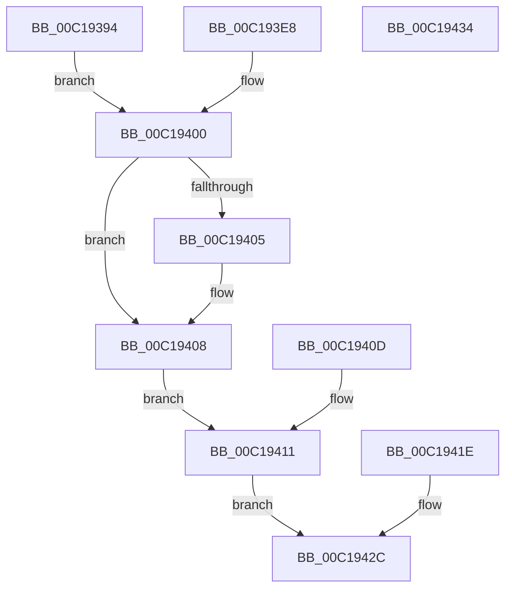

# sub_00C19394

- RVA: `0x00C19394`–`0x00C19435` (길이 `161` bytes)
- VA: `0x0000000140C19394`
- 실행 섹션: `INIT`
- PDB 이름 있음: `아니요`; PDB Function 태그: `아니요`
- unwind 정보 RVA: `0x000C2A9C`
- 디코드: `47`개 명령, `161/161` bytes 표시
- 미해석 바이트: `0` (있으면 어셈블리에 `.byte`로 보존)

> 이 문서는 커널 이미지의 기계어와 PDB 기호를 분석해 생성했습니다. 4번과 5번은 함수 원형과 자료형을 바이너리 사용 방식에서 추정한 C 해석이며 원본 소스 복구 결과는 아닙니다.

## 1. Dependencies

- 직접 호출 지점: **1**; 고유 호출 대상: **1**
- 직접 호출자로 확인된 함수: **1**
- RIP 상대 이미지 참조: **1**

### Outgoing calls
- `0x00C193DB` → [KiErrata671Present](../../initkdbg/BE/KiErrata671Present_function_00BEA8B0.md) (function, `0x00BEA8B0`)

### Direct callers
- [sub_00BF16D0](../BF/Unknown_function_00BF16D0.md) at `0x00BF238B`
- [sub_00BF16D0](../BF/Unknown_function_00BF16D0.md) at `0x00C164D0`

### Static image references
- `0x00C193C0` → RVA `0x00BEA8B0` (`KiErrata671Present`; read)

## 2. Other-region calls and transfers

- 다른 실행 섹션으로 향하는 call: **1**
  - `0x00C193DB` → [KiErrata671Present](../../initkdbg/BE/KiErrata671Present_function_00BEA8B0.md) (`INIT` → `INITKDBG`)
- 별도 외부 분기/꼬리 이동을 확인하지 못했습니다.

## 3. Assembly (complete function range)

```asm
00C19394  40 53                           push rbx
00C19396  56                              push rsi
00C19397  57                              push rdi
00C19398  48 83 EC 30                     sub rsp, 0x30
00C1939C  44 0F 20 C0                     mov rax, cr8
00C193A0  88 44 24 50                     mov byte ptr [rsp + 0x50], al
00C193A4  B8 0F 00 00 00                  mov eax, 0xf
00C193A9  44 0F 22 C0                     mov cr8, rax
00C193AD  0F 20 C7                        mov rdi, cr0
00C193B0  48 89 7C 24 60                  mov qword ptr [rsp + 0x60], rdi
00C193B5  48 8B C7                        mov rax, rdi
00C193B8  48 0F BA F0 10                  btr rax, 0x10
00C193BD  0F 22 C0                        mov cr0, rax
00C193C0  48 8D 1D E9 14 FD FF            lea rbx, [rip - 0x2eb17]
00C193C7  48 83 C3 02                     add rbx, 2
00C193CB  48 89 5C 24 68                  mov qword ptr [rsp + 0x68], rbx
00C193D0  40 8A 33                        mov sil, byte ptr [rbx]
00C193D3  40 88 74 24 58                  mov byte ptr [rsp + 0x58], sil
00C193D8  C6 03 C3                        mov byte ptr [rbx], 0xc3
00C193DB  E8 D0 14 FD FF                  call 0x140bea8b0
00C193E0  8B C8                           mov ecx, eax
00C193E2  89 44 24 20                     mov dword ptr [rsp + 0x20], eax
00C193E6  EB 18                           jmp 0x140c19400
00C193E8  B9 01 00 00 00                  mov ecx, 1
00C193ED  89 4C 24 20                     mov dword ptr [rsp + 0x20], ecx
00C193F1  48 8B 7C 24 60                  mov rdi, qword ptr [rsp + 0x60]
00C193F6  40 8A 74 24 58                  mov sil, byte ptr [rsp + 0x58]
00C193FB  48 8B 5C 24 68                  mov rbx, qword ptr [rsp + 0x68]
00C19400  40 38 33                        cmp byte ptr [rbx], sil
00C19403  74 03                           je 0x140c19408
00C19405  40 88 33                        mov byte ptr [rbx], sil
00C19408  0F 22 C7                        mov cr0, rdi
00C1940B  EB 04                           jmp 0x140c19411
00C1940D  8B 4C 24 20                     mov ecx, dword ptr [rsp + 0x20]
00C19411  0F B6 44 24 50                  movzx eax, byte ptr [rsp + 0x50]
00C19416  44 0F 22 C0                     mov cr8, rax
00C1941A  8B C1                           mov eax, ecx
00C1941C  EB 0E                           jmp 0x140c1942c
00C1941E  0F B6 44 24 50                  movzx eax, byte ptr [rsp + 0x50]
00C19423  44 0F 22 C0                     mov cr8, rax
00C19427  B8 01 00 00 00                  mov eax, 1
00C1942C  48 83 C4 30                     add rsp, 0x30
00C19430  5F                              pop rdi
00C19431  5E                              pop rsi
00C19432  5B                              pop rbx
00C19433  C3                              ret
00C19434  CC                              int3
```

## 4. C-style interpretation (structured pseudocode)

```c
__int64 __fastcall sub_00C19394(void)
{
    __int64 result;
    __int64 v_rbx;
    __int64 v_rsp;
    unsigned int v_stack_m28;
    unsigned __int8 v_stack_p10;
    unsigned __int64 v_stack_p18;
    unsigned __int64 v_stack_p20;
    unsigned __int8 v_stack_p8;

    v_rsp = (v_rsp) - (48);
    v_stack_p8 = (unsigned __int8)(v_cr8);
    v_stack_p18 = v_cr0;
    v_rbx = (v_rip - 191255) + (2);
    v_stack_p20 = v_rbx;
    v_stack_p10 = (unsigned __int8)(*(unsigned __int8 *)(v_rbx));
    *(unsigned __int8 *)(v_rbx) = 195;
    result = KiErrata671Present(a1, a2, a3, a4);
    v_stack_m28 = (unsigned int)(result);
    goto loc_00C19400;
loc_00C19400:
    if ((*(unsigned __int8 *)(v_rbx)) != ((unsigned __int8)(*(unsigned __int8 *)(v_rbx)))) {
        *(unsigned __int8 *)(v_rbx) = (unsigned __int8)(*(unsigned __int8 *)(v_rbx));
    }
    goto loc_00C19411;
loc_00C19411:
    goto loc_00C1942C;
loc_00C1942C:
    v_rsp = (v_rsp) + (48);
    return (unsigned int)((unsigned int)((unsigned int)((unsigned int)(result))));
}
```

## 5. (Beta) C Style

```c
void sub_00C19394(void)
{
    int64_t result;
    int64_t local_rbx;
    int64_t local_rsp;
    uint32_t v_stack_m28;
    uint8_t v_stack_p10;
    uint64_t v_stack_p18;
    uint64_t v_stack_p20;
    uint8_t v_stack_p8;

    local_rsp = (local_rsp) - (48);
    v_stack_p8 = (uint8_t)(v_cr8);
    v_stack_p18 = v_cr0;
    local_rbx = (v_rip - 191255) + (2);
    v_stack_p20 = local_rbx;
    v_stack_p10 = (uint8_t)(*(uint8_t *)(local_rbx));
    *(uint8_t *)(local_rbx) = 195;
    result = KiErrata671Present(a1, a2, a3, a4);
    v_stack_m28 = (uint32_t)(result);
    goto loc_00C19400;
loc_00C19400:
    if ((*(uint8_t *)(local_rbx)) != ((uint8_t)(*(uint8_t *)(local_rbx)))) {
        *(uint8_t *)(local_rbx) = (uint8_t)(*(uint8_t *)(local_rbx));
    }
    goto loc_00C19411;
loc_00C19411:
    goto loc_00C1942C;
loc_00C1942C:
    local_rsp = (local_rsp) + (48);
    return (uint32_t)((uint32_t)((uint32_t)((uint32_t)(result))));
}
```

## 6. Execution-region graph

[열기: 2D/3D 그래프와 함수 탐색 컨트롤 패널](../../../control-panel.html?section=init&rva=0x00C19394&view=graph)

- 2D 그래프는 위에서 아래로 흐르고, 3D 그래프는 빈 공간을 드래그해 회전합니다. Shift+드래그는 이동, 휠은 확대·축소, 함수 노드 선택은 대상 보고서 이동입니다.

### Static fallback


