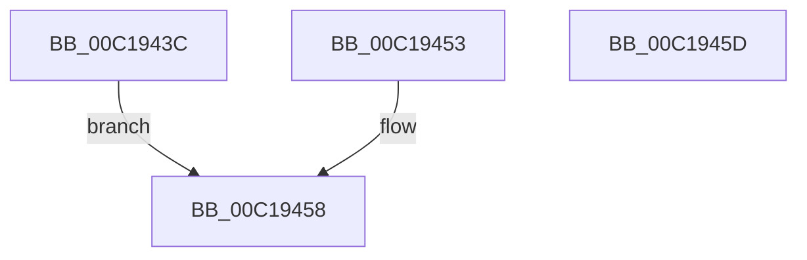

# sub_00C1943C

- RVA: `0x00C1943C`–`0x00C1945E` (길이 `34` bytes)
- VA: `0x0000000140C1943C`
- 실행 섹션: `INIT`
- PDB 이름 있음: `아니요`; PDB Function 태그: `아니요`
- unwind 정보 RVA: `0x000C2AE4`
- 디코드: `11`개 명령, `34/34` bytes 표시
- 미해석 바이트: `0` (있으면 어셈블리에 `.byte`로 보존)

> 이 문서는 커널 이미지의 기계어와 PDB 기호를 분석해 생성했습니다. 4번과 5번은 함수 원형과 자료형을 바이너리 사용 방식에서 추정한 C 해석이며 원본 소스 복구 결과는 아닙니다.

## 1. Dependencies

- 직접 호출 지점: **0**; 고유 호출 대상: **0**
- 직접 호출자로 확인된 함수: **2**
- RIP 상대 이미지 참조: **0**

### Outgoing calls
- 직접 디코드된 call 명령이 없습니다.

### Direct callers
- [KeCheckedKernelInitialize](../BE/KeCheckedKernelInitialize_function_00BEFA6C.md) at `0x00BEFA92`
- [sub_00BF16D0](../BF/Unknown_function_00BF16D0.md) at `0x00BF1771`

### Static image references
- 디코드된 RIP-relative 메모리 참조가 없습니다.

## 2. Other-region calls and transfers

- 다른 실행 섹션으로 향하는 call: **0**
- 별도 외부 분기/꼬리 이동을 확인하지 못했습니다.

## 3. Assembly (complete function range)

```asm
00C1943C  48 83 EC 18                     sub rsp, 0x18
00C19440  33 C0                           xor eax, eax
00C19442  48 89 04 24                     mov qword ptr [rsp], rax
00C19446  66 89 44 24 08                  mov word ptr [rsp + 8], ax
00C1944B  0F 01 1C 24                     lidt [rsp]
00C1944F  33 C0                           xor eax, eax
00C19451  EB 05                           jmp 0x140c19458
00C19453  B8 01 00 00 00                  mov eax, 1
00C19458  48 83 C4 18                     add rsp, 0x18
00C1945C  C3                              ret
00C1945D  CC                              int3
```

## 4. C-style interpretation (structured pseudocode)

```c
__int64 __fastcall sub_00C1943C(void)
{
    __int64 result;
    __int64 v_rsp;
    unsigned __int16 v_stack_m10;
    unsigned __int64 v_stack_m18;

    v_rsp = (v_rsp) - (24);
    result = 0;
    v_stack_m18 = 0;
    v_stack_m10 = 0;
    result = 0;
    goto loc_00C19458;
loc_00C19458:
    v_rsp = (v_rsp) + (24);
    return result;
}
```

## 5. (Beta) C Style

```c
void sub_00C1943C(void)
{
    int64_t result;
    int64_t local_rsp;
    uint16_t v_stack_m10;
    uint64_t v_stack_m18;

    local_rsp = (local_rsp) - (24);
    result = 0;
    v_stack_m18 = 0;
    v_stack_m10 = 0;
    result = 0;
    goto loc_00C19458;
loc_00C19458:
    local_rsp = (local_rsp) + (24);
    return result;
}
```

## 6. Execution-region graph

[열기: 2D/3D 그래프와 함수 탐색 컨트롤 패널](../../../control-panel.html?section=init&rva=0x00C1943C&view=graph)

- 2D 그래프는 위에서 아래로 흐르고, 3D 그래프는 빈 공간을 드래그해 회전합니다. Shift+드래그는 이동, 휠은 확대·축소, 함수 노드 선택은 대상 보고서 이동입니다.

### Static fallback


