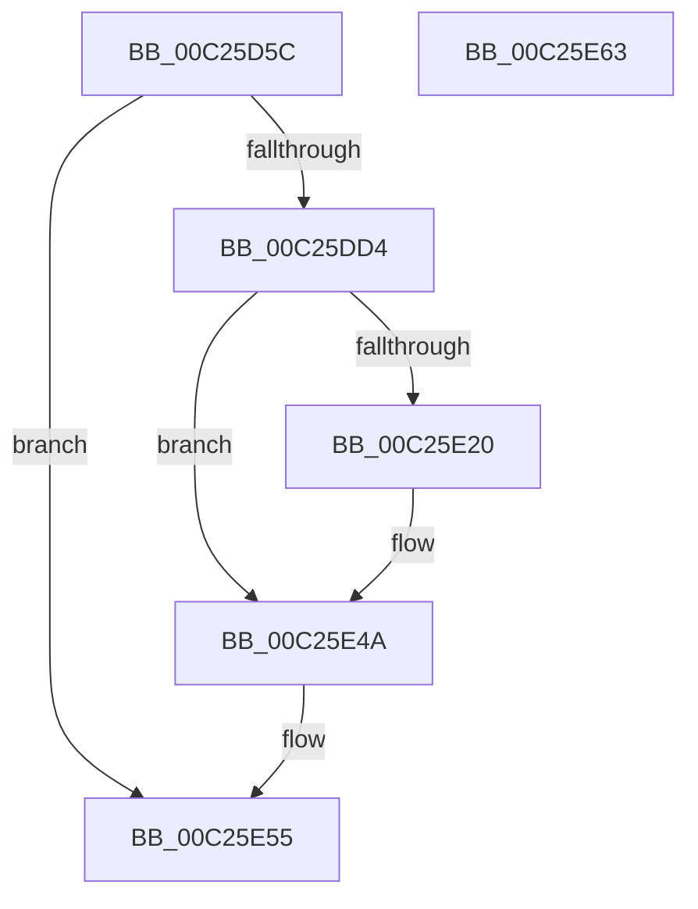

# ArbDeleteMmConfigRange

- RVA: `0x00C25D5C`–`0x00C25E64` (길이 `264` bytes)
- VA: `0x0000000140C25D5C`
- 실행 섹션: `INIT`
- PDB 이름 있음: `예`; PDB Function 태그: `아니요`
- unwind 정보 RVA: `0x000C5708`
- 디코드: `61`개 명령, `264/264` bytes 표시
- 미해석 바이트: `0` (있으면 어셈블리에 `.byte`로 보존)

> 이 문서는 커널 이미지의 기계어와 PDB 기호를 분석해 생성했습니다. 4번과 5번은 함수 원형과 자료형을 바이너리 사용 방식에서 추정한 C 해석이며 원본 소스 복구 결과는 아닙니다.

## 1. Dependencies

- 직접 호출 지점: **5**; 고유 호출 대상: **3**
- 직접 호출자로 확인된 함수: **1**
- RIP 상대 이미지 참조: **3**

### Outgoing calls
- `0x00C25DC7` → [ZwOpenKey](../../text/6A/ZwOpenKey_function_006AD310.md) (function, `0x006AD310`)
- `0x00C25E15` → [ZwOpenKey](../../text/6A/ZwOpenKey_function_006AD310.md) (function, `0x006AD310`)
- `0x00C25E3A` → [ZwDeleteValueKey](../../text/6A/ZwDeleteValueKey_function_006AECB0.md) (function, `0x006AECB0`)
- `0x00C25E45` → [ZwClose](../../text/6A/ZwClose_function_006AD2B0.md) (function, `0x006AD2B0`)
- `0x00C25E4E` → [ZwClose](../../text/6A/ZwClose_function_006AD2B0.md) (function, `0x006AD2B0`)

### Direct callers
- [HalpPciReportMmConfigAddressRange](HalpPciReportMmConfigAddressRange_function_00C2390C.md) at `0x00C23916`

### Static image references
- `0x00C25D6E` → RVA `0x00C79480` (` ?? ::PBOPGDP::`string'`; read)
- `0x00C25DD4` → RVA `0x00C79570` (` ?? ::PBOPGDP::`string'`; read)
- `0x00C25E24` → RVA `0x00C79530` (` ?? ::PBOPGDP::`string'`; read)

## 2. Other-region calls and transfers

- 다른 실행 섹션으로 향하는 call: **5**
  - `0x00C25DC7` → [ZwOpenKey](../../text/6A/ZwOpenKey_function_006AD310.md) (`INIT` → `.text`)
  - `0x00C25E15` → [ZwOpenKey](../../text/6A/ZwOpenKey_function_006AD310.md) (`INIT` → `.text`)
  - `0x00C25E3A` → [ZwDeleteValueKey](../../text/6A/ZwDeleteValueKey_function_006AECB0.md) (`INIT` → `.text`)
  - `0x00C25E45` → [ZwClose](../../text/6A/ZwClose_function_006AD2B0.md) (`INIT` → `.text`)
  - `0x00C25E4E` → [ZwClose](../../text/6A/ZwClose_function_006AD2B0.md) (`INIT` → `.text`)
- 별도 외부 분기/꼬리 이동을 확인하지 못했습니다.

## 3. Assembly (complete function range)

```asm
00C25D5C  48 89 5C 24 18                  mov qword ptr [rsp + 0x18], rbx
00C25D61  55                              push rbp
00C25D62  48 8B EC                        mov rbp, rsp
00C25D65  48 83 EC 60                     sub rsp, 0x60
00C25D69  48 83 65 10 00                  and qword ptr [rbp + 0x10], 0
00C25D6E  48 8D 05 0B 37 05 00            lea rax, [rip + 0x5370b]
00C25D75  83 65 EC 00                     and dword ptr [rbp - 0x14], 0
00C25D79  4C 8D 45 D0                     lea r8, [rbp - 0x30]
00C25D7D  48 83 65 18 00                  and qword ptr [rbp + 0x18], 0
00C25D82  48 8D 4D 10                     lea rcx, [rbp + 0x10]
00C25D86  83 65 C4 00                     and dword ptr [rbp - 0x3c], 0
00C25D8A  0F 57 C0                        xorps xmm0, xmm0
00C25D8D  48 83 65 D8 00                  and qword ptr [rbp - 0x28], 0
00C25D92  BA 1F 00 02 00                  mov edx, 0x2001f
00C25D97  48 89 45 C8                     mov qword ptr [rbp - 0x38], rax
00C25D9B  BB 30 00 00 00                  mov ebx, 0x30
00C25DA0  48 8D 45 C0                     lea rax, [rbp - 0x40]
00C25DA4  48 C7 45 D0 30 00 00 00         mov qword ptr [rbp - 0x30], 0x30
00C25DAC  83 65 D4 00                     and dword ptr [rbp - 0x2c], 0
00C25DB0  48 89 45 E0                     mov qword ptr [rbp - 0x20], rax
00C25DB4  C7 45 C0 76 00 76 00            mov dword ptr [rbp - 0x40], 0x760076
00C25DBB  C7 45 E8 40 02 00 00            mov dword ptr [rbp - 0x18], 0x240
00C25DC2  F3 0F 7F 45 F0                  movdqu xmmword ptr [rbp - 0x10], xmm0
00C25DC7  E8 44 75 A8 FF                  call 0x1406ad310
00C25DCC  85 C0                           test eax, eax
00C25DCE  0F 88 81 00 00 00               js 0x140c25e55
00C25DD4  48 8D 05 95 37 05 00            lea rax, [rip + 0x53795]
00C25DDB  C7 45 C0 22 00 22 00            mov dword ptr [rbp - 0x40], 0x220022
00C25DE2  48 89 45 C8                     mov qword ptr [rbp - 0x38], rax
00C25DE6  4C 8D 45 D0                     lea r8, [rbp - 0x30]
00C25DEA  48 8B 45 10                     mov rax, qword ptr [rbp + 0x10]
00C25DEE  48 8D 4D 18                     lea rcx, [rbp + 0x18]
00C25DF2  48 89 45 D8                     mov qword ptr [rbp - 0x28], rax
00C25DF6  0F 57 C0                        xorps xmm0, xmm0
00C25DF9  48 8D 45 C0                     lea rax, [rbp - 0x40]
00C25DFD  89 5D D0                        mov dword ptr [rbp - 0x30], ebx
00C25E00  BA 1F 00 02 00                  mov edx, 0x2001f
00C25E05  48 89 45 E0                     mov qword ptr [rbp - 0x20], rax
00C25E09  C7 45 E8 40 02 00 00            mov dword ptr [rbp - 0x18], 0x240
00C25E10  F3 0F 7F 45 F0                  movdqu xmmword ptr [rbp - 0x10], xmm0
00C25E15  E8 F6 74 A8 FF                  call 0x1406ad310
00C25E1A  8B D8                           mov ebx, eax
00C25E1C  85 C0                           test eax, eax
00C25E1E  78 2A                           js 0x140c25e4a
00C25E20  48 8B 4D 18                     mov rcx, qword ptr [rbp + 0x18]
00C25E24  48 8D 05 05 37 05 00            lea rax, [rip + 0x53705]
00C25E2B  48 8D 55 C0                     lea rdx, [rbp - 0x40]
00C25E2F  48 89 45 C8                     mov qword ptr [rbp - 0x38], rax
00C25E33  C7 45 C0 1A 00 1A 00            mov dword ptr [rbp - 0x40], 0x1a001a
00C25E3A  E8 71 8E A8 FF                  call 0x1406aecb0
00C25E3F  48 8B 4D 18                     mov rcx, qword ptr [rbp + 0x18]
00C25E43  8B D8                           mov ebx, eax
00C25E45  E8 66 74 A8 FF                  call 0x1406ad2b0
00C25E4A  48 8B 4D 10                     mov rcx, qword ptr [rbp + 0x10]
00C25E4E  E8 5D 74 A8 FF                  call 0x1406ad2b0
00C25E53  8B C3                           mov eax, ebx
00C25E55  48 8B 9C 24 80 00 00 00         mov rbx, qword ptr [rsp + 0x80]
00C25E5D  48 83 C4 60                     add rsp, 0x60
00C25E61  5D                              pop rbp
00C25E62  C3                              ret
00C25E63  CC                              int3
```

## 4. C-style interpretation (structured pseudocode)

```c
__int64 __fastcall ArbDeleteMmConfigRange(void)
{
    __int64 result;
    __int64 v_rbx;
    __int64 v_rsp;
    unsigned __int64 v_stack_m18;
    unsigned int v_stack_m1C;
    unsigned int v_stack_m20;
    unsigned __int64 v_stack_m28;
    unsigned __int64 v_stack_m30;
    unsigned int v_stack_m34;
    unsigned __int64 v_stack_m38;
    unsigned __int64 v_stack_m40;
    unsigned int v_stack_m44;
    unsigned __int64 v_stack_m48;
    unsigned __int64 v_stack_p10;
    unsigned __int64 v_stack_p18;
    unsigned __int64 v_stack_p8;

    v_stack_p18 = v_rbx;
    v_rsp = (v_rsp) - (96);
    v_stack_m40 = v_rip + 341771;
    v_stack_m38 = 48;
    v_stack_m28 = v_stack_m48;
    v_stack_m48 = 0x760076ULL;
    v_stack_m20 = 576;
    v_stack_m18 = v_xmm0;
    result = ZwOpenKey(v_stack_p8, (unsigned int)(0x2001FULL), v_stack_m38, a4);
    if (sign_flag) goto loc_00C25E55;
    v_stack_m48 = 0x220022ULL;
    v_stack_m40 = v_rip + 341909;
    v_stack_m30 = v_stack_p8;
    v_stack_m38 = 48;
    v_stack_m28 = v_stack_m48;
    v_stack_m20 = 576;
    v_stack_m18 = v_xmm0;
    result = ZwOpenKey(v_stack_p10, (unsigned int)(0x2001FULL), v_stack_m38, a4);
    v_rbx = (unsigned int)((unsigned int)(result));
    if (!(sign_flag)) {
        a1 = v_stack_p10;
        result = v_rip + 341765;
        a2 = v_stack_m48;
        v_stack_m40 = result;
        v_stack_m48 = 0x1A001AULL;
        result = ZwDeleteValueKey(a1, a2, v_stack_m38, a4);
        a1 = v_stack_p10;
        v_rbx = (unsigned int)(result);
        result = ZwClose(a1, a2, v_stack_m38, a4);
    }
    result = ZwClose(v_stack_p8, a2, v_stack_m38, a4);
loc_00C25E55:
    v_rsp = (v_rsp) + (96);
    return (unsigned int)((unsigned int)(v_rbx));
}
```

## 5. (Beta) C Style

```c
void ArbDeleteMmConfigRange(void)
{
    int64_t result;
    int64_t local_rbx;
    int64_t local_rsp;
    uint64_t v_stack_m18;
    uint32_t v_stack_m1C;
    uint32_t v_stack_m20;
    uint64_t v_stack_m28;
    uint64_t v_stack_m30;
    uint32_t v_stack_m34;
    uint64_t v_stack_m38;
    uint64_t v_stack_m40;
    uint32_t v_stack_m44;
    uint64_t v_stack_m48;
    uint64_t v_stack_p10;
    uint64_t v_stack_p18;
    uint64_t v_stack_p8;

    v_stack_p18 = local_rbx;
    local_rsp = (local_rsp) - (96);
    v_stack_m40 = v_rip + 341771;
    v_stack_m38 = 48;
    v_stack_m28 = v_stack_m48;
    v_stack_m48 = 0x760076ULL;
    v_stack_m20 = 576;
    v_stack_m18 = v_xmm0;
    result = ZwOpenKey(v_stack_p8, (uint32_t)(0x2001FULL), v_stack_m38, a4);
    if (sign_flag) goto loc_00C25E55;
    v_stack_m48 = 0x220022ULL;
    v_stack_m40 = v_rip + 341909;
    v_stack_m30 = v_stack_p8;
    v_stack_m38 = 48;
    v_stack_m28 = v_stack_m48;
    v_stack_m20 = 576;
    v_stack_m18 = v_xmm0;
    result = ZwOpenKey(v_stack_p10, (uint32_t)(0x2001FULL), v_stack_m38, a4);
    local_rbx = (uint32_t)((uint32_t)(result));
    if (!(sign_flag)) {
        a1 = v_stack_p10;
        result = v_rip + 341765;
        a2 = v_stack_m48;
        v_stack_m40 = result;
        v_stack_m48 = 0x1A001AULL;
        result = ZwDeleteValueKey(a1, a2, v_stack_m38, a4);
        a1 = v_stack_p10;
        local_rbx = (uint32_t)(result);
        result = ZwClose(a1, a2, v_stack_m38, a4);
    }
    result = ZwClose(v_stack_p8, a2, v_stack_m38, a4);
loc_00C25E55:
    local_rsp = (local_rsp) + (96);
    return (uint32_t)((uint32_t)(local_rbx));
}
```

## 6. Execution-region graph

[열기: 2D/3D 그래프와 함수 탐색 컨트롤 패널](../../../control-panel.html?section=init&rva=0x00C25D5C&view=graph)

- 2D 그래프는 위에서 아래로 흐르고, 3D 그래프는 빈 공간을 드래그해 회전합니다. Shift+드래그는 이동, 휠은 확대·축소, 함수 노드 선택은 대상 보고서 이동입니다.

### Static fallback


