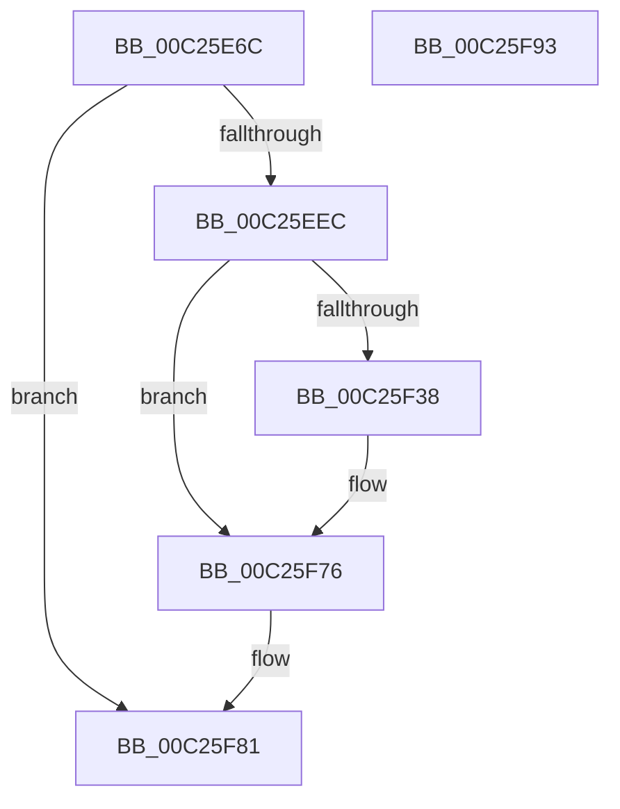

# ArbInitializeMmConfigRange

- RVA: `0x00C25E6C`–`0x00C25F94` (길이 `296` bytes)
- VA: `0x0000000140C25E6C`
- 실행 섹션: `INIT`
- PDB 이름 있음: `예`; PDB Function 태그: `아니요`
- unwind 정보 RVA: `0x000C5718`
- 디코드: `70`개 명령, `296/296` bytes 표시
- 미해석 바이트: `0` (있으면 어셈블리에 `.byte`로 보존)

> 이 문서는 커널 이미지의 기계어와 PDB 기호를 분석해 생성했습니다. 4번과 5번은 함수 원형과 자료형을 바이너리 사용 방식에서 추정한 C 해석이며 원본 소스 복구 결과는 아닙니다.

## 1. Dependencies

- 직접 호출 지점: **5**; 고유 호출 대상: **3**
- 직접 호출자로 확인된 함수: **1**
- RIP 상대 이미지 참조: **3**

### Outgoing calls
- `0x00C25EDF` → [ZwOpenKey](../../text/6A/ZwOpenKey_function_006AD310.md) (function, `0x006AD310`)
- `0x00C25F2D` → [ZwOpenKey](../../text/6A/ZwOpenKey_function_006AD310.md) (function, `0x006AD310`)
- `0x00C25F66` → [ZwSetValueKey](../../text/6A/ZwSetValueKey_function_006ADCD0.md) (function, `0x006ADCD0`)
- `0x00C25F71` → [ZwClose](../../text/6A/ZwClose_function_006AD2B0.md) (function, `0x006AD2B0`)
- `0x00C25F7A` → [ZwClose](../../text/6A/ZwClose_function_006AD2B0.md) (function, `0x006AD2B0`)

### Direct callers
- [HalpPciReportMmConfigAddressRange](HalpPciReportMmConfigAddressRange_function_00C2390C.md) at `0x00C239B8`

### Static image references
- `0x00C25E83` → RVA `0x00C79480` (` ?? ::PBOPGDP::`string'`; read)
- `0x00C25EEC` → RVA `0x00C79570` (` ?? ::PBOPGDP::`string'`; read)
- `0x00C25F3C` → RVA `0x00C79530` (` ?? ::PBOPGDP::`string'`; read)

## 2. Other-region calls and transfers

- 다른 실행 섹션으로 향하는 call: **5**
  - `0x00C25EDF` → [ZwOpenKey](../../text/6A/ZwOpenKey_function_006AD310.md) (`INIT` → `.text`)
  - `0x00C25F2D` → [ZwOpenKey](../../text/6A/ZwOpenKey_function_006AD310.md) (`INIT` → `.text`)
  - `0x00C25F66` → [ZwSetValueKey](../../text/6A/ZwSetValueKey_function_006ADCD0.md) (`INIT` → `.text`)
  - `0x00C25F71` → [ZwClose](../../text/6A/ZwClose_function_006AD2B0.md) (`INIT` → `.text`)
  - `0x00C25F7A` → [ZwClose](../../text/6A/ZwClose_function_006AD2B0.md) (`INIT` → `.text`)
- 별도 외부 분기/꼬리 이동을 확인하지 못했습니다.

## 3. Assembly (complete function range)

```asm
00C25E6C  48 89 5C 24 08                  mov qword ptr [rsp + 8], rbx
00C25E71  48 89 7C 24 20                  mov qword ptr [rsp + 0x20], rdi
00C25E76  55                              push rbp
00C25E77  48 8B EC                        mov rbp, rsp
00C25E7A  48 83 EC 70                     sub rsp, 0x70
00C25E7E  48 83 65 18 00                  and qword ptr [rbp + 0x18], 0
00C25E83  48 8D 05 F6 35 05 00            lea rax, [rip + 0x535f6]
00C25E8A  83 65 EC 00                     and dword ptr [rbp - 0x14], 0
00C25E8E  4C 8D 45 D0                     lea r8, [rbp - 0x30]
00C25E92  48 83 65 20 00                  and qword ptr [rbp + 0x20], 0
00C25E97  48 8B F9                        mov rdi, rcx
00C25E9A  83 65 C4 00                     and dword ptr [rbp - 0x3c], 0
00C25E9E  48 8D 4D 18                     lea rcx, [rbp + 0x18]
00C25EA2  48 83 65 D8 00                  and qword ptr [rbp - 0x28], 0
00C25EA7  0F 57 C0                        xorps xmm0, xmm0
00C25EAA  48 89 45 C8                     mov qword ptr [rbp - 0x38], rax
00C25EAE  BA 1F 00 02 00                  mov edx, 0x2001f
00C25EB3  48 8D 45 C0                     lea rax, [rbp - 0x40]
00C25EB7  48 C7 45 D0 30 00 00 00         mov qword ptr [rbp - 0x30], 0x30
00C25EBF  83 65 D4 00                     and dword ptr [rbp - 0x2c], 0
00C25EC3  BB 30 00 00 00                  mov ebx, 0x30
00C25EC8  48 89 45 E0                     mov qword ptr [rbp - 0x20], rax
00C25ECC  C7 45 C0 76 00 76 00            mov dword ptr [rbp - 0x40], 0x760076
00C25ED3  C7 45 E8 40 02 00 00            mov dword ptr [rbp - 0x18], 0x240
00C25EDA  F3 0F 7F 45 F0                  movdqu xmmword ptr [rbp - 0x10], xmm0
00C25EDF  E8 2C 74 A8 FF                  call 0x1406ad310
00C25EE4  85 C0                           test eax, eax
00C25EE6  0F 88 95 00 00 00               js 0x140c25f81
00C25EEC  48 8D 05 7D 36 05 00            lea rax, [rip + 0x5367d]
00C25EF3  C7 45 C0 22 00 22 00            mov dword ptr [rbp - 0x40], 0x220022
00C25EFA  48 89 45 C8                     mov qword ptr [rbp - 0x38], rax
00C25EFE  4C 8D 45 D0                     lea r8, [rbp - 0x30]
00C25F02  48 8B 45 18                     mov rax, qword ptr [rbp + 0x18]
00C25F06  48 8D 4D 20                     lea rcx, [rbp + 0x20]
00C25F0A  48 89 45 D8                     mov qword ptr [rbp - 0x28], rax
00C25F0E  0F 57 C0                        xorps xmm0, xmm0
00C25F11  48 8D 45 C0                     lea rax, [rbp - 0x40]
00C25F15  89 5D D0                        mov dword ptr [rbp - 0x30], ebx
00C25F18  BA 1F 00 02 00                  mov edx, 0x2001f
00C25F1D  48 89 45 E0                     mov qword ptr [rbp - 0x20], rax
00C25F21  C7 45 E8 40 02 00 00            mov dword ptr [rbp - 0x18], 0x240
00C25F28  F3 0F 7F 45 F0                  movdqu xmmword ptr [rbp - 0x10], xmm0
00C25F2D  E8 DE 73 A8 FF                  call 0x1406ad310
00C25F32  8B D8                           mov ebx, eax
00C25F34  85 C0                           test eax, eax
00C25F36  78 3E                           js 0x140c25f76
00C25F38  48 8B 4D 20                     mov rcx, qword ptr [rbp + 0x20]
00C25F3C  48 8D 05 ED 35 05 00            lea rax, [rip + 0x535ed]
00C25F43  48 89 45 C8                     mov qword ptr [rbp - 0x38], rax
00C25F47  48 8D 55 C0                     lea rdx, [rbp - 0x40]
00C25F4B  8B 07                           mov eax, dword ptr [rdi]
00C25F4D  41 B9 0A 00 00 00               mov r9d, 0xa
00C25F53  89 44 24 28                     mov dword ptr [rsp + 0x28], eax
00C25F57  45 33 C0                        xor r8d, r8d
00C25F5A  48 89 7C 24 20                  mov qword ptr [rsp + 0x20], rdi
00C25F5F  C7 45 C0 1A 00 1A 00            mov dword ptr [rbp - 0x40], 0x1a001a
00C25F66  E8 65 7D A8 FF                  call 0x1406adcd0
00C25F6B  48 8B 4D 20                     mov rcx, qword ptr [rbp + 0x20]
00C25F6F  8B D8                           mov ebx, eax
00C25F71  E8 3A 73 A8 FF                  call 0x1406ad2b0
00C25F76  48 8B 4D 18                     mov rcx, qword ptr [rbp + 0x18]
00C25F7A  E8 31 73 A8 FF                  call 0x1406ad2b0
00C25F7F  8B C3                           mov eax, ebx
00C25F81  4C 8D 5C 24 70                  lea r11, [rsp + 0x70]
00C25F86  49 8B 5B 10                     mov rbx, qword ptr [r11 + 0x10]
00C25F8A  49 8B 7B 28                     mov rdi, qword ptr [r11 + 0x28]
00C25F8E  49 8B E3                        mov rsp, r11
00C25F91  5D                              pop rbp
00C25F92  C3                              ret
00C25F93  CC                              int3
```

## 4. C-style interpretation (structured pseudocode)

```c
__int64 __fastcall ArbInitializeMmConfigRange(__int64 a1)
{
    __int64 result;
    __int64 v_rbx;
    __int64 v_rsp;
    unsigned __int64 v_stack_m18;
    unsigned int v_stack_m1C;
    unsigned int v_stack_m20;
    unsigned __int64 v_stack_m28;
    unsigned __int64 v_stack_m30;
    unsigned int v_stack_m34;
    unsigned __int64 v_stack_m38;
    unsigned __int64 v_stack_m40;
    unsigned int v_stack_m44;
    unsigned __int64 v_stack_m48;
    unsigned int v_stack_m50;
    unsigned __int64 v_stack_m58;
    unsigned __int64 v_stack_m8;
    unsigned __int64 v_stack_p10;
    unsigned __int64 v_stack_p18;
    unsigned __int64 v_stack_p20;
    unsigned __int64 v_stack_p8;

    v_stack_p8 = v_rbx;
    v_stack_p20 = v_rdi;
    v_rsp = (v_rsp) - (112);
    v_stack_m40 = v_rip + 341494;
    v_stack_m38 = 48;
    v_stack_m28 = v_stack_m48;
    v_stack_m48 = 0x760076ULL;
    v_stack_m20 = 576;
    v_stack_m18 = v_xmm0;
    result = ZwOpenKey(v_stack_p10, (unsigned int)(0x2001FULL), v_stack_m38, a4);
    if (sign_flag) goto loc_00C25F81;
    v_stack_m48 = 0x220022ULL;
    v_stack_m40 = v_rip + 341629;
    v_stack_m30 = v_stack_p10;
    v_stack_m38 = 48;
    v_stack_m28 = v_stack_m48;
    v_stack_m20 = 576;
    v_stack_m18 = v_xmm0;
    result = ZwOpenKey(v_stack_p18, (unsigned int)(0x2001FULL), v_stack_m38, a4);
    v_rbx = (unsigned int)((unsigned int)(result));
    if (!(sign_flag)) {
        a1 = v_stack_p18;
        result = v_rip + 341485;
        v_stack_m40 = result;
        a2 = v_stack_m48;
        result = *(unsigned int *)(a1);
        a4 = 10;
        v_stack_m50 = (unsigned int)(result);
        a3 = 0;
        v_stack_m58 = a1;
        v_stack_m48 = 0x1A001AULL;
        result = ZwSetValueKey(a1, a2, a3, a4);
        a1 = v_stack_p18;
        v_rbx = (unsigned int)(result);
        result = ZwClose(a1, a2, a3, a4);
    }
    result = ZwClose(v_stack_p10, a2, a3, a4);
loc_00C25F81:
    return (unsigned int)((unsigned int)(v_rbx));
}
```

## 5. (Beta) C Style

```c
int64_t ArbInitializeMmConfigRange(void *Arg1)
{
    uint8_t *arg1 = (uint8_t *)Arg1;

    int64_t result;
    int64_t local_rbx;
    int64_t local_rsp;
    uint64_t v_stack_m18;
    uint32_t v_stack_m1C;
    uint32_t v_stack_m20;
    uint64_t v_stack_m28;
    uint64_t v_stack_m30;
    uint32_t v_stack_m34;
    uint64_t v_stack_m38;
    uint64_t v_stack_m40;
    uint32_t v_stack_m44;
    uint64_t v_stack_m48;
    uint32_t v_stack_m50;
    uint64_t v_stack_m58;
    uint64_t v_stack_m8;
    uint64_t v_stack_p10;
    uint64_t v_stack_p18;
    uint64_t v_stack_p20;
    uint64_t v_stack_p8;

    v_stack_p8 = local_rbx;
    v_stack_p20 = local_rdi;
    local_rsp = (local_rsp) - (112);
    v_stack_m40 = v_rip + 341494;
    v_stack_m38 = 48;
    v_stack_m28 = v_stack_m48;
    v_stack_m48 = 0x760076ULL;
    v_stack_m20 = 576;
    v_stack_m18 = v_xmm0;
    result = ZwOpenKey(v_stack_p10, (uint32_t)(0x2001FULL), v_stack_m38, a4);
    if (sign_flag) goto loc_00C25F81;
    v_stack_m48 = 0x220022ULL;
    v_stack_m40 = v_rip + 341629;
    v_stack_m30 = v_stack_p10;
    v_stack_m38 = 48;
    v_stack_m28 = v_stack_m48;
    v_stack_m20 = 576;
    v_stack_m18 = v_xmm0;
    result = ZwOpenKey(v_stack_p18, (uint32_t)(0x2001FULL), v_stack_m38, a4);
    local_rbx = (uint32_t)((uint32_t)(result));
    if (!(sign_flag)) {
        Arg1 = v_stack_p18;
        result = v_rip + 341485;
        v_stack_m40 = result;
        a2 = v_stack_m48;
        result = *(uint32_t *)(arg1);
        a4 = 10;
        v_stack_m50 = (uint32_t)(result);
        a3 = 0;
        v_stack_m58 = Arg1;
        v_stack_m48 = 0x1A001AULL;
        result = ZwSetValueKey(Arg1, a2, a3, a4);
        Arg1 = v_stack_p18;
        local_rbx = (uint32_t)(result);
        result = ZwClose(Arg1, a2, a3, a4);
    }
    result = ZwClose(v_stack_p10, a2, a3, a4);
loc_00C25F81:
    return (uint32_t)((uint32_t)(local_rbx));
}
```

### 관측된 메모리 오프셋

구조체 형식이 확인되지 않은 접근은 인자 기준의 오프셋으로만 기록했습니다.

| 기준 인자 | 오프셋 표현 | 폭 (bit) | 접근 |
|---|---:|---:|---|
| `Arg1` | `+ 0x0` | `32` | `R` |

## 6. Execution-region graph

[열기: 2D/3D 그래프와 함수 탐색 컨트롤 패널](../../../control-panel.html?section=init&rva=0x00C25E6C&view=graph)

- 2D 그래프는 위에서 아래로 흐르고, 3D 그래프는 빈 공간을 드래그해 회전합니다. Shift+드래그는 이동, 휠은 확대·축소, 함수 노드 선택은 대상 보고서 이동입니다.

### Static fallback


