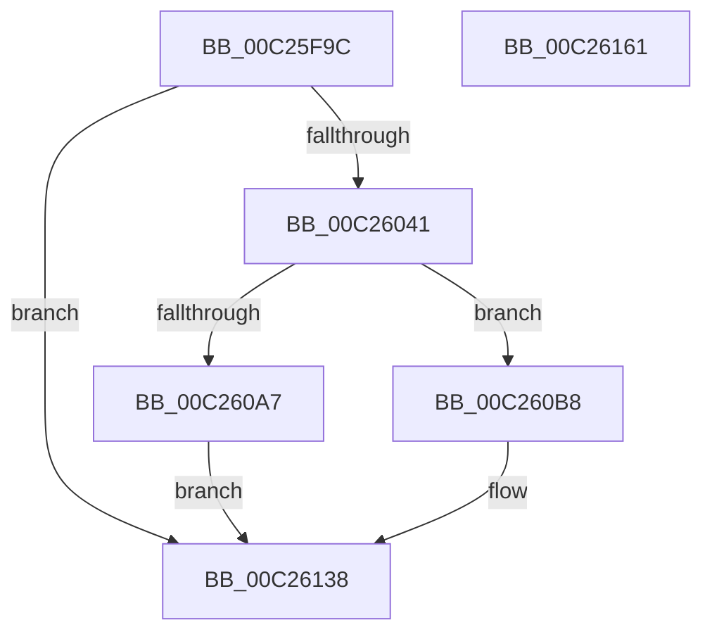

# ArbInitializeOsInaccessibleRange

- RVA: `0x00C25F9C`–`0x00C26162` (길이 `454` bytes)
- VA: `0x0000000140C25F9C`
- 실행 섹션: `INIT`
- PDB 이름 있음: `예`; PDB Function 태그: `아니요`
- unwind 정보 RVA: `0x000C56E0`
- 디코드: `107`개 명령, `454/454` bytes 표시
- 미해석 바이트: `0` (있으면 어셈블리에 `.byte`로 보존)

> 이 문서는 커널 이미지의 기계어와 PDB 기호를 분석해 생성했습니다. 4번과 5번은 함수 원형과 자료형을 바이너리 사용 방식에서 추정한 C 해석이며 원본 소스 복구 결과는 아닙니다.

## 1. Dependencies

- 직접 호출 지점: **8**; 고유 호출 대상: **6**
- 직접 호출자로 확인된 함수: **1**
- RIP 상대 이미지 참조: **4**

### Outgoing calls
- `0x00C26034` → [ZwOpenKey](../../text/6A/ZwOpenKey_function_006AD310.md) (function, `0x006AD310`)
- `0x00C2609C` → [ZwCreateKey](../../text/6A/ZwCreateKey_function_006AD470.md) (function, `0x006AD470`)
- `0x00C260AC` → [ZwClose](../../text/6A/ZwClose_function_006AD2B0.md) (function, `0x006AD2B0`)
- `0x00C260C6` → [memset](../../text/6C/memset_function_006C6C40.md) (function, `0x006C6C40`)
- `0x00C26118` → [ZwSetValueKey](../../text/6A/ZwSetValueKey_function_006ADCD0.md) (function, `0x006ADCD0`)
- `0x00C26127` → [ZwClose](../../text/6A/ZwClose_function_006AD2B0.md) (function, `0x006AD2B0`)
- `0x00C26131` → [ZwClose](../../text/6A/ZwClose_function_006AD2B0.md) (function, `0x006AD2B0`)
- `0x00C2613F` → [_security_check_cookie](../../text/6A/_security_check_cookie_function_006AC640.md) (function, `0x006AC640`)

### Direct callers
- [IopInitializePlugPlayServices](IopInitializePlugPlayServices_function_00C2F298.md) at `0x00C2F5A5`

### Static image references
- `0x00C25FBB` → RVA `0x00E0A740` (`.data`; read)
- `0x00C25FD3` → RVA `0x00C79480` (` ?? ::PBOPGDP::`string'`; read)
- `0x00C26041` → RVA `0x00C79500` (` ?? ::PBOPGDP::`string'`; read)
- `0x00C260D0` → RVA `0x00C79550` (` ?? ::PBOPGDP::`string'`; read)

## 2. Other-region calls and transfers

- 다른 실행 섹션으로 향하는 call: **8**
  - `0x00C26034` → [ZwOpenKey](../../text/6A/ZwOpenKey_function_006AD310.md) (`INIT` → `.text`)
  - `0x00C2609C` → [ZwCreateKey](../../text/6A/ZwCreateKey_function_006AD470.md) (`INIT` → `.text`)
  - `0x00C260AC` → [ZwClose](../../text/6A/ZwClose_function_006AD2B0.md) (`INIT` → `.text`)
  - `0x00C260C6` → [memset](../../text/6C/memset_function_006C6C40.md) (`INIT` → `.text`)
  - `0x00C26118` → [ZwSetValueKey](../../text/6A/ZwSetValueKey_function_006ADCD0.md) (`INIT` → `.text`)
  - `0x00C26127` → [ZwClose](../../text/6A/ZwClose_function_006AD2B0.md) (`INIT` → `.text`)
  - `0x00C26131` → [ZwClose](../../text/6A/ZwClose_function_006AD2B0.md) (`INIT` → `.text`)
  - `0x00C2613F` → [_security_check_cookie](../../text/6A/_security_check_cookie_function_006AC640.md) (`INIT` → `.text`)
- 별도 외부 분기/꼬리 이동을 확인하지 못했습니다.

## 3. Assembly (complete function range)

```asm
00C25F9C  48 8B C4                        mov rax, rsp
00C25F9F  48 89 58 08                     mov qword ptr [rax + 8], rbx
00C25FA3  48 89 70 10                     mov qword ptr [rax + 0x10], rsi
00C25FA7  48 89 78 18                     mov qword ptr [rax + 0x18], rdi
00C25FAB  4C 89 70 20                     mov qword ptr [rax + 0x20], r14
00C25FAF  55                              push rbp
00C25FB0  48 8D 68 D8                     lea rbp, [rax - 0x28]
00C25FB4  48 81 EC 20 01 00 00            sub rsp, 0x120
00C25FBB  48 8B 05 7E 47 1E 00            mov rax, qword ptr [rip + 0x1e477e]
00C25FC2  48 33 C4                        xor rax, rsp
00C25FC5  48 89 45 10                     mov qword ptr [rbp + 0x10], rax
00C25FC9  33 DB                           xor ebx, ebx
00C25FCB  48 C7 45 88 30 00 00 00         mov qword ptr [rbp - 0x78], 0x30
00C25FD3  48 8D 05 A6 34 05 00            lea rax, [rip + 0x534a6]
00C25FDA  48 89 5C 24 40                  mov qword ptr [rsp + 0x40], rbx
00C25FDF  48 89 44 24 60                  mov qword ptr [rsp + 0x60], rax
00C25FE4  4C 8D 45 88                     lea r8, [rbp - 0x78]
00C25FE8  48 8D 44 24 58                  lea rax, [rsp + 0x58]
00C25FED  48 C7 45 A0 40 02 00 00         mov qword ptr [rbp - 0x60], 0x240
00C25FF5  44 8B F1                        mov r14d, ecx
00C25FF8  48 89 45 98                     mov qword ptr [rbp - 0x68], rax
00C25FFC  0F 57 C0                        xorps xmm0, xmm0
00C25FFF  89 5C 24 48                     mov dword ptr [rsp + 0x48], ebx
00C26003  BA 1F 00 02 00                  mov edx, 0x2001f
00C26008  48 C7 44 24 58 76 00 76 00      mov qword ptr [rsp + 0x58], 0x760076
00C26011  48 8D 4C 24 40                  lea rcx, [rsp + 0x40]
00C26016  48 89 5C 24 50                  mov qword ptr [rsp + 0x50], rbx
00C2601B  8D 7B 30                        lea edi, [rbx + 0x30]
00C2601E  89 5C 24 6C                     mov dword ptr [rsp + 0x6c], ebx
00C26022  89 5C 24 7C                     mov dword ptr [rsp + 0x7c], ebx
00C26026  BE 40 02 00 00                  mov esi, 0x240
00C2602B  48 89 5D 90                     mov qword ptr [rbp - 0x70], rbx
00C2602F  F3 0F 7F 45 A8                  movdqu xmmword ptr [rbp - 0x58], xmm0
00C26034  E8 D7 72 A8 FF                  call 0x1406ad310
00C26039  85 C0                           test eax, eax
00C2603B  0F 88 F7 00 00 00               js 0x140c26138
00C26041  48 8D 05 B8 34 05 00            lea rax, [rip + 0x534b8]
00C26048  89 75 A0                        mov dword ptr [rbp - 0x60], esi
00C2604B  48 89 44 24 70                  mov qword ptr [rsp + 0x70], rax
00C26050  8D 73 01                        lea esi, [rbx + 1]
00C26053  48 8B 44 24 40                  mov rax, qword ptr [rsp + 0x40]
00C26058  4C 8D 45 88                     lea r8, [rbp - 0x78]
00C2605C  48 89 45 90                     mov qword ptr [rbp - 0x70], rax
00C26060  48 8D 4C 24 50                  lea rcx, [rsp + 0x50]
00C26065  48 8D 44 24 68                  lea rax, [rsp + 0x68]
00C2606A  C7 44 24 68 22 00 22 00         mov dword ptr [rsp + 0x68], 0x220022
00C26072  48 89 45 98                     mov qword ptr [rbp - 0x68], rax
00C26076  0F 57 C0                        xorps xmm0, xmm0
00C26079  48 8D 44 24 48                  lea rax, [rsp + 0x48]
00C2607E  89 7D 88                        mov dword ptr [rbp - 0x78], edi
00C26081  48 89 44 24 30                  mov qword ptr [rsp + 0x30], rax
00C26086  45 33 C9                        xor r9d, r9d
00C26089  89 74 24 28                     mov dword ptr [rsp + 0x28], esi
00C2608D  BA 1F 00 02 00                  mov edx, 0x2001f
00C26092  48 89 5C 24 20                  mov qword ptr [rsp + 0x20], rbx
00C26097  F3 0F 7F 45 A8                  movdqu xmmword ptr [rbp - 0x58], xmm0
00C2609C  E8 CF 73 A8 FF                  call 0x1406ad470
00C260A1  8B F8                           mov edi, eax
00C260A3  85 C0                           test eax, eax
00C260A5  79 11                           jns 0x140c260b8
00C260A7  48 8B 4C 24 40                  mov rcx, qword ptr [rsp + 0x40]
00C260AC  E8 FF 71 A8 FF                  call 0x1406ad2b0
00C260B1  8B C7                           mov eax, edi
00C260B3  E9 80 00 00 00                  jmp 0x140c26138
00C260B8  BF 48 00 00 00                  mov edi, 0x48
00C260BD  48 8D 4D C0                     lea rcx, [rbp - 0x40]
00C260C1  44 8B C7                        mov r8d, edi
00C260C4  33 D2                           xor edx, edx
00C260C6  E8 75 0B AA FF                  call 0x1406c6c40
00C260CB  48 83 4D 00 FF                  or qword ptr [rbp], 0xffffffffffffffff
00C260D0  48 8D 05 79 34 05 00            lea rax, [rip + 0x53479]
00C260D7  41 8B CE                        mov ecx, r14d
00C260DA  48 89 45 80                     mov qword ptr [rbp - 0x80], rax
00C260DE  89 75 DC                        mov dword ptr [rbp - 0x24], esi
00C260E1  48 8D 45 C0                     lea rax, [rbp - 0x40]
00C260E5  89 75 E4                        mov dword ptr [rbp - 0x1c], esi
00C260E8  44 8D 4F C2                     lea r9d, [rdi - 0x3e]
00C260EC  48 D3 E6                        shl rsi, cl
00C260EF  48 8D 54 24 78                  lea rdx, [rsp + 0x78]
00C260F4  48 8B 4C 24 50                  mov rcx, qword ptr [rsp + 0x50]
00C260F9  45 33 C0                        xor r8d, r8d
00C260FC  89 7C 24 28                     mov dword ptr [rsp + 0x28], edi
00C26100  48 89 44 24 20                  mov qword ptr [rsp + 0x20], rax
00C26105  89 7D C0                        mov dword ptr [rbp - 0x40], edi
00C26108  C6 45 E9 03                     mov byte ptr [rbp - 0x17], 3
00C2610C  48 89 75 F8                     mov qword ptr [rbp - 8], rsi
00C26110  C7 44 24 78 1E 00 1E 00         mov dword ptr [rsp + 0x78], 0x1e001e
00C26118  E8 B3 7B A8 FF                  call 0x1406adcd0
00C2611D  48 8B 4C 24 50                  mov rcx, qword ptr [rsp + 0x50]
00C26122  85 C0                           test eax, eax
00C26124  0F 48 D8                        cmovs ebx, eax
00C26127  E8 84 71 A8 FF                  call 0x1406ad2b0
00C2612C  48 8B 4C 24 40                  mov rcx, qword ptr [rsp + 0x40]
00C26131  E8 7A 71 A8 FF                  call 0x1406ad2b0
00C26136  8B C3                           mov eax, ebx
00C26138  48 8B 4D 10                     mov rcx, qword ptr [rbp + 0x10]
00C2613C  48 33 CC                        xor rcx, rsp
00C2613F  E8 FC 64 A8 FF                  call 0x1406ac640
00C26144  4C 8D 9C 24 20 01 00 00         lea r11, [rsp + 0x120]
00C2614C  49 8B 5B 10                     mov rbx, qword ptr [r11 + 0x10]
00C26150  49 8B 73 18                     mov rsi, qword ptr [r11 + 0x18]
00C26154  49 8B 7B 20                     mov rdi, qword ptr [r11 + 0x20]
00C26158  4D 8B 73 28                     mov r14, qword ptr [r11 + 0x28]
00C2615C  49 8B E3                        mov rsp, r11
00C2615F  5D                              pop rbp
00C26160  C3                              ret
00C26161  CC                              int3
```

## 4. C-style interpretation (structured pseudocode)

```c
__int64 __fastcall ArbInitializeOsInaccessibleRange(int a1, __int64 a2, __int64 a3, int a4)
{
    __int64 result;
    __int64 v_rbx;
    __int64 v_rsi;
    __int64 v_rsp;
    unsigned int v_stack_m100;
    unsigned __int64 v_stack_m108;
    unsigned __int64 v_stack_m8;
    unsigned int v_stack_mAC;
    unsigned __int64 v_stack_mB0;
    unsigned __int64 v_stack_mB8;
    unsigned int v_stack_mBC;
    unsigned __int64 v_stack_mC0;
    unsigned __int64 v_stack_mC8;
    unsigned __int64 v_stack_mD0;
    unsigned __int64 v_stack_mD8;
    unsigned int v_stack_mE0;
    unsigned __int64 v_stack_mE8;
    unsigned __int64 v_stack_mF8;

    *(unsigned __int64 *)(v_rsp + 8) = v_rbx;
    *(unsigned __int64 *)(v_rsp + 16) = v_rsi;
    *(unsigned __int64 *)(v_rsp + 24) = v_rdi;
    *(unsigned __int64 *)(v_rsp + 32) = v_r14;
    v_rsp = (v_rsp) - (288);
    result = (*(unsigned __int64 *)(v_rip + 1984382)) ^ (v_rsp);
    *(unsigned __int64 *)(v_rsp - 40 + 16) = result;
    v_rbx = 0;
    *(unsigned __int64 *)(v_rsp - 40 - 120) = 48;
    v_stack_mE8 = 0;
    v_stack_mC8 = v_rip + 341158;
    *(unsigned __int64 *)(v_rsp - 40 - 96) = 576;
    *(unsigned __int64 *)(v_rsp - 40 - 104) = v_stack_mD0;
    v_stack_mE0 = 0;
    v_stack_mD0 = 0x760076ULL;
    v_stack_mD8 = 0;
    v_stack_mBC = 0;
    v_stack_mAC = 0;
    *(unsigned __int64 *)(v_rsp - 40 - 112) = 0;
    *(unsigned __int64 *)(v_rsp - 40 - 88) = v_xmm0;
    result = ZwOpenKey(v_stack_mE8, (unsigned int)(0x2001FULL), v_rsp - 40 - 120, a4);
    if (sign_flag) goto loc_00C26138;
    *(unsigned int *)(v_rsp - 40 - 96) = 576;
    v_stack_mB8 = v_rip + 341176;
    *(unsigned __int64 *)(v_rsp - 40 - 112) = v_stack_mE8;
    v_stack_mC0 = 0x220022ULL;
    *(unsigned __int64 *)(v_rsp - 40 - 104) = v_stack_mC0;
    *(unsigned int *)(v_rsp - 40 - 120) = (unsigned int)(v_rbx + 48);
    v_stack_mF8 = v_stack_mE0;
    a4 = 0;
    v_stack_m100 = (unsigned int)(v_rbx + 1);
    v_stack_m108 = 0;
    *(unsigned __int64 *)(v_rsp - 40 - 88) = v_xmm0;
    result = ZwCreateKey(v_stack_mD8, (unsigned int)(0x2001FULL), v_rsp - 40 - 120, a4);
    if (!sign_flag) goto loc_00C260B8;
    result = ZwClose(v_stack_mE8, (unsigned int)(0x2001FULL), v_rsp - 40 - 120, a4);
    goto loc_00C26138;
loc_00C260B8:
    a2 = 0;
    result = memset(v_rsp - 40 - 64, a2, 72, a4);
    *(unsigned __int64 *)(v_rsp - 40 - 128) = v_rip + 341113;
    *(unsigned int *)(v_rsp - 40 - 36) = (unsigned int)(v_rbx + 1);
    *(unsigned int *)(v_rsp - 40 - 28) = (unsigned int)(v_rbx + 1);
    v_rsi = (v_rbx + 1) << ((unsigned __int8)((unsigned int)((unsigned int)((unsigned int)(a1)))));
    a3 = 0;
    v_stack_m100 = 72;
    v_stack_m108 = v_rsp - 40 - 64;
    *(unsigned int *)(v_rsp - 40 - 64) = 72;
    *(unsigned __int8 *)(v_rsp - 40 - 23) = 3;
    *(unsigned __int64 *)(v_rsp - 40 - 8) = v_rsi;
    v_stack_mB0 = 0x1E001EULL;
    result = ZwSetValueKey(v_stack_mD8, v_stack_mB0, a3, 72 - 62);
    if (sign_flag) { v_rbx = (unsigned int)(result); }
    result = ZwClose(v_stack_mD8, v_stack_mB0, a3, 72 - 62);
    result = ZwClose(v_stack_mE8, v_stack_mB0, a3, 72 - 62);
loc_00C26138:
    a1 = (*(unsigned __int64 *)(v_rsp - 40 + 16)) ^ (v_rsp);
    result = _security_check_cookie(a1, v_stack_mB0, a3, 72 - 62);
    return result;
}
```

## 5. (Beta) C Style

```c
int64_t ArbInitializeOsInaccessibleRange(int32_t Arg1, int64_t Arg2, int64_t Arg3, int32_t Arg4)
{
    int64_t result;
    int64_t local_rbx;
    int64_t local_rsi;
    int64_t local_rsp;
    uint32_t v_stack_m100;
    uint64_t v_stack_m108;
    uint64_t v_stack_m8;
    uint32_t v_stack_mAC;
    uint64_t v_stack_mB0;
    uint64_t v_stack_mB8;
    uint32_t v_stack_mBC;
    uint64_t v_stack_mC0;
    uint64_t v_stack_mC8;
    uint64_t v_stack_mD0;
    uint64_t v_stack_mD8;
    uint32_t v_stack_mE0;
    uint64_t v_stack_mE8;
    uint64_t v_stack_mF8;

    *(uint64_t *)(local_rsp + 0x8) = local_rbx;
    *(uint64_t *)(local_rsp + 0x10) = local_rsi;
    *(uint64_t *)(local_rsp + 0x18) = local_rdi;
    *(uint64_t *)(local_rsp + 0x20) = local_r14;
    local_rsp = (local_rsp) - (288);
    result = (*(uint64_t *)(v_rip + 0x1E477E)) ^ (local_rsp);
    *(uint64_t *)(local_rsp - 0x28 + 0x10) = result;
    local_rbx = 0;
    *(uint64_t *)(local_rsp - 0x28 - 0x78) = 48;
    v_stack_mE8 = 0;
    v_stack_mC8 = v_rip + 341158;
    *(uint64_t *)(local_rsp - 0x28 - 0x60) = 576;
    *(uint64_t *)(local_rsp - 0x28 - 0x68) = v_stack_mD0;
    v_stack_mE0 = 0;
    v_stack_mD0 = 0x760076ULL;
    v_stack_mD8 = 0;
    v_stack_mBC = 0;
    v_stack_mAC = 0;
    *(uint64_t *)(local_rsp - 0x28 - 0x70) = 0;
    *(uint64_t *)(local_rsp - 0x28 - 0x58) = v_xmm0;
    result = ZwOpenKey(v_stack_mE8, (uint32_t)(0x2001FULL), local_rsp - 40 - 120, Arg4);
    if (sign_flag) goto loc_00C26138;
    *(uint32_t *)(local_rsp - 0x28 - 0x60) = 576;
    v_stack_mB8 = v_rip + 341176;
    *(uint64_t *)(local_rsp - 0x28 - 0x70) = v_stack_mE8;
    v_stack_mC0 = 0x220022ULL;
    *(uint64_t *)(local_rsp - 0x28 - 0x68) = v_stack_mC0;
    *(uint32_t *)(local_rsp - 0x28 - 0x78) = (uint32_t)(local_rbx + 48);
    v_stack_mF8 = v_stack_mE0;
    Arg4 = 0;
    v_stack_m100 = (uint32_t)(local_rbx + 1);
    v_stack_m108 = 0;
    *(uint64_t *)(local_rsp - 0x28 - 0x58) = v_xmm0;
    result = ZwCreateKey(v_stack_mD8, (uint32_t)(0x2001FULL), local_rsp - 40 - 120, Arg4);
    if (!sign_flag) goto loc_00C260B8;
    result = ZwClose(v_stack_mE8, (uint32_t)(0x2001FULL), local_rsp - 40 - 120, Arg4);
    goto loc_00C26138;
loc_00C260B8:
    Arg2 = 0;
    result = memset(local_rsp - 40 - 64, Arg2, 72, Arg4);
    *(uint64_t *)(local_rsp - 0x28 - 0x80) = v_rip + 341113;
    *(uint32_t *)(local_rsp - 0x28 - 0x24) = (uint32_t)(local_rbx + 1);
    *(uint32_t *)(local_rsp - 0x28 - 0x1C) = (uint32_t)(local_rbx + 1);
    local_rsi = (local_rbx + 1) << ((uint8_t)((uint32_t)((uint32_t)((uint32_t)(Arg1)))));
    Arg3 = 0;
    v_stack_m100 = 72;
    v_stack_m108 = local_rsp - 40 - 64;
    *(uint32_t *)(local_rsp - 0x28 - 0x40) = 72;
    *(uint8_t *)(local_rsp - 0x28 - 0x17) = 3;
    *(uint64_t *)(local_rsp - 0x28 - 0x8) = local_rsi;
    v_stack_mB0 = 0x1E001EULL;
    result = ZwSetValueKey(v_stack_mD8, v_stack_mB0, Arg3, 72 - 62);
    if (sign_flag) { local_rbx = (uint32_t)(result); }
    result = ZwClose(v_stack_mD8, v_stack_mB0, Arg3, 72 - 62);
    result = ZwClose(v_stack_mE8, v_stack_mB0, Arg3, 72 - 62);
loc_00C26138:
    Arg1 = (*(uint64_t *)(local_rsp - 0x28 + 0x10)) ^ (local_rsp);
    result = _security_check_cookie(Arg1, v_stack_mB0, Arg3, 72 - 62);
    return result;
}
```

## 6. Execution-region graph

[열기: 2D/3D 그래프와 함수 탐색 컨트롤 패널](../../../control-panel.html?section=init&rva=0x00C25F9C&view=graph)

- 2D 그래프는 위에서 아래로 흐르고, 3D 그래프는 빈 공간을 드래그해 회전합니다. Shift+드래그는 이동, 휠은 확대·축소, 함수 노드 선택은 대상 보고서 이동입니다.

### Static fallback


