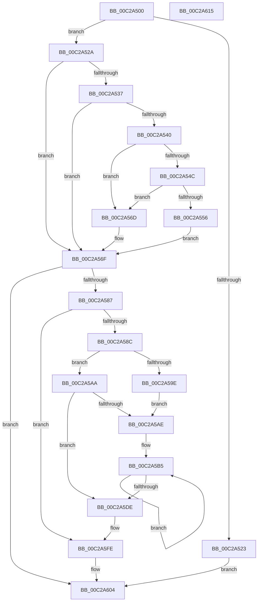

# BvgaDriverInitialize

- RVA: `0x00C2A500`–`0x00C2A616` (길이 `278` bytes)
- VA: `0x0000000140C2A500`
- 실행 섹션: `INIT`
- PDB 이름 있음: `예`; PDB Function 태그: `아니요`
- unwind 정보 RVA: `0x000C6F0C`
- 디코드: `68`개 명령, `278/278` bytes 표시
- 미해석 바이트: `0` (있으면 어셈블리에 `.byte`로 보존)

> 이 문서는 커널 이미지의 기계어와 PDB 기호를 분석해 생성했습니다. 4번과 5번은 함수 원형과 자료형을 바이너리 사용 방식에서 추정한 C 해석이며 원본 소스 복구 결과는 아닙니다.

## 1. Dependencies

- 직접 호출 지점: **5**; 고유 호출 대상: **5**
- 직접 호출자로 확인된 함수: **1**
- RIP 상대 이미지 참조: **14**

### Outgoing calls
- `0x00C2A54C` → [strupr](../../text/4F/strupr_function_004FEEE0.md) (function, `0x004FEEE0`)
- `0x00C2A560` → [strstr](../../text/4F/strstr_function_004FF680.md) (function, `0x004FF680`)
- `0x00C2A571` → `BOOTVID.dll!VidInitialize` (import, 간접 대상; import `BOOTVID.dll!VidInitialize`)
- `0x00C2A5C7` → [FindBitmapResource](FindBitmapResource_function_00C2A6FC.md) (function, `0x00C2A6FC`)
- `0x00C2A5DE` → [BvgaSaveResources](BvgaSaveResources_function_00C2A668.md) (function, `0x00C2A668`)

### Direct callers
- [InbvDriverInitialize](InbvDriverInitialize_function_00C2A420.md) at `0x00C2A4AA`

### Static image references
- `0x00C2A51A` → RVA `0x00E65EC9` (`.data`; read)
- `0x00C2A52A` → RVA `0x00F8E9E0` (`.data`; read/write)
- `0x00C2A537` → RVA `0x00E65ED0` (`.data`; read)
- `0x00C2A556` → RVA `0x00C798E0` (` ?? ::PBOPGDP::`string'`; read)
- `0x00C2A571` → RVA `0x00151020` (`BOOTVID.dll!VidInitialize (IAT)`; read)
- `0x00C2A57D` → RVA `0x00E65EC8` (`.data`; write)
- `0x00C2A58C` → RVA `0x00E65EC9` (`.data`; write)
- `0x00C2A593` → RVA `0x00E65ECC` (`.data`; write)
- `0x00C2A5AE` → RVA `0x00000000` (`image boundary/outside`; read)
- `0x00C2A5D6` → RVA `0x00E65ECC` (`.data`; read)
- `0x00C2A5E3` → RVA `0x00F8E9F0` (`.data`; read/write)
- `0x00C2A5EA` → RVA `0x00F8E9F4` (`.data`; write)
- `0x00C2A5F4` → RVA `0x00F8E9F8` (`.data`; write)
- `0x00C2A5FE` → RVA `0x00E65EC8` (`.data`; read)

## 2. Other-region calls and transfers

- 다른 실행 섹션으로 향하는 call: **2**
  - `0x00C2A54C` → [strupr](../../text/4F/strupr_function_004FEEE0.md) (`INIT` → `.text`)
  - `0x00C2A560` → [strstr](../../text/4F/strstr_function_004FF680.md) (`INIT` → `.text`)
- 별도 외부 분기/꼬리 이동을 확인하지 못했습니다.

## 3. Assembly (complete function range)

```asm
00C2A500  48 89 5C 24 08                  mov qword ptr [rsp + 8], rbx
00C2A505  48 89 7C 24 10                  mov qword ptr [rsp + 0x10], rdi
00C2A50A  41 56                           push r14
00C2A50C  48 83 EC 20                     sub rsp, 0x20
00C2A510  41 8B D8                        mov ebx, r8d
00C2A513  8B F9                           mov edi, ecx
00C2A515  4C 8B C2                        mov r8, rdx
00C2A518  32 D2                           xor dl, dl
00C2A51A  80 3D A8 B9 23 00 01            cmp byte ptr [rip + 0x23b9a8], 1
00C2A521  75 07                           jne 0x140c2a52a
00C2A523  B0 01                           mov al, 1
00C2A525  E9 DA 00 00 00                  jmp 0x140c2a604
00C2A52A  48 83 25 AE 44 36 00 00         and qword ptr [rip + 0x3644ae], 0
00C2A532  83 FF 01                        cmp edi, 1
00C2A535  75 38                           jne 0x140c2a56f
00C2A537  83 3D 92 B9 23 00 00            cmp dword ptr [rip + 0x23b992], 0
00C2A53E  75 2F                           jne 0x140c2a56f
00C2A540  49 8B 88 D8 00 00 00            mov rcx, qword ptr [r8 + 0xd8]
00C2A547  48 85 C9                        test rcx, rcx
00C2A54A  74 21                           je 0x140c2a56d
00C2A54C  E8 8F 49 8D FF                  call 0x1404feee0
00C2A551  48 85 C0                        test rax, rax
00C2A554  74 17                           je 0x140c2a56d
00C2A556  48 8D 15 83 F3 04 00            lea rdx, [rip + 0x4f383]
00C2A55D  48 8B C8                        mov rcx, rax
00C2A560  E8 1B 51 8D FF                  call 0x1404ff680
00C2A565  48 85 C0                        test rax, rax
00C2A568  0F 94 C2                        sete dl
00C2A56B  EB 02                           jmp 0x140c2a56f
00C2A56D  B2 01                           mov dl, 1
00C2A56F  8B CF                           mov ecx, edi
00C2A571  48 FF 15 A8 6A 52 FF            call qword ptr [rip - 0xad9558]
00C2A578  0F 1F 44 00 00                  nop dword ptr [rax + rax]
00C2A57D  88 05 45 B9 23 00               mov byte ptr [rip + 0x23b945], al
00C2A583  84 C0                           test al, al
00C2A585  74 7D                           je 0x140c2a604
00C2A587  83 FF 01                        cmp edi, 1
00C2A58A  75 72                           jne 0x140c2a5fe
00C2A58C  40 88 3D 36 B9 23 00            mov byte ptr [rip + 0x23b936], dil
00C2A593  89 1D 33 B9 23 00               mov dword ptr [rip + 0x23b933], ebx
00C2A599  83 FB 07                        cmp ebx, 7
00C2A59C  76 0C                           jbe 0x140c2a5aa
00C2A59E  C7 05 24 B9 23 00 07 00 00 00   mov dword ptr [rip + 0x23b924], 7
00C2A5A8  EB 04                           jmp 0x140c2a5ae
00C2A5AA  3B DF                           cmp ebx, edi
00C2A5AC  72 30                           jb 0x140c2a5de
00C2A5AE  4C 8D 35 4B 5A 3D FF            lea r14, [rip - 0xc2a5b5]
00C2A5B5  8D 47 FF                        lea eax, [rdi - 1]
00C2A5B8  8B CF                           mov ecx, edi
00C2A5BA  49 8D 96 C0 E9 F8 00            lea rdx, [r14 + 0xf8e9c0]
00C2A5C1  8B D8                           mov ebx, eax
00C2A5C3  48 8D 14 82                     lea rdx, [rdx + rax*4]
00C2A5C7  E8 30 01 00 00                  call 0x140c2a6fc
00C2A5CC  FF C7                           inc edi
00C2A5CE  49 89 84 DE 80 E9 F8 00         mov qword ptr [r14 + rbx*8 + 0xf8e980], rax
00C2A5D6  3B 3D F0 B8 23 00               cmp edi, dword ptr [rip + 0x23b8f0]
00C2A5DC  76 D7                           jbe 0x140c2a5b5
00C2A5DE  E8 85 00 00 00                  call 0x140c2a668
00C2A5E3  83 25 06 44 36 00 00            and dword ptr [rip + 0x364406], 0
00C2A5EA  C7 05 00 44 36 00 10 27 00 00   mov dword ptr [rip + 0x364400], 0x2710
00C2A5F4  C7 05 FA 43 36 00 64 00 00 00   mov dword ptr [rip + 0x3643fa], 0x64
00C2A5FE  8A 05 C4 B8 23 00               mov al, byte ptr [rip + 0x23b8c4]
00C2A604  48 8B 5C 24 30                  mov rbx, qword ptr [rsp + 0x30]
00C2A609  48 8B 7C 24 38                  mov rdi, qword ptr [rsp + 0x38]
00C2A60E  48 83 C4 20                     add rsp, 0x20
00C2A612  41 5E                           pop r14
00C2A614  C3                              ret
00C2A615  CC                              int3
```

## 4. C-style interpretation (structured pseudocode)

```c
__int64 __fastcall BvgaDriverInitialize(int a1, __int64 a2, int a3)
{
    __int64 result;
    __int64 v_rdi;
    __int64 v_rsp;
    unsigned __int64 v_stack_p10;
    unsigned __int64 v_stack_p8;

    v_stack_p8 = v_rbx;
    v_stack_p10 = v_rdi;
    v_rsp = (v_rsp) - (32);
    a2 = 0;
    if ((*(unsigned __int8 *)(v_rip + 2341288)) != 1) goto loc_00C2A52A;
    goto loc_00C2A604;
loc_00C2A52A:
    if (((unsigned int)((unsigned int)(a1))) != 1) goto loc_00C2A56F;
    if ((*(unsigned int *)(v_rip + 2341266)) != 0) goto loc_00C2A56F;
    if (*(unsigned __int64 *)(a2 + 216) == 0) goto loc_00C2A56D;
    result = strupr(*(unsigned __int64 *)(a2 + 216), a2, a2, a4);
    if (result == 0) goto loc_00C2A56D;
    result = strstr(result, v_rip + 324483, a2, a4);
    a2 = (result == 0) ? 1 : 0;
    goto loc_00C2A56F;
loc_00C2A56D:
loc_00C2A56F:
    result = BOOTVID_dll_VidInitialize((unsigned int)((unsigned int)((unsigned int)(a1))), 1, a2, a4);
    *(unsigned __int8 *)(v_rip + 2341189) = (unsigned __int8)(result);
    if ((unsigned __int8)(result) == 0) goto loc_00C2A604;
    if (((unsigned int)((unsigned int)(a1))) != 1) goto loc_00C2A5FE;
    *(unsigned __int8 *)(v_rip + 2341174) = (unsigned __int8)((unsigned int)(a1));
    *(unsigned int *)(v_rip + 2341171) = (unsigned int)((unsigned int)(a3));
    if (((unsigned int)((unsigned int)(a3))) <= 7) goto loc_00C2A5AA;
    *(unsigned int *)(v_rip + 2341156) = 7;
    goto loc_00C2A5AE;
loc_00C2A5AA:
    if (((unsigned int)((unsigned int)(a3))) < ((unsigned int)((unsigned int)(a1)))) goto loc_00C2A5DE;
loc_00C2A5AE:
loc_00C2A5B5:
    result = FindBitmapResource((unsigned int)((unsigned int)((unsigned int)(a1))), v_rip - 12756405 + 16312768 + (unsigned int)(a1) - 1 * 4, a2, a4);
    v_rdi = (unsigned int)(((unsigned int)(a1)) + 1);
    *(unsigned __int64 *)(v_rip - 12756405 + (unsigned int)((unsigned int)((unsigned int)(a1) - 1)) * 8 + 16312704) = result;
    if (((unsigned int)(v_rdi)) <= (*(unsigned int *)(v_rip + 2341104))) goto loc_00C2A5B5;
loc_00C2A5DE:
    result = BvgaSaveResources((unsigned int)((unsigned int)((unsigned int)(a1))), v_rip - 12756405 + 16312768 + (unsigned int)(a1) - 1 * 4, a2, a4);
    *(unsigned int *)(v_rip + 3556352) = 0x2710ULL;
    *(unsigned int *)(v_rip + 3556346) = 100;
loc_00C2A5FE:
loc_00C2A604:
    v_rsp = (v_rsp) + (32);
    return *(unsigned __int8 *)(v_rip + 2341060);
}
```

## 5. (Beta) C Style

```c
int64_t BvgaDriverInitialize(int32_t Arg1, void *Arg2, int32_t Arg3)
{
    uint8_t *arg2 = (uint8_t *)Arg2;

    int64_t result;
    int64_t local_rdi;
    int64_t local_rsp;
    uint64_t v_stack_p10;
    uint64_t v_stack_p8;

    v_stack_p8 = local_rbx;
    v_stack_p10 = local_rdi;
    local_rsp = (local_rsp) - (32);
    Arg2 = 0;
    if ((*(uint8_t *)(v_rip + 0x23B9A8)) != 1) goto loc_00C2A52A;
    goto loc_00C2A604;
loc_00C2A52A:
    if (((uint32_t)((uint32_t)(Arg1))) != 1) goto loc_00C2A56F;
    if ((*(uint32_t *)(v_rip + 0x23B992)) != 0) goto loc_00C2A56F;
    if (*(uint64_t *)(arg2 + 0xD8) == 0) goto loc_00C2A56D;
    result = strupr(*(uint64_t *)(arg2 + 0xD8), Arg2, Arg2, a4);
    if (result == 0) goto loc_00C2A56D;
    result = strstr(result, v_rip + 324483, Arg2, a4);
    Arg2 = (result == 0) ? 1 : 0;
    goto loc_00C2A56F;
loc_00C2A56D:
loc_00C2A56F:
    result = kernel_indirect_call((uint32_t)((uint32_t)((uint32_t)(Arg1))), 1, Arg2, a4);
    *(uint8_t *)(v_rip + 0x23B945) = (uint8_t)(result);
    if ((uint8_t)(result) == 0) goto loc_00C2A604;
    if (((uint32_t)((uint32_t)(Arg1))) != 1) goto loc_00C2A5FE;
    *(uint8_t *)(v_rip + 0x23B936) = (uint8_t)((uint32_t)(Arg1));
    *(uint32_t *)(v_rip + 0x23B933) = (uint32_t)((uint32_t)(Arg3));
    if (((uint32_t)((uint32_t)(Arg3))) <= 7) goto loc_00C2A5AA;
    *(uint32_t *)(v_rip + 0x23B924) = 7;
    goto loc_00C2A5AE;
loc_00C2A5AA:
    if (((uint32_t)((uint32_t)(Arg3))) < ((uint32_t)((uint32_t)(Arg1)))) goto loc_00C2A5DE;
loc_00C2A5AE:
loc_00C2A5B5:
    result = FindBitmapResource((uint32_t)((uint32_t)((uint32_t)(Arg1))), v_rip - 12756405 + 16312768 + (uint32_t)(Arg1) - 1 * 4, Arg2, a4);
    local_rdi = (uint32_t)(((uint32_t)(Arg1)) + 1);
    *(uint64_t *)(v_rip - 0xC2A5B5 + (uint32_t)((uint32_t)((uint32_t)(Arg1) - 0x1)) * 8 + 0xF8E980) = result;
    if (((uint32_t)(local_rdi)) <= (*(uint32_t *)(v_rip + 0x23B8F0))) goto loc_00C2A5B5;
loc_00C2A5DE:
    result = BvgaSaveResources((uint32_t)((uint32_t)((uint32_t)(Arg1))), v_rip - 12756405 + 16312768 + (uint32_t)(Arg1) - 1 * 4, Arg2, a4);
    *(uint32_t *)(v_rip + 0x364400) = 0x2710ULL;
    *(uint32_t *)(v_rip + 0x3643FA) = 100;
loc_00C2A5FE:
loc_00C2A604:
    local_rsp = (local_rsp) + (32);
    return *(uint8_t *)(v_rip + 0x23B8C4);
}
```

### 관측된 메모리 오프셋

구조체 형식이 확인되지 않은 접근은 인자 기준의 오프셋으로만 기록했습니다.

| 기준 인자 | 오프셋 표현 | 폭 (bit) | 접근 |
|---|---:|---:|---|
| `Arg2` | `+ 0xD8` | `64` | `R` |

## 6. Execution-region graph

[열기: 2D/3D 그래프와 함수 탐색 컨트롤 패널](../../../control-panel.html?section=init&rva=0x00C2A500&view=graph)

- 2D 그래프는 위에서 아래로 흐르고, 3D 그래프는 빈 공간을 드래그해 회전합니다. Shift+드래그는 이동, 휠은 확대·축소, 함수 노드 선택은 대상 보고서 이동입니다.

### Static fallback


