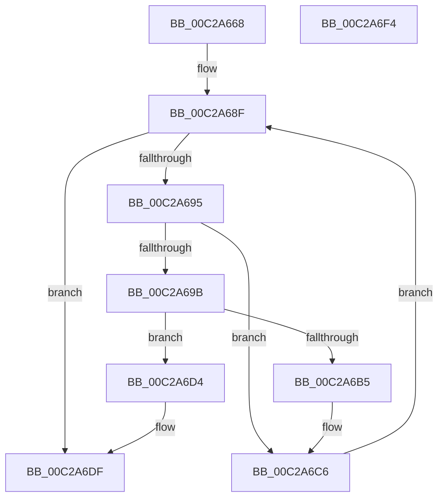

# BvgaSaveResources

- RVA: `0x00C2A668`–`0x00C2A6F5` (길이 `141` bytes)
- VA: `0x0000000140C2A668`
- 실행 섹션: `INIT`
- PDB 이름 있음: `예`; PDB Function 태그: `아니요`
- unwind 정보 RVA: `0x0005C954`
- 디코드: `38`개 명령, `141/141` bytes 표시
- 미해석 바이트: `0` (있으면 어셈블리에 `.byte`로 보존)

> 이 문서는 커널 이미지의 기계어와 PDB 기호를 분석해 생성했습니다. 4번과 5번은 함수 원형과 자료형을 바이너리 사용 방식에서 추정한 C 해석이며 원본 소스 복구 결과는 아닙니다.

## 1. Dependencies

- 직접 호출 지점: **3**; 고유 호출 대상: **3**
- 직접 호출자로 확인된 함수: **1**
- RIP 상대 이미지 참조: **2**

### Outgoing calls
- `0x00C2A6A8` → [ExAllocatePool2](../../poolcode/B8/ExAllocatePool2_function_00B820F0.md) (function, `0x00B820F0`)
- `0x00C2A6BE` → [memcpy](../../text/6C/memcpy_function_006C6840.md) (function, `0x006C6840`)
- `0x00C2A6D9` → [KeBugCheck](../../text/4F/KeBugCheck_function_004FD640.md) (function, `0x004FD640`)

### Direct callers
- [BvgaDriverInitialize](BvgaDriverInitialize_function_00C2A500.md) at `0x00C2A5DE`

### Static image references
- `0x00C2A67C` → RVA `0x00F8E980` (`.data`; read)
- `0x00C2A688` → RVA `0x00F8E9C0` (`.data`; read)

## 2. Other-region calls and transfers

- 다른 실행 섹션으로 향하는 call: **3**
  - `0x00C2A6A8` → [ExAllocatePool2](../../poolcode/B8/ExAllocatePool2_function_00B820F0.md) (`INIT` → `POOLCODE`)
  - `0x00C2A6BE` → [memcpy](../../text/6C/memcpy_function_006C6840.md) (`INIT` → `.text`)
  - `0x00C2A6D9` → [KeBugCheck](../../text/4F/KeBugCheck_function_004FD640.md) (`INIT` → `.text`)
- 별도 외부 분기/꼬리 이동을 확인하지 못했습니다.

## 3. Assembly (complete function range)

```asm
00C2A668  48 89 5C 24 08                  mov qword ptr [rsp + 8], rbx
00C2A66D  48 89 6C 24 10                  mov qword ptr [rsp + 0x10], rbp
00C2A672  48 89 74 24 18                  mov qword ptr [rsp + 0x18], rsi
00C2A677  57                              push rdi
00C2A678  48 83 EC 20                     sub rsp, 0x20
00C2A67C  48 8D 1D FD 42 36 00            lea rbx, [rip + 0x3642fd]
00C2A683  BE 04 00 00 00                  mov esi, 4
00C2A688  48 8D 3D 31 43 36 00            lea rdi, [rip + 0x364331]
00C2A68F  48 83 FE 1C                     cmp rsi, 0x1c
00C2A693  73 4A                           jae 0x140c2a6df
00C2A695  48 83 3B 00                     cmp qword ptr [rbx], 0
00C2A699  74 2B                           je 0x140c2a6c6
00C2A69B  8B 17                           mov edx, dword ptr [rdi]
00C2A69D  B9 40 00 00 00                  mov ecx, 0x40
00C2A6A2  41 B8 42 76 42 6D               mov r8d, 0x6d427642
00C2A6A8  E8 43 7A F5 FF                  call 0x140b820f0
00C2A6AD  48 8B E8                        mov rbp, rax
00C2A6B0  48 85 C0                        test rax, rax
00C2A6B3  74 1F                           je 0x140c2a6d4
00C2A6B5  44 8B 07                        mov r8d, dword ptr [rdi]
00C2A6B8  48 8B C8                        mov rcx, rax
00C2A6BB  48 8B 13                        mov rdx, qword ptr [rbx]
00C2A6BE  E8 7D C1 A9 FF                  call 0x1406c6840
00C2A6C3  48 89 2B                        mov qword ptr [rbx], rbp
00C2A6C6  48 83 C6 04                     add rsi, 4
00C2A6CA  48 83 C7 04                     add rdi, 4
00C2A6CE  48 83 C3 08                     add rbx, 8
00C2A6D2  EB BB                           jmp 0x140c2a68f
00C2A6D4  B9 7D 00 00 00                  mov ecx, 0x7d
00C2A6D9  E8 62 2F 8D FF                  call 0x1404fd640
00C2A6DE  CC                              int3
00C2A6DF  48 8B 5C 24 30                  mov rbx, qword ptr [rsp + 0x30]
00C2A6E4  48 8B 6C 24 38                  mov rbp, qword ptr [rsp + 0x38]
00C2A6E9  48 8B 74 24 40                  mov rsi, qword ptr [rsp + 0x40]
00C2A6EE  48 83 C4 20                     add rsp, 0x20
00C2A6F2  5F                              pop rdi
00C2A6F3  C3                              ret
00C2A6F4  CC                              int3
```

## 4. C-style interpretation (structured pseudocode)

```c
__int64 __fastcall BvgaSaveResources(void)
{
    __int64 result;
    __int64 v_rbx;
    __int64 v_rdi;
    __int64 v_rsi;
    __int64 v_rsp;
    unsigned __int64 v_stack_p10;
    unsigned __int64 v_stack_p18;
    unsigned __int64 v_stack_p8;

    v_stack_p8 = v_rbx;
    v_stack_p10 = v_rbp;
    v_stack_p18 = v_rsi;
    v_rsp = (v_rsp) - (32);
loc_00C2A68F:
    if (4 >= 28) goto loc_00C2A6DF;
    if ((*(unsigned __int64 *)(v_rip + 3556093)) == 0) goto loc_00C2A6C6;
    result = ExAllocatePool2(64, (unsigned int)(*(unsigned int *)(v_rip + 3556145)), (unsigned int)(0x6D427642ULL), a4);
    if (result == 0) goto loc_00C2A6D4;
    result = memcpy(result, *(unsigned __int64 *)(v_rip + 3556093), (unsigned int)(*(unsigned int *)(v_rip + 3556145)), a4);
    *(unsigned __int64 *)(v_rip + 3556093) = result;
loc_00C2A6C6:
    v_rsi = (4) + (4);
    v_rdi = (v_rip + 3556145) + (4);
    v_rbx = (v_rip + 3556093) + (8);
    goto loc_00C2A68F;
loc_00C2A6D4:
    result = KeBugCheck(125, *(unsigned __int64 *)(v_rip + 3556093), (unsigned int)(*(unsigned int *)(v_rip + 3556145)), a4);
loc_00C2A6DF:
    v_rsp = (v_rsp) + (32);
    return result;
}
```

## 5. (Beta) C Style

```c
void BvgaSaveResources(void)
{
    int64_t result;
    int64_t local_rbx;
    int64_t local_rdi;
    int64_t local_rsi;
    int64_t local_rsp;
    uint64_t v_stack_p10;
    uint64_t v_stack_p18;
    uint64_t v_stack_p8;

    v_stack_p8 = local_rbx;
    v_stack_p10 = local_rbp;
    v_stack_p18 = local_rsi;
    local_rsp = (local_rsp) - (32);
loc_00C2A68F:
    if (4 >= 28) goto loc_00C2A6DF;
    if ((*(uint64_t *)(v_rip + 0x3642FD)) == 0) goto loc_00C2A6C6;
    result = ExAllocatePool2(64, (uint32_t)(*(uint32_t *)(v_rip + 0x364331)), (uint32_t)(0x6D427642ULL), a4);
    if (result == 0) goto loc_00C2A6D4;
    result = memcpy(result, *(uint64_t *)(v_rip + 0x3642FD), (uint32_t)(*(uint32_t *)(v_rip + 0x364331)), a4);
    *(uint64_t *)(v_rip + 0x3642FD) = result;
loc_00C2A6C6:
    local_rsi = (4) + (4);
    local_rdi = (v_rip + 3556145) + (4);
    local_rbx = (v_rip + 3556093) + (8);
    goto loc_00C2A68F;
loc_00C2A6D4:
    result = KeBugCheck(125, *(uint64_t *)(v_rip + 0x3642FD), (uint32_t)(*(uint32_t *)(v_rip + 0x364331)), a4);
loc_00C2A6DF:
    local_rsp = (local_rsp) + (32);
    return result;
}
```

## 6. Execution-region graph

[열기: 2D/3D 그래프와 함수 탐색 컨트롤 패널](../../../control-panel.html?section=init&rva=0x00C2A668&view=graph)

- 2D 그래프는 위에서 아래로 흐르고, 3D 그래프는 빈 공간을 드래그해 회전합니다. Shift+드래그는 이동, 휠은 확대·축소, 함수 노드 선택은 대상 보고서 이동입니다.

### Static fallback


