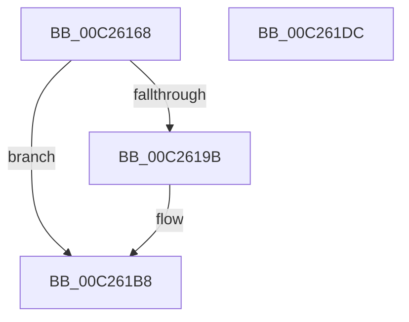

# CcInitializeVacbs

- RVA: `0x00C26168`–`0x00C261DD` (길이 `117` bytes)
- VA: `0x0000000140C26168`
- 실행 섹션: `INIT`
- PDB 이름 있음: `예`; PDB Function 태그: `아니요`
- unwind 정보 RVA: `0x0005D2F4`
- 디코드: `24`개 명령, `117/117` bytes 표시
- 미해석 바이트: `0` (있으면 어셈블리에 `.byte`로 보존)

> 이 문서는 커널 이미지의 기계어와 PDB 기호를 분석해 생성했습니다. 4번과 5번은 함수 원형과 자료형을 바이너리 사용 방식에서 추정한 C 해석이며 원본 소스 복구 결과는 아닙니다.

## 1. Dependencies

- 직접 호출 지점: **2**; 고유 호출 대상: **2**
- 직접 호출자로 확인된 함수: **1**
- RIP 상대 이미지 참조: **7**

### Outgoing calls
- `0x00C2618A` → [ExAllocatePoolWithTag](../../poolcode/B8/ExAllocatePoolWithTag_function_00B82010.md) (function, `0x00B82010`)
- `0x00C261B2` → [KeBugCheckEx](../../text/4F/KeBugCheckEx_function_004FD660.md) (function, `0x004FD660`)

### Direct callers
- [CcInitializeCacheManager](../BE/CcInitializeCacheManager_function_00BEE2E8.md) at `0x00BEE3BA`

### Static image references
- `0x00C2616C` → RVA `0x00F8F4AC` (`.data`; read/write)
- `0x00C26178` → RVA `0x00F8F4B0` (`.data`; read/write)
- `0x00C2618F` → RVA `0x00F8F4A0` (`.data`; write)
- `0x00C261B8` → RVA `0x00F8F4C0` (`.data`; read)
- `0x00C261BF` → RVA `0x00F8F498` (`.data`; write)
- `0x00C261C9` → RVA `0x00F8F4C8` (`.data`; write)
- `0x00C261D0` → RVA `0x00F8F4C0` (`.data`; write)

## 2. Other-region calls and transfers

- 다른 실행 섹션으로 향하는 call: **2**
  - `0x00C2618A` → [ExAllocatePoolWithTag](../../poolcode/B8/ExAllocatePoolWithTag_function_00B82010.md) (`INIT` → `POOLCODE`)
  - `0x00C261B2` → [KeBugCheckEx](../../text/4F/KeBugCheckEx_function_004FD660.md) (`INIT` → `.text`)
- 별도 외부 분기/꼬리 이동을 확인하지 못했습니다.

## 3. Assembly (complete function range)

```asm
00C26168  48 83 EC 38                     sub rsp, 0x38
00C2616C  83 25 39 93 36 00 00            and dword ptr [rip + 0x369339], 0
00C26173  BA 00 28 00 00                  mov edx, 0x2800
00C26178  83 25 31 93 36 00 00            and dword ptr [rip + 0x369331], 0
00C2617F  B9 00 06 00 00                  mov ecx, 0x600
00C26184  41 B8 43 63 56 61               mov r8d, 0x61566343
00C2618A  E8 81 BE F5 FF                  call 0x140b82010
00C2618F  48 89 05 0A 93 36 00            mov qword ptr [rip + 0x36930a], rax
00C26196  48 85 C0                        test rax, rax
00C26199  75 1D                           jne 0x140c261b8
00C2619B  48 21 44 24 20                  and qword ptr [rsp + 0x20], rax
00C261A0  8D 48 34                        lea ecx, [rax + 0x34]
00C261A3  45 33 C9                        xor r9d, r9d
00C261A6  BA 93 04 09 00                  mov edx, 0x90493
00C261AB  49 C7 C0 9A 00 00 C0            mov r8, 0xffffffffc000009a
00C261B2  E8 A9 74 8D FF                  call 0x1404fd660
00C261B7  CC                              int3
00C261B8  48 8D 05 01 93 36 00            lea rax, [rip + 0x369301]
00C261BF  C7 05 CF 92 36 00 80 00 00 00   mov dword ptr [rip + 0x3692cf], 0x80
00C261C9  48 89 05 F8 92 36 00            mov qword ptr [rip + 0x3692f8], rax
00C261D0  48 89 05 E9 92 36 00            mov qword ptr [rip + 0x3692e9], rax
00C261D7  48 83 C4 38                     add rsp, 0x38
00C261DB  C3                              ret
00C261DC  CC                              int3
```

## 4. C-style interpretation (structured pseudocode)

```c
__int64 __fastcall CcInitializeVacbs(__int64 a1, __int64 a2, __int64 a3, int a4)
{
    __int64 result;
    __int64 v_rsp;
    unsigned __int64 v_stack_m18;

    v_rsp = (v_rsp) - (56);
    result = ExAllocatePoolWithTag((unsigned int)(0x600ULL), (unsigned int)(0x2800ULL), (unsigned int)(0x61566343ULL), a4);
    *(unsigned __int64 *)(v_rip + 3576586) = result;
    if (result == 0) {
        a1 = result + 52;
        a4 = 0;
        a2 = 0x90493ULL;
        a3 = 0xFFFFFFFFC000009AULL;
        result = KeBugCheckEx(a1, a2, a3, a4);
    }
    *(unsigned int *)(v_rip + 3576527) = 128;
    *(unsigned __int64 *)(v_rip + 3576568) = v_rip + 3576577;
    *(unsigned __int64 *)(v_rip + 3576553) = v_rip + 3576577;
    v_rsp = (v_rsp) + (56);
    return v_rip + 3576577;
}
```

## 5. (Beta) C Style

```c
int64_t CcInitializeVacbs(int64_t Arg1, int64_t Arg2, int64_t Arg3, int32_t Arg4)
{
    int64_t result;
    int64_t local_rsp;
    uint64_t v_stack_m18;

    local_rsp = (local_rsp) - (56);
    result = ExAllocatePoolWithTag((uint32_t)(0x600ULL), (uint32_t)(0x2800ULL), (uint32_t)(0x61566343ULL), Arg4);
    *(uint64_t *)(v_rip + 0x36930A) = result;
    if (result == 0) {
        Arg1 = result + 52;
        Arg4 = 0;
        Arg2 = 0x90493ULL;
        Arg3 = 0xFFFFFFFFC000009AULL;
        result = KeBugCheckEx(Arg1, Arg2, Arg3, Arg4);
    }
    *(uint32_t *)(v_rip + 0x3692CF) = 128;
    *(uint64_t *)(v_rip + 0x3692F8) = v_rip + 3576577;
    *(uint64_t *)(v_rip + 0x3692E9) = v_rip + 3576577;
    local_rsp = (local_rsp) + (56);
    return v_rip + 3576577;
}
```

## 6. Execution-region graph

[열기: 2D/3D 그래프와 함수 탐색 컨트롤 패널](../../../control-panel.html?section=init&rva=0x00C26168&view=graph)

- 2D 그래프는 위에서 아래로 흐르고, 3D 그래프는 빈 공간을 드래그해 회전합니다. Shift+드래그는 이동, 휠은 확대·축소, 함수 노드 선택은 대상 보고서 이동입니다.

### Static fallback


