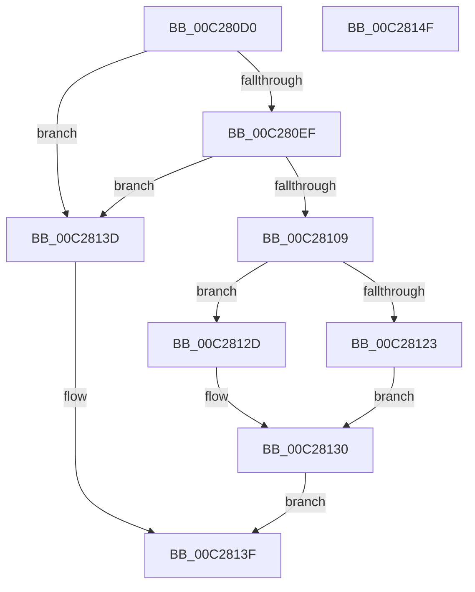

# CmpAppendLine

- RVA: `0x00C280D0`–`0x00C28150` (길이 `128` bytes)
- VA: `0x0000000140C280D0`
- 실행 섹션: `INIT`
- PDB 이름 있음: `예`; PDB Function 태그: `아니요`
- unwind 정보 RVA: `0x00060BC4`
- 디코드: `37`개 명령, `128/128` bytes 표시
- 미해석 바이트: `0` (있으면 어셈블리에 `.byte`로 보존)

> 이 문서는 커널 이미지의 기계어와 PDB 기호를 분석해 생성했습니다. 4번과 5번은 함수 원형과 자료형을 바이너리 사용 방식에서 추정한 C 해석이며 원본 소스 복구 결과는 아닙니다.

## 1. Dependencies

- 직접 호출 지점: **1**; 고유 호출 대상: **1**
- 직접 호출자로 확인된 함수: **1**
- RIP 상대 이미지 참조: **0**

### Outgoing calls
- `0x00C280FF` → [ExAllocatePool2](../../poolcode/B8/ExAllocatePool2_function_00B820F0.md) (function, `0x00B820F0`)

### Direct callers
- [CmpParseInfBuffer](CmpParseInfBuffer_function_00C28734.md) at `0x00C28972`
- [CmpParseInfBuffer](CmpParseInfBuffer_function_00C28734.md) at `0x00C289AC`
- [CmpParseInfBuffer](CmpParseInfBuffer_function_00C28734.md) at `0x00C289DC`
- [CmpParseInfBuffer](CmpParseInfBuffer_function_00C28734.md) at `0x00C28A17`

### Static image references
- 디코드된 RIP-relative 메모리 참조가 없습니다.

## 2. Other-region calls and transfers

- 다른 실행 섹션으로 향하는 call: **1**
  - `0x00C280FF` → [ExAllocatePool2](../../poolcode/B8/ExAllocatePool2_function_00B820F0.md) (`INIT` → `POOLCODE`)
- 별도 외부 분기/꼬리 이동을 확인하지 못했습니다.

## 3. Assembly (complete function range)

```asm
00C280D0  48 89 5C 24 08                  mov qword ptr [rsp + 8], rbx
00C280D5  48 89 74 24 10                  mov qword ptr [rsp + 0x10], rsi
00C280DA  57                              push rdi
00C280DB  48 83 EC 20                     sub rsp, 0x20
00C280DF  48 83 79 08 00                  cmp qword ptr [rcx + 8], 0
00C280E4  41 8A F8                        mov dil, r8b
00C280E7  48 8B F2                        mov rsi, rdx
00C280EA  48 8B D9                        mov rbx, rcx
00C280ED  74 4E                           je 0x140c2813d
00C280EF  BA 20 00 00 00                  mov edx, 0x20
00C280F4  B9 00 01 00 00                  mov ecx, 0x100
00C280F9  41 B8 43 4D 70 69               mov r8d, 0x69704d43
00C280FF  E8 EC 9F F5 FF                  call 0x140b820f0
00C28104  48 85 C0                        test rax, rax
00C28107  74 34                           je 0x140c2813d
00C28109  48 83 20 00                     and qword ptr [rax], 0
00C2810D  48 83 60 10 00                  and qword ptr [rax + 0x10], 0
00C28112  48 89 70 08                     mov qword ptr [rax + 8], rsi
00C28116  40 88 78 18                     mov byte ptr [rax + 0x18], dil
00C2811A  48 8B 4B 10                     mov rcx, qword ptr [rbx + 0x10]
00C2811E  48 85 C9                        test rcx, rcx
00C28121  75 0A                           jne 0x140c2812d
00C28123  48 8B 4B 08                     mov rcx, qword ptr [rbx + 8]
00C28127  48 89 41 10                     mov qword ptr [rcx + 0x10], rax
00C2812B  EB 03                           jmp 0x140c28130
00C2812D  48 89 01                        mov qword ptr [rcx], rax
00C28130  48 83 63 18 00                  and qword ptr [rbx + 0x18], 0
00C28135  48 89 43 10                     mov qword ptr [rbx + 0x10], rax
00C28139  B0 01                           mov al, 1
00C2813B  EB 02                           jmp 0x140c2813f
00C2813D  32 C0                           xor al, al
00C2813F  48 8B 5C 24 30                  mov rbx, qword ptr [rsp + 0x30]
00C28144  48 8B 74 24 38                  mov rsi, qword ptr [rsp + 0x38]
00C28149  48 83 C4 20                     add rsp, 0x20
00C2814D  5F                              pop rdi
00C2814E  C3                              ret
00C2814F  CC                              int3
```

## 4. C-style interpretation (structured pseudocode)

```c
__int64 __fastcall CmpAppendLine(__int64 a1, __int64 a2, unsigned __int8 a3)
{
    __int64 result;
    __int64 v_rsp;
    unsigned __int64 v_stack_p10;
    unsigned __int64 v_stack_p8;

    v_stack_p8 = v_rbx;
    v_stack_p10 = v_rsi;
    v_rsp = (v_rsp) - (32);
    if ((*(unsigned __int64 *)(a1 + 8)) == 0) goto loc_00C2813D;
    result = ExAllocatePool2(256, 32, (unsigned int)(0x69704D43ULL), a4);
    if (result == 0) goto loc_00C2813D;
    *(unsigned __int64 *)(result + 8) = a2;
    *(unsigned __int8 *)(result + 24) = a3;
    if (*(unsigned __int64 *)(a1 + 16) != 0) goto loc_00C2812D;
    *(unsigned __int64 *)(*(unsigned __int64 *)(a1 + 8) + 16) = result;
    goto loc_00C28130;
loc_00C2812D:
    *(unsigned __int64 *)(*(unsigned __int64 *)(a1 + 8)) = result;
loc_00C28130:
    *(unsigned __int64 *)(a1 + 16) = result;
    goto loc_00C2813F;
loc_00C2813D:
    result = 0;
loc_00C2813F:
    v_rsp = (v_rsp) + (32);
    return result;
}
```

## 5. (Beta) C Style

```c
int64_t CmpAppendLine(void *Arg1, int64_t Arg2, uint8_t Arg3)
{
    uint8_t *arg1 = (uint8_t *)Arg1;

    int64_t result;
    int64_t local_rsp;
    uint64_t v_stack_p10;
    uint64_t v_stack_p8;

    v_stack_p8 = local_rbx;
    v_stack_p10 = local_rsi;
    local_rsp = (local_rsp) - (32);
    if ((*(uint64_t *)(arg1 + 0x8)) == 0) goto loc_00C2813D;
    result = ExAllocatePool2(256, 32, (uint32_t)(0x69704D43ULL), a4);
    if (result == 0) goto loc_00C2813D;
    *(uint64_t *)(result + 0x8) = Arg2;
    *(uint8_t *)(result + 0x18) = Arg3;
    if (*(uint64_t *)(arg1 + 0x10) != 0) goto loc_00C2812D;
    *(uint64_t *)(*(uint64_t *)(arg1 + 0x8) + 0x10) = result;
    goto loc_00C28130;
loc_00C2812D:
    *(uint64_t *)(*(uint64_t *)(arg1 + 0x8)) = result;
loc_00C28130:
    *(uint64_t *)(arg1 + 0x10) = result;
    goto loc_00C2813F;
loc_00C2813D:
    result = 0;
loc_00C2813F:
    local_rsp = (local_rsp) + (32);
    return result;
}
```

### 관측된 메모리 오프셋

구조체 형식이 확인되지 않은 접근은 인자 기준의 오프셋으로만 기록했습니다.

| 기준 인자 | 오프셋 표현 | 폭 (bit) | 접근 |
|---|---:|---:|---|
| `Arg1` | `+ 0x8` | `64` | `R` |
| `Arg1` | `+ 0x10` | `64` | `R` |
| `Arg1` | `+ 0x10` | `64` | `W` |
| `Arg1` | `+ 0x18` | `64` | `R/W` |

## 6. Execution-region graph

[열기: 2D/3D 그래프와 함수 탐색 컨트롤 패널](../../../control-panel.html?section=init&rva=0x00C280D0&view=graph)

- 2D 그래프는 위에서 아래로 흐르고, 3D 그래프는 빈 공간을 드래그해 회전합니다. Shift+드래그는 이동, 휠은 확대·축소, 함수 노드 선택은 대상 보고서 이동입니다.

### Static fallback


