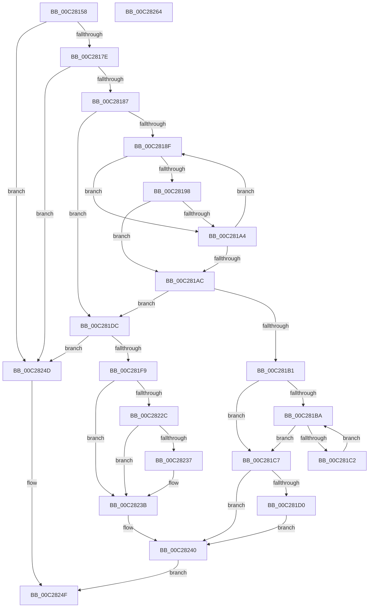

# CmpAppendSection

- RVA: `0x00C28158`–`0x00C28265` (길이 `269` bytes)
- VA: `0x0000000140C28158`
- 실행 섹션: `INIT`
- PDB 이름 있음: `예`; PDB Function 태그: `아니요`
- unwind 정보 RVA: `0x0005C954`
- 디코드: `80`개 명령, `269/269` bytes 표시
- 미해석 바이트: `0` (있으면 어셈블리에 `.byte`로 보존)

> 이 문서는 커널 이미지의 기계어와 PDB 기호를 분석해 생성했습니다. 4번과 5번은 함수 원형과 자료형을 바이너리 사용 방식에서 추정한 C 해석이며 원본 소스 복구 결과는 아닙니다.

## 1. Dependencies

- 직접 호출 지점: **4**; 고유 호출 대상: **4**
- 직접 호출자로 확인된 함수: **1**
- RIP 상대 이미지 참조: **1**

### Outgoing calls
- `0x00C2819B` → [stricmp](../../text/4F/stricmp_function_004FFD80.md) (function, `0x004FFD80`)
- `0x00C281D5` → [ExFreePoolWithTag](../../poolcode/B8/ExFreePoolWithTag_function_00B82870.md) (function, `0x00B82870`)
- `0x00C281EC` → [ExAllocatePool2](../../poolcode/B8/ExAllocatePool2_function_00B820F0.md) (function, `0x00B820F0`)
- `0x00C28223` → [strnicmp](../../text/4F/strnicmp_function_004FFE30.md) (function, `0x004FFE30`)

### Direct callers
- [CmpParseInfBuffer](CmpParseInfBuffer_function_00C28734.md) at `0x00C28876`
- [CmpParseInfBuffer](CmpParseInfBuffer_function_00C28734.md) at `0x00C288B0`

### Static image references
- `0x00C281FD` → RVA `0x00C79680` (` ?? ::PBOPGDP::`string'`; read)

## 2. Other-region calls and transfers

- 다른 실행 섹션으로 향하는 call: **4**
  - `0x00C2819B` → [stricmp](../../text/4F/stricmp_function_004FFD80.md) (`INIT` → `.text`)
  - `0x00C281D5` → [ExFreePoolWithTag](../../poolcode/B8/ExFreePoolWithTag_function_00B82870.md) (`INIT` → `POOLCODE`)
  - `0x00C281EC` → [ExAllocatePool2](../../poolcode/B8/ExAllocatePool2_function_00B820F0.md) (`INIT` → `POOLCODE`)
  - `0x00C28223` → [strnicmp](../../text/4F/strnicmp_function_004FFE30.md) (`INIT` → `.text`)
- 별도 외부 분기/꼬리 이동을 확인하지 못했습니다.

## 3. Assembly (complete function range)

```asm
00C28158  48 89 5C 24 08                  mov qword ptr [rsp + 8], rbx
00C2815D  48 89 6C 24 10                  mov qword ptr [rsp + 0x10], rbp
00C28162  48 89 74 24 18                  mov qword ptr [rsp + 0x18], rsi
00C28167  57                              push rdi
00C28168  48 83 EC 20                     sub rsp, 0x20
00C2816C  41 8A E8                        mov bpl, r8b
00C2816F  48 8B F2                        mov rsi, rdx
00C28172  48 8B F9                        mov rdi, rcx
00C28175  48 85 C9                        test rcx, rcx
00C28178  0F 84 CF 00 00 00               je 0x140c2824d
00C2817E  48 85 D2                        test rdx, rdx
00C28181  0F 84 C6 00 00 00               je 0x140c2824d
00C28187  48 8B 19                        mov rbx, qword ptr [rcx]
00C2818A  48 85 DB                        test rbx, rbx
00C2818D  74 4D                           je 0x140c281dc
00C2818F  48 8B 4B 08                     mov rcx, qword ptr [rbx + 8]
00C28193  48 85 C9                        test rcx, rcx
00C28196  74 0C                           je 0x140c281a4
00C28198  48 8B D6                        mov rdx, rsi
00C2819B  E8 E0 7B 8D FF                  call 0x1404ffd80
00C281A0  85 C0                           test eax, eax
00C281A2  74 08                           je 0x140c281ac
00C281A4  48 8B 1B                        mov rbx, qword ptr [rbx]
00C281A7  48 85 DB                        test rbx, rbx
00C281AA  75 E3                           jne 0x140c2818f
00C281AC  48 85 DB                        test rbx, rbx
00C281AF  74 2B                           je 0x140c281dc
00C281B1  48 8B 43 10                     mov rax, qword ptr [rbx + 0x10]
00C281B5  48 85 C0                        test rax, rax
00C281B8  74 0D                           je 0x140c281c7
00C281BA  48 8B 08                        mov rcx, qword ptr [rax]
00C281BD  48 85 C9                        test rcx, rcx
00C281C0  74 05                           je 0x140c281c7
00C281C2  48 8B C1                        mov rax, rcx
00C281C5  EB F3                           jmp 0x140c281ba
00C281C7  48 89 47 10                     mov qword ptr [rdi + 0x10], rax
00C281CB  40 84 ED                        test bpl, bpl
00C281CE  74 70                           je 0x140c28240
00C281D0  33 D2                           xor edx, edx
00C281D2  48 8B CE                        mov rcx, rsi
00C281D5  E8 96 A6 F5 FF                  call 0x140b82870
00C281DA  EB 64                           jmp 0x140c28240
00C281DC  BA 20 00 00 00                  mov edx, 0x20
00C281E1  B9 00 01 00 00                  mov ecx, 0x100
00C281E6  41 B8 43 4D 70 69               mov r8d, 0x69704d43
00C281EC  E8 FF 9E F5 FF                  call 0x140b820f0
00C281F1  48 8B D8                        mov rbx, rax
00C281F4  48 85 C0                        test rax, rax
00C281F7  74 54                           je 0x140c2824d
00C281F9  48 83 20 00                     and qword ptr [rax], 0
00C281FD  48 8D 15 7C 14 05 00            lea rdx, [rip + 0x5147c]
00C28204  48 83 60 10 00                  and qword ptr [rax + 0x10], 0
00C28209  41 B8 07 00 00 00               mov r8d, 7
00C2820F  48 89 70 08                     mov qword ptr [rax + 8], rsi
00C28213  40 88 68 18                     mov byte ptr [rax + 0x18], bpl
00C28217  48 8B 0F                        mov rcx, qword ptr [rdi]
00C2821A  48 89 08                        mov qword ptr [rax], rcx
00C2821D  48 8B CE                        mov rcx, rsi
00C28220  48 89 07                        mov qword ptr [rdi], rax
00C28223  E8 08 7C 8D FF                  call 0x1404ffe30
00C28228  85 C0                           test eax, eax
00C2822A  75 0F                           jne 0x140c2823b
00C2822C  38 46 07                        cmp byte ptr [rsi + 7], al
00C2822F  0F 94 C0                        sete al
00C28232  3B 47 20                        cmp eax, dword ptr [rdi + 0x20]
00C28235  7E 04                           jle 0x140c2823b
00C28237  48 89 5F 28                     mov qword ptr [rdi + 0x28], rbx
00C2823B  48 83 67 10 00                  and qword ptr [rdi + 0x10], 0
00C28240  48 83 67 18 00                  and qword ptr [rdi + 0x18], 0
00C28245  B0 01                           mov al, 1
00C28247  48 89 5F 08                     mov qword ptr [rdi + 8], rbx
00C2824B  EB 02                           jmp 0x140c2824f
00C2824D  32 C0                           xor al, al
00C2824F  48 8B 5C 24 30                  mov rbx, qword ptr [rsp + 0x30]
00C28254  48 8B 6C 24 38                  mov rbp, qword ptr [rsp + 0x38]
00C28259  48 8B 74 24 40                  mov rsi, qword ptr [rsp + 0x40]
00C2825E  48 83 C4 20                     add rsp, 0x20
00C28262  5F                              pop rdi
00C28263  C3                              ret
00C28264  CC                              int3
```

## 4. C-style interpretation (structured pseudocode)

```c
__int64 __fastcall CmpAppendSection(__int64 a1, __int64 a2, unsigned __int8 a3)
{
    __int64 result;
    __int64 v_rsp;
    unsigned __int64 v_stack_p10;
    unsigned __int64 v_stack_p18;
    unsigned __int64 v_stack_p8;

    v_stack_p8 = v_rbx;
    v_stack_p10 = v_rbp;
    v_stack_p18 = v_rsi;
    v_rsp = (v_rsp) - (32);
    if (a1 == 0) goto loc_00C2824D;
    if (a2 == 0) goto loc_00C2824D;
    if (*(unsigned __int64 *)(a1) == 0) goto loc_00C281DC;
loc_00C2818F:
    if (*(unsigned __int64 *)(*(unsigned __int64 *)(a1) + 8) == 0) goto loc_00C281A4;
    result = stricmp(*(unsigned __int64 *)(*(unsigned __int64 *)(a1) + 8), a2, a3, a4);
    if ((unsigned int)(result) == 0) goto loc_00C281AC;
loc_00C281A4:
    if (*(unsigned __int64 *)(*(unsigned __int64 *)(a1)) != 0) goto loc_00C2818F;
loc_00C281AC:
    if (*(unsigned __int64 *)(*(unsigned __int64 *)(a1)) == 0) goto loc_00C281DC;
    if (*(unsigned __int64 *)(*(unsigned __int64 *)(*(unsigned __int64 *)(a1)) + 16) == 0) goto loc_00C281C7;
loc_00C281BA:
    if (*(unsigned __int64 *)(*(unsigned __int64 *)(*(unsigned __int64 *)(*(unsigned __int64 *)(a1)) + 16)) == 0) goto loc_00C281C7;
    goto loc_00C281BA;
loc_00C281C7:
    *(unsigned __int64 *)(a1 + 16) = *(unsigned __int64 *)(*(unsigned __int64 *)(*(unsigned __int64 *)(*(unsigned __int64 *)(a1)) + 16));
    if (a3 == 0) goto loc_00C28240;
    a2 = 0;
    result = ExFreePoolWithTag(0, a2, a3, a4);
    goto loc_00C28240;
loc_00C281DC:
    result = ExAllocatePool2(256, 32, (unsigned int)(0x69704D43ULL), a4);
    if (result == 0) goto loc_00C2824D;
    *(unsigned __int64 *)(result + 8) = 0;
    *(unsigned __int8 *)(result + 24) = a3;
    *(unsigned __int64 *)(result) = *(unsigned __int64 *)(a1);
    *(unsigned __int64 *)(a1) = result;
    result = strnicmp(0, v_rip + 332924, 7, a4);
    if ((unsigned int)(result) != 0) goto loc_00C2823B;
    result = ((*(unsigned __int8 *)(a2 + 7)) == ((unsigned __int8)(result))) ? 1 : 0;
    if (((unsigned int)(result)) >= = (*(unsigned int *)(a1 + 32))) {
        *(unsigned __int64 *)(a1 + 40) = result;
    }
loc_00C28240:
    *(unsigned __int64 *)(a1 + 8) = result;
    goto loc_00C2824F;
loc_00C2824D:
    result = 0;
loc_00C2824F:
    v_rsp = (v_rsp) + (32);
    return result;
}
```

## 5. (Beta) C Style

```c
int64_t CmpAppendSection(void *Arg1, void *Arg2, uint8_t Arg3)
{
    uint8_t *arg1 = (uint8_t *)Arg1;
    uint8_t *arg2 = (uint8_t *)Arg2;

    int64_t result;
    int64_t local_rsp;
    uint64_t v_stack_p10;
    uint64_t v_stack_p18;
    uint64_t v_stack_p8;

    v_stack_p8 = local_rbx;
    v_stack_p10 = local_rbp;
    v_stack_p18 = local_rsi;
    local_rsp = (local_rsp) - (32);
    if (Arg1 == NULL) goto loc_00C2824D;
    if (Arg2 == NULL) goto loc_00C2824D;
    if (*(uint64_t *)(arg1) == 0) goto loc_00C281DC;
loc_00C2818F:
    if (*(uint64_t *)(*(uint64_t *)(arg1) + 0x8) == 0) goto loc_00C281A4;
    result = stricmp(*(uint64_t *)(*(uint64_t *)(arg1) + 0x8), Arg2, Arg3, a4);
    if ((uint32_t)(result) == 0) goto loc_00C281AC;
loc_00C281A4:
    if (*(uint64_t *)(*(uint64_t *)(arg1)) != 0) goto loc_00C2818F;
loc_00C281AC:
    if (*(uint64_t *)(*(uint64_t *)(arg1)) == 0) goto loc_00C281DC;
    if (*(uint64_t *)(*(uint64_t *)(*(uint64_t *)(arg1)) + 0x10) == 0) goto loc_00C281C7;
loc_00C281BA:
    if (*(uint64_t *)(*(uint64_t *)(*(uint64_t *)(*(uint64_t *)(arg1)) + 0x10)) == 0) goto loc_00C281C7;
    goto loc_00C281BA;
loc_00C281C7:
    *(uint64_t *)(arg1 + 0x10) = *(uint64_t *)(*(uint64_t *)(*(uint64_t *)(*(uint64_t *)(arg1)) + 0x10));
    if (Arg3 == 0) goto loc_00C28240;
    Arg2 = 0;
    result = ExFreePoolWithTag(0, Arg2, Arg3, a4);
    goto loc_00C28240;
loc_00C281DC:
    result = ExAllocatePool2(256, 32, (uint32_t)(0x69704D43ULL), a4);
    if (result == 0) goto loc_00C2824D;
    *(uint64_t *)(result + 0x8) = 0;
    *(uint8_t *)(result + 0x18) = Arg3;
    *(uint64_t *)(result) = *(uint64_t *)(arg1);
    *(uint64_t *)(arg1) = result;
    result = strnicmp(0, v_rip + 332924, 7, a4);
    if ((uint32_t)(result) != 0) goto loc_00C2823B;
    result = ((*(uint8_t *)(arg2 + 0x7)) == ((uint8_t)(result))) ? 1 : 0;
    if (((uint32_t)(result)) >= = (*(uint32_t *)(arg1 + 0x20))) {
        *(uint64_t *)(arg1 + 0x28) = result;
    }
loc_00C28240:
    *(uint64_t *)(arg1 + 0x8) = result;
    goto loc_00C2824F;
loc_00C2824D:
    result = 0;
loc_00C2824F:
    local_rsp = (local_rsp) + (32);
    return result;
}
```

### 관측된 메모리 오프셋

구조체 형식이 확인되지 않은 접근은 인자 기준의 오프셋으로만 기록했습니다.

| 기준 인자 | 오프셋 표현 | 폭 (bit) | 접근 |
|---|---:|---:|---|
| `Arg1` | `+ 0x0` | `64` | `R` |
| `Arg1` | `+ 0x0` | `64` | `W` |
| `Arg1` | `+ 0x8` | `64` | `W` |
| `Arg1` | `+ 0x10` | `64` | `R/W` |
| `Arg1` | `+ 0x10` | `64` | `W` |
| `Arg1` | `+ 0x18` | `64` | `R/W` |
| `Arg1` | `+ 0x20` | `32` | `R` |
| `Arg1` | `+ 0x28` | `64` | `W` |
| `Arg2` | `+ 0x7` | `8` | `R` |

## 6. Execution-region graph

[열기: 2D/3D 그래프와 함수 탐색 컨트롤 패널](../../../control-panel.html?section=init&rva=0x00C28158&view=graph)

- 2D 그래프는 위에서 아래로 흐르고, 3D 그래프는 빈 공간을 드래그해 회전합니다. Shift+드래그는 이동, 휠은 확대·축소, 함수 노드 선택은 대상 보고서 이동입니다.

### Static fallback


