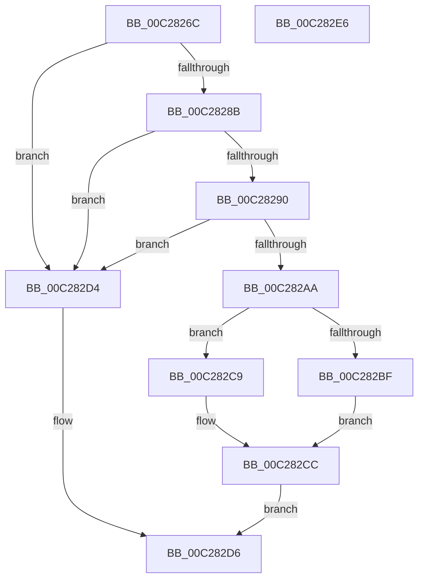

# CmpAppendValue

- RVA: `0x00C2826C`–`0x00C282E7` (길이 `123` bytes)
- VA: `0x0000000140C2826C`
- 실행 섹션: `INIT`
- PDB 이름 있음: `예`; PDB Function 태그: `아니요`
- unwind 정보 RVA: `0x00060BC4`
- 디코드: `37`개 명령, `123/123` bytes 표시
- 미해석 바이트: `0` (있으면 어셈블리에 `.byte`로 보존)

> 이 문서는 커널 이미지의 기계어와 PDB 기호를 분석해 생성했습니다. 4번과 5번은 함수 원형과 자료형을 바이너리 사용 방식에서 추정한 C 해석이며 원본 소스 복구 결과는 아닙니다.

## 1. Dependencies

- 직접 호출 지점: **1**; 고유 호출 대상: **1**
- 직접 호출자로 확인된 함수: **1**
- RIP 상대 이미지 참조: **0**

### Outgoing calls
- `0x00C282A0` → [ExAllocatePool2](../../poolcode/B8/ExAllocatePool2_function_00B820F0.md) (function, `0x00B820F0`)

### Direct callers
- [CmpParseInfBuffer](CmpParseInfBuffer_function_00C28734.md) at `0x00C28988`
- [CmpParseInfBuffer](CmpParseInfBuffer_function_00C28734.md) at `0x00C289F2`
- [CmpParseInfBuffer](CmpParseInfBuffer_function_00C28734.md) at `0x00C28A2F`
- [CmpParseInfBuffer](CmpParseInfBuffer_function_00C28734.md) at `0x00C28AAF`
- [CmpParseInfBuffer](CmpParseInfBuffer_function_00C28734.md) at `0x00C28B33`
- [CmpParseInfBuffer](CmpParseInfBuffer_function_00C28734.md) at `0x00C28B66`
- [CmpParseInfBuffer](CmpParseInfBuffer_function_00C28734.md) at `0x00C28BAF`

### Static image references
- 디코드된 RIP-relative 메모리 참조가 없습니다.

## 2. Other-region calls and transfers

- 다른 실행 섹션으로 향하는 call: **1**
  - `0x00C282A0` → [ExAllocatePool2](../../poolcode/B8/ExAllocatePool2_function_00B820F0.md) (`INIT` → `POOLCODE`)
- 별도 외부 분기/꼬리 이동을 확인하지 못했습니다.

## 3. Assembly (complete function range)

```asm
00C2826C  48 89 5C 24 08                  mov qword ptr [rsp + 8], rbx
00C28271  48 89 74 24 10                  mov qword ptr [rsp + 0x10], rsi
00C28276  57                              push rdi
00C28277  48 83 EC 20                     sub rsp, 0x20
00C2827B  48 83 79 10 00                  cmp qword ptr [rcx + 0x10], 0
00C28280  41 8A F0                        mov sil, r8b
00C28283  48 8B FA                        mov rdi, rdx
00C28286  48 8B D9                        mov rbx, rcx
00C28289  74 49                           je 0x140c282d4
00C2828B  48 85 D2                        test rdx, rdx
00C2828E  74 44                           je 0x140c282d4
00C28290  BA 18 00 00 00                  mov edx, 0x18
00C28295  B9 00 01 00 00                  mov ecx, 0x100
00C2829A  41 B8 43 4D 70 69               mov r8d, 0x69704d43
00C282A0  E8 4B 9E F5 FF                  call 0x140b820f0
00C282A5  48 85 C0                        test rax, rax
00C282A8  74 2A                           je 0x140c282d4
00C282AA  48 83 20 00                     and qword ptr [rax], 0
00C282AE  48 89 78 08                     mov qword ptr [rax + 8], rdi
00C282B2  40 88 70 10                     mov byte ptr [rax + 0x10], sil
00C282B6  48 8B 4B 18                     mov rcx, qword ptr [rbx + 0x18]
00C282BA  48 85 C9                        test rcx, rcx
00C282BD  75 0A                           jne 0x140c282c9
00C282BF  48 8B 4B 10                     mov rcx, qword ptr [rbx + 0x10]
00C282C3  48 89 41 10                     mov qword ptr [rcx + 0x10], rax
00C282C7  EB 03                           jmp 0x140c282cc
00C282C9  48 89 01                        mov qword ptr [rcx], rax
00C282CC  48 89 43 18                     mov qword ptr [rbx + 0x18], rax
00C282D0  B0 01                           mov al, 1
00C282D2  EB 02                           jmp 0x140c282d6
00C282D4  32 C0                           xor al, al
00C282D6  48 8B 5C 24 30                  mov rbx, qword ptr [rsp + 0x30]
00C282DB  48 8B 74 24 38                  mov rsi, qword ptr [rsp + 0x38]
00C282E0  48 83 C4 20                     add rsp, 0x20
00C282E4  5F                              pop rdi
00C282E5  C3                              ret
00C282E6  CC                              int3
```

## 4. C-style interpretation (structured pseudocode)

```c
__int64 __fastcall CmpAppendValue(__int64 a1, __int64 a2, unsigned __int8 a3)
{
    __int64 result;
    __int64 v_rsp;
    unsigned __int64 v_stack_p10;
    unsigned __int64 v_stack_p8;

    v_stack_p8 = v_rbx;
    v_stack_p10 = v_rsi;
    v_rsp = (v_rsp) - (32);
    if ((*(unsigned __int64 *)(a1 + 16)) == 0) goto loc_00C282D4;
    if (a2 == 0) goto loc_00C282D4;
    result = ExAllocatePool2(256, 24, (unsigned int)(0x69704D43ULL), a4);
    if (result == 0) goto loc_00C282D4;
    *(unsigned __int64 *)(result + 8) = a2;
    *(unsigned __int8 *)(result + 16) = a3;
    if (*(unsigned __int64 *)(a1 + 24) != 0) goto loc_00C282C9;
    *(unsigned __int64 *)(*(unsigned __int64 *)(a1 + 16) + 16) = result;
    goto loc_00C282CC;
loc_00C282C9:
    *(unsigned __int64 *)(*(unsigned __int64 *)(a1 + 16)) = result;
loc_00C282CC:
    *(unsigned __int64 *)(a1 + 24) = result;
    goto loc_00C282D6;
loc_00C282D4:
    result = 0;
loc_00C282D6:
    v_rsp = (v_rsp) + (32);
    return result;
}
```

## 5. (Beta) C Style

```c
int64_t CmpAppendValue(void *Arg1, int64_t Arg2, uint8_t Arg3)
{
    uint8_t *arg1 = (uint8_t *)Arg1;

    int64_t result;
    int64_t local_rsp;
    uint64_t v_stack_p10;
    uint64_t v_stack_p8;

    v_stack_p8 = local_rbx;
    v_stack_p10 = local_rsi;
    local_rsp = (local_rsp) - (32);
    if ((*(uint64_t *)(arg1 + 0x10)) == 0) goto loc_00C282D4;
    if (Arg2 == 0) goto loc_00C282D4;
    result = ExAllocatePool2(256, 24, (uint32_t)(0x69704D43ULL), a4);
    if (result == 0) goto loc_00C282D4;
    *(uint64_t *)(result + 0x8) = Arg2;
    *(uint8_t *)(result + 0x10) = Arg3;
    if (*(uint64_t *)(arg1 + 0x18) != 0) goto loc_00C282C9;
    *(uint64_t *)(*(uint64_t *)(arg1 + 0x10) + 0x10) = result;
    goto loc_00C282CC;
loc_00C282C9:
    *(uint64_t *)(*(uint64_t *)(arg1 + 0x10)) = result;
loc_00C282CC:
    *(uint64_t *)(arg1 + 0x18) = result;
    goto loc_00C282D6;
loc_00C282D4:
    result = 0;
loc_00C282D6:
    local_rsp = (local_rsp) + (32);
    return result;
}
```

### 관측된 메모리 오프셋

구조체 형식이 확인되지 않은 접근은 인자 기준의 오프셋으로만 기록했습니다.

| 기준 인자 | 오프셋 표현 | 폭 (bit) | 접근 |
|---|---:|---:|---|
| `Arg1` | `+ 0x10` | `64` | `R` |
| `Arg1` | `+ 0x18` | `64` | `R` |
| `Arg1` | `+ 0x18` | `64` | `W` |

## 6. Execution-region graph

[열기: 2D/3D 그래프와 함수 탐색 컨트롤 패널](../../../control-panel.html?section=init&rva=0x00C2826C&view=graph)

- 2D 그래프는 위에서 아래로 흐르고, 3D 그래프는 빈 공간을 드래그해 회전합니다. Shift+드래그는 이동, 휠은 확대·축소, 함수 노드 선택은 대상 보고서 이동입니다.

### Static fallback


