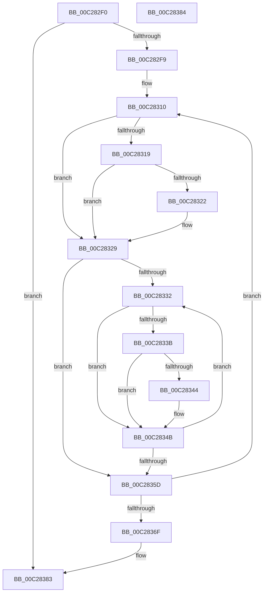

# CmpFreeLineList

- RVA: `0x00C282F0`–`0x00C28385` (길이 `149` bytes)
- VA: `0x0000000140C282F0`
- 실행 섹션: `INIT`
- PDB 이름 있음: `예`; PDB Function 태그: `아니요`
- unwind 정보 RVA: `0x000BEAEC`
- 디코드: `46`개 명령, `149/149` bytes 표시
- 미해석 바이트: `0` (있으면 어셈블리에 `.byte`로 보존)

> 이 문서는 커널 이미지의 기계어와 PDB 기호를 분석해 생성했습니다. 4번과 5번은 함수 원형과 자료형을 바이너리 사용 방식에서 추정한 C 해석이며 원본 소스 복구 결과는 아닙니다.

## 1. Dependencies

- 직접 호출 지점: **4**; 고유 호출 대상: **1**
- 직접 호출자로 확인된 함수: **1**
- RIP 상대 이미지 참조: **0**

### Outgoing calls
- `0x00C28324` → [ExFreePoolWithTag](../../poolcode/B8/ExFreePoolWithTag_function_00B82870.md) (function, `0x00B82870`)
- `0x00C28346` → [ExFreePoolWithTag](../../poolcode/B8/ExFreePoolWithTag_function_00B82870.md) (function, `0x00B82870`)
- `0x00C28350` → [ExFreePoolWithTag](../../poolcode/B8/ExFreePoolWithTag_function_00B82870.md) (function, `0x00B82870`)
- `0x00C28362` → [ExFreePoolWithTag](../../poolcode/B8/ExFreePoolWithTag_function_00B82870.md) (function, `0x00B82870`)

### Direct callers
- [EmpParseInfDatabase](EmpParseInfDatabase_function_00C26934.md) at `0x00C26A0E`

### Static image references
- 디코드된 RIP-relative 메모리 참조가 없습니다.

## 2. Other-region calls and transfers

- 다른 실행 섹션으로 향하는 call: **4**
  - `0x00C28324` → [ExFreePoolWithTag](../../poolcode/B8/ExFreePoolWithTag_function_00B82870.md) (`INIT` → `POOLCODE`)
  - `0x00C28346` → [ExFreePoolWithTag](../../poolcode/B8/ExFreePoolWithTag_function_00B82870.md) (`INIT` → `POOLCODE`)
  - `0x00C28350` → [ExFreePoolWithTag](../../poolcode/B8/ExFreePoolWithTag_function_00B82870.md) (`INIT` → `POOLCODE`)
  - `0x00C28362` → [ExFreePoolWithTag](../../poolcode/B8/ExFreePoolWithTag_function_00B82870.md) (`INIT` → `POOLCODE`)
- 별도 외부 분기/꼬리 이동을 확인하지 못했습니다.

## 3. Assembly (complete function range)

```asm
00C282F0  48 85 C9                        test rcx, rcx
00C282F3  0F 84 8A 00 00 00               je 0x140c28383
00C282F9  48 89 5C 24 08                  mov qword ptr [rsp + 8], rbx
00C282FE  48 89 6C 24 10                  mov qword ptr [rsp + 0x10], rbp
00C28303  48 89 74 24 18                  mov qword ptr [rsp + 0x18], rsi
00C28308  57                              push rdi
00C28309  48 83 EC 20                     sub rsp, 0x20
00C2830D  48 8B D9                        mov rbx, rcx
00C28310  80 7B 18 00                     cmp byte ptr [rbx + 0x18], 0
00C28314  48 8B 33                        mov rsi, qword ptr [rbx]
00C28317  74 10                           je 0x140c28329
00C28319  48 8B 4B 08                     mov rcx, qword ptr [rbx + 8]
00C2831D  48 85 C9                        test rcx, rcx
00C28320  74 07                           je 0x140c28329
00C28322  33 D2                           xor edx, edx
00C28324  E8 47 A5 F5 FF                  call 0x140b82870
00C28329  48 8B 7B 10                     mov rdi, qword ptr [rbx + 0x10]
00C2832D  48 85 FF                        test rdi, rdi
00C28330  74 2B                           je 0x140c2835d
00C28332  80 7F 10 00                     cmp byte ptr [rdi + 0x10], 0
00C28336  48 8B 2F                        mov rbp, qword ptr [rdi]
00C28339  74 10                           je 0x140c2834b
00C2833B  48 8B 4F 08                     mov rcx, qword ptr [rdi + 8]
00C2833F  48 85 C9                        test rcx, rcx
00C28342  74 07                           je 0x140c2834b
00C28344  33 D2                           xor edx, edx
00C28346  E8 25 A5 F5 FF                  call 0x140b82870
00C2834B  33 D2                           xor edx, edx
00C2834D  48 8B CF                        mov rcx, rdi
00C28350  E8 1B A5 F5 FF                  call 0x140b82870
00C28355  48 8B FD                        mov rdi, rbp
00C28358  48 85 ED                        test rbp, rbp
00C2835B  75 D5                           jne 0x140c28332
00C2835D  33 D2                           xor edx, edx
00C2835F  48 8B CB                        mov rcx, rbx
00C28362  E8 09 A5 F5 FF                  call 0x140b82870
00C28367  48 8B DE                        mov rbx, rsi
00C2836A  48 85 F6                        test rsi, rsi
00C2836D  75 A1                           jne 0x140c28310
00C2836F  48 8B 5C 24 30                  mov rbx, qword ptr [rsp + 0x30]
00C28374  48 8B 6C 24 38                  mov rbp, qword ptr [rsp + 0x38]
00C28379  48 8B 74 24 40                  mov rsi, qword ptr [rsp + 0x40]
00C2837E  48 83 C4 20                     add rsp, 0x20
00C28382  5F                              pop rdi
00C28383  C3                              ret
00C28384  CC                              int3
```

## 4. C-style interpretation (structured pseudocode)

```c
__int64 __fastcall CmpFreeLineList(__int64 a1, int a2)
{
    __int64 result;
    __int64 v_rsp;
    unsigned __int64 v_stack_p10;
    unsigned __int64 v_stack_p18;
    unsigned __int64 v_stack_p8;

    if (a1 == 0) goto loc_00C28383;
    v_stack_p8 = v_rbx;
    v_stack_p10 = v_rbp;
    v_stack_p18 = v_rsi;
    v_rsp = (v_rsp) - (32);
loc_00C28310:
    if ((*(unsigned __int8 *)(a1 + 24)) == 0) goto loc_00C28329;
    if (*(unsigned __int64 *)(a1 + 8) != 0) {
        a2 = 0;
        result = ExFreePoolWithTag(*(unsigned __int64 *)(a1 + 8), a2, a3, a4);
    }
    if (*(unsigned __int64 *)(a1 + 16) == 0) goto loc_00C2835D;
loc_00C28332:
    if ((*(unsigned __int8 *)(*(unsigned __int64 *)(a1 + 16) + 16)) == 0) goto loc_00C2834B;
    if (*(unsigned __int64 *)(*(unsigned __int64 *)(a1 + 16) + 8) != 0) {
        a2 = 0;
        result = ExFreePoolWithTag(*(unsigned __int64 *)(*(unsigned __int64 *)(a1 + 16) + 8), a2, a3, a4);
    }
    a2 = 0;
    result = ExFreePoolWithTag(*(unsigned __int64 *)(a1 + 16), a2, a3, a4);
    if (*(unsigned __int64 *)(*(unsigned __int64 *)(a1 + 16)) != 0) goto loc_00C28332;
loc_00C2835D:
    a2 = 0;
    result = ExFreePoolWithTag(a1, a2, a3, a4);
    if (*(unsigned __int64 *)(a1) != 0) goto loc_00C28310;
    v_rsp = (v_rsp) + (32);
loc_00C28383:
    return result;
}
```

## 5. (Beta) C Style

```c
int64_t CmpFreeLineList(int64_t Arg1, int32_t Arg2)
{
    int64_t result;
    int64_t local_rsp;
    uint64_t v_stack_p10;
    uint64_t v_stack_p18;
    uint64_t v_stack_p8;

    if (Arg1 == 0) goto loc_00C28383;
    v_stack_p8 = local_rbx;
    v_stack_p10 = local_rbp;
    v_stack_p18 = local_rsi;
    local_rsp = (local_rsp) - (32);
loc_00C28310:
    if ((*(uint8_t *)(Arg1 + 0x18)) == 0) goto loc_00C28329;
    if (*(uint64_t *)(Arg1 + 0x8) != 0) {
        Arg2 = 0;
        result = ExFreePoolWithTag(*(uint64_t *)(Arg1 + 0x8), Arg2, a3, a4);
    }
    if (*(uint64_t *)(Arg1 + 0x10) == 0) goto loc_00C2835D;
loc_00C28332:
    if ((*(uint8_t *)(*(uint64_t *)(Arg1 + 0x10) + 0x10)) == 0) goto loc_00C2834B;
    if (*(uint64_t *)(*(uint64_t *)(Arg1 + 0x10) + 0x8) != 0) {
        Arg2 = 0;
        result = ExFreePoolWithTag(*(uint64_t *)(*(uint64_t *)(Arg1 + 0x10) + 0x8), Arg2, a3, a4);
    }
    Arg2 = 0;
    result = ExFreePoolWithTag(*(uint64_t *)(Arg1 + 0x10), Arg2, a3, a4);
    if (*(uint64_t *)(*(uint64_t *)(Arg1 + 0x10)) != 0) goto loc_00C28332;
loc_00C2835D:
    Arg2 = 0;
    result = ExFreePoolWithTag(Arg1, Arg2, a3, a4);
    if (*(uint64_t *)(Arg1) != 0) goto loc_00C28310;
    local_rsp = (local_rsp) + (32);
loc_00C28383:
    return result;
}
```

## 6. Execution-region graph

[열기: 2D/3D 그래프와 함수 탐색 컨트롤 패널](../../../control-panel.html?section=init&rva=0x00C282F0&view=graph)

- 2D 그래프는 위에서 아래로 흐르고, 3D 그래프는 빈 공간을 드래그해 회전합니다. Shift+드래그는 이동, 휠은 확대·축소, 함수 노드 선택은 대상 보고서 이동입니다.

### Static fallback


