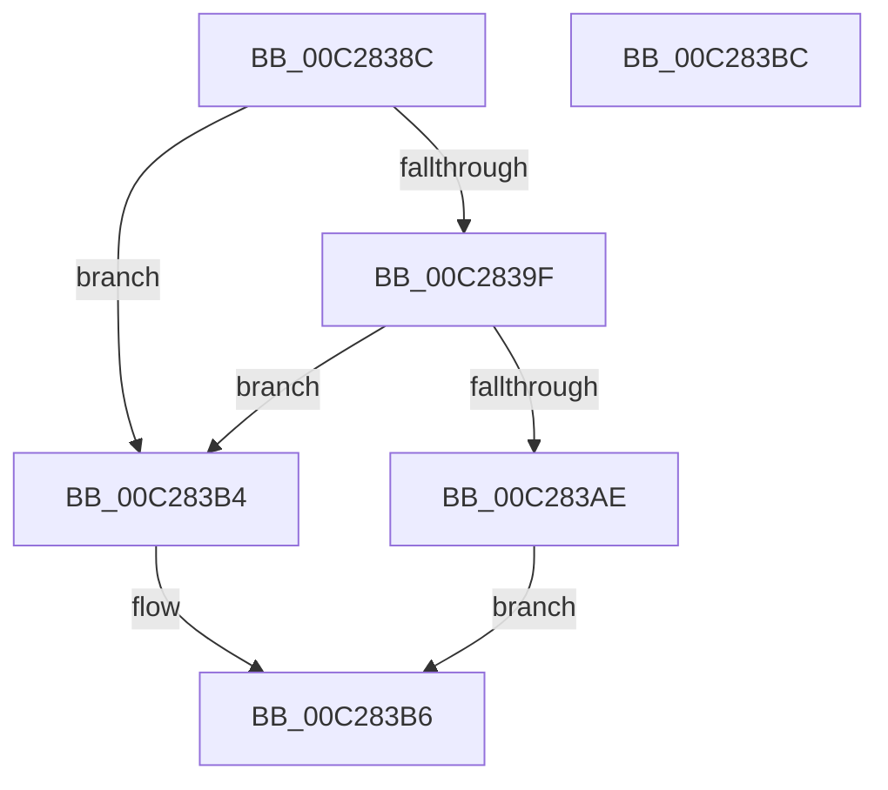

# CmpGetKeyName

- RVA: `0x00C2838C`–`0x00C283BD` (길이 `49` bytes)
- VA: `0x0000000140C2838C`
- 실행 섹션: `INIT`
- PDB 이름 있음: `예`; PDB Function 태그: `아니요`
- unwind 정보 RVA: `0x0005CF00`
- 디코드: `18`개 명령, `49/49` bytes 표시
- 미해석 바이트: `0` (있으면 어셈블리에 `.byte`로 보존)

> 이 문서는 커널 이미지의 기계어와 PDB 기호를 분석해 생성했습니다. 4번과 5번은 함수 원형과 자료형을 바이너리 사용 방식에서 추정한 C 해석이며 원본 소스 복구 결과는 아닙니다.

## 1. Dependencies

- 직접 호출 지점: **2**; 고유 호출 대상: **2**
- 직접 호출자로 확인된 함수: **4**
- RIP 상대 이미지 참조: **0**

### Outgoing calls
- `0x00C28395` → [CmpSearchSectionByName](CmpSearchSectionByName_function_00C28CE0.md) (function, `0x00C28CE0`)
- `0x00C283A4` → [CmpSearchLineInSectionByIndex](CmpSearchLineInSectionByIndex_function_00C28CB4.md) (function, `0x00C28CB4`)

### Direct callers
- [EmpInfParseGetValueFromSectionAndKeyName](EmpInfParseGetValueFromSectionAndKeyName_function_00C264B4.md) at `0x00C264E2`
- [EmpParseCallbacks](EmpParseCallbacks_function_00C2657C.md) at `0x00C265E3`
- [EmpParseRules](EmpParseRules_function_00C2745C.md) at `0x00C274C8`
- [EmpParseTargetRules](EmpParseTargetRules_function_00C27C78.md) at `0x00C27CE1`

### Static image references
- 디코드된 RIP-relative 메모리 참조가 없습니다.

## 2. Other-region calls and transfers

- 다른 실행 섹션으로 향하는 call: **0**
- 별도 외부 분기/꼬리 이동을 확인하지 못했습니다.

## 3. Assembly (complete function range)

```asm
00C2838C  40 53                           push rbx
00C2838E  48 83 EC 20                     sub rsp, 0x20
00C28392  41 8B D8                        mov ebx, r8d
00C28395  E8 46 09 00 00                  call 0x140c28ce0
00C2839A  48 85 C0                        test rax, rax
00C2839D  74 15                           je 0x140c283b4
00C2839F  8B D3                           mov edx, ebx
00C283A1  48 8B C8                        mov rcx, rax
00C283A4  E8 0B 09 00 00                  call 0x140c28cb4
00C283A9  48 85 C0                        test rax, rax
00C283AC  74 06                           je 0x140c283b4
00C283AE  48 8B 40 08                     mov rax, qword ptr [rax + 8]
00C283B2  EB 02                           jmp 0x140c283b6
00C283B4  33 C0                           xor eax, eax
00C283B6  48 83 C4 20                     add rsp, 0x20
00C283BA  5B                              pop rbx
00C283BB  C3                              ret
00C283BC  CC                              int3
```

## 4. C-style interpretation (structured pseudocode)

```c
__int64 __fastcall CmpGetKeyName(__int64 a1, __int64 a2, int a3)
{
    __int64 result;
    __int64 v_rsp;

    v_rsp = (v_rsp) - (32);
    result = CmpSearchSectionByName(a1, a2, a3, a4);
    if (result == 0) goto loc_00C283B4;
    result = CmpSearchLineInSectionByIndex(result, (unsigned int)((unsigned int)((unsigned int)(a3))), a3, a4);
    if (result == 0) goto loc_00C283B4;
    goto loc_00C283B6;
loc_00C283B4:
    result = 0;
loc_00C283B6:
    v_rsp = (v_rsp) + (32);
    return result;
}
```

## 5. (Beta) C Style

```c
int64_t CmpGetKeyName(int64_t Arg1, int64_t Arg2, int32_t Arg3)
{
    int64_t result;
    int64_t local_rsp;

    local_rsp = (local_rsp) - (32);
    result = CmpSearchSectionByName(Arg1, Arg2, Arg3, a4);
    if (result == 0) goto loc_00C283B4;
    result = CmpSearchLineInSectionByIndex(result, (uint32_t)((uint32_t)((uint32_t)(Arg3))), Arg3, a4);
    if (result == 0) goto loc_00C283B4;
    goto loc_00C283B6;
loc_00C283B4:
    result = 0;
loc_00C283B6:
    local_rsp = (local_rsp) + (32);
    return result;
}
```

## 6. Execution-region graph

[열기: 2D/3D 그래프와 함수 탐색 컨트롤 패널](../../../control-panel.html?section=init&rva=0x00C2838C&view=graph)

- 2D 그래프는 위에서 아래로 흐르고, 3D 그래프는 빈 공간을 드래그해 회전합니다. Shift+드래그는 이동, 휠은 확대·축소, 함수 노드 선택은 대상 보고서 이동입니다.

### Static fallback


