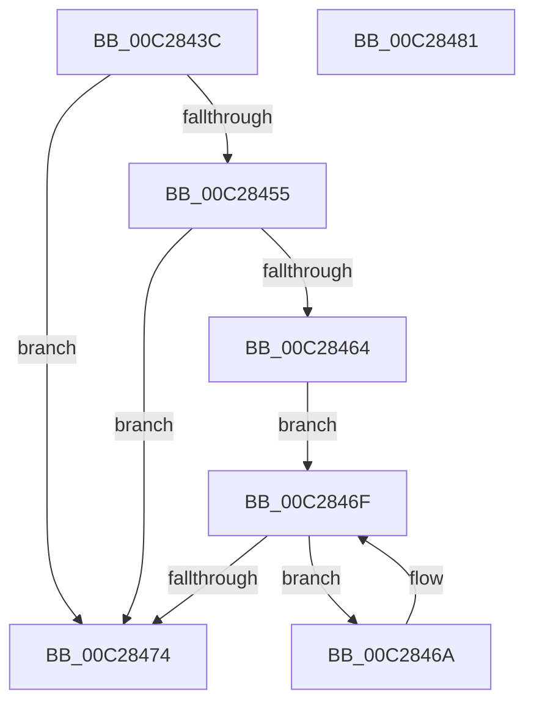

# CmpGetSectionLineIndexValueCount

- RVA: `0x00C2843C`–`0x00C28482` (길이 `70` bytes)
- VA: `0x0000000140C2843C`
- 실행 섹션: `INIT`
- PDB 이름 있음: `예`; PDB Function 태그: `아니요`
- unwind 정보 RVA: `0x0005CAAC`
- 디코드: `25`개 명령, `70/70` bytes 표시
- 미해석 바이트: `0` (있으면 어셈블리에 `.byte`로 보존)

> 이 문서는 커널 이미지의 기계어와 PDB 기호를 분석해 생성했습니다. 4번과 5번은 함수 원형과 자료형을 바이너리 사용 방식에서 추정한 C 해석이며 원본 소스 복구 결과는 아닙니다.

## 1. Dependencies

- 직접 호출 지점: **2**; 고유 호출 대상: **2**
- 직접 호출자로 확인된 함수: **3**
- RIP 상대 이미지 참조: **0**

### Outgoing calls
- `0x00C2844B` → [CmpSearchSectionByName](CmpSearchSectionByName_function_00C28CE0.md) (function, `0x00C28CE0`)
- `0x00C2845A` → [CmpSearchLineInSectionByIndex](CmpSearchLineInSectionByIndex_function_00C28CB4.md) (function, `0x00C28CB4`)

### Direct callers
- [EmpParseCallbacks](EmpParseCallbacks_function_00C2657C.md) at `0x00C26601`
- [EmpParseRules](EmpParseRules_function_00C2745C.md) at `0x00C275CF`
- [EmpParseTargetRules](EmpParseTargetRules_function_00C27C78.md) at `0x00C27D48`

### Static image references
- 디코드된 RIP-relative 메모리 참조가 없습니다.

## 2. Other-region calls and transfers

- 다른 실행 섹션으로 향하는 call: **0**
- 별도 외부 분기/꼬리 이동을 확인하지 못했습니다.

## 3. Assembly (complete function range)

```asm
00C2843C  48 89 5C 24 08                  mov qword ptr [rsp + 8], rbx
00C28441  57                              push rdi
00C28442  48 83 EC 20                     sub rsp, 0x20
00C28446  41 8B F8                        mov edi, r8d
00C28449  33 DB                           xor ebx, ebx
00C2844B  E8 90 08 00 00                  call 0x140c28ce0
00C28450  48 85 C0                        test rax, rax
00C28453  74 1F                           je 0x140c28474
00C28455  8B D7                           mov edx, edi
00C28457  48 8B C8                        mov rcx, rax
00C2845A  E8 55 08 00 00                  call 0x140c28cb4
00C2845F  48 85 C0                        test rax, rax
00C28462  74 10                           je 0x140c28474
00C28464  48 8B 48 10                     mov rcx, qword ptr [rax + 0x10]
00C28468  EB 05                           jmp 0x140c2846f
00C2846A  48 8B 09                        mov rcx, qword ptr [rcx]
00C2846D  FF C3                           inc ebx
00C2846F  48 85 C9                        test rcx, rcx
00C28472  75 F6                           jne 0x140c2846a
00C28474  8B C3                           mov eax, ebx
00C28476  48 8B 5C 24 30                  mov rbx, qword ptr [rsp + 0x30]
00C2847B  48 83 C4 20                     add rsp, 0x20
00C2847F  5F                              pop rdi
00C28480  C3                              ret
00C28481  CC                              int3
```

## 4. C-style interpretation (structured pseudocode)

```c
__int64 __fastcall CmpGetSectionLineIndexValueCount(__int64 a1, __int64 a2, int a3)
{
    __int64 result;
    __int64 v_rbx;
    __int64 v_rsp;
    unsigned __int64 v_stack_p8;

    v_stack_p8 = v_rbx;
    v_rsp = (v_rsp) - (32);
    v_rbx = 0;
    result = CmpSearchSectionByName(a1, a2, a3, a4);
    if (result == 0) goto loc_00C28474;
    result = CmpSearchLineInSectionByIndex(result, (unsigned int)((unsigned int)((unsigned int)(a3))), a3, a4);
    if (result == 0) goto loc_00C28474;
    goto loc_00C2846F;
loc_00C2846A:
    v_rbx = (unsigned int)((v_rbx) + 1);
loc_00C2846F:
    if (*(unsigned __int64 *)(*(unsigned __int64 *)(result + 16)) != 0) goto loc_00C2846A;
loc_00C28474:
    v_rsp = (v_rsp) + (32);
    return (unsigned int)((unsigned int)(v_rbx));
}
```

## 5. (Beta) C Style

```c
int64_t CmpGetSectionLineIndexValueCount(int64_t Arg1, int64_t Arg2, int32_t Arg3)
{
    int64_t result;
    int64_t local_rbx;
    int64_t local_rsp;
    uint64_t v_stack_p8;

    v_stack_p8 = local_rbx;
    local_rsp = (local_rsp) - (32);
    local_rbx = 0;
    result = CmpSearchSectionByName(Arg1, Arg2, Arg3, a4);
    if (result == 0) goto loc_00C28474;
    result = CmpSearchLineInSectionByIndex(result, (uint32_t)((uint32_t)((uint32_t)(Arg3))), Arg3, a4);
    if (result == 0) goto loc_00C28474;
    goto loc_00C2846F;
loc_00C2846A:
    local_rbx = (uint32_t)((local_rbx) + 1);
loc_00C2846F:
    if (*(uint64_t *)(*(uint64_t *)(result + 0x10)) != 0) goto loc_00C2846A;
loc_00C28474:
    local_rsp = (local_rsp) + (32);
    return (uint32_t)((uint32_t)(local_rbx));
}
```

## 6. Execution-region graph

[열기: 2D/3D 그래프와 함수 탐색 컨트롤 패널](../../../control-panel.html?section=init&rva=0x00C2843C&view=graph)

- 2D 그래프는 위에서 아래로 흐르고, 3D 그래프는 빈 공간을 드래그해 회전합니다. Shift+드래그는 이동, 휠은 확대·축소, 함수 노드 선택은 대상 보고서 이동입니다.

### Static fallback


