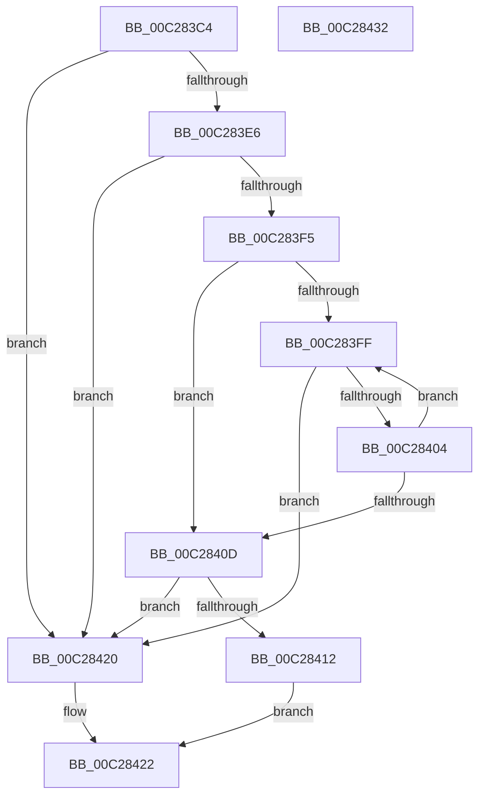

# CmpGetSectionLineIndex

- RVA: `0x00C283C4`–`0x00C28433` (길이 `111` bytes)
- VA: `0x0000000140C283C4`
- 실행 섹션: `INIT`
- PDB 이름 있음: `예`; PDB Function 태그: `아니요`
- unwind 정보 RVA: `0x00060BC4`
- 디코드: `38`개 명령, `111/111` bytes 표시
- 미해석 바이트: `0` (있으면 어셈블리에 `.byte`로 보존)

> 이 문서는 커널 이미지의 기계어와 PDB 기호를 분석해 생성했습니다. 4번과 5번은 함수 원형과 자료형을 바이너리 사용 방식에서 추정한 C 해석이며 원본 소스 복구 결과는 아닙니다.

## 1. Dependencies

- 직접 호출 지점: **3**; 고유 호출 대상: **3**
- 직접 호출자로 확인된 함수: **7**
- RIP 상대 이미지 참조: **0**

### Outgoing calls
- `0x00C283DC` → [CmpSearchSectionByName](CmpSearchSectionByName_function_00C28CE0.md) (function, `0x00C28CE0`)
- `0x00C283EB` → [CmpSearchLineInSectionByIndex](CmpSearchLineInSectionByIndex_function_00C28CB4.md) (function, `0x00C28CB4`)
- `0x00C28419` → [CmpProcessForSimpleStringSub](CmpProcessForSimpleStringSub_function_00C28C10.md) (function, `0x00C28C10`)

### Direct callers
- [EmpInfParseGetValueFromSectionAndKeyName](EmpInfParseGetValueFromSectionAndKeyName_function_00C264B4.md) at `0x00C26520`
- [EmpParseCallbacks](EmpParseCallbacks_function_00C2657C.md) at `0x00C26676`
- [EmpParseCallbacks](EmpParseCallbacks_function_00C2657C.md) at `0x00C266A4`
- [EmpParseCallbacks](EmpParseCallbacks_function_00C2657C.md) at `0x00C266EA`
- [EmpParseEntryTypes](EmpParseEntryTypes_function_00C267B4.md) at `0x00C26832`
- [EmpParseRuleExpression](EmpParseRuleExpression_function_00C26A70.md) at `0x00C26E1E`
- [EmpParseRules](EmpParseRules_function_00C2745C.md) at `0x00C27571`
- [EmpParseRules](EmpParseRules_function_00C2745C.md) at `0x00C275A3`
- [EmpParseRules](EmpParseRules_function_00C2745C.md) at `0x00C2762D`
- [EmpParseStrings](EmpParseStrings_function_00C277E0.md) at `0x00C278CC`
- [EmpParseTargetRules](EmpParseTargetRules_function_00C27C78.md) at `0x00C27E04`

### Static image references
- 디코드된 RIP-relative 메모리 참조가 없습니다.

## 2. Other-region calls and transfers

- 다른 실행 섹션으로 향하는 call: **0**
- 별도 외부 분기/꼬리 이동을 확인하지 못했습니다.

## 3. Assembly (complete function range)

```asm
00C283C4  48 89 5C 24 08                  mov qword ptr [rsp + 8], rbx
00C283C9  48 89 74 24 10                  mov qword ptr [rsp + 0x10], rsi
00C283CE  57                              push rdi
00C283CF  48 83 EC 20                     sub rsp, 0x20
00C283D3  41 8B D9                        mov ebx, r9d
00C283D6  41 8B F0                        mov esi, r8d
00C283D9  48 8B F9                        mov rdi, rcx
00C283DC  E8 FF 08 00 00                  call 0x140c28ce0
00C283E1  48 85 C0                        test rax, rax
00C283E4  74 3A                           je 0x140c28420
00C283E6  8B D6                           mov edx, esi
00C283E8  48 8B C8                        mov rcx, rax
00C283EB  E8 C4 08 00 00                  call 0x140c28cb4
00C283F0  48 85 C0                        test rax, rax
00C283F3  74 2B                           je 0x140c28420
00C283F5  48 8B 50 10                     mov rdx, qword ptr [rax + 0x10]
00C283F9  33 C9                           xor ecx, ecx
00C283FB  85 DB                           test ebx, ebx
00C283FD  74 0E                           je 0x140c2840d
00C283FF  48 85 D2                        test rdx, rdx
00C28402  74 1C                           je 0x140c28420
00C28404  48 8B 12                        mov rdx, qword ptr [rdx]
00C28407  FF C1                           inc ecx
00C28409  3B CB                           cmp ecx, ebx
00C2840B  72 F2                           jb 0x140c283ff
00C2840D  48 85 D2                        test rdx, rdx
00C28410  74 0E                           je 0x140c28420
00C28412  48 8B 52 08                     mov rdx, qword ptr [rdx + 8]
00C28416  48 8B CF                        mov rcx, rdi
00C28419  E8 F2 07 00 00                  call 0x140c28c10
00C2841E  EB 02                           jmp 0x140c28422
00C28420  33 C0                           xor eax, eax
00C28422  48 8B 5C 24 30                  mov rbx, qword ptr [rsp + 0x30]
00C28427  48 8B 74 24 38                  mov rsi, qword ptr [rsp + 0x38]
00C2842C  48 83 C4 20                     add rsp, 0x20
00C28430  5F                              pop rdi
00C28431  C3                              ret
00C28432  CC                              int3
```

## 4. C-style interpretation (structured pseudocode)

```c
__int64 __fastcall CmpGetSectionLineIndex(__int64 a1, __int64 a2, int a3, int a4)
{
    __int64 result;
    __int64 v_rsp;
    unsigned __int64 v_stack_p10;
    unsigned __int64 v_stack_p8;

    v_stack_p8 = v_rbx;
    v_stack_p10 = v_rsi;
    v_rsp = (v_rsp) - (32);
    result = CmpSearchSectionByName(a1, a2, a3, a4);
    if (result == 0) goto loc_00C28420;
    result = CmpSearchLineInSectionByIndex(result, (unsigned int)((unsigned int)((unsigned int)(a3))), a3, a4);
    if (result == 0) goto loc_00C28420;
    a1 = 0;
    if ((unsigned int)((unsigned int)(a4)) == 0) goto loc_00C2840D;
loc_00C283FF:
    if (*(unsigned __int64 *)(result + 16) == 0) goto loc_00C28420;
    a1 = (unsigned int)((a1) + 1);
    if (((unsigned int)(a1)) < ((unsigned int)((unsigned int)(a4)))) goto loc_00C283FF;
loc_00C2840D:
    if (*(unsigned __int64 *)(*(unsigned __int64 *)(result + 16)) == 0) goto loc_00C28420;
    result = CmpProcessForSimpleStringSub(a1, *(unsigned __int64 *)(*(unsigned __int64 *)(*(unsigned __int64 *)(result + 16)) + 8), a3, a4);
    goto loc_00C28422;
loc_00C28420:
    result = 0;
loc_00C28422:
    v_rsp = (v_rsp) + (32);
    return result;
}
```

## 5. (Beta) C Style

```c
int64_t CmpGetSectionLineIndex(int64_t Arg1, int64_t Arg2, int32_t Arg3, int32_t Arg4)
{
    int64_t result;
    int64_t local_rsp;
    uint64_t v_stack_p10;
    uint64_t v_stack_p8;

    v_stack_p8 = local_rbx;
    v_stack_p10 = local_rsi;
    local_rsp = (local_rsp) - (32);
    result = CmpSearchSectionByName(Arg1, Arg2, Arg3, Arg4);
    if (result == 0) goto loc_00C28420;
    result = CmpSearchLineInSectionByIndex(result, (uint32_t)((uint32_t)((uint32_t)(Arg3))), Arg3, Arg4);
    if (result == 0) goto loc_00C28420;
    Arg1 = 0;
    if ((uint32_t)((uint32_t)(Arg4)) == 0) goto loc_00C2840D;
loc_00C283FF:
    if (*(uint64_t *)(result + 0x10) == 0) goto loc_00C28420;
    Arg1 = (uint32_t)((Arg1) + 1);
    if (((uint32_t)(Arg1)) < ((uint32_t)((uint32_t)(Arg4)))) goto loc_00C283FF;
loc_00C2840D:
    if (*(uint64_t *)(*(uint64_t *)(result + 0x10)) == 0) goto loc_00C28420;
    result = CmpProcessForSimpleStringSub(Arg1, *(uint64_t *)(*(uint64_t *)(*(uint64_t *)(result + 0x10)) + 0x8), Arg3, Arg4);
    goto loc_00C28422;
loc_00C28420:
    result = 0;
loc_00C28422:
    local_rsp = (local_rsp) + (32);
    return result;
}
```

## 6. Execution-region graph

[열기: 2D/3D 그래프와 함수 탐색 컨트롤 패널](../../../control-panel.html?section=init&rva=0x00C283C4&view=graph)

- 2D 그래프는 위에서 아래로 흐르고, 3D 그래프는 빈 공간을 드래그해 회전합니다. Shift+드래그는 이동, 휠은 확대·축소, 함수 노드 선택은 대상 보고서 이동입니다.

### Static fallback


