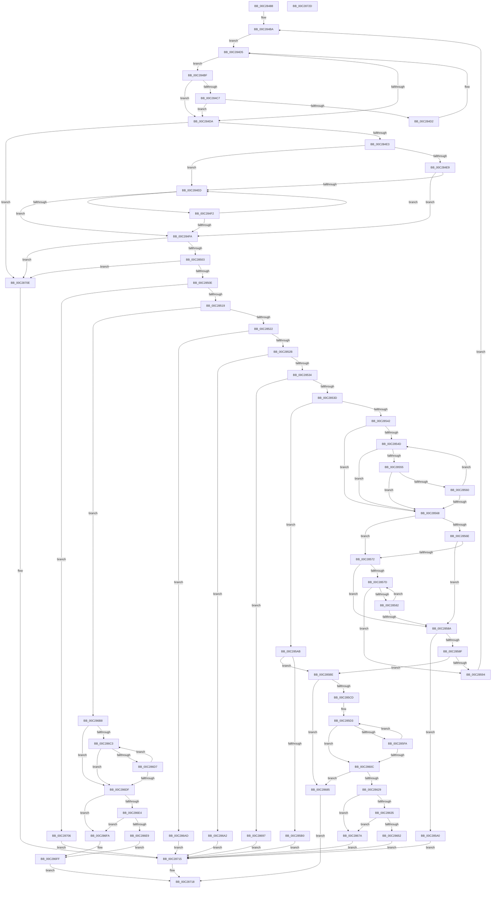

# CmpGetToken

- RVA: `0x00C28488`–`0x00C2872E` (길이 `678` bytes)
- VA: `0x0000000140C28488`
- 실행 섹션: `INIT`
- PDB 이름 있음: `예`; PDB Function 태그: `아니요`
- unwind 정보 RVA: `0x000BE6C8`
- 디코드: `210`개 명령, `678/678` bytes 표시
- 미해석 바이트: `0` (있으면 어셈블리에 `.byte`로 보존)

> 이 문서는 커널 이미지의 기계어와 PDB 기호를 분석해 생성했습니다. 4번과 5번은 함수 원형과 자료형을 바이너리 사용 방식에서 추정한 C 해석이며 원본 소스 복구 결과는 아닙니다.

## 1. Dependencies

- 직접 호출 지점: **6**; 고유 호출 대상: **4**
- 직접 호출자로 확인된 함수: **1**
- RIP 상대 이미지 참조: **2**

### Outgoing calls
- `0x00C284C9` → [isspace](../../text/50/isspace_function_00500710.md) (function, `0x00500710`)
- `0x00C28557` → [isspace](../../text/50/isspace_function_00500710.md) (function, `0x00500710`)
- `0x00C285ED` → [strchr](../../text/50/strchr_function_005014F0.md) (function, `0x005014F0`)
- `0x00C28645` → [ExAllocatePool2](../../poolcode/B8/ExAllocatePool2_function_00B820F0.md) (function, `0x00B820F0`)
- `0x00C2865E` → [strncpy_s](../../text/50/strncpy_s_function_00506140.md) (function, `0x00506140`)
- `0x00C286CD` → [strchr](../../text/50/strchr_function_005014F0.md) (function, `0x005014F0`)

### Direct callers
- [CmpParseInfBuffer](CmpParseInfBuffer_function_00C28734.md) at `0x00C287C9`

### Static image references
- `0x00C285E1` → RVA `0x00C821B8` (`StringTerminators`; read)
- `0x00C286C6` → RVA `0x00C821BE` (`INIT`; read)

## 2. Other-region calls and transfers

- 다른 실행 섹션으로 향하는 call: **6**
  - `0x00C284C9` → [isspace](../../text/50/isspace_function_00500710.md) (`INIT` → `.text`)
  - `0x00C28557` → [isspace](../../text/50/isspace_function_00500710.md) (`INIT` → `.text`)
  - `0x00C285ED` → [strchr](../../text/50/strchr_function_005014F0.md) (`INIT` → `.text`)
  - `0x00C28645` → [ExAllocatePool2](../../poolcode/B8/ExAllocatePool2_function_00B820F0.md) (`INIT` → `POOLCODE`)
  - `0x00C2865E` → [strncpy_s](../../text/50/strncpy_s_function_00506140.md) (`INIT` → `.text`)
  - `0x00C286CD` → [strchr](../../text/50/strchr_function_005014F0.md) (`INIT` → `.text`)
- 별도 외부 분기/꼬리 이동을 확인하지 못했습니다.

## 3. Assembly (complete function range)

```asm
00C28488  48 89 5C 24 18                  mov qword ptr [rsp + 0x18], rbx
00C2848D  55                              push rbp
00C2848E  56                              push rsi
00C2848F  57                              push rdi
00C28490  41 54                           push r12
00C28492  41 55                           push r13
00C28494  41 56                           push r14
00C28496  41 57                           push r15
00C28498  48 83 EC 20                     sub rsp, 0x20
00C2849C  45 33 E4                        xor r12d, r12d
00C2849F  49 8B F0                        mov rsi, r8
00C284A2  48 8B EA                        mov rbp, rdx
00C284A5  45 88 60 10                     mov byte ptr [r8 + 0x10], r12b
00C284A9  4C 8B F1                        mov r14, rcx
00C284AC  4D 89 60 08                     mov qword ptr [r8 + 8], r12
00C284B0  45 8D 6C 24 0A                  lea r13d, [r12 + 0xa]
00C284B5  45 8D 7C 24 01                  lea r15d, [r12 + 1]
00C284BA  49 8B 3E                        mov rdi, qword ptr [r14]
00C284BD  EB 16                           jmp 0x140c284d5
00C284BF  0F B6 07                        movzx eax, byte ptr [rdi]
00C284C2  41 3A C5                        cmp al, r13b
00C284C5  74 13                           je 0x140c284da
00C284C7  8B C8                           mov ecx, eax
00C284C9  E8 42 82 8D FF                  call 0x140500710
00C284CE  85 C0                           test eax, eax
00C284D0  74 08                           je 0x140c284da
00C284D2  49 03 FF                        add rdi, r15
00C284D5  48 3B FD                        cmp rdi, rbp
00C284D8  72 E5                           jb 0x140c284bf
00C284DA  48 3B FD                        cmp rdi, rbp
00C284DD  0F 83 2B 02 00 00               jae 0x140c2870e
00C284E3  8A 07                           mov al, byte ptr [rdi]
00C284E5  3C 23                           cmp al, 0x23
00C284E7  74 04                           je 0x140c284ed
00C284E9  3C 3B                           cmp al, 0x3b
00C284EB  75 0D                           jne 0x140c284fa
00C284ED  44 38 2F                        cmp byte ptr [rdi], r13b
00C284F0  74 08                           je 0x140c284fa
00C284F2  49 03 FF                        add rdi, r15
00C284F5  48 3B FD                        cmp rdi, rbp
00C284F8  72 F3                           jb 0x140c284ed
00C284FA  48 3B FD                        cmp rdi, rbp
00C284FD  0F 83 0B 02 00 00               jae 0x140c2870e
00C28503  0F BE 07                        movsx eax, byte ptr [rdi]
00C28506  3C 1A                           cmp al, 0x1a
00C28508  0F 84 00 02 00 00               je 0x140c2870e
00C2850E  8B C8                           mov ecx, eax
00C28510  41 2B CD                        sub ecx, r13d
00C28513  0F 84 ED 01 00 00               je 0x140c28706
00C28519  83 E9 18                        sub ecx, 0x18
00C2851C  0F 84 96 01 00 00               je 0x140c286b8
00C28522  41 2B CD                        sub ecx, r13d
00C28525  0F 84 82 01 00 00               je 0x140c286ad
00C2852B  83 E9 11                        sub ecx, 0x11
00C2852E  0F 84 6E 01 00 00               je 0x140c286a2
00C28534  83 E9 1E                        sub ecx, 0x1e
00C28537  0F 84 5A 01 00 00               je 0x140c28697
00C2853D  41 2B CF                        sub ecx, r15d
00C28540  75 69                           jne 0x140c285ab
00C28542  48 FF C7                        inc rdi
00C28545  48 8B DF                        mov rbx, rdi
00C28548  48 3B FD                        cmp rdi, rbp
00C2854B  73 1B                           jae 0x140c28568
00C2854D  0F B6 03                        movzx eax, byte ptr [rbx]
00C28550  41 3A C5                        cmp al, r13b
00C28553  74 13                           je 0x140c28568
00C28555  8B C8                           mov ecx, eax
00C28557  E8 B4 81 8D FF                  call 0x140500710
00C2855C  85 C0                           test eax, eax
00C2855E  74 08                           je 0x140c28568
00C28560  49 03 DF                        add rbx, r15
00C28563  48 3B DD                        cmp rbx, rbp
00C28566  72 E5                           jb 0x140c2854d
00C28568  8A 03                           mov al, byte ptr [rbx]
00C2856A  3C 23                           cmp al, 0x23
00C2856C  74 04                           je 0x140c28572
00C2856E  3C 3B                           cmp al, 0x3b
00C28570  75 18                           jne 0x140c2858a
00C28572  48 FF C7                        inc rdi
00C28575  48 8B DF                        mov rbx, rdi
00C28578  48 3B FD                        cmp rdi, rbp
00C2857B  73 0D                           jae 0x140c2858a
00C2857D  44 38 2B                        cmp byte ptr [rbx], r13b
00C28580  74 12                           je 0x140c28594
00C28582  49 03 DF                        add rbx, r15
00C28585  48 3B DD                        cmp rbx, rbp
00C28588  72 F3                           jb 0x140c2857d
00C2858A  48 3B DD                        cmp rbx, rbp
00C2858D  73 11                           jae 0x140c285a0
00C2858F  44 38 2B                        cmp byte ptr [rbx], r13b
00C28592  75 2A                           jne 0x140c285be
00C28594  48 8D 43 01                     lea rax, [rbx + 1]
00C28598  49 89 06                        mov qword ptr [r14], rax
00C2859B  E9 1A FF FF FF                  jmp 0x140c284ba
00C285A0  C7 06 07 00 00 00               mov dword ptr [rsi], 7
00C285A6  E9 6A 01 00 00                  jmp 0x140c28715
00C285AB  41 3B CF                        cmp ecx, r15d
00C285AE  75 0E                           jne 0x140c285be
00C285B0  49 03 FF                        add rdi, r15
00C285B3  C7 06 03 00 00 00               mov dword ptr [rsi], 3
00C285B9  E9 57 01 00 00                  jmp 0x140c28715
00C285BE  4C 8B FF                        mov r15, rdi
00C285C1  48 8B CF                        mov rcx, rdi
00C285C4  48 3B FD                        cmp rdi, rbp
00C285C7  0F 83 B8 00 00 00               jae 0x140c28685
00C285CD  48 8B DF                        mov rbx, rdi
00C285D0  48 8B C7                        mov rax, rdi
00C285D3  0F BE 17                        movsx edx, byte ptr [rdi]
00C285D6  4C 8B EB                        mov r13, rbx
00C285D9  48 89 4C 24 60                  mov qword ptr [rsp + 0x60], rcx
00C285DE  4C 8B E3                        mov r12, rbx
00C285E1  48 8D 0D D0 9B 05 00            lea rcx, [rip + 0x59bd0]
00C285E8  48 89 44 24 68                  mov qword ptr [rsp + 0x68], rax
00C285ED  E8 FE 8E 8D FF                  call 0x1405014f0
00C285F2  48 8B D0                        mov rdx, rax
00C285F5  48 85 C0                        test rax, rax
00C285F8  75 12                           jne 0x140c2860c
00C285FA  48 8D 7B 01                     lea rdi, [rbx + 1]
00C285FE  48 8B C7                        mov rax, rdi
00C28601  48 8B DF                        mov rbx, rdi
00C28604  48 8B CF                        mov rcx, rdi
00C28607  48 3B FD                        cmp rdi, rbp
00C2860A  72 C7                           jb 0x140c285d3
00C2860C  48 85 D2                        test rdx, rdx
00C2860F  49 8D 44 24 01                  lea rax, [r12 + 1]
00C28614  49 8D 4D 01                     lea rcx, [r13 + 1]
00C28618  48 0F 45 44 24 68               cmovne rax, qword ptr [rsp + 0x68]
00C2861E  48 0F 45 4C 24 60               cmovne rcx, qword ptr [rsp + 0x60]
00C28624  49 3B C7                        cmp rax, r15
00C28627  74 5C                           je 0x140c28685
00C28629  8B DF                           mov ebx, edi
00C2862B  41 2B DF                        sub ebx, r15d
00C2862E  8D 43 01                        lea eax, [rbx + 1]
00C28631  3B C3                           cmp eax, ebx
00C28633  72 45                           jb 0x140c2867a
00C28635  41 B8 43 4D 70 69               mov r8d, 0x69704d43
00C2863B  8B D0                           mov edx, eax
00C2863D  B9 00 01 00 00                  mov ecx, 0x100
00C28642  44 8B E0                        mov r12d, eax
00C28645  E8 A6 9A F5 FF                  call 0x140b820f0
00C2864A  48 8B E8                        mov rbp, rax
00C2864D  48 85 C0                        test rax, rax
00C28650  74 28                           je 0x140c2867a
00C28652  44 8B CB                        mov r9d, ebx
00C28655  4D 8B C7                        mov r8, r15
00C28658  41 8B D4                        mov edx, r12d
00C2865B  48 8B C8                        mov rcx, rax
00C2865E  E8 DD DA 8D FF                  call 0x140506140
00C28663  C6 04 2B 00                     mov byte ptr [rbx + rbp], 0
00C28667  C7 06 04 00 00 00               mov dword ptr [rsi], 4
00C2866D  48 89 6E 08                     mov qword ptr [rsi + 8], rbp
00C28671  C6 46 10 01                     mov byte ptr [rsi + 0x10], 1
00C28675  E9 9B 00 00 00                  jmp 0x140c28715
00C2867A  C7 06 08 00 00 00               mov dword ptr [rsi], 8
00C28680  E9 90 00 00 00                  jmp 0x140c28715
00C28685  48 8D 41 01                     lea rax, [rcx + 1]
00C28689  C7 06 07 00 00 00               mov dword ptr [rsi], 7
00C2868F  49 89 06                        mov qword ptr [r14], rax
00C28692  E9 81 00 00 00                  jmp 0x140c28718
00C28697  49 03 FF                        add rdi, r15
00C2869A  C7 06 02 00 00 00               mov dword ptr [rsi], 2
00C286A0  EB 73                           jmp 0x140c28715
00C286A2  49 03 FF                        add rdi, r15
00C286A5  C7 06 05 00 00 00               mov dword ptr [rsi], 5
00C286AB  EB 68                           jmp 0x140c28715
00C286AD  49 03 FF                        add rdi, r15
00C286B0  C7 06 06 00 00 00               mov dword ptr [rsi], 6
00C286B6  EB 5D                           jmp 0x140c28715
00C286B8  48 FF C7                        inc rdi
00C286BB  48 8B DF                        mov rbx, rdi
00C286BE  48 3B FD                        cmp rdi, rbp
00C286C1  73 1C                           jae 0x140c286df
00C286C3  0F BE 13                        movsx edx, byte ptr [rbx]
00C286C6  48 8D 0D F1 9A 05 00            lea rcx, [rip + 0x59af1]
00C286CD  E8 1E 8E 8D FF                  call 0x1405014f0
00C286D2  48 85 C0                        test rax, rax
00C286D5  75 08                           jne 0x140c286df
00C286D7  49 03 DF                        add rbx, r15
00C286DA  48 3B DD                        cmp rbx, rbp
00C286DD  72 E4                           jb 0x140c286c3
00C286DF  48 3B DD                        cmp rbx, rbp
00C286E2  73 16                           jae 0x140c286fa
00C286E4  80 3B 22                        cmp byte ptr [rbx], 0x22
00C286E7  75 11                           jne 0x140c286fa
00C286E9  44 88 23                        mov byte ptr [rbx], r12b
00C286EC  B9 04 00 00 00                  mov ecx, 4
00C286F1  49 03 DF                        add rbx, r15
00C286F4  48 89 7E 08                     mov qword ptr [rsi + 8], rdi
00C286F8  EB 05                           jmp 0x140c286ff
00C286FA  B9 07 00 00 00                  mov ecx, 7
00C286FF  89 0E                           mov dword ptr [rsi], ecx
00C28701  49 89 1E                        mov qword ptr [r14], rbx
00C28704  EB 12                           jmp 0x140c28718
00C28706  49 03 FF                        add rdi, r15
00C28709  44 89 3E                        mov dword ptr [rsi], r15d
00C2870C  EB 07                           jmp 0x140c28715
00C2870E  44 89 26                        mov dword ptr [rsi], r12d
00C28711  4C 89 66 08                     mov qword ptr [rsi + 8], r12
00C28715  49 89 3E                        mov qword ptr [r14], rdi
00C28718  48 8B 5C 24 70                  mov rbx, qword ptr [rsp + 0x70]
00C2871D  48 83 C4 20                     add rsp, 0x20
00C28721  41 5F                           pop r15
00C28723  41 5E                           pop r14
00C28725  41 5D                           pop r13
00C28727  41 5C                           pop r12
00C28729  5F                              pop rdi
00C2872A  5E                              pop rsi
00C2872B  5D                              pop rbp
00C2872C  C3                              ret
00C2872D  CC                              int3
```

## 4. C-style interpretation (structured pseudocode)

```c
__int64 __fastcall CmpGetToken(__int64 a1, __int64 a2, __int64 a3)
{
    __int64 result;
    __int64 v_r12;
    __int64 v_rbx;
    __int64 v_rdi;
    __int64 v_rsp;
    unsigned __int64 v_stack_p10;
    unsigned __int64 v_stack_p18;
    unsigned __int64 v_stack_p8;

    v_stack_p18 = v_rbx;
    v_rsp = (v_rsp) - (32);
    v_r12 = 0;
    *(unsigned __int8 *)(a3 + 16) = 0;
    *(unsigned __int64 *)(a3 + 8) = 0;
loc_00C284BA:
    goto loc_00C284D5;
loc_00C284BF:
    if (((unsigned __int8)(*(unsigned __int8 *)(*(unsigned __int64 *)(a1)))) == ((unsigned __int8)(v_r12 + 10))) goto loc_00C284DA;
    result = isspace((unsigned int)((unsigned int)(*(unsigned __int8 *)(*(unsigned __int64 *)(a1)))), a2, a3, a4);
    if ((unsigned int)(result) == 0) goto loc_00C284DA;
    v_rdi = (*(unsigned __int64 *)(a1)) + (v_r12 + 1);
loc_00C284D5:
    if (v_rdi < a2) goto loc_00C284BF;
loc_00C284DA:
    if (v_rdi >= a2) goto loc_00C2870E;
    if (((unsigned __int8)(*(unsigned __int8 *)(v_rdi))) == 35) goto loc_00C284ED;
    if (((unsigned __int8)(*(unsigned __int8 *)(v_rdi))) != 59) goto loc_00C284FA;
loc_00C284ED:
    if ((*(unsigned __int8 *)(v_rdi)) == ((unsigned __int8)(v_r12 + 10))) goto loc_00C284FA;
    v_rdi = (v_rdi) + (v_r12 + 1);
    if (v_rdi < a2) goto loc_00C284ED;
loc_00C284FA:
    if (v_rdi >= a2) goto loc_00C2870E;
    if (((unsigned __int8)((__int8)(*(unsigned __int8 *)(v_rdi)))) == 26) goto loc_00C2870E;
    a1 = (unsigned int)(((unsigned int)((unsigned int)((__int8)(*(unsigned __int8 *)(v_rdi))))) - ((unsigned int)(v_r12 + 10)));
    if (condition_is_equal) goto loc_00C28706;
    a1 = (unsigned int)((a1) - (24));
    if (condition_is_equal) goto loc_00C286B8;
    a1 = (unsigned int)((a1) - ((unsigned int)(v_r12 + 10)));
    if (condition_is_equal) goto loc_00C286AD;
    a1 = (unsigned int)((a1) - (17));
    if (condition_is_equal) goto loc_00C286A2;
    a1 = (unsigned int)((a1) - (30));
    if (condition_is_equal) goto loc_00C28697;
    a1 = (unsigned int)((a1) - ((unsigned int)(v_r12 + 1)));
    if (condition_is_not_equal) goto loc_00C285AB;
    v_rdi = (v_rdi) + 1;
    if (v_rdi >= a2) goto loc_00C28568;
loc_00C2854D:
    if (((unsigned __int8)(*(unsigned __int8 *)(v_rdi))) == ((unsigned __int8)(v_r12 + 10))) goto loc_00C28568;
    result = isspace((unsigned int)((unsigned int)(*(unsigned __int8 *)(v_rdi))), a2, a3, a4);
    if ((unsigned int)(result) == 0) goto loc_00C28568;
    v_rbx = (v_rdi) + (v_r12 + 1);
    if (v_rbx < a2) goto loc_00C2854D;
loc_00C28568:
    if (((unsigned __int8)(*(unsigned __int8 *)(v_rbx))) == 35) goto loc_00C28572;
    if (((unsigned __int8)(*(unsigned __int8 *)(v_rbx))) != 59) goto loc_00C2858A;
loc_00C28572:
    v_rdi = (v_rdi) + 1;
    if (v_rdi >= a2) goto loc_00C2858A;
loc_00C2857D:
    if ((*(unsigned __int8 *)(v_rdi)) == ((unsigned __int8)(v_r12 + 10))) goto loc_00C28594;
    v_rbx = (v_rdi) + (v_r12 + 1);
    if (v_rbx < a2) goto loc_00C2857D;
loc_00C2858A:
    if (v_rbx >= a2) goto loc_00C285A0;
    if ((*(unsigned __int8 *)(v_rbx)) != ((unsigned __int8)(v_r12 + 10))) goto loc_00C285BE;
loc_00C28594:
    *(unsigned __int64 *)(a1) = v_rbx + 1;
    goto loc_00C284BA;
loc_00C285A0:
    *(unsigned int *)(a3) = 7;
    goto loc_00C28715;
loc_00C285AB:
    if (((unsigned int)((unsigned int)((unsigned int)(*(unsigned __int8 *)(v_rdi))))) != ((unsigned int)(v_r12 + 1))) goto loc_00C285BE;
    v_rdi = (v_rdi) + (v_r12 + 1);
    *(unsigned int *)(a3) = 3;
    goto loc_00C28715;
loc_00C285BE:
    if (v_rdi >= a2) goto loc_00C28685;
loc_00C285D3:
    v_stack_p8 = v_rdi;
    v_stack_p10 = v_rdi;
    result = strchr(v_rip + 367568, (__int8)(*(unsigned __int8 *)(v_rdi)), a3, a4);
    if (result != 0) goto loc_00C2860C;
    if ((v_rdi + 1) < a2) goto loc_00C285D3;
loc_00C2860C:
    result = v_rdi + 1;
    if (result != 0) { result = v_stack_p10; }
    a1 = v_rdi + 1;
    if (result != 0) { a1 = v_stack_p8; }
    if (result == v_rdi) goto loc_00C28685;
    v_rbx = (unsigned int)(((unsigned int)((unsigned int)(v_rdi + 1))) - ((unsigned int)(v_rdi)));
    if (((unsigned int)(v_rbx + 1)) < ((unsigned int)(v_rbx))) goto loc_00C2867A;
    result = ExAllocatePool2(256, (unsigned int)((unsigned int)(v_rbx + 1)), (unsigned int)(0x69704D43ULL), a4);
    if (result == 0) goto loc_00C2867A;
    result = strncpy_s(result, (unsigned int)((unsigned int)((unsigned int)((unsigned int)(v_rbx + 1)))), v_rdi, (unsigned int)((unsigned int)(v_rbx)));
    *(unsigned __int8 *)(v_rbx + result * 1) = 0;
    *(unsigned int *)(a3) = 4;
    *(unsigned __int64 *)(a3 + 8) = result;
    *(unsigned __int8 *)(a3 + 16) = 1;
    goto loc_00C28715;
loc_00C2867A:
    *(unsigned int *)(a3) = 8;
    goto loc_00C28715;
loc_00C28685:
    *(unsigned int *)(a3) = 7;
    *(unsigned __int64 *)(a1) = result + 1;
    goto loc_00C28718;
loc_00C28697:
    v_rdi = (v_rdi + 1) + (v_rdi);
    *(unsigned int *)(a3) = 2;
    goto loc_00C28715;
loc_00C286A2:
    v_rdi = (v_rdi) + (v_rdi);
    *(unsigned int *)(a3) = 5;
    goto loc_00C28715;
loc_00C286AD:
    v_rdi = (v_rdi) + (v_rdi);
    *(unsigned int *)(a3) = 6;
    goto loc_00C28715;
loc_00C286B8:
    v_rdi = (v_rdi) + 1;
    if (v_rdi >= result) goto loc_00C286DF;
loc_00C286C3:
    result = strchr(v_rip + 367345, (__int8)(*(unsigned __int8 *)(v_rdi)), v_rdi, (unsigned int)((unsigned int)(v_rbx)));
    if (result != 0) goto loc_00C286DF;
    v_rbx = (v_rdi) + (v_rdi);
    if (v_rbx < result) goto loc_00C286C3;
loc_00C286DF:
    if (v_rbx >= result) goto loc_00C286FA;
    if ((*(unsigned __int8 *)(v_rbx)) != 34) goto loc_00C286FA;
    *(unsigned __int8 *)(v_rbx) = (unsigned __int8)((unsigned int)((unsigned int)(v_rbx + 1)));
    v_rbx = (v_rbx) + (v_rdi);
    *(unsigned __int64 *)(a3 + 8) = v_rdi;
    goto loc_00C286FF;
loc_00C286FA:
loc_00C286FF:
    *(unsigned int *)(a3) = 7;
    *(unsigned __int64 *)(a1) = v_rbx;
    goto loc_00C28718;
loc_00C28706:
    v_rdi = (v_rdi) + (v_rdi);
    *(unsigned int *)(a3) = (unsigned int)(v_rdi);
    goto loc_00C28715;
loc_00C2870E:
    *(unsigned int *)(a3) = (unsigned int)((unsigned int)((unsigned int)(v_rbx + 1)));
    *(unsigned __int64 *)(a3 + 8) = (unsigned int)((unsigned int)(v_rbx + 1));
loc_00C28715:
    *(unsigned __int64 *)(a1) = v_rdi;
loc_00C28718:
    v_rsp = (v_rsp) + (32);
    return result;
}
```

## 5. (Beta) C Style

```c
int64_t CmpGetToken(void *Arg1, int64_t Arg2, void *Arg3)
{
    uint8_t *arg1 = (uint8_t *)Arg1;
    uint8_t *arg3 = (uint8_t *)Arg3;

    int64_t result;
    int64_t local_r12;
    int64_t local_rbx;
    int64_t local_rdi;
    int64_t local_rsp;
    uint64_t v_stack_p10;
    uint64_t v_stack_p18;
    uint64_t v_stack_p8;

    v_stack_p18 = local_rbx;
    local_rsp = (local_rsp) - (32);
    local_r12 = 0;
    *(uint8_t *)(arg3 + 0x10) = 0;
    *(uint64_t *)(arg3 + 0x8) = 0;
loc_00C284BA:
    goto loc_00C284D5;
loc_00C284BF:
    if (((uint8_t)(*(uint8_t *)(*(uint64_t *)(arg1)))) == ((uint8_t)(local_r12 + 10))) goto loc_00C284DA;
    result = isspace((uint32_t)((uint32_t)(*(uint8_t *)(*(uint64_t *)(arg1)))), Arg2, Arg3, a4);
    if ((uint32_t)(result) == 0) goto loc_00C284DA;
    local_rdi = (*(uint64_t *)(arg1)) + (local_r12 + 1);
loc_00C284D5:
    if (local_rdi < Arg2) goto loc_00C284BF;
loc_00C284DA:
    if (local_rdi >= Arg2) goto loc_00C2870E;
    if (((uint8_t)(*(uint8_t *)(local_rdi))) == 35) goto loc_00C284ED;
    if (((uint8_t)(*(uint8_t *)(local_rdi))) != 59) goto loc_00C284FA;
loc_00C284ED:
    if ((*(uint8_t *)(local_rdi)) == ((uint8_t)(local_r12 + 10))) goto loc_00C284FA;
    local_rdi = (local_rdi) + (local_r12 + 1);
    if (local_rdi < Arg2) goto loc_00C284ED;
loc_00C284FA:
    if (local_rdi >= Arg2) goto loc_00C2870E;
    if (((uint8_t)((int8_t)(*(uint8_t *)(local_rdi)))) == 26) goto loc_00C2870E;
    Arg1 = (uint32_t)(((uint32_t)((uint32_t)((int8_t)(*(uint8_t *)(local_rdi))))) - ((uint32_t)(local_r12 + 10)));
    if (condition_is_equal) goto loc_00C28706;
    Arg1 = (uint32_t)((Arg1) - (24));
    if (condition_is_equal) goto loc_00C286B8;
    Arg1 = (uint32_t)((Arg1) - ((uint32_t)(local_r12 + 10)));
    if (condition_is_equal) goto loc_00C286AD;
    Arg1 = (uint32_t)((Arg1) - (17));
    if (condition_is_equal) goto loc_00C286A2;
    Arg1 = (uint32_t)((Arg1) - (30));
    if (condition_is_equal) goto loc_00C28697;
    Arg1 = (uint32_t)((Arg1) - ((uint32_t)(local_r12 + 1)));
    if (condition_is_not_equal) goto loc_00C285AB;
    local_rdi = (local_rdi) + 1;
    if (local_rdi >= Arg2) goto loc_00C28568;
loc_00C2854D:
    if (((uint8_t)(*(uint8_t *)(local_rdi))) == ((uint8_t)(local_r12 + 10))) goto loc_00C28568;
    result = isspace((uint32_t)((uint32_t)(*(uint8_t *)(local_rdi))), Arg2, Arg3, a4);
    if ((uint32_t)(result) == 0) goto loc_00C28568;
    local_rbx = (local_rdi) + (local_r12 + 1);
    if (local_rbx < Arg2) goto loc_00C2854D;
loc_00C28568:
    if (((uint8_t)(*(uint8_t *)(local_rbx))) == 35) goto loc_00C28572;
    if (((uint8_t)(*(uint8_t *)(local_rbx))) != 59) goto loc_00C2858A;
loc_00C28572:
    local_rdi = (local_rdi) + 1;
    if (local_rdi >= Arg2) goto loc_00C2858A;
loc_00C2857D:
    if ((*(uint8_t *)(local_rdi)) == ((uint8_t)(local_r12 + 10))) goto loc_00C28594;
    local_rbx = (local_rdi) + (local_r12 + 1);
    if (local_rbx < Arg2) goto loc_00C2857D;
loc_00C2858A:
    if (local_rbx >= Arg2) goto loc_00C285A0;
    if ((*(uint8_t *)(local_rbx)) != ((uint8_t)(local_r12 + 10))) goto loc_00C285BE;
loc_00C28594:
    *(uint64_t *)(arg1) = local_rbx + 1;
    goto loc_00C284BA;
loc_00C285A0:
    *(uint32_t *)(arg3) = 7;
    goto loc_00C28715;
loc_00C285AB:
    if (((uint32_t)((uint32_t)((uint32_t)(*(uint8_t *)(local_rdi))))) != ((uint32_t)(local_r12 + 1))) goto loc_00C285BE;
    local_rdi = (local_rdi) + (local_r12 + 1);
    *(uint32_t *)(arg3) = 3;
    goto loc_00C28715;
loc_00C285BE:
    if (local_rdi >= Arg2) goto loc_00C28685;
loc_00C285D3:
    v_stack_p8 = local_rdi;
    v_stack_p10 = local_rdi;
    result = strchr(v_rip + 367568, (int8_t)(*(uint8_t *)(local_rdi)), Arg3, a4);
    if (result != 0) goto loc_00C2860C;
    if ((local_rdi + 1) < Arg2) goto loc_00C285D3;
loc_00C2860C:
    result = local_rdi + 1;
    if (result != 0) { result = v_stack_p10; }
    Arg1 = local_rdi + 1;
    if (result != 0) { Arg1 = v_stack_p8; }
    if (result == local_rdi) goto loc_00C28685;
    local_rbx = (uint32_t)(((uint32_t)((uint32_t)(local_rdi + 1))) - ((uint32_t)(local_rdi)));
    if (((uint32_t)(local_rbx + 1)) < ((uint32_t)(local_rbx))) goto loc_00C2867A;
    result = ExAllocatePool2(256, (uint32_t)((uint32_t)(local_rbx + 1)), (uint32_t)(0x69704D43ULL), a4);
    if (result == 0) goto loc_00C2867A;
    result = strncpy_s(result, (uint32_t)((uint32_t)((uint32_t)((uint32_t)(local_rbx + 1)))), local_rdi, (uint32_t)((uint32_t)(local_rbx)));
    *(uint8_t *)(local_rbx + result * 1) = 0;
    *(uint32_t *)(arg3) = 4;
    *(uint64_t *)(arg3 + 0x8) = result;
    *(uint8_t *)(arg3 + 0x10) = 1;
    goto loc_00C28715;
loc_00C2867A:
    *(uint32_t *)(arg3) = 8;
    goto loc_00C28715;
loc_00C28685:
    *(uint32_t *)(arg3) = 7;
    *(uint64_t *)(arg1) = result + 1;
    goto loc_00C28718;
loc_00C28697:
    local_rdi = (local_rdi + 1) + (local_rdi);
    *(uint32_t *)(arg3) = 2;
    goto loc_00C28715;
loc_00C286A2:
    local_rdi = (local_rdi) + (local_rdi);
    *(uint32_t *)(arg3) = 5;
    goto loc_00C28715;
loc_00C286AD:
    local_rdi = (local_rdi) + (local_rdi);
    *(uint32_t *)(arg3) = 6;
    goto loc_00C28715;
loc_00C286B8:
    local_rdi = (local_rdi) + 1;
    if (local_rdi >= result) goto loc_00C286DF;
loc_00C286C3:
    result = strchr(v_rip + 367345, (int8_t)(*(uint8_t *)(local_rdi)), local_rdi, (uint32_t)((uint32_t)(local_rbx)));
    if (result != 0) goto loc_00C286DF;
    local_rbx = (local_rdi) + (local_rdi);
    if (local_rbx < result) goto loc_00C286C3;
loc_00C286DF:
    if (local_rbx >= result) goto loc_00C286FA;
    if ((*(uint8_t *)(local_rbx)) != 34) goto loc_00C286FA;
    *(uint8_t *)(local_rbx) = (uint8_t)((uint32_t)((uint32_t)(local_rbx + 1)));
    local_rbx = (local_rbx) + (local_rdi);
    *(uint64_t *)(arg3 + 0x8) = local_rdi;
    goto loc_00C286FF;
loc_00C286FA:
loc_00C286FF:
    *(uint32_t *)(arg3) = 7;
    *(uint64_t *)(arg1) = local_rbx;
    goto loc_00C28718;
loc_00C28706:
    local_rdi = (local_rdi) + (local_rdi);
    *(uint32_t *)(arg3) = (uint32_t)(local_rdi);
    goto loc_00C28715;
loc_00C2870E:
    *(uint32_t *)(arg3) = (uint32_t)((uint32_t)((uint32_t)(local_rbx + 1)));
    *(uint64_t *)(arg3 + 0x8) = (uint32_t)((uint32_t)(local_rbx + 1));
loc_00C28715:
    *(uint64_t *)(arg1) = local_rdi;
loc_00C28718:
    local_rsp = (local_rsp) + (32);
    return result;
}
```

### 관측된 메모리 오프셋

구조체 형식이 확인되지 않은 접근은 인자 기준의 오프셋으로만 기록했습니다.

| 기준 인자 | 오프셋 표현 | 폭 (bit) | 접근 |
|---|---:|---:|---|
| `Arg1` | `+ 0x0` | `64` | `R` |
| `Arg1` | `+ 0x0` | `64` | `W` |
| `Arg3` | `+ 0x0` | `32` | `W` |
| `Arg3` | `+ 0x8` | `64` | `W` |
| `Arg3` | `+ 0x10` | `8` | `W` |

## 6. Execution-region graph

[열기: 2D/3D 그래프와 함수 탐색 컨트롤 패널](../../../control-panel.html?section=init&rva=0x00C28488&view=graph)

- 2D 그래프는 위에서 아래로 흐르고, 3D 그래프는 빈 공간을 드래그해 회전합니다. Shift+드래그는 이동, 휠은 확대·축소, 함수 노드 선택은 대상 보고서 이동입니다.

### Static fallback


