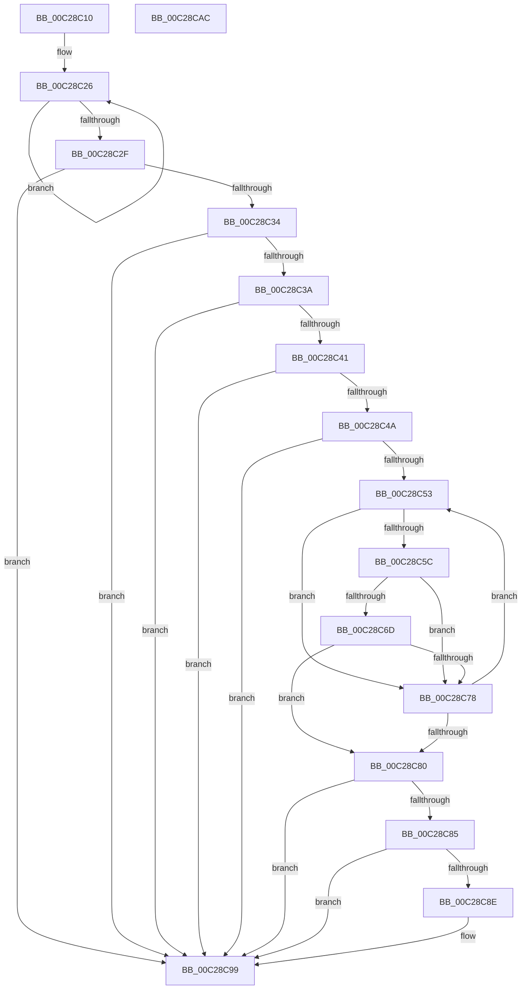

# CmpProcessForSimpleStringSub

- RVA: `0x00C28C10`–`0x00C28CAD` (길이 `157` bytes)
- VA: `0x0000000140C28C10`
- 실행 섹션: `INIT`
- PDB 이름 있음: `예`; PDB Function 태그: `아니요`
- unwind 정보 RVA: `0x00060BC4`
- 디코드: `50`개 명령, `157/157` bytes 표시
- 미해석 바이트: `0` (있으면 어셈블리에 `.byte`로 보존)

> 이 문서는 커널 이미지의 기계어와 PDB 기호를 분석해 생성했습니다. 4번과 5번은 함수 원형과 자료형을 바이너리 사용 방식에서 추정한 C 해석이며 원본 소스 복구 결과는 아닙니다.

## 1. Dependencies

- 직접 호출 지점: **1**; 고유 호출 대상: **1**
- 직접 호출자로 확인된 함수: **1**
- RIP 상대 이미지 참조: **0**

### Outgoing calls
- `0x00C28C64` → [strnicmp](../../text/4F/strnicmp_function_004FFE30.md) (function, `0x004FFE30`)

### Direct callers
- [CmpGetSectionLineIndex](CmpGetSectionLineIndex_function_00C283C4.md) at `0x00C28419`

### Static image references
- 디코드된 RIP-relative 메모리 참조가 없습니다.

## 2. Other-region calls and transfers

- 다른 실행 섹션으로 향하는 call: **1**
  - `0x00C28C64` → [strnicmp](../../text/4F/strnicmp_function_004FFE30.md) (`INIT` → `.text`)
- 별도 외부 분기/꼬리 이동을 확인하지 못했습니다.

## 3. Assembly (complete function range)

```asm
00C28C10  48 89 5C 24 08                  mov qword ptr [rsp + 8], rbx
00C28C15  48 89 74 24 10                  mov qword ptr [rsp + 0x10], rsi
00C28C1A  57                              push rdi
00C28C1B  48 83 EC 20                     sub rsp, 0x20
00C28C1F  48 8B FA                        mov rdi, rdx
00C28C22  48 83 CE FF                     or rsi, 0xffffffffffffffff
00C28C26  48 FF C6                        inc rsi
00C28C29  80 3C 32 00                     cmp byte ptr [rdx + rsi], 0
00C28C2D  75 F7                           jne 0x140c28c26
00C28C2F  80 3A 25                        cmp byte ptr [rdx], 0x25
00C28C32  75 65                           jne 0x140c28c99
00C28C34  48 83 FE 02                     cmp rsi, 2
00C28C38  76 5F                           jbe 0x140c28c99
00C28C3A  80 7C 16 FF 25                  cmp byte ptr [rsi + rdx - 1], 0x25
00C28C3F  75 58                           jne 0x140c28c99
00C28C41  48 8B 59 28                     mov rbx, qword ptr [rcx + 0x28]
00C28C45  48 85 DB                        test rbx, rbx
00C28C48  74 4F                           je 0x140c28c99
00C28C4A  48 8B 5B 10                     mov rbx, qword ptr [rbx + 0x10]
00C28C4E  48 85 DB                        test rbx, rbx
00C28C51  74 46                           je 0x140c28c99
00C28C53  48 8B 4B 08                     mov rcx, qword ptr [rbx + 8]
00C28C57  48 85 C9                        test rcx, rcx
00C28C5A  74 1C                           je 0x140c28c78
00C28C5C  4C 8D 46 FE                     lea r8, [rsi - 2]
00C28C60  48 8D 57 01                     lea rdx, [rdi + 1]
00C28C64  E8 C7 71 8D FF                  call 0x1404ffe30
00C28C69  85 C0                           test eax, eax
00C28C6B  75 0B                           jne 0x140c28c78
00C28C6D  48 8B 43 08                     mov rax, qword ptr [rbx + 8]
00C28C71  80 7C 30 FE 00                  cmp byte ptr [rax + rsi - 2], 0
00C28C76  74 08                           je 0x140c28c80
00C28C78  48 8B 1B                        mov rbx, qword ptr [rbx]
00C28C7B  48 85 DB                        test rbx, rbx
00C28C7E  75 D3                           jne 0x140c28c53
00C28C80  48 85 DB                        test rbx, rbx
00C28C83  74 14                           je 0x140c28c99
00C28C85  48 8B 4B 10                     mov rcx, qword ptr [rbx + 0x10]
00C28C89  48 85 C9                        test rcx, rcx
00C28C8C  74 0B                           je 0x140c28c99
00C28C8E  48 8B 49 08                     mov rcx, qword ptr [rcx + 8]
00C28C92  48 85 C9                        test rcx, rcx
00C28C95  48 0F 45 F9                     cmovne rdi, rcx
00C28C99  48 8B 5C 24 30                  mov rbx, qword ptr [rsp + 0x30]
00C28C9E  48 8B C7                        mov rax, rdi
00C28CA1  48 8B 74 24 38                  mov rsi, qword ptr [rsp + 0x38]
00C28CA6  48 83 C4 20                     add rsp, 0x20
00C28CAA  5F                              pop rdi
00C28CAB  C3                              ret
00C28CAC  CC                              int3
```

## 4. C-style interpretation (structured pseudocode)

```c
__int64 __fastcall CmpProcessForSimpleStringSub(__int64 a1, __int64 a2)
{
    __int64 result;
    __int64 v_rsi;
    __int64 v_rsp;
    unsigned __int64 v_stack_p10;
    unsigned __int64 v_stack_p8;

    v_stack_p8 = v_rbx;
    v_stack_p10 = v_rsi;
    v_rsp = (v_rsp) - (32);
    v_rsi = (v_rsi) | (-1);
loc_00C28C26:
    v_rsi = (v_rsi) + 1;
    if ((*(unsigned __int8 *)(a2 + v_rsi * 1)) != 0) goto loc_00C28C26;
    if ((*(unsigned __int8 *)(a2)) != 37) goto loc_00C28C99;
    if (v_rsi <= 2) goto loc_00C28C99;
    if ((*(unsigned __int8 *)(v_rsi + a2 * 1 - 1)) != 37) goto loc_00C28C99;
    if (*(unsigned __int64 *)(a1 + 40) == 0) goto loc_00C28C99;
    if (*(unsigned __int64 *)(*(unsigned __int64 *)(a1 + 40) + 16) == 0) goto loc_00C28C99;
loc_00C28C53:
    if (*(unsigned __int64 *)(*(unsigned __int64 *)(*(unsigned __int64 *)(a1 + 40) + 16) + 8) == 0) goto loc_00C28C78;
    result = strnicmp(*(unsigned __int64 *)(*(unsigned __int64 *)(*(unsigned __int64 *)(a1 + 40) + 16) + 8), a2 + 1, v_rsi - 2, a4);
    if ((unsigned int)(result) != 0) goto loc_00C28C78;
    if ((*(unsigned __int8 *)(*(unsigned __int64 *)(*(unsigned __int64 *)(*(unsigned __int64 *)(a1 + 40) + 16) + 8) + v_rsi * 1 - 2)) == 0) goto loc_00C28C80;
loc_00C28C78:
    if (*(unsigned __int64 *)(*(unsigned __int64 *)(*(unsigned __int64 *)(a1 + 40) + 16)) != 0) goto loc_00C28C53;
loc_00C28C80:
    if (*(unsigned __int64 *)(*(unsigned __int64 *)(*(unsigned __int64 *)(a1 + 40) + 16)) == 0) goto loc_00C28C99;
    if (*(unsigned __int64 *)(*(unsigned __int64 *)(*(unsigned __int64 *)(*(unsigned __int64 *)(a1 + 40) + 16)) + 16) != 0) {
        a1 = *(unsigned __int64 *)(*(unsigned __int64 *)(*(unsigned __int64 *)(*(unsigned __int64 *)(*(unsigned __int64 *)(a1 + 40) + 16)) + 16) + 8);
        if (a1 != 0) { a2 = a1; }
    }
    v_rsp = (v_rsp) + (32);
    return a2;
}
```

## 5. (Beta) C Style

```c
void *CmpProcessForSimpleStringSub(void *Arg1, void *Arg2)
{
    uint8_t *arg1 = (uint8_t *)Arg1;
    uint8_t *arg2 = (uint8_t *)Arg2;

    int64_t result;
    int64_t local_rsi;
    int64_t local_rsp;
    uint64_t v_stack_p10;
    uint64_t v_stack_p8;

    v_stack_p8 = local_rbx;
    v_stack_p10 = local_rsi;
    local_rsp = (local_rsp) - (32);
    local_rsi = (local_rsi) | (-1);
loc_00C28C26:
    local_rsi = (local_rsi) + 1;
    if ((*(uint8_t *)(arg2 + local_rsi * 1)) != 0) goto loc_00C28C26;
    if ((*(uint8_t *)(arg2)) != 37) goto loc_00C28C99;
    if (local_rsi <= 2) goto loc_00C28C99;
    if ((*(uint8_t *)(local_rsi + arg2 * 1 - 0x1)) != 37) goto loc_00C28C99;
    if (*(uint64_t *)(arg1 + 0x28) == 0) goto loc_00C28C99;
    if (*(uint64_t *)(*(uint64_t *)(arg1 + 0x28) + 0x10) == 0) goto loc_00C28C99;
loc_00C28C53:
    if (*(uint64_t *)(*(uint64_t *)(*(uint64_t *)(arg1 + 0x28) + 0x10) + 0x8) == 0) goto loc_00C28C78;
    result = strnicmp(*(uint64_t *)(*(uint64_t *)(*(uint64_t *)(arg1 + 0x28) + 0x10) + 0x8), Arg2 + 1, local_rsi - 2, a4);
    if ((uint32_t)(result) != 0) goto loc_00C28C78;
    if ((*(uint8_t *)(*(uint64_t *)(*(uint64_t *)(*(uint64_t *)(arg1 + 0x28) + 0x10) + 0x8) + local_rsi * 1 - 0x2)) == 0) goto loc_00C28C80;
loc_00C28C78:
    if (*(uint64_t *)(*(uint64_t *)(*(uint64_t *)(arg1 + 0x28) + 0x10)) != 0) goto loc_00C28C53;
loc_00C28C80:
    if (*(uint64_t *)(*(uint64_t *)(*(uint64_t *)(arg1 + 0x28) + 0x10)) == 0) goto loc_00C28C99;
    if (*(uint64_t *)(*(uint64_t *)(*(uint64_t *)(*(uint64_t *)(arg1 + 0x28) + 0x10)) + 0x10) != 0) {
        Arg1 = *(uint64_t *)(*(uint64_t *)(*(uint64_t *)(*(uint64_t *)(*(uint64_t *)(arg1 + 0x28) + 0x10)) + 0x10) + 0x8);
        if (Arg1 != NULL) { Arg2 = Arg1; }
    }
    local_rsp = (local_rsp) + (32);
    return Arg2;
}
```

### 관측된 메모리 오프셋

구조체 형식이 확인되지 않은 접근은 인자 기준의 오프셋으로만 기록했습니다.

| 기준 인자 | 오프셋 표현 | 폭 (bit) | 접근 |
|---|---:|---:|---|
| `Arg1` | `+ 0x28` | `64` | `R` |
| `Arg2` | `+ 0x0` | `8` | `R` |
| `Arg2` | `+ 0x0 + rsi*1` | `8` | `R` |
| `Arg2` | `+ 0x1` | `64` | `R` |

## 6. Execution-region graph

[열기: 2D/3D 그래프와 함수 탐색 컨트롤 패널](../../../control-panel.html?section=init&rva=0x00C28C10&view=graph)

- 2D 그래프는 위에서 아래로 흐르고, 3D 그래프는 빈 공간을 드래그해 회전합니다. Shift+드래그는 이동, 휠은 확대·축소, 함수 노드 선택은 대상 보고서 이동입니다.

### Static fallback


