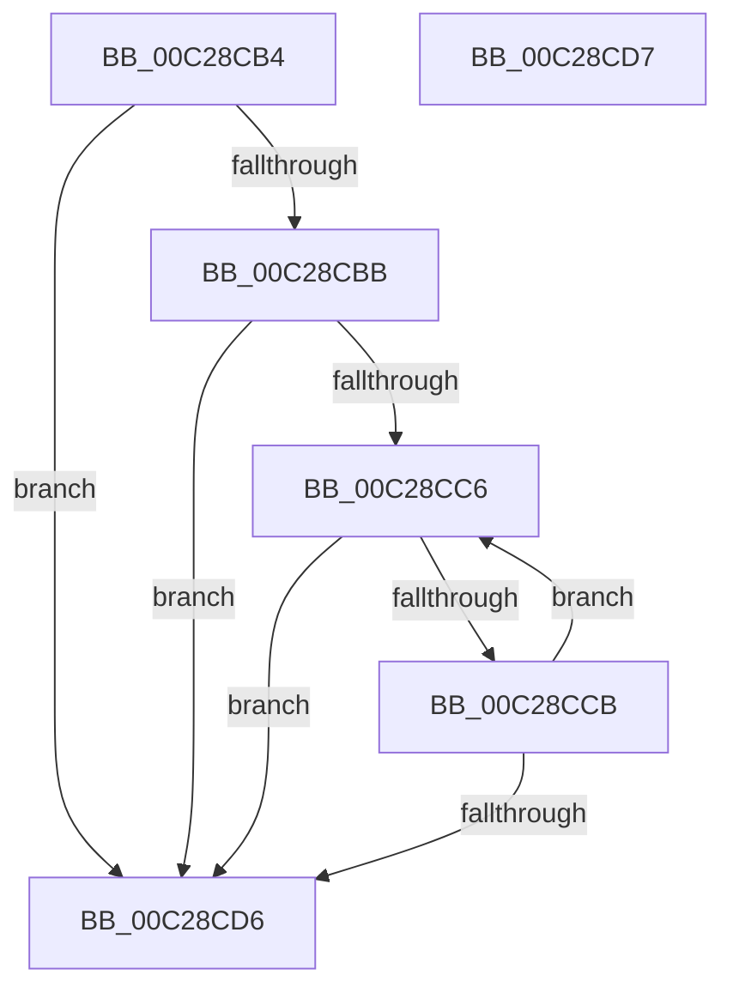

# CmpSearchLineInSectionByIndex

- RVA: `0x00C28CB4`–`0x00C28CD8` (길이 `36` bytes)
- VA: `0x0000000140C28CB4`
- 실행 섹션: `INIT`
- PDB 이름 있음: `예`; PDB Function 태그: `아니요`
- unwind 정보 RVA: `0x000DB714`
- 디코드: `15`개 명령, `36/36` bytes 표시
- 미해석 바이트: `0` (있으면 어셈블리에 `.byte`로 보존)

> 이 문서는 커널 이미지의 기계어와 PDB 기호를 분석해 생성했습니다. 4번과 5번은 함수 원형과 자료형을 바이너리 사용 방식에서 추정한 C 해석이며 원본 소스 복구 결과는 아닙니다.

## 1. Dependencies

- 직접 호출 지점: **0**; 고유 호출 대상: **0**
- 직접 호출자로 확인된 함수: **4**
- RIP 상대 이미지 참조: **0**

### Outgoing calls
- 직접 디코드된 call 명령이 없습니다.

### Direct callers
- [EmpInfParseGetSectionLineCount](EmpInfParseGetSectionLineCount_function_00C26460.md) at `0x00C2648C`
- [CmpGetKeyName](CmpGetKeyName_function_00C2838C.md) at `0x00C283A4`
- [CmpGetSectionLineIndex](CmpGetSectionLineIndex_function_00C283C4.md) at `0x00C283EB`
- [CmpGetSectionLineIndexValueCount](CmpGetSectionLineIndexValueCount_function_00C2843C.md) at `0x00C2845A`

### Static image references
- 디코드된 RIP-relative 메모리 참조가 없습니다.

## 2. Other-region calls and transfers

- 다른 실행 섹션으로 향하는 call: **0**
- 별도 외부 분기/꼬리 이동을 확인하지 못했습니다.

## 3. Assembly (complete function range)

```asm
00C28CB4  33 C0                           xor eax, eax
00C28CB6  48 85 C9                        test rcx, rcx
00C28CB9  74 1B                           je 0x140c28cd6
00C28CBB  48 8B 41 10                     mov rax, qword ptr [rcx + 0x10]
00C28CBF  45 33 C0                        xor r8d, r8d
00C28CC2  85 D2                           test edx, edx
00C28CC4  74 10                           je 0x140c28cd6
00C28CC6  48 85 C0                        test rax, rax
00C28CC9  74 0B                           je 0x140c28cd6
00C28CCB  48 8B 00                        mov rax, qword ptr [rax]
00C28CCE  41 FF C0                        inc r8d
00C28CD1  44 3B C2                        cmp r8d, edx
00C28CD4  72 F0                           jb 0x140c28cc6
00C28CD6  C3                              ret
00C28CD7  CC                              int3
```

## 4. C-style interpretation (structured pseudocode)

```c
__int64 __fastcall CmpSearchLineInSectionByIndex(__int64 a1, int a2, int a3)
{
    __int64 result;

    result = 0;
    if (a1 == 0) goto loc_00C28CD6;
    a3 = 0;
    if (a2 == 0) goto loc_00C28CD6;
loc_00C28CC6:
    if (*(unsigned __int64 *)(a1 + 16) == 0) goto loc_00C28CD6;
    a3 = (unsigned int)((a3) + 1);
    if (a3 < a2) goto loc_00C28CC6;
loc_00C28CD6:
    return *(unsigned __int64 *)(*(unsigned __int64 *)(a1 + 16));
}
```

## 5. (Beta) C Style

```c
int64_t CmpSearchLineInSectionByIndex(int64_t Arg1, int32_t Arg2, int32_t Arg3)
{
    int64_t result;

    result = 0;
    if (Arg1 == 0) goto loc_00C28CD6;
    Arg3 = 0;
    if (Arg2 == 0) goto loc_00C28CD6;
loc_00C28CC6:
    if (*(uint64_t *)(Arg1 + 0x10) == 0) goto loc_00C28CD6;
    Arg3 = (uint32_t)((Arg3) + 1);
    if (Arg3 < Arg2) goto loc_00C28CC6;
loc_00C28CD6:
    return *(uint64_t *)(*(uint64_t *)(Arg1 + 0x10));
}
```

## 6. Execution-region graph

[열기: 2D/3D 그래프와 함수 탐색 컨트롤 패널](../../../control-panel.html?section=init&rva=0x00C28CB4&view=graph)

- 2D 그래프는 위에서 아래로 흐르고, 3D 그래프는 빈 공간을 드래그해 회전합니다. Shift+드래그는 이동, 휠은 확대·축소, 함수 노드 선택은 대상 보고서 이동입니다.

### Static fallback


