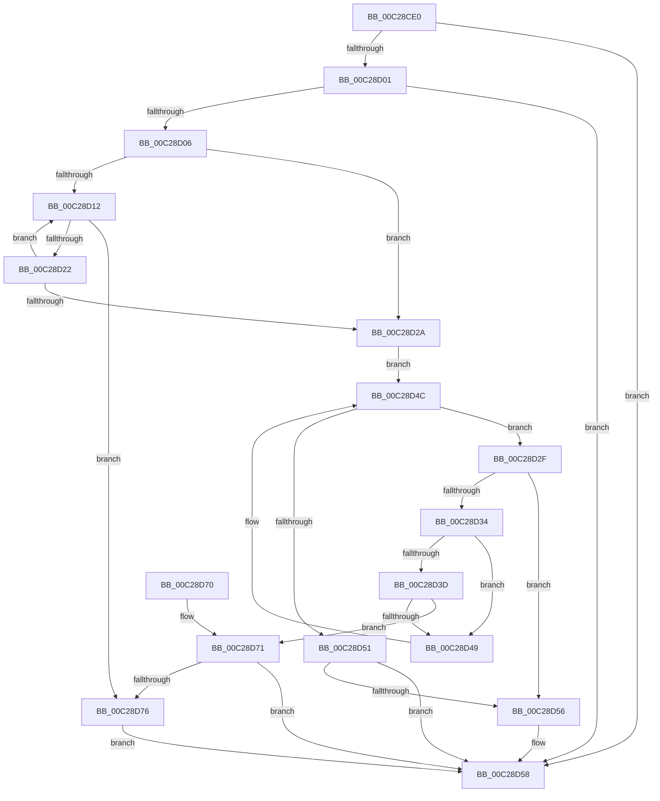

# CmpSearchSectionByName

- RVA: `0x00C28CE0`–`0x00C28D7C` (길이 `156` bytes)
- VA: `0x0000000140C28CE0`
- 실행 섹션: `INIT`
- PDB 이름 있음: `예`; PDB Function 태그: `아니요`
- unwind 정보 RVA: `0x000A8CB4`
- 디코드: `53`개 명령, `156/156` bytes 표시
- 미해석 바이트: `0` (있으면 어셈블리에 `.byte`로 보존)

> 이 문서는 커널 이미지의 기계어와 PDB 기호를 분석해 생성했습니다. 4번과 5번은 함수 원형과 자료형을 바이너리 사용 방식에서 추정한 C 해석이며 원본 소스 복구 결과는 아닙니다.

## 1. Dependencies

- 직접 호출 지점: **2**; 고유 호출 대상: **1**
- 직접 호출자로 확인된 함수: **4**
- RIP 상대 이미지 참조: **0**

### Outgoing calls
- `0x00C28D19` → [stricmp](../../text/4F/stricmp_function_004FFD80.md) (function, `0x004FFD80`)
- `0x00C28D40` → [stricmp](../../text/4F/stricmp_function_004FFD80.md) (function, `0x004FFD80`)

### Direct callers
- [EmpInfParseGetSectionLineCount](EmpInfParseGetSectionLineCount_function_00C26460.md) at `0x00C2647D`
- [CmpGetKeyName](CmpGetKeyName_function_00C2838C.md) at `0x00C28395`
- [CmpGetSectionLineIndex](CmpGetSectionLineIndex_function_00C283C4.md) at `0x00C283DC`
- [CmpGetSectionLineIndexValueCount](CmpGetSectionLineIndexValueCount_function_00C2843C.md) at `0x00C2844B`

### Static image references
- 디코드된 RIP-relative 메모리 참조가 없습니다.

## 2. Other-region calls and transfers

- 다른 실행 섹션으로 향하는 call: **2**
  - `0x00C28D19` → [stricmp](../../text/4F/stricmp_function_004FFD80.md) (`INIT` → `.text`)
  - `0x00C28D40` → [stricmp](../../text/4F/stricmp_function_004FFD80.md) (`INIT` → `.text`)
- 별도 외부 분기/꼬리 이동을 확인하지 못했습니다.

## 3. Assembly (complete function range)

```asm
00C28CE0  48 89 5C 24 08                  mov qword ptr [rsp + 8], rbx
00C28CE5  48 89 6C 24 10                  mov qword ptr [rsp + 0x10], rbp
00C28CEA  48 89 74 24 18                  mov qword ptr [rsp + 0x18], rsi
00C28CEF  57                              push rdi
00C28CF0  48 83 EC 20                     sub rsp, 0x20
00C28CF4  33 DB                           xor ebx, ebx
00C28CF6  48 8B EA                        mov rbp, rdx
00C28CF9  48 8B F1                        mov rsi, rcx
00C28CFC  48 85 C9                        test rcx, rcx
00C28CFF  74 57                           je 0x140c28d58
00C28D01  48 85 D2                        test rdx, rdx
00C28D04  74 52                           je 0x140c28d58
00C28D06  48 8B 79 08                     mov rdi, qword ptr [rcx + 8]
00C28D0A  48 8B DF                        mov rbx, rdi
00C28D0D  48 85 FF                        test rdi, rdi
00C28D10  74 18                           je 0x140c28d2a
00C28D12  48 8B 4B 08                     mov rcx, qword ptr [rbx + 8]
00C28D16  48 8B D5                        mov rdx, rbp
00C28D19  E8 62 70 8D FF                  call 0x1404ffd80
00C28D1E  85 C0                           test eax, eax
00C28D20  74 54                           je 0x140c28d76
00C28D22  48 8B 1B                        mov rbx, qword ptr [rbx]
00C28D25  48 85 DB                        test rbx, rbx
00C28D28  75 E8                           jne 0x140c28d12
00C28D2A  48 8B 1E                        mov rbx, qword ptr [rsi]
00C28D2D  EB 1D                           jmp 0x140c28d4c
00C28D2F  48 3B DF                        cmp rbx, rdi
00C28D32  74 22                           je 0x140c28d56
00C28D34  48 8B 4B 08                     mov rcx, qword ptr [rbx + 8]
00C28D38  48 85 C9                        test rcx, rcx
00C28D3B  74 0C                           je 0x140c28d49
00C28D3D  48 8B D5                        mov rdx, rbp
00C28D40  E8 3B 70 8D FF                  call 0x1404ffd80
00C28D45  85 C0                           test eax, eax
00C28D47  74 28                           je 0x140c28d71
00C28D49  48 8B 1B                        mov rbx, qword ptr [rbx]
00C28D4C  48 85 DB                        test rbx, rbx
00C28D4F  75 DE                           jne 0x140c28d2f
00C28D51  48 3B DF                        cmp rbx, rdi
00C28D54  75 02                           jne 0x140c28d58
00C28D56  33 DB                           xor ebx, ebx
00C28D58  48 8B 6C 24 38                  mov rbp, qword ptr [rsp + 0x38]
00C28D5D  48 8B C3                        mov rax, rbx
00C28D60  48 8B 5C 24 30                  mov rbx, qword ptr [rsp + 0x30]
00C28D65  48 8B 74 24 40                  mov rsi, qword ptr [rsp + 0x40]
00C28D6A  48 83 C4 20                     add rsp, 0x20
00C28D6E  5F                              pop rdi
00C28D6F  C3                              ret
00C28D70  CC                              int3
00C28D71  48 85 DB                        test rbx, rbx
00C28D74  74 E2                           je 0x140c28d58
00C28D76  48 89 5E 08                     mov qword ptr [rsi + 8], rbx
00C28D7A  EB DC                           jmp 0x140c28d58
```

## 4. C-style interpretation (structured pseudocode)

```c
__int64 __fastcall CmpSearchSectionByName(__int64 a1, __int64 a2)
{
    __int64 result;
    __int64 v_rbx;
    __int64 v_rsp;
    unsigned __int64 v_stack_p10;
    unsigned __int64 v_stack_p18;
    unsigned __int64 v_stack_p8;

    v_stack_p8 = v_rbx;
    v_stack_p10 = v_rbp;
    v_stack_p18 = v_rsi;
    v_rsp = (v_rsp) - (32);
    v_rbx = 0;
    if (a1 == 0) goto loc_00C28D58;
    if (a2 == 0) goto loc_00C28D58;
    if (*(unsigned __int64 *)(a1 + 8) == 0) goto loc_00C28D2A;
loc_00C28D12:
    result = stricmp(*(unsigned __int64 *)(*(unsigned __int64 *)(a1 + 8) + 8), a2, a3, a4);
    if ((unsigned int)(result) == 0) goto loc_00C28D76;
    if (*(unsigned __int64 *)(*(unsigned __int64 *)(a1 + 8)) != 0) goto loc_00C28D12;
loc_00C28D2A:
    goto loc_00C28D4C;
loc_00C28D2F:
    if ((*(unsigned __int64 *)(a1)) == (*(unsigned __int64 *)(a1 + 8))) goto loc_00C28D56;
    if (*(unsigned __int64 *)(*(unsigned __int64 *)(a1) + 8) == 0) goto loc_00C28D49;
    result = stricmp(*(unsigned __int64 *)(*(unsigned __int64 *)(a1) + 8), a2, a3, a4);
    if ((unsigned int)(result) == 0) goto loc_00C28D71;
loc_00C28D49:
loc_00C28D4C:
    if (*(unsigned __int64 *)(*(unsigned __int64 *)(a1)) != 0) goto loc_00C28D2F;
    v_rbx = *(unsigned __int64 *)(*(unsigned __int64 *)(a1));
    if ((*(unsigned __int64 *)(*(unsigned __int64 *)(a1))) == (*(unsigned __int64 *)(a1 + 8))) {
        v_rbx = 0;
    }
    v_rsp = (v_rsp) + (32);
    return 0;
loc_00C28D71:
    if (v_stack_p8 == 0) goto loc_00C28D58;
loc_00C28D76:
    *(unsigned __int64 *)(v_stack_p18 + 8) = v_stack_p8;
    goto loc_00C28D58;
}
```

## 5. (Beta) C Style

```c
int64_t CmpSearchSectionByName(void *Arg1, int64_t Arg2)
{
    uint8_t *arg1 = (uint8_t *)Arg1;

    int64_t result;
    int64_t local_rbx;
    int64_t local_rsp;
    uint64_t v_stack_p10;
    uint64_t v_stack_p18;
    uint64_t v_stack_p8;

    v_stack_p8 = local_rbx;
    v_stack_p10 = local_rbp;
    v_stack_p18 = local_rsi;
    local_rsp = (local_rsp) - (32);
    local_rbx = 0;
    if (Arg1 == NULL) goto loc_00C28D58;
    if (Arg2 == 0) goto loc_00C28D58;
    if (*(uint64_t *)(arg1 + 0x8) == 0) goto loc_00C28D2A;
loc_00C28D12:
    result = stricmp(*(uint64_t *)(*(uint64_t *)(arg1 + 0x8) + 0x8), Arg2, a3, a4);
    if ((uint32_t)(result) == 0) goto loc_00C28D76;
    if (*(uint64_t *)(*(uint64_t *)(arg1 + 0x8)) != 0) goto loc_00C28D12;
loc_00C28D2A:
    goto loc_00C28D4C;
loc_00C28D2F:
    if ((*(uint64_t *)(arg1)) == (*(uint64_t *)(arg1 + 0x8))) goto loc_00C28D56;
    if (*(uint64_t *)(*(uint64_t *)(arg1) + 0x8) == 0) goto loc_00C28D49;
    result = stricmp(*(uint64_t *)(*(uint64_t *)(arg1) + 0x8), Arg2, a3, a4);
    if ((uint32_t)(result) == 0) goto loc_00C28D71;
loc_00C28D49:
loc_00C28D4C:
    if (*(uint64_t *)(*(uint64_t *)(arg1)) != 0) goto loc_00C28D2F;
    local_rbx = *(uint64_t *)(*(uint64_t *)(arg1));
    if ((*(uint64_t *)(*(uint64_t *)(arg1))) == (*(uint64_t *)(arg1 + 0x8))) {
        local_rbx = 0;
    }
    local_rsp = (local_rsp) + (32);
    return 0;
loc_00C28D71:
    if (v_stack_p8 == 0) goto loc_00C28D58;
loc_00C28D76:
    *(uint64_t *)(v_stack_p18 + 0x8) = v_stack_p8;
    goto loc_00C28D58;
}
```

### 관측된 메모리 오프셋

구조체 형식이 확인되지 않은 접근은 인자 기준의 오프셋으로만 기록했습니다.

| 기준 인자 | 오프셋 표현 | 폭 (bit) | 접근 |
|---|---:|---:|---|
| `Arg1` | `+ 0x0` | `64` | `R` |
| `Arg1` | `+ 0x8` | `64` | `W` |

## 6. Execution-region graph

[열기: 2D/3D 그래프와 함수 탐색 컨트롤 패널](../../../control-panel.html?section=init&rva=0x00C28CE0&view=graph)

- 2D 그래프는 위에서 아래로 흐르고, 3D 그래프는 빈 공간을 드래그해 회전합니다. Shift+드래그는 이동, 휠은 확대·축소, 함수 노드 선택은 대상 보고서 이동입니다.

### Static fallback


