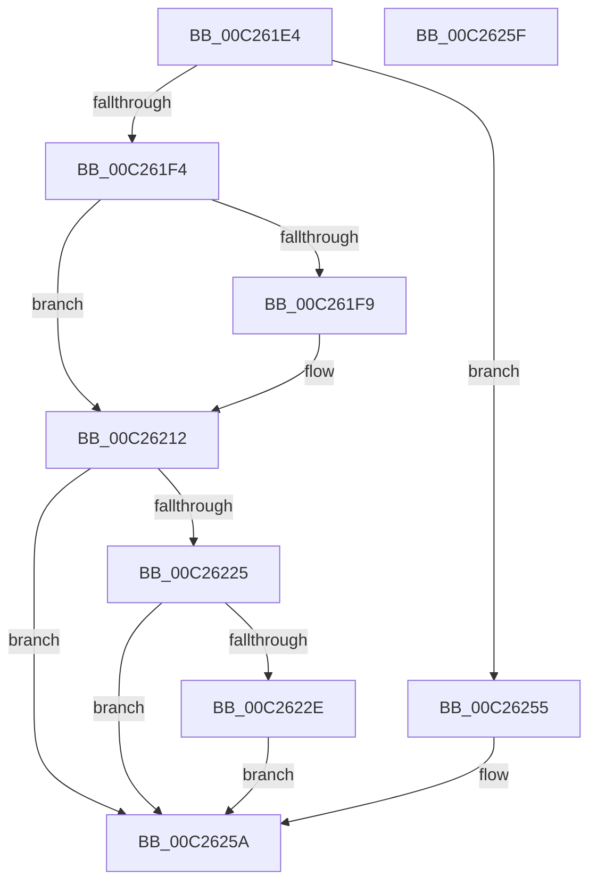

# DbgkInitialize

- RVA: `0x00C261E4`–`0x00C26260` (길이 `124` bytes)
- VA: `0x0000000140C261E4`
- 실행 섹션: `INIT`
- PDB 이름 있음: `예`; PDB Function 태그: `아니요`
- unwind 정보 RVA: `0x0005D2F4`
- 디코드: `31`개 명령, `124/124` bytes 표시
- 미해석 바이트: `0` (있으면 어셈블리에 `.byte`로 보존)

> 이 문서는 커널 이미지의 기계어와 PDB 기호를 분석해 생성했습니다. 4번과 5번은 함수 원형과 자료형을 바이너리 사용 방식에서 추정한 C 해석이며 원본 소스 복구 결과는 아닙니다.

## 1. Dependencies

- 직접 호출 지점: **4**; 고유 호출 대상: **4**
- 직접 호출자로 확인된 함수: **2**
- RIP 상대 이미지 참조: **6**

### Outgoing calls
- `0x00C2620C` → [KeBugCheckEx](../../text/4F/KeBugCheckEx_function_004FD660.md) (function, `0x004FD660`)
- `0x00C26214` → [DbgkpGetServerSiloState](../../page/A9/DbgkpGetServerSiloState_function_00A95774.md) (function, `0x00A95774`)
- `0x00C2621C` → [DbgkpInitializePhase1SiloState](../../page/71/DbgkpInitializePhase1SiloState_function_00710774.md) (function, `0x00710774`)
- `0x00C26255` → [DbgkpInitializePhase0](DbgkpInitializePhase0_function_00C26268.md) (function, `0x00C26268`)

### Direct callers
- [InitBootProcessor](../C1/InitBootProcessor_function_00C1B1C8.md) at `0x00C1BD82`
- [Phase1InitializationDiscard](../C1/Phase1InitializationDiscard_function_00C1C728.md) at `0x00C1D2D3`

### Static image references
- `0x00C261E8` → RVA `0x00FC41A0` (`.data`; read)
- `0x00C26225` → RVA `0x00E65BD0` (`.data`; read)
- `0x00C2622E` → RVA `0x00F8F20C` (`.data`; write)
- `0x00C26238` → RVA `0x00F8F210` (`.data`; write)
- `0x00C26242` → RVA `0x00F8F208` (`.data`; write)
- `0x00C2624C` → RVA `0x00E65BD0` (`.data`; write)

## 2. Other-region calls and transfers

- 다른 실행 섹션으로 향하는 call: **3**
  - `0x00C2620C` → [KeBugCheckEx](../../text/4F/KeBugCheckEx_function_004FD660.md) (`INIT` → `.text`)
  - `0x00C26214` → [DbgkpGetServerSiloState](../../page/A9/DbgkpGetServerSiloState_function_00A95774.md) (`INIT` → `PAGE`)
  - `0x00C2621C` → [DbgkpInitializePhase1SiloState](../../page/71/DbgkpInitializePhase1SiloState_function_00710774.md) (`INIT` → `PAGE`)
- 별도 외부 분기/꼬리 이동을 확인하지 못했습니다.

## 3. Assembly (complete function range)

```asm
00C261E4  48 83 EC 38                     sub rsp, 0x38
00C261E8  8B 0D B2 DF 39 00               mov ecx, dword ptr [rip + 0x39dfb2]
00C261EE  8B C1                           mov eax, ecx
00C261F0  85 C9                           test ecx, ecx
00C261F2  74 61                           je 0x140c26255
00C261F4  83 F8 01                        cmp eax, 1
00C261F7  74 19                           je 0x140c26212
00C261F9  48 83 64 24 20 00               and qword ptr [rsp + 0x20], 0
00C261FF  45 33 C9                        xor r9d, r9d
00C26202  44 8B C1                        mov r8d, ecx
00C26205  41 8D 51 03                     lea edx, [r9 + 3]
00C26209  8D 4A 30                        lea ecx, [rdx + 0x30]
00C2620C  E8 4F 74 8D FF                  call 0x1404fd660
00C26211  CC                              int3
00C26212  33 C9                           xor ecx, ecx
00C26214  E8 5B F5 E6 FF                  call 0x140a95774
00C26219  48 8B C8                        mov rcx, rax
00C2621C  E8 53 A5 AE FF                  call 0x140710774
00C26221  85 C0                           test eax, eax
00C26223  78 35                           js 0x140c2625a
00C26225  80 3D A4 F9 23 00 00            cmp byte ptr [rip + 0x23f9a4], 0
00C2622C  75 2C                           jne 0x140c2625a
00C2622E  C7 05 D4 8F 36 00 00 00 00 00   mov dword ptr [rip + 0x368fd4], 0
00C26238  C7 05 CE 8F 36 00 02 00 00 00   mov dword ptr [rip + 0x368fce], 2
00C26242  C7 05 BC 8F 36 00 58 02 00 00   mov dword ptr [rip + 0x368fbc], 0x258
00C2624C  C6 05 7D F9 23 00 01            mov byte ptr [rip + 0x23f97d], 1
00C26253  EB 05                           jmp 0x140c2625a
00C26255  E8 0E 00 00 00                  call 0x140c26268
00C2625A  48 83 C4 38                     add rsp, 0x38
00C2625E  C3                              ret
00C2625F  CC                              int3
```

## 4. C-style interpretation (structured pseudocode)

```c
__int64 __fastcall DbgkInitialize(__int64 a1, __int64 a2, __int64 a3, int a4)
{
    __int64 result;
    __int64 v_rsp;
    unsigned __int64 v_stack_m18;

    v_rsp = (v_rsp) - (56);
    if ((unsigned int)((unsigned int)(*(unsigned int *)(v_rip + 3792818))) == 0) goto loc_00C26255;
    result = (unsigned int)((unsigned int)((unsigned int)(*(unsigned int *)(v_rip + 3792818))));
    if (((unsigned int)((unsigned int)((unsigned int)((unsigned int)(*(unsigned int *)(v_rip + 3792818)))))) != 1) {
        a4 = 0;
        a3 = (unsigned int)((unsigned int)(*(unsigned int *)(v_rip + 3792818)));
        a2 = a4 + 3;
        a1 = a2 + 48;
        result = KeBugCheckEx(a1, a2, a3, a4);
    }
    a1 = 0;
    result = DbgkpGetServerSiloState(a1, a2, a3, a4);
    result = DbgkpInitializePhase1SiloState(result, a2, a3, a4);
    if (sign_flag) goto loc_00C2625A;
    if ((*(unsigned __int8 *)(v_rip + 2357668)) != 0) goto loc_00C2625A;
    *(unsigned int *)(v_rip + 3575764) = 0;
    *(unsigned int *)(v_rip + 3575758) = 2;
    *(unsigned int *)(v_rip + 3575740) = 600;
    *(unsigned __int8 *)(v_rip + 2357629) = 1;
    goto loc_00C2625A;
loc_00C26255:
    result = DbgkpInitializePhase0(result, a2, a3, a4);
loc_00C2625A:
    v_rsp = (v_rsp) + (56);
    return result;
}
```

## 5. (Beta) C Style

```c
int64_t DbgkInitialize(int64_t Arg1, int64_t Arg2, int64_t Arg3, int32_t Arg4)
{
    int64_t result;
    int64_t local_rsp;
    uint64_t v_stack_m18;

    local_rsp = (local_rsp) - (56);
    if ((uint32_t)((uint32_t)(*(uint32_t *)(v_rip + 0x39DFB2))) == 0) goto loc_00C26255;
    result = (uint32_t)((uint32_t)((uint32_t)(*(uint32_t *)(v_rip + 0x39DFB2))));
    if (((uint32_t)((uint32_t)((uint32_t)((uint32_t)(*(uint32_t *)(v_rip + 0x39DFB2)))))) != 1) {
        Arg4 = 0;
        Arg3 = (uint32_t)((uint32_t)(*(uint32_t *)(v_rip + 0x39DFB2)));
        Arg2 = Arg4 + 3;
        Arg1 = Arg2 + 48;
        result = KeBugCheckEx(Arg1, Arg2, Arg3, Arg4);
    }
    Arg1 = 0;
    result = DbgkpGetServerSiloState(Arg1, Arg2, Arg3, Arg4);
    result = DbgkpInitializePhase1SiloState(result, Arg2, Arg3, Arg4);
    if (sign_flag) goto loc_00C2625A;
    if ((*(uint8_t *)(v_rip + 0x23F9A4)) != 0) goto loc_00C2625A;
    *(uint32_t *)(v_rip + 0x368FD4) = 0;
    *(uint32_t *)(v_rip + 0x368FCE) = 2;
    *(uint32_t *)(v_rip + 0x368FBC) = 600;
    *(uint8_t *)(v_rip + 0x23F97D) = 1;
    goto loc_00C2625A;
loc_00C26255:
    result = DbgkpInitializePhase0(result, Arg2, Arg3, Arg4);
loc_00C2625A:
    local_rsp = (local_rsp) + (56);
    return result;
}
```

## 6. Execution-region graph

[열기: 2D/3D 그래프와 함수 탐색 컨트롤 패널](../../../control-panel.html?section=init&rva=0x00C261E4&view=graph)

- 2D 그래프는 위에서 아래로 흐르고, 3D 그래프는 빈 공간을 드래그해 회전합니다. Shift+드래그는 이동, 휠은 확대·축소, 함수 노드 선택은 대상 보고서 이동입니다.

### Static fallback


