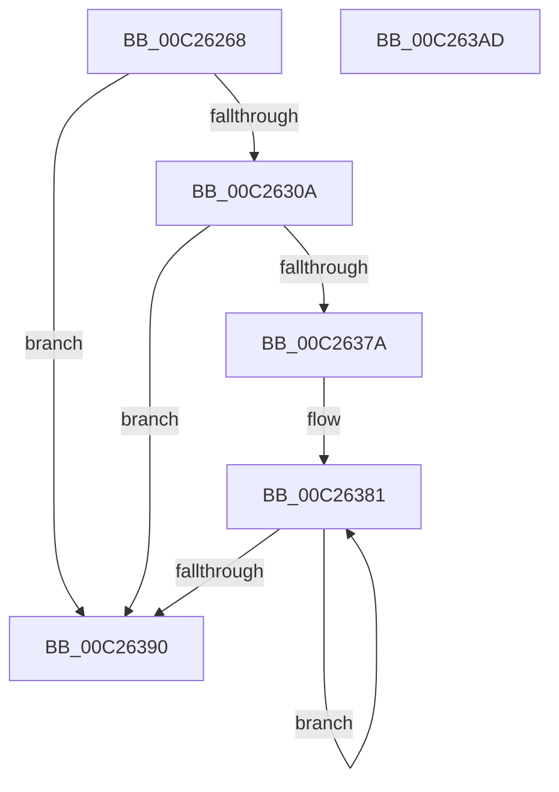

# DbgkpInitializePhase0

- RVA: `0x00C26268`–`0x00C263AE` (길이 `326` bytes)
- VA: `0x0000000140C26268`
- 실행 섹션: `INIT`
- PDB 이름 있음: `예`; PDB Function 태그: `아니요`
- unwind 정보 RVA: `0x000C43B4`
- 디코드: `67`개 명령, `326/326` bytes 표시
- 미해석 바이트: `0` (있으면 어셈블리에 `.byte`로 보존)

> 이 문서는 커널 이미지의 기계어와 PDB 기호를 분석해 생성했습니다. 4번과 5번은 함수 원형과 자료형을 바이너리 사용 방식에서 추정한 C 해석이며 원본 소스 복구 결과는 아닙니다.

## 1. Dependencies

- 직접 호출 지점: **6**; 고유 호출 대상: **6**
- 직접 호출자로 확인된 함수: **1**
- RIP 상대 이미지 참조: **15**

### Outgoing calls
- `0x00C262A9` → [memset](../../text/6C/memset_function_006C6C40.md) (function, `0x006C6C40`)
- `0x00C262F5` → [DbgkpGetServerSiloState](../../page/A9/DbgkpGetServerSiloState_function_00A95774.md) (function, `0x00A95774`)
- `0x00C262FD` → [DbgkpInitializePhase0SiloState](../../page/71/DbgkpInitializePhase0SiloState_function_00710764.md) (function, `0x00710764`)
- `0x00C26371` → [ObCreateObjectType](../../page/70/ObCreateObjectType_function_00705230.md) (function, `0x00705230`)
- `0x00C26381` → [CmSiRWLockInitialize](../../page/AD/CmSiRWLockInitialize_function_00AD69E0.md) (function, `0x00AD69E0`)
- `0x00C26397` → [_security_check_cookie](../../text/6A/_security_check_cookie_function_006AC640.md) (function, `0x006AC640`)

### Direct callers
- [DbgkInitialize](DbgkInitialize_function_00C261E4.md) at `0x00C26255`

### Static image references
- `0x00C2627A` → RVA `0x00E0A740` (`.data`; read)
- `0x00C26288` → RVA `0x00C795A0` (` ?? ::PBOPGDP::`string'`; read)
- `0x00C262AE` → RVA `0x00F8F228` (`.data`; read/write)
- `0x00C262B6` → RVA `0x00F8F240` (`.data`; read)
- `0x00C262BD` → RVA `0x00F8F230` (`.data`; read/write)
- `0x00C262C6` → RVA `0x00F8F23C` (`.data`; read/write)
- `0x00C262CD` → RVA `0x00F8F248` (`.data`; write)
- `0x00C262D4` → RVA `0x00F8F240` (`.data`; write)
- `0x00C262DB` → RVA `0x00F8F220` (`.data`; write)
- `0x00C262E5` → RVA `0x00F8F238` (`.data`; write)
- `0x00C262EE` → RVA `0x00F8F23A` (`.data`; write)
- `0x00C2630E` → RVA `0x00A64D60` (`AlpcConnectionCleanupProcedure`; read)
- `0x00C26319` → RVA `0x00FC5140` (`ALMOSTRO`; read)
- `0x00C26330` → RVA `0x0091D5F0` (`DbgkpCloseObject`; read)
- `0x00C2637A` → RVA `0x00E3ECE0` (`.data`; read)

## 2. Other-region calls and transfers

- 다른 실행 섹션으로 향하는 call: **6**
  - `0x00C262A9` → [memset](../../text/6C/memset_function_006C6C40.md) (`INIT` → `.text`)
  - `0x00C262F5` → [DbgkpGetServerSiloState](../../page/A9/DbgkpGetServerSiloState_function_00A95774.md) (`INIT` → `PAGE`)
  - `0x00C262FD` → [DbgkpInitializePhase0SiloState](../../page/71/DbgkpInitializePhase0SiloState_function_00710764.md) (`INIT` → `PAGE`)
  - `0x00C26371` → [ObCreateObjectType](../../page/70/ObCreateObjectType_function_00705230.md) (`INIT` → `PAGE`)
  - `0x00C26381` → [CmSiRWLockInitialize](../../page/AD/CmSiRWLockInitialize_function_00AD69E0.md) (`INIT` → `PAGE`)
  - `0x00C26397` → [_security_check_cookie](../../text/6A/_security_check_cookie_function_006AC640.md) (`INIT` → `.text`)
- 별도 외부 분기/꼬리 이동을 확인하지 못했습니다.

## 3. Assembly (complete function range)

```asm
00C26268  48 89 5C 24 08                  mov qword ptr [rsp + 8], rbx
00C2626D  55                              push rbp
00C2626E  48 8D 6C 24 A9                  lea rbp, [rsp - 0x57]
00C26273  48 81 EC C0 00 00 00            sub rsp, 0xc0
00C2627A  48 8B 05 BF 44 1E 00            mov rax, qword ptr [rip + 0x1e44bf]
00C26281  48 33 C4                        xor rax, rsp
00C26284  48 89 45 47                     mov qword ptr [rbp + 0x47], rax
00C26288  48 8D 05 11 33 05 00            lea rax, [rip + 0x53311]
00C2628F  48 C7 45 B7 16 00 18 00         mov qword ptr [rbp - 0x49], 0x180016
00C26297  BB 78 00 00 00                  mov ebx, 0x78
00C2629C  48 89 45 BF                     mov qword ptr [rbp - 0x41], rax
00C262A0  44 8B C3                        mov r8d, ebx
00C262A3  48 8D 4D C7                     lea rcx, [rbp - 0x39]
00C262A7  33 D2                           xor edx, edx
00C262A9  E8 92 09 AA FF                  call 0x1406c6c40
00C262AE  48 83 25 72 8F 36 00 00         and qword ptr [rip + 0x368f72], 0
00C262B6  48 8D 05 83 8F 36 00            lea rax, [rip + 0x368f83]
00C262BD  83 25 6C 8F 36 00 00            and dword ptr [rip + 0x368f6c], 0
00C262C4  33 C9                           xor ecx, ecx
00C262C6  83 25 6F 8F 36 00 00            and dword ptr [rip + 0x368f6f], 0
00C262CD  48 89 05 74 8F 36 00            mov qword ptr [rip + 0x368f74], rax
00C262D4  48 89 05 65 8F 36 00            mov qword ptr [rip + 0x368f65], rax
00C262DB  C7 05 3B 8F 36 00 01 00 00 00   mov dword ptr [rip + 0x368f3b], 1
00C262E5  66 C7 05 4A 8F 36 00 01 00      mov word ptr [rip + 0x368f4a], 1
00C262EE  C6 05 45 8F 36 00 06            mov byte ptr [rip + 0x368f45], 6
00C262F5  E8 7A F4 E6 FF                  call 0x140a95774
00C262FA  48 8B C8                        mov rcx, rax
00C262FD  E8 62 A4 AE FF                  call 0x140710764
00C26302  85 C0                           test eax, eax
00C26304  0F 88 86 00 00 00               js 0x140c26390
00C2630A  83 65 CF 00                     and dword ptr [rbp - 0x31], 0
00C2630E  48 8D 05 4B EA E3 FF            lea rax, [rip - 0x1c15b5]
00C26315  83 65 EF 00                     and dword ptr [rbp - 0x11], 0
00C26319  4C 8D 0D 20 EE 39 00            lea r9, [rip + 0x39ee20]
00C26320  83 65 F3 00                     and dword ptr [rbp - 0xd], 0
00C26324  48 8D 55 C7                     lea rdx, [rbp - 0x39]
00C26328  48 89 45 0F                     mov qword ptr [rbp + 0xf], rax
00C2632C  48 8D 4D B7                     lea rcx, [rbp - 0x49]
00C26330  48 8D 05 B9 72 CF FF            lea rax, [rip - 0x308d47]
00C26337  66 89 5D C7                     mov word ptr [rbp - 0x39], bx
00C2633B  48 89 45 07                     mov qword ptr [rbp + 7], rax
00C2633F  BB 08 00 00 00                  mov ebx, 8
00C26344  08 5D C9                        or byte ptr [rbp - 0x37], bl
00C26347  B8 0F 00 1F 00                  mov eax, 0x1f000f
00C2634C  45 33 C0                        xor r8d, r8d
00C2634F  89 45 E3                        mov dword ptr [rbp - 0x1d], eax
00C26352  89 45 DF                        mov dword ptr [rbp - 0x21], eax
00C26355  C7 45 EB 00 02 00 00            mov dword ptr [rbp - 0x15], 0x200
00C2635C  C7 45 D3 01 00 02 00            mov dword ptr [rbp - 0x2d], 0x20001
00C26363  C7 45 D7 02 00 02 00            mov dword ptr [rbp - 0x29], 0x20002
00C2636A  C7 45 DB 00 00 12 00            mov dword ptr [rbp - 0x25], 0x120000
00C26371  E8 BA EE AD FF                  call 0x140705230
00C26376  85 C0                           test eax, eax
00C26378  78 16                           js 0x140c26390
00C2637A  48 8D 0D 5F 89 21 00            lea rcx, [rip + 0x21895f]
00C26381  E8 5A 06 EB FF                  call 0x140ad69e0
00C26386  48 83 C1 10                     add rcx, 0x10
00C2638A  48 83 EB 01                     sub rbx, 1
00C2638E  75 F1                           jne 0x140c26381
00C26390  48 8B 4D 47                     mov rcx, qword ptr [rbp + 0x47]
00C26394  48 33 CC                        xor rcx, rsp
00C26397  E8 A4 62 A8 FF                  call 0x1406ac640
00C2639C  48 8B 9C 24 D0 00 00 00         mov rbx, qword ptr [rsp + 0xd0]
00C263A4  48 81 C4 C0 00 00 00            add rsp, 0xc0
00C263AB  5D                              pop rbp
00C263AC  C3                              ret
00C263AD  CC                              int3
```

## 4. C-style interpretation (structured pseudocode)

```c
__int64 __fastcall DbgkpInitializePhase0(__int64 a1, int a2)
{
    __int64 result;
    __int64 v_rbx;
    __int64 v_rsp;
    unsigned __int64 v_stack_m18;
    unsigned __int64 v_stack_m50;
    unsigned __int64 v_stack_m58;
    unsigned __int64 v_stack_m5F;
    unsigned int v_stack_m6C;
    unsigned int v_stack_m70;
    unsigned int v_stack_m74;
    unsigned int v_stack_m7C;
    unsigned int v_stack_m80;
    unsigned int v_stack_m84;
    unsigned int v_stack_m88;
    unsigned int v_stack_m8C;
    unsigned int v_stack_m90;
    unsigned __int8 v_stack_m96;
    unsigned __int64 v_stack_m98;
    unsigned __int64 v_stack_mA0;
    unsigned __int64 v_stack_mA8;
    unsigned __int64 v_stack_p8;

    v_stack_p8 = v_rbx;
    v_rsp = (v_rsp) - (192);
    result = (*(unsigned __int64 *)(v_rip + 1983679)) ^ (v_rsp);
    v_stack_m18 = result;
    v_stack_mA8 = 0x180016ULL;
    v_stack_mA0 = v_rip + 340753;
    a2 = 0;
    result = memset(v_stack_m98, a2, 120, a4);
    a1 = 0;
    *(unsigned __int64 *)(v_rip + 3575668) = v_rip + 3575683;
    *(unsigned __int64 *)(v_rip + 3575653) = v_rip + 3575683;
    *(unsigned int *)(v_rip + 3575611) = 1;
    *(unsigned __int16 *)(v_rip + 3575626) = 1;
    *(unsigned __int8 *)(v_rip + 3575621) = 6;
    result = DbgkpGetServerSiloState(a1, a2, 120, a4);
    result = DbgkpInitializePhase0SiloState(result, a2, 120, a4);
    if (sign_flag) goto loc_00C26390;
    v_stack_m50 = v_rip - 1840565;
    v_stack_m98 = 120;
    v_stack_m58 = v_rip - 3181895;
    a3 = 0;
    v_stack_m7C = (unsigned int)((unsigned int)(0x1F000FULL));
    v_stack_m80 = (unsigned int)((unsigned int)(0x1F000FULL));
    v_stack_m74 = 512;
    v_stack_m8C = 0x20001ULL;
    v_stack_m88 = 0x20002ULL;
    v_stack_m84 = 0x120000ULL;
    result = ObCreateObjectType(v_stack_mA8, v_stack_m98, a3, v_rip + 3796512);
    if (sign_flag) goto loc_00C26390;
loc_00C26381:
    result = CmSiRWLockInitialize(v_rip + 2197855, v_stack_m98, a3, v_rip + 3796512);
    a1 = (v_rip + 2197855) + (16);
    v_rbx = (8) - (1);
    if (condition_is_not_equal) goto loc_00C26381;
loc_00C26390:
    a1 = (v_stack_m18) ^ (v_rsp);
    result = _security_check_cookie(a1, v_stack_m98, a3, v_rip + 3796512);
    v_rsp = (v_rsp) + (192);
    return result;
}
```

## 5. (Beta) C Style

```c
int64_t DbgkpInitializePhase0(int64_t Arg1, int32_t Arg2)
{
    int64_t result;
    int64_t local_rbx;
    int64_t local_rsp;
    uint64_t v_stack_m18;
    uint64_t v_stack_m50;
    uint64_t v_stack_m58;
    uint64_t v_stack_m5F;
    uint32_t v_stack_m6C;
    uint32_t v_stack_m70;
    uint32_t v_stack_m74;
    uint32_t v_stack_m7C;
    uint32_t v_stack_m80;
    uint32_t v_stack_m84;
    uint32_t v_stack_m88;
    uint32_t v_stack_m8C;
    uint32_t v_stack_m90;
    uint8_t v_stack_m96;
    uint64_t v_stack_m98;
    uint64_t v_stack_mA0;
    uint64_t v_stack_mA8;
    uint64_t v_stack_p8;

    v_stack_p8 = local_rbx;
    local_rsp = (local_rsp) - (192);
    result = (*(uint64_t *)(v_rip + 0x1E44BF)) ^ (local_rsp);
    v_stack_m18 = result;
    v_stack_mA8 = 0x180016ULL;
    v_stack_mA0 = v_rip + 340753;
    Arg2 = 0;
    result = memset(v_stack_m98, Arg2, 120, a4);
    Arg1 = 0;
    *(uint64_t *)(v_rip + 0x368F74) = v_rip + 3575683;
    *(uint64_t *)(v_rip + 0x368F65) = v_rip + 3575683;
    *(uint32_t *)(v_rip + 0x368F3B) = 1;
    *(uint16_t *)(v_rip + 0x368F4A) = 1;
    *(uint8_t *)(v_rip + 0x368F45) = 6;
    result = DbgkpGetServerSiloState(Arg1, Arg2, 120, a4);
    result = DbgkpInitializePhase0SiloState(result, Arg2, 120, a4);
    if (sign_flag) goto loc_00C26390;
    v_stack_m50 = v_rip - 1840565;
    v_stack_m98 = 120;
    v_stack_m58 = v_rip - 3181895;
    a3 = 0;
    v_stack_m7C = (uint32_t)((uint32_t)(0x1F000FULL));
    v_stack_m80 = (uint32_t)((uint32_t)(0x1F000FULL));
    v_stack_m74 = 512;
    v_stack_m8C = 0x20001ULL;
    v_stack_m88 = 0x20002ULL;
    v_stack_m84 = 0x120000ULL;
    result = ObCreateObjectType(v_stack_mA8, v_stack_m98, a3, v_rip + 3796512);
    if (sign_flag) goto loc_00C26390;
loc_00C26381:
    result = CmSiRWLockInitialize(v_rip + 2197855, v_stack_m98, a3, v_rip + 3796512);
    Arg1 = (v_rip + 2197855) + (16);
    local_rbx = (8) - (1);
    if (condition_is_not_equal) goto loc_00C26381;
loc_00C26390:
    Arg1 = (v_stack_m18) ^ (local_rsp);
    result = _security_check_cookie(Arg1, v_stack_m98, a3, v_rip + 3796512);
    local_rsp = (local_rsp) + (192);
    return result;
}
```

## 6. Execution-region graph

[열기: 2D/3D 그래프와 함수 탐색 컨트롤 패널](../../../control-panel.html?section=init&rva=0x00C26268&view=graph)

- 2D 그래프는 위에서 아래로 흐르고, 3D 그래프는 빈 공간을 드래그해 회전합니다. Shift+드래그는 이동, 휠은 확대·축소, 함수 노드 선택은 대상 보고서 이동입니다.

### Static fallback


