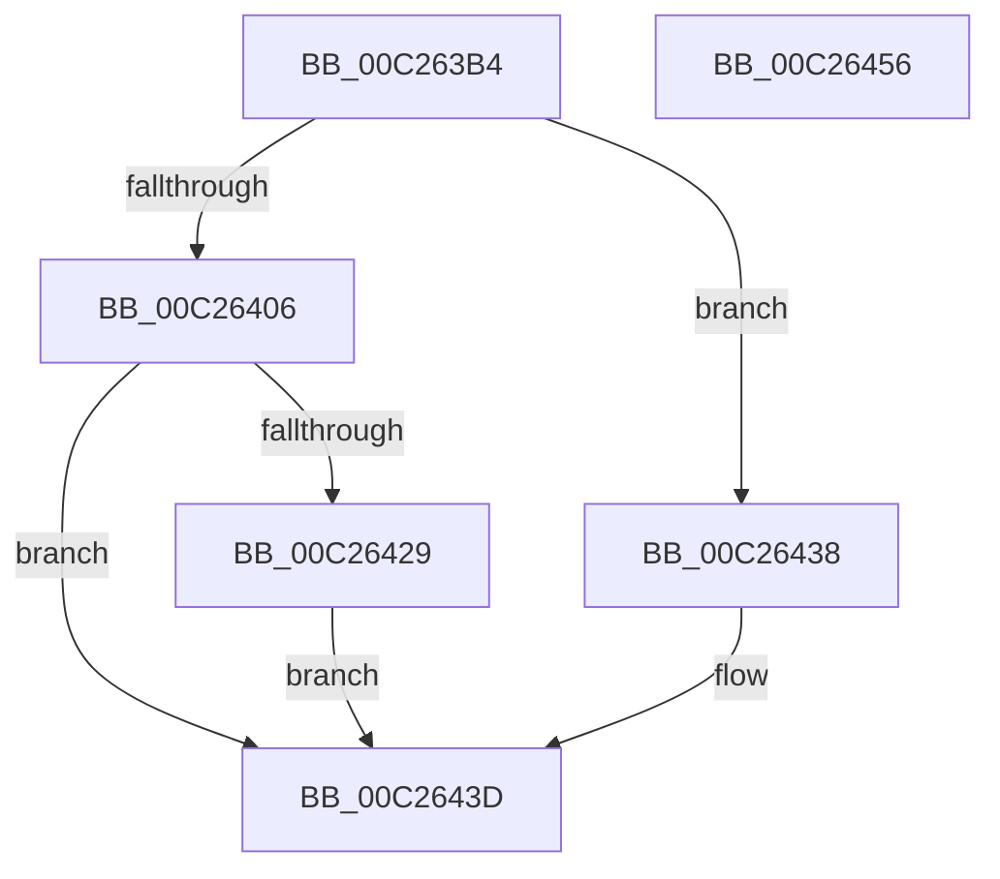

# EmpInfParseGetGuidFromName

- RVA: `0x00C263B4`–`0x00C26457` (길이 `163` bytes)
- VA: `0x0000000140C263B4`
- 실행 섹션: `INIT`
- PDB 이름 있음: `예`; PDB Function 태그: `아니요`
- unwind 정보 RVA: `0x000C5C10`
- 디코드: `39`개 명령, `163/163` bytes 표시
- 미해석 바이트: `0` (있으면 어셈블리에 `.byte`로 보존)

> 이 문서는 커널 이미지의 기계어와 PDB 기호를 분석해 생성했습니다. 4번과 5번은 함수 원형과 자료형을 바이너리 사용 방식에서 추정한 C 해석이며 원본 소스 복구 결과는 아닙니다.

## 1. Dependencies

- 직접 호출 지점: **5**; 고유 호출 대상: **5**
- 직접 호출자로 확인된 함수: **4**
- RIP 상대 이미지 참조: **1**

### Outgoing calls
- `0x00C263FC` → [EmpInfParseGetValueFromSectionAndKeyName](EmpInfParseGetValueFromSectionAndKeyName_function_00C264B4.md) (function, `0x00C264B4`)
- `0x00C2640E` → [RtlInitAnsiString](../../text/47/RtlInitAnsiString_function_00470F40.md) (function, `0x00470F40`)
- `0x00C26420` → [RtlAnsiStringToUnicodeString](../../page/90/RtlAnsiStringToUnicodeString_function_0090BEA0.md) (function, `0x0090BEA0`)
- `0x00C26431` → [RtlGUIDFromString](../../page/8F/RtlGUIDFromString_function_008F1EF0.md) (function, `0x008F1EF0`)
- `0x00C26448` → [_security_check_cookie](../../text/6A/_security_check_cookie_function_006AC640.md) (function, `0x006AC640`)

### Direct callers
- [EmpParseCallbacks](EmpParseCallbacks_function_00C2657C.md) at `0x00C26647`
- [EmpParseCallbacks](EmpParseCallbacks_function_00C2657C.md) at `0x00C26701`
- [EmpParseRuleTerm](EmpParseRuleTerm_function_00C26FC0.md) at `0x00C2703F`
- [EmpParseRuleTerm](EmpParseRuleTerm_function_00C26FC0.md) at `0x00C2707E`
- [EmpParseRules](EmpParseRules_function_00C2745C.md) at `0x00C27538`
- [EmpParseRules](EmpParseRules_function_00C2745C.md) at `0x00C27644`
- [EmpParseTargetRules](EmpParseTargetRules_function_00C27C78.md) at `0x00C27D05`

### Static image references
- `0x00C263BD` → RVA `0x00E0A740` (`.data`; read)

## 2. Other-region calls and transfers

- 다른 실행 섹션으로 향하는 call: **4**
  - `0x00C2640E` → [RtlInitAnsiString](../../text/47/RtlInitAnsiString_function_00470F40.md) (`INIT` → `.text`)
  - `0x00C26420` → [RtlAnsiStringToUnicodeString](../../page/90/RtlAnsiStringToUnicodeString_function_0090BEA0.md) (`INIT` → `PAGE`)
  - `0x00C26431` → [RtlGUIDFromString](../../page/8F/RtlGUIDFromString_function_008F1EF0.md) (`INIT` → `PAGE`)
  - `0x00C26448` → [_security_check_cookie](../../text/6A/_security_check_cookie_function_006AC640.md) (`INIT` → `.text`)
- 별도 외부 분기/꼬리 이동을 확인하지 못했습니다.

## 3. Assembly (complete function range)

```asm
00C263B4  40 53                           push rbx
00C263B6  48 81 EC B0 00 00 00            sub rsp, 0xb0
00C263BD  48 8B 05 7C 43 1E 00            mov rax, qword ptr [rip + 0x1e437c]
00C263C4  48 33 C4                        xor rax, rsp
00C263C7  48 89 84 24 A0 00 00 00         mov qword ptr [rsp + 0xa0], rax
00C263CF  48 83 64 24 20 00               and qword ptr [rsp + 0x20], 0
00C263D5  48 8D 44 24 50                  lea rax, [rsp + 0x50]
00C263DA  0F 57 C9                        xorps xmm1, xmm1
00C263DD  0F 57 C0                        xorps xmm0, xmm0
00C263E0  0F 11 4C 24 30                  movups xmmword ptr [rsp + 0x30], xmm1
00C263E5  48 89 44 24 38                  mov qword ptr [rsp + 0x38], rax
00C263EA  49 8B D9                        mov rbx, r9
00C263ED  B8 4E 00 00 00                  mov eax, 0x4e
00C263F2  66 89 44 24 32                  mov word ptr [rsp + 0x32], ax
00C263F7  0F 11 44 24 40                  movups xmmword ptr [rsp + 0x40], xmm0
00C263FC  E8 B3 00 00 00                  call 0x140c264b4
00C26401  48 85 C0                        test rax, rax
00C26404  74 32                           je 0x140c26438
00C26406  48 8B D0                        mov rdx, rax
00C26409  48 8D 4C 24 40                  lea rcx, [rsp + 0x40]
00C2640E  E8 2D AB 84 FF                  call 0x140470f40
00C26413  45 33 C0                        xor r8d, r8d
00C26416  48 8D 54 24 40                  lea rdx, [rsp + 0x40]
00C2641B  48 8D 4C 24 30                  lea rcx, [rsp + 0x30]
00C26420  E8 7B 5A CE FF                  call 0x14090bea0
00C26425  85 C0                           test eax, eax
00C26427  78 14                           js 0x140c2643d
00C26429  48 8B D3                        mov rdx, rbx
00C2642C  48 8D 4C 24 30                  lea rcx, [rsp + 0x30]
00C26431  E8 BA BA CC FF                  call 0x1408f1ef0
00C26436  EB 05                           jmp 0x140c2643d
00C26438  B8 25 02 00 C0                  mov eax, 0xc0000225
00C2643D  48 8B 8C 24 A0 00 00 00         mov rcx, qword ptr [rsp + 0xa0]
00C26445  48 33 CC                        xor rcx, rsp
00C26448  E8 F3 61 A8 FF                  call 0x1406ac640
00C2644D  48 81 C4 B0 00 00 00            add rsp, 0xb0
00C26454  5B                              pop rbx
00C26455  C3                              ret
00C26456  CC                              int3
```

## 4. C-style interpretation (structured pseudocode)

```c
__int64 __fastcall EmpInfParseGetGuidFromName(__int64 a1, __int64 a2, int a3, __int64 a4)
{
    __int64 result;
    __int64 v_rsp;
    unsigned __int64 v_stack_m18;
    unsigned __int64 v_stack_m68;
    unsigned __int64 v_stack_m78;
    unsigned __int64 v_stack_m80;
    unsigned __int16 v_stack_m86;
    unsigned __int64 v_stack_m88;
    unsigned __int64 v_stack_m98;

    v_rsp = (v_rsp) - (176);
    result = (*(unsigned __int64 *)(v_rip + 1983356)) ^ (v_rsp);
    v_stack_m18 = result;
    v_stack_m88 = v_xmm1;
    v_stack_m80 = v_stack_m68;
    v_stack_m86 = 78;
    v_stack_m78 = v_xmm0;
    result = EmpInfParseGetValueFromSectionAndKeyName(a1, a2, a3, a4);
    if (result == 0) goto loc_00C26438;
    result = RtlInitAnsiString(v_stack_m78, result, a3, a4);
    a3 = 0;
    result = RtlAnsiStringToUnicodeString(v_stack_m88, v_stack_m78, a3, a4);
    if (sign_flag) goto loc_00C2643D;
    result = RtlGUIDFromString(v_stack_m88, a4, a3, a4);
    goto loc_00C2643D;
loc_00C26438:
loc_00C2643D:
    a1 = (v_stack_m18) ^ (v_rsp);
    result = _security_check_cookie(a1, a4, a3, a4);
    v_rsp = (v_rsp) + (176);
    return result;
}
```

## 5. (Beta) C Style

```c
int64_t EmpInfParseGetGuidFromName(int64_t Arg1, int64_t Arg2, int32_t Arg3, int64_t Arg4)
{
    int64_t result;
    int64_t local_rsp;
    uint64_t v_stack_m18;
    uint64_t v_stack_m68;
    uint64_t v_stack_m78;
    uint64_t v_stack_m80;
    uint16_t v_stack_m86;
    uint64_t v_stack_m88;
    uint64_t v_stack_m98;

    local_rsp = (local_rsp) - (176);
    result = (*(uint64_t *)(v_rip + 0x1E437C)) ^ (local_rsp);
    v_stack_m18 = result;
    v_stack_m88 = v_xmm1;
    v_stack_m80 = v_stack_m68;
    v_stack_m86 = 78;
    v_stack_m78 = v_xmm0;
    result = EmpInfParseGetValueFromSectionAndKeyName(Arg1, Arg2, Arg3, Arg4);
    if (result == 0) goto loc_00C26438;
    result = RtlInitAnsiString(v_stack_m78, result, Arg3, Arg4);
    Arg3 = 0;
    result = RtlAnsiStringToUnicodeString(v_stack_m88, v_stack_m78, Arg3, Arg4);
    if (sign_flag) goto loc_00C2643D;
    result = RtlGUIDFromString(v_stack_m88, Arg4, Arg3, Arg4);
    goto loc_00C2643D;
loc_00C26438:
loc_00C2643D:
    Arg1 = (v_stack_m18) ^ (local_rsp);
    result = _security_check_cookie(Arg1, Arg4, Arg3, Arg4);
    local_rsp = (local_rsp) + (176);
    return result;
}
```

## 6. Execution-region graph

[열기: 2D/3D 그래프와 함수 탐색 컨트롤 패널](../../../control-panel.html?section=init&rva=0x00C263B4&view=graph)

- 2D 그래프는 위에서 아래로 흐르고, 3D 그래프는 빈 공간을 드래그해 회전합니다. Shift+드래그는 이동, 휠은 확대·축소, 함수 노드 선택은 대상 보고서 이동입니다.

### Static fallback


