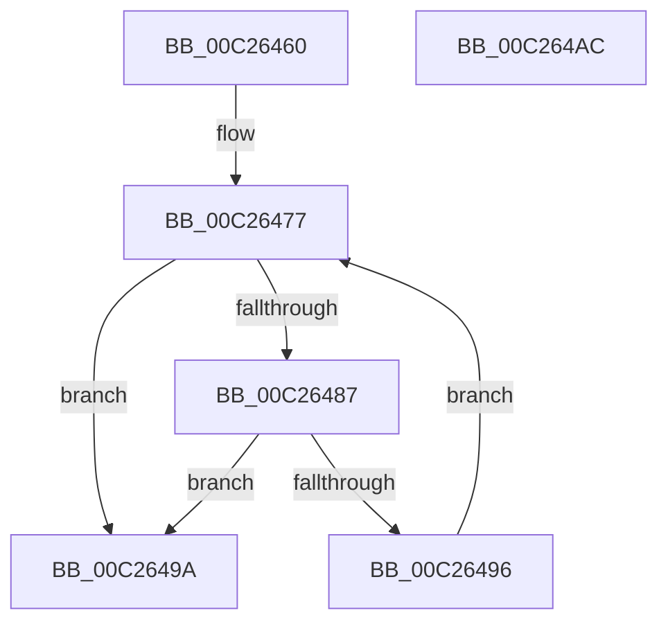

# EmpInfParseGetSectionLineCount

- RVA: `0x00C26460`–`0x00C264AD` (길이 `77` bytes)
- VA: `0x0000000140C26460`
- 실행 섹션: `INIT`
- PDB 이름 있음: `예`; PDB Function 태그: `아니요`
- unwind 정보 RVA: `0x00060BC4`
- 디코드: `26`개 명령, `77/77` bytes 표시
- 미해석 바이트: `0` (있으면 어셈블리에 `.byte`로 보존)

> 이 문서는 커널 이미지의 기계어와 PDB 기호를 분석해 생성했습니다. 4번과 5번은 함수 원형과 자료형을 바이너리 사용 방식에서 추정한 C 해석이며 원본 소스 복구 결과는 아닙니다.

## 1. Dependencies

- 직접 호출 지점: **2**; 고유 호출 대상: **2**
- 직접 호출자로 확인된 함수: **5**
- RIP 상대 이미지 참조: **0**

### Outgoing calls
- `0x00C2647D` → [CmpSearchSectionByName](CmpSearchSectionByName_function_00C28CE0.md) (function, `0x00C28CE0`)
- `0x00C2648C` → [CmpSearchLineInSectionByIndex](CmpSearchLineInSectionByIndex_function_00C28CB4.md) (function, `0x00C28CB4`)

### Direct callers
- [EmpParseCallbacks](EmpParseCallbacks_function_00C2657C.md) at `0x00C265B7`
- [EmpParseEntryTypes](EmpParseEntryTypes_function_00C267B4.md) at `0x00C2680B`
- [EmpParseRules](EmpParseRules_function_00C2745C.md) at `0x00C274A2`
- [EmpParseStrings](EmpParseStrings_function_00C277E0.md) at `0x00C27805`
- [EmpParseTargetRules](EmpParseTargetRules_function_00C27C78.md) at `0x00C27CB7`

### Static image references
- 디코드된 RIP-relative 메모리 참조가 없습니다.

## 2. Other-region calls and transfers

- 다른 실행 섹션으로 향하는 call: **0**
- 별도 외부 분기/꼬리 이동을 확인하지 못했습니다.

## 3. Assembly (complete function range)

```asm
00C26460  48 89 5C 24 08                  mov qword ptr [rsp + 8], rbx
00C26465  48 89 74 24 10                  mov qword ptr [rsp + 0x10], rsi
00C2646A  57                              push rdi
00C2646B  48 83 EC 20                     sub rsp, 0x20
00C2646F  48 8B FA                        mov rdi, rdx
00C26472  48 8B F1                        mov rsi, rcx
00C26475  33 DB                           xor ebx, ebx
00C26477  48 8B D7                        mov rdx, rdi
00C2647A  48 8B CE                        mov rcx, rsi
00C2647D  E8 5E 28 00 00                  call 0x140c28ce0
00C26482  48 85 C0                        test rax, rax
00C26485  74 13                           je 0x140c2649a
00C26487  8B D3                           mov edx, ebx
00C26489  48 8B C8                        mov rcx, rax
00C2648C  E8 23 28 00 00                  call 0x140c28cb4
00C26491  48 85 C0                        test rax, rax
00C26494  74 04                           je 0x140c2649a
00C26496  FF C3                           inc ebx
00C26498  EB DD                           jmp 0x140c26477
00C2649A  48 8B 74 24 38                  mov rsi, qword ptr [rsp + 0x38]
00C2649F  8B C3                           mov eax, ebx
00C264A1  48 8B 5C 24 30                  mov rbx, qword ptr [rsp + 0x30]
00C264A6  48 83 C4 20                     add rsp, 0x20
00C264AA  5F                              pop rdi
00C264AB  C3                              ret
00C264AC  CC                              int3
```

## 4. C-style interpretation (structured pseudocode)

```c
__int64 __fastcall EmpInfParseGetSectionLineCount(__int64 a1, __int64 a2)
{
    __int64 result;
    __int64 v_rbx;
    __int64 v_rsp;
    unsigned __int64 v_stack_p10;
    unsigned __int64 v_stack_p8;

    v_stack_p8 = v_rbx;
    v_stack_p10 = v_rsi;
    v_rsp = (v_rsp) - (32);
    v_rbx = 0;
loc_00C26477:
    result = CmpSearchSectionByName(a1, a2, a3, a4);
    if (result == 0) goto loc_00C2649A;
    result = CmpSearchLineInSectionByIndex(result, 0, a3, a4);
    if (result == 0) goto loc_00C2649A;
    v_rbx = (unsigned int)((v_rbx) + 1);
    goto loc_00C26477;
loc_00C2649A:
    v_rsp = (v_rsp) + (32);
    return (unsigned int)((unsigned int)(v_rbx));
}
```

## 5. (Beta) C Style

```c
int64_t EmpInfParseGetSectionLineCount(int64_t Arg1, int64_t Arg2)
{
    int64_t result;
    int64_t local_rbx;
    int64_t local_rsp;
    uint64_t v_stack_p10;
    uint64_t v_stack_p8;

    v_stack_p8 = local_rbx;
    v_stack_p10 = local_rsi;
    local_rsp = (local_rsp) - (32);
    local_rbx = 0;
loc_00C26477:
    result = CmpSearchSectionByName(Arg1, Arg2, a3, a4);
    if (result == 0) goto loc_00C2649A;
    result = CmpSearchLineInSectionByIndex(result, 0, a3, a4);
    if (result == 0) goto loc_00C2649A;
    local_rbx = (uint32_t)((local_rbx) + 1);
    goto loc_00C26477;
loc_00C2649A:
    local_rsp = (local_rsp) + (32);
    return (uint32_t)((uint32_t)(local_rbx));
}
```

## 6. Execution-region graph

[열기: 2D/3D 그래프와 함수 탐색 컨트롤 패널](../../../control-panel.html?section=init&rva=0x00C26460&view=graph)

- 2D 그래프는 위에서 아래로 흐르고, 3D 그래프는 빈 공간을 드래그해 회전합니다. Shift+드래그는 이동, 휠은 확대·축소, 함수 노드 선택은 대상 보고서 이동입니다.

### Static fallback


