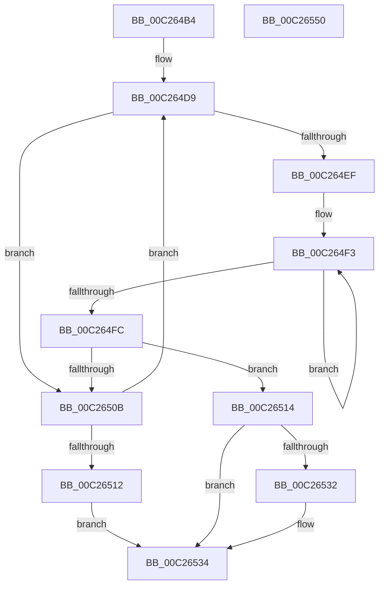

# EmpInfParseGetValueFromSectionAndKeyName

- RVA: `0x00C264B4`–`0x00C26551` (길이 `157` bytes)
- VA: `0x0000000140C264B4`
- 실행 섹션: `INIT`
- PDB 이름 있음: `예`; PDB Function 태그: `아니요`
- unwind 정보 RVA: `0x00060300`
- 디코드: `52`개 명령, `157/157` bytes 표시
- 미해석 바이트: `0` (있으면 어셈블리에 `.byte`로 보존)

> 이 문서는 커널 이미지의 기계어와 PDB 기호를 분석해 생성했습니다. 4번과 5번은 함수 원형과 자료형을 바이너리 사용 방식에서 추정한 C 해석이며 원본 소스 복구 결과는 아닙니다.

## 1. Dependencies

- 직접 호출 지점: **3**; 고유 호출 대상: **3**
- 직접 호출자로 확인된 함수: **3**
- RIP 상대 이미지 참조: **0**

### Outgoing calls
- `0x00C264E2` → [CmpGetKeyName](CmpGetKeyName_function_00C2838C.md) (function, `0x00C2838C`)
- `0x00C26502` → [strnicmp](../../text/4F/strnicmp_function_004FFE30.md) (function, `0x004FFE30`)
- `0x00C26520` → [CmpGetSectionLineIndex](CmpGetSectionLineIndex_function_00C283C4.md) (function, `0x00C283C4`)

### Direct callers
- [EmpInfParseGetGuidFromName](EmpInfParseGetGuidFromName_function_00C263B4.md) at `0x00C263FC`
- [EmpParseRuleExpression](EmpParseRuleExpression_function_00C26A70.md) at `0x00C26AC5`
- [EmpParseTargetRuleStringIndexList](EmpParseTargetRuleStringIndexList_function_00C2795C.md) at `0x00C27B4B`

### Static image references
- 디코드된 RIP-relative 메모리 참조가 없습니다.

## 2. Other-region calls and transfers

- 다른 실행 섹션으로 향하는 call: **1**
  - `0x00C26502` → [strnicmp](../../text/4F/strnicmp_function_004FFE30.md) (`INIT` → `.text`)
- 별도 외부 분기/꼬리 이동을 확인하지 못했습니다.

## 3. Assembly (complete function range)

```asm
00C264B4  48 89 5C 24 08                  mov qword ptr [rsp + 8], rbx
00C264B9  48 89 6C 24 10                  mov qword ptr [rsp + 0x10], rbp
00C264BE  48 89 74 24 18                  mov qword ptr [rsp + 0x18], rsi
00C264C3  57                              push rdi
00C264C4  41 56                           push r14
00C264C6  41 57                           push r15
00C264C8  48 83 EC 20                     sub rsp, 0x20
00C264CC  33 F6                           xor esi, esi
00C264CE  4D 8B F8                        mov r15, r8
00C264D1  33 DB                           xor ebx, ebx
00C264D3  48 8B EA                        mov rbp, rdx
00C264D6  4C 8B F1                        mov r14, rcx
00C264D9  44 8B C3                        mov r8d, ebx
00C264DC  48 8B D5                        mov rdx, rbp
00C264DF  49 8B CE                        mov rcx, r14
00C264E2  E8 A5 1E 00 00                  call 0x140c2838c
00C264E7  48 8B F8                        mov rdi, rax
00C264EA  48 85 C0                        test rax, rax
00C264ED  74 1C                           je 0x140c2650b
00C264EF  49 83 C8 FF                     or r8, 0xffffffffffffffff
00C264F3  49 FF C0                        inc r8
00C264F6  43 38 34 07                     cmp byte ptr [r15 + r8], sil
00C264FA  75 F7                           jne 0x140c264f3
00C264FC  49 8B D7                        mov rdx, r15
00C264FF  48 8B CF                        mov rcx, rdi
00C26502  E8 29 99 8D FF                  call 0x1404ffe30
00C26507  85 C0                           test eax, eax
00C26509  74 09                           je 0x140c26514
00C2650B  FF C3                           inc ebx
00C2650D  48 85 FF                        test rdi, rdi
00C26510  75 C7                           jne 0x140c264d9
00C26512  EB 20                           jmp 0x140c26534
00C26514  45 33 C9                        xor r9d, r9d
00C26517  44 8B C3                        mov r8d, ebx
00C2651A  48 8B D5                        mov rdx, rbp
00C2651D  49 8B CE                        mov rcx, r14
00C26520  E8 9F 1E 00 00                  call 0x140c283c4
00C26525  48 8B 4C 24 60                  mov rcx, qword ptr [rsp + 0x60]
00C2652A  48 8B F0                        mov rsi, rax
00C2652D  48 85 C9                        test rcx, rcx
00C26530  74 02                           je 0x140c26534
00C26532  89 19                           mov dword ptr [rcx], ebx
00C26534  48 8B 5C 24 40                  mov rbx, qword ptr [rsp + 0x40]
00C26539  48 8B C6                        mov rax, rsi
00C2653C  48 8B 74 24 50                  mov rsi, qword ptr [rsp + 0x50]
00C26541  48 8B 6C 24 48                  mov rbp, qword ptr [rsp + 0x48]
00C26546  48 83 C4 20                     add rsp, 0x20
00C2654A  41 5F                           pop r15
00C2654C  41 5E                           pop r14
00C2654E  5F                              pop rdi
00C2654F  C3                              ret
00C26550  CC                              int3
```

## 4. C-style interpretation (structured pseudocode)

```c
__int64 __fastcall EmpInfParseGetValueFromSectionAndKeyName(__int64 a1, __int64 a2, __int64 a3, int a4, __int64 a5)
{
    __int64 result;
    __int64 v_rbx;
    __int64 v_rsi;
    __int64 v_rsp;
    unsigned __int64 v_stack_p10;
    unsigned __int64 v_stack_p18;
    unsigned __int64 v_stack_p8;

    v_stack_p8 = v_rbx;
    v_stack_p10 = v_rbp;
    v_stack_p18 = v_rsi;
    v_rsp = (v_rsp) - (32);
    v_rsi = 0;
    v_rbx = 0;
loc_00C264D9:
    result = CmpGetKeyName(a1, a2, 0, a4);
    if (result == 0) goto loc_00C2650B;
    a3 = (0) | (-1);
loc_00C264F3:
    a3 = (a3) + 1;
    if ((*(unsigned __int8 *)(a3 + a3 * 1)) != 0) goto loc_00C264F3;
    result = strnicmp(result, a3, a3, a4);
    if ((unsigned int)(result) == 0) goto loc_00C26514;
loc_00C2650B:
    v_rbx = (unsigned int)((v_rbx) + 1);
    if (result != 0) goto loc_00C264D9;
    goto loc_00C26534;
loc_00C26514:
    a4 = 0;
    result = CmpGetSectionLineIndex(a1, a2, (unsigned int)((unsigned int)(v_rbx)), a4);
    if (a5 != 0) {
        *(unsigned int *)(a5) = (unsigned int)(v_rbx);
    }
    v_rsp = (v_rsp) + (32);
    return result;
}
```

## 5. (Beta) C Style

```c
int64_t EmpInfParseGetValueFromSectionAndKeyName(int64_t Arg1, int64_t Arg2, void *Arg3, int32_t Arg4, int64_t Arg5)
{
    uint8_t *arg3 = (uint8_t *)Arg3;

    int64_t result;
    int64_t local_rbx;
    int64_t local_rsi;
    int64_t local_rsp;
    uint64_t v_stack_p10;
    uint64_t v_stack_p18;
    uint64_t v_stack_p8;

    v_stack_p8 = local_rbx;
    v_stack_p10 = local_rbp;
    v_stack_p18 = local_rsi;
    local_rsp = (local_rsp) - (32);
    local_rsi = 0;
    local_rbx = 0;
loc_00C264D9:
    result = CmpGetKeyName(Arg1, Arg2, 0, Arg4);
    if (result == 0) goto loc_00C2650B;
    Arg3 = (0) | (-1);
loc_00C264F3:
    Arg3 = (Arg3) + 1;
    if ((*(uint8_t *)(arg3 + arg3 * 1)) != 0) goto loc_00C264F3;
    result = strnicmp(result, Arg3, Arg3, Arg4);
    if ((uint32_t)(result) == 0) goto loc_00C26514;
loc_00C2650B:
    local_rbx = (uint32_t)((local_rbx) + 1);
    if (result != 0) goto loc_00C264D9;
    goto loc_00C26534;
loc_00C26514:
    Arg4 = 0;
    result = CmpGetSectionLineIndex(Arg1, Arg2, (uint32_t)((uint32_t)(local_rbx)), Arg4);
    if (Arg5 != 0) {
        *(uint32_t *)(Arg5) = (uint32_t)(local_rbx);
    }
    local_rsp = (local_rsp) + (32);
    return result;
}
```

### 관측된 메모리 오프셋

구조체 형식이 확인되지 않은 접근은 인자 기준의 오프셋으로만 기록했습니다.

| 기준 인자 | 오프셋 표현 | 폭 (bit) | 접근 |
|---|---:|---:|---|
| `Arg3` | `+ 0x0 + r8*1` | `8` | `R` |

## 6. Execution-region graph

[열기: 2D/3D 그래프와 함수 탐색 컨트롤 패널](../../../control-panel.html?section=init&rva=0x00C264B4&view=graph)

- 2D 그래프는 위에서 아래로 흐르고, 3D 그래프는 빈 공간을 드래그해 회전합니다. Shift+드래그는 이동, 휠은 확대·축소, 함수 노드 선택은 대상 보고서 이동입니다.

### Static fallback


