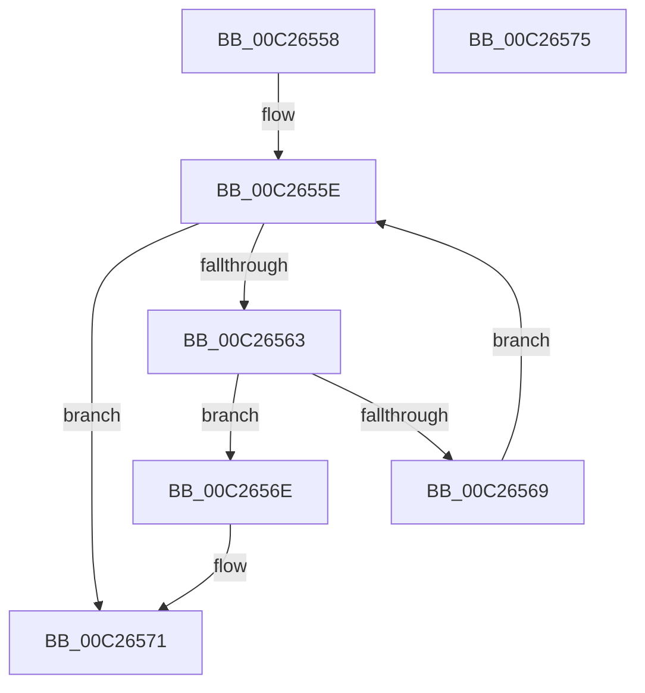

# EmpInfParseSearchDependencyList

- RVA: `0x00C26558`–`0x00C26576` (길이 `30` bytes)
- VA: `0x0000000140C26558`
- 실행 섹션: `INIT`
- PDB 이름 있음: `예`; PDB Function 태그: `아니요`
- unwind 정보 RVA: `0x000DB714`
- 디코드: `12`개 명령, `30/30` bytes 표시
- 미해석 바이트: `0` (있으면 어셈블리에 `.byte`로 보존)

> 이 문서는 커널 이미지의 기계어와 PDB 기호를 분석해 생성했습니다. 4번과 5번은 함수 원형과 자료형을 바이너리 사용 방식에서 추정한 C 해석이며 원본 소스 복구 결과는 아닙니다.

## 1. Dependencies

- 직접 호출 지점: **0**; 고유 호출 대상: **0**
- 직접 호출자로 확인된 함수: **2**
- RIP 상대 이미지 참조: **0**

### Outgoing calls
- 직접 디코드된 call 명령이 없습니다.

### Direct callers
- [EmpParseRuleExpression](EmpParseRuleExpression_function_00C26A70.md) at `0x00C26D3E`
- [EmpParseRuleExpression](EmpParseRuleExpression_function_00C26A70.md) at `0x00C26DAA`
- [EmpParseRules](EmpParseRules_function_00C2745C.md) at `0x00C27671`

### Static image references
- 디코드된 RIP-relative 메모리 참조가 없습니다.

## 2. Other-region calls and transfers

- 다른 실행 섹션으로 향하는 call: **0**
- 별도 외부 분기/꼬리 이동을 확인하지 못했습니다.

## 3. Assembly (complete function range)

```asm
00C26558  48 8B 01                        mov rax, qword ptr [rcx]
00C2655B  45 33 C0                        xor r8d, r8d
00C2655E  48 85 C0                        test rax, rax
00C26561  74 0E                           je 0x140c26571
00C26563  48 39 50 F8                     cmp qword ptr [rax - 8], rdx
00C26567  74 05                           je 0x140c2656e
00C26569  48 8B 00                        mov rax, qword ptr [rax]
00C2656C  EB F0                           jmp 0x140c2655e
00C2656E  41 B0 01                        mov r8b, 1
00C26571  41 8A C0                        mov al, r8b
00C26574  C3                              ret
00C26575  CC                              int3
```

## 4. C-style interpretation (structured pseudocode)

```c
__int64 __fastcall EmpInfParseSearchDependencyList(__int64 a1, __int64 a2, int a3)
{
    a3 = 0;
loc_00C2655E:
    if (*(unsigned __int64 *)(a1) == 0) goto loc_00C26571;
    if ((*(unsigned __int64 *)(*(unsigned __int64 *)(a1) - 8)) == a2) goto loc_00C2656E;
    goto loc_00C2655E;
loc_00C2656E:
loc_00C26571:
    return 1;
}
```

## 5. (Beta) C Style

```c
int64_t EmpInfParseSearchDependencyList(void *Arg1, int64_t Arg2, int32_t Arg3)
{
    uint8_t *arg1 = (uint8_t *)Arg1;

    Arg3 = 0;
loc_00C2655E:
    if (*(uint64_t *)(arg1) == 0) goto loc_00C26571;
    if ((*(uint64_t *)(*(uint64_t *)(arg1) - 0x8)) == Arg2) goto loc_00C2656E;
    goto loc_00C2655E;
loc_00C2656E:
loc_00C26571:
    return 1;
}
```

### 관측된 메모리 오프셋

구조체 형식이 확인되지 않은 접근은 인자 기준의 오프셋으로만 기록했습니다.

| 기준 인자 | 오프셋 표현 | 폭 (bit) | 접근 |
|---|---:|---:|---|
| `Arg1` | `+ 0x0` | `64` | `R` |

## 6. Execution-region graph

[열기: 2D/3D 그래프와 함수 탐색 컨트롤 패널](../../../control-panel.html?section=init&rva=0x00C26558&view=graph)

- 2D 그래프는 위에서 아래로 흐르고, 3D 그래프는 빈 공간을 드래그해 회전합니다. Shift+드래그는 이동, 휠은 확대·축소, 함수 노드 선택은 대상 보고서 이동입니다.

### Static fallback


