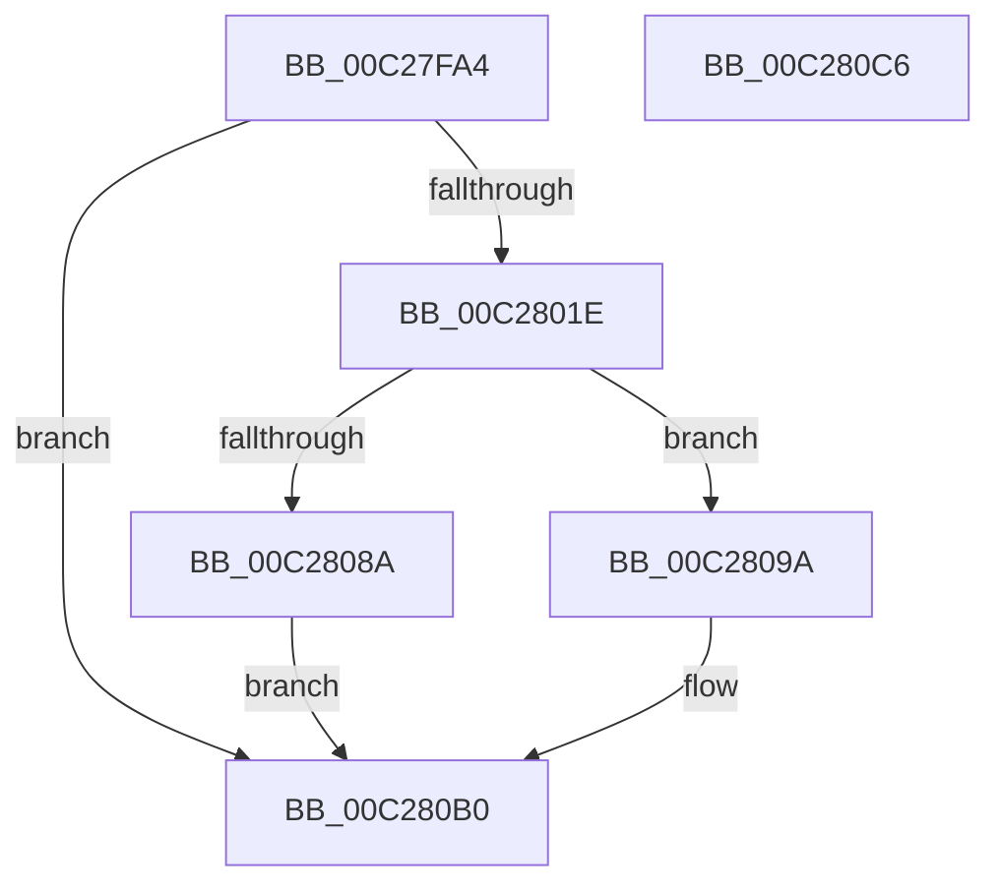

# EmpMapPhysicalAddress

- RVA: `0x00C27FA4`–`0x00C280C7` (길이 `291` bytes)
- VA: `0x0000000140C27FA4`
- 실행 섹션: `INIT`
- PDB 이름 있음: `예`; PDB Function 태그: `아니요`
- unwind 정보 RVA: `0x000C5C28`
- 디코드: `72`개 명령, `291/291` bytes 표시
- 미해석 바이트: `0` (있으면 어셈블리에 `.byte`로 보존)

> 이 문서는 커널 이미지의 기계어와 PDB 기호를 분석해 생성했습니다. 4번과 5번은 함수 원형과 자료형을 바이너리 사용 방식에서 추정한 C 해석이며 원본 소스 복구 결과는 아닙니다.

## 1. Dependencies

- 직접 호출 지점: **6**; 고유 호출 대상: **6**
- 직접 호출자로 확인된 함수: **1**
- RIP 상대 이미지 참조: **2**

### Outgoing calls
- `0x00C27FE0` → [RtlInitUnicodeString](../../text/42/RtlInitUnicodeString_function_0042A780.md) (function, `0x0042A780`)
- `0x00C28011` → [ZwOpenSection](../../text/6A/ZwOpenSection_function_006AD7B0.md) (function, `0x006AD7B0`)
- `0x00C2803F` → [KiStackAttachProcess](../../text/21/KiStackAttachProcess_function_00216820.md) (function, `0x00216820`)
- `0x00C28081` → [ZwMapViewOfSection](../../text/6A/ZwMapViewOfSection_function_006AD5D0.md) (function, `0x006AD5D0`)
- `0x00C280A0` → [KiUnstackDetachProcess](../../text/21/KiUnstackDetachProcess_function_00217D30.md) (function, `0x00217D30`)
- `0x00C280A8` → [ZwClose](../../text/6A/ZwClose_function_006AD2B0.md) (function, `0x006AD2B0`)

### Direct callers
- [EmpCacheBiosDate](../C7/EmpCacheBiosDate_function_00C73258.md) at `0x00C732BA`

### Static image references
- `0x00C27FBF` → RVA `0x00C79720` (` ?? ::PBOPGDP::`string'`; read)
- `0x00C28024` → RVA `0x00FC6AB0` (`ALMOSTRO`; read)

## 2. Other-region calls and transfers

- 다른 실행 섹션으로 향하는 call: **6**
  - `0x00C27FE0` → [RtlInitUnicodeString](../../text/42/RtlInitUnicodeString_function_0042A780.md) (`INIT` → `.text`)
  - `0x00C28011` → [ZwOpenSection](../../text/6A/ZwOpenSection_function_006AD7B0.md) (`INIT` → `.text`)
  - `0x00C2803F` → [KiStackAttachProcess](../../text/21/KiStackAttachProcess_function_00216820.md) (`INIT` → `.text`)
  - `0x00C28081` → [ZwMapViewOfSection](../../text/6A/ZwMapViewOfSection_function_006AD5D0.md) (`INIT` → `.text`)
  - `0x00C280A0` → [KiUnstackDetachProcess](../../text/21/KiUnstackDetachProcess_function_00217D30.md) (`INIT` → `.text`)
  - `0x00C280A8` → [ZwClose](../../text/6A/ZwClose_function_006AD2B0.md) (`INIT` → `.text`)
- 별도 외부 분기/꼬리 이동을 확인하지 못했습니다.

## 3. Assembly (complete function range)

```asm
00C27FA4  48 89 5C 24 10                  mov qword ptr [rsp + 0x10], rbx
00C27FA9  48 89 4C 24 08                  mov qword ptr [rsp + 8], rcx
00C27FAE  55                              push rbp
00C27FAF  56                              push rsi
00C27FB0  57                              push rdi
00C27FB1  48 8D 6C 24 C1                  lea rbp, [rsp - 0x3f]
00C27FB6  48 81 EC A0 00 00 00            sub rsp, 0xa0
00C27FBD  33 DB                           xor ebx, ebx
00C27FBF  48 8D 15 5A 17 05 00            lea rdx, [rip + 0x5175a]
00C27FC6  0F 57 C0                        xorps xmm0, xmm0
00C27FC9  89 5D 0B                        mov dword ptr [rbp + 0xb], ebx
00C27FCC  48 8D 4D F7                     lea rcx, [rbp - 9]
00C27FD0  89 5D 23                        mov dword ptr [rbp + 0x23], ebx
00C27FD3  0F 11 45 F7                     movups xmmword ptr [rbp - 9], xmm0
00C27FD7  49 89 19                        mov qword ptr [r9], rbx
00C27FDA  49 8B F1                        mov rsi, r9
00C27FDD  49 8B F8                        mov rdi, r8
00C27FE0  E8 9B 27 80 FF                  call 0x14042a780
00C27FE5  48 8D 45 F7                     lea rax, [rbp - 9]
00C27FE9  C7 45 07 30 00 00 00            mov dword ptr [rbp + 7], 0x30
00C27FF0  0F 57 C0                        xorps xmm0, xmm0
00C27FF3  48 89 45 17                     mov qword ptr [rbp + 0x17], rax
00C27FF7  4C 8D 45 07                     lea r8, [rbp + 7]
00C27FFB  48 89 5D 0F                     mov qword ptr [rbp + 0xf], rbx
00C27FFF  8D 53 04                        lea edx, [rbx + 4]
00C28002  C7 45 1F 40 02 00 00            mov dword ptr [rbp + 0x1f], 0x240
00C28009  48 8B CF                        mov rcx, rdi
00C2800C  F3 0F 7F 45 27                  movdqu xmmword ptr [rbp + 0x27], xmm0
00C28011  E8 9A 57 A8 FF                  call 0x1406ad7b0
00C28016  85 C0                           test eax, eax
00C28018  0F 88 92 00 00 00               js 0x140c280b0
00C2801E  4C 8B 45 7F                     mov r8, qword ptr [rbp + 0x7f]
00C28022  33 D2                           xor edx, edx
00C28024  48 8B 0D 85 EA 39 00            mov rcx, qword ptr [rip + 0x39ea85]
00C2802B  48 89 5D 77                     mov qword ptr [rbp + 0x77], rbx
00C2802F  48 C7 45 5F 08 00 00 00         mov qword ptr [rbp + 0x5f], 8
00C28037  48 C7 45 EF 00 F0 0F 00         mov qword ptr [rbp - 0x11], 0xff000
00C2803F  E8 DC E7 5E FF                  call 0x140216820
00C28044  48 8B 0F                        mov rcx, qword ptr [rdi]
00C28047  48 8D 45 5F                     lea rax, [rbp + 0x5f]
00C2804B  C7 44 24 48 04 00 00 00         mov dword ptr [rsp + 0x48], 4
00C28053  4C 8D 45 77                     lea r8, [rbp + 0x77]
00C28057  89 5C 24 40                     mov dword ptr [rsp + 0x40], ebx
00C2805B  45 33 C9                        xor r9d, r9d
00C2805E  C7 44 24 38 02 00 00 00         mov dword ptr [rsp + 0x38], 2
00C28066  48 83 CA FF                     or rdx, 0xffffffffffffffff
00C2806A  48 89 44 24 30                  mov qword ptr [rsp + 0x30], rax
00C2806F  48 8D 45 EF                     lea rax, [rbp - 0x11]
00C28073  48 89 44 24 28                  mov qword ptr [rsp + 0x28], rax
00C28078  48 8B 45 5F                     mov rax, qword ptr [rbp + 0x5f]
00C2807C  48 89 44 24 20                  mov qword ptr [rsp + 0x20], rax
00C28081  E8 4A 55 A8 FF                  call 0x1406ad5d0
00C28086  85 C0                           test eax, eax
00C28088  78 10                           js 0x140c2809a
00C2808A  48 8B 45 77                     mov rax, qword ptr [rbp + 0x77]
00C2808E  48 89 06                        mov qword ptr [rsi], rax
00C28091  48 8D 98 F5 0F 00 00            lea rbx, [rax + 0xff5]
00C28098  EB 16                           jmp 0x140c280b0
00C2809A  48 8B 4D 7F                     mov rcx, qword ptr [rbp + 0x7f]
00C2809E  33 D2                           xor edx, edx
00C280A0  E8 8B FC 5E FF                  call 0x140217d30
00C280A5  48 8B 0F                        mov rcx, qword ptr [rdi]
00C280A8  E8 03 52 A8 FF                  call 0x1406ad2b0
00C280AD  48 89 1F                        mov qword ptr [rdi], rbx
00C280B0  48 8B C3                        mov rax, rbx
00C280B3  48 8B 9C 24 C8 00 00 00         mov rbx, qword ptr [rsp + 0xc8]
00C280BB  48 81 C4 A0 00 00 00            add rsp, 0xa0
00C280C2  5F                              pop rdi
00C280C3  5E                              pop rsi
00C280C4  5D                              pop rbp
00C280C5  C3                              ret
00C280C6  CC                              int3
```

## 4. C-style interpretation (structured pseudocode)

```c
__int64 __fastcall EmpMapPhysicalAddress(__int64 a1, __int64 a2, __int64 a3, __int64 a4, __int64 a5)
{
    __int64 result;
    __int64 v_rbx;
    __int64 v_rsp;
    unsigned __int64 v_stack_m30;
    unsigned int v_stack_m34;
    unsigned int v_stack_m38;
    unsigned __int64 v_stack_m40;
    unsigned __int64 v_stack_m48;
    unsigned int v_stack_m4C;
    unsigned int v_stack_m50;
    unsigned __int64 v_stack_m57;
    unsigned __int64 v_stack_m60;
    unsigned __int64 v_stack_m68;
    unsigned int v_stack_m70;
    unsigned int v_stack_m78;
    unsigned int v_stack_m80;
    unsigned __int64 v_stack_m88;
    unsigned __int64 v_stack_m90;
    unsigned __int64 v_stack_m98;
    unsigned __int64 v_stack_p10;
    unsigned __int64 v_stack_p20;
    unsigned __int64 v_stack_p8;

    v_stack_p10 = v_rbx;
    v_stack_p8 = a1;
    v_rsp = (v_rsp) - (160);
    v_rbx = 0;
    v_stack_m4C = 0;
    v_stack_m34 = 0;
    v_stack_m60 = v_xmm0;
    *(unsigned __int64 *)(a4) = 0;
    result = RtlInitUnicodeString(v_stack_m60, v_rip + 333658, a3, a4);
    v_stack_m50 = 48;
    v_stack_m40 = v_stack_m60;
    v_stack_m48 = 0;
    v_stack_m38 = 576;
    v_stack_m30 = v_xmm0;
    result = ZwOpenSection(a3, v_rbx + 4, v_stack_m50, a4);
    if (sign_flag) goto loc_00C280B0;
    a2 = 0;
    v_stack_p20 = 0;
    v_stack_p8 = 8;
    v_stack_m68 = 0xFF000ULL;
    result = KiStackAttachProcess(*(unsigned __int64 *)(v_rip + 3795589), a2, a5, a4);
    v_stack_m70 = 4;
    v_stack_m78 = 0;
    a4 = 0;
    v_stack_m80 = 2;
    a2 = (a2) | (-1);
    v_stack_m88 = v_stack_p8;
    v_stack_m90 = v_stack_m68;
    v_stack_m98 = v_stack_p8;
    result = ZwMapViewOfSection(*(unsigned __int64 *)(a3), a2, v_stack_p20, a4);
    if (sign_flag) goto loc_00C2809A;
    *(unsigned __int64 *)(a4) = v_stack_p20;
    goto loc_00C280B0;
loc_00C2809A:
    a2 = 0;
    result = KiUnstackDetachProcess(a5, a2, v_stack_p20, a4);
    result = ZwClose(*(unsigned __int64 *)(a3), a2, v_stack_p20, a4);
    *(unsigned __int64 *)(a3) = v_stack_p20 + 4085;
loc_00C280B0:
    v_rsp = (v_rsp) + (160);
    return v_stack_p20 + 4085;
}
```

## 5. (Beta) C Style

```c
int64_t EmpMapPhysicalAddress(int64_t Arg1, int64_t Arg2, void *Arg3, void *Arg4, int64_t Arg5)
{
    uint8_t *arg3 = (uint8_t *)Arg3;
    uint8_t *arg4 = (uint8_t *)Arg4;

    int64_t result;
    int64_t local_rbx;
    int64_t local_rsp;
    uint64_t v_stack_m30;
    uint32_t v_stack_m34;
    uint32_t v_stack_m38;
    uint64_t v_stack_m40;
    uint64_t v_stack_m48;
    uint32_t v_stack_m4C;
    uint32_t v_stack_m50;
    uint64_t v_stack_m57;
    uint64_t v_stack_m60;
    uint64_t v_stack_m68;
    uint32_t v_stack_m70;
    uint32_t v_stack_m78;
    uint32_t v_stack_m80;
    uint64_t v_stack_m88;
    uint64_t v_stack_m90;
    uint64_t v_stack_m98;
    uint64_t v_stack_p10;
    uint64_t v_stack_p20;
    uint64_t v_stack_p8;

    v_stack_p10 = local_rbx;
    v_stack_p8 = Arg1;
    local_rsp = (local_rsp) - (160);
    local_rbx = 0;
    v_stack_m4C = 0;
    v_stack_m34 = 0;
    v_stack_m60 = v_xmm0;
    *(uint64_t *)(arg4) = 0;
    result = RtlInitUnicodeString(v_stack_m60, v_rip + 333658, Arg3, Arg4);
    v_stack_m50 = 48;
    v_stack_m40 = v_stack_m60;
    v_stack_m48 = 0;
    v_stack_m38 = 576;
    v_stack_m30 = v_xmm0;
    result = ZwOpenSection(Arg3, local_rbx + 4, v_stack_m50, Arg4);
    if (sign_flag) goto loc_00C280B0;
    Arg2 = 0;
    v_stack_p20 = 0;
    v_stack_p8 = 8;
    v_stack_m68 = 0xFF000ULL;
    result = KiStackAttachProcess(*(uint64_t *)(v_rip + 0x39EA85), Arg2, Arg5, Arg4);
    v_stack_m70 = 4;
    v_stack_m78 = 0;
    Arg4 = 0;
    v_stack_m80 = 2;
    Arg2 = (Arg2) | (-1);
    v_stack_m88 = v_stack_p8;
    v_stack_m90 = v_stack_m68;
    v_stack_m98 = v_stack_p8;
    result = ZwMapViewOfSection(*(uint64_t *)(arg3), Arg2, v_stack_p20, Arg4);
    if (sign_flag) goto loc_00C2809A;
    *(uint64_t *)(arg4) = v_stack_p20;
    goto loc_00C280B0;
loc_00C2809A:
    Arg2 = 0;
    result = KiUnstackDetachProcess(Arg5, Arg2, v_stack_p20, Arg4);
    result = ZwClose(*(uint64_t *)(arg3), Arg2, v_stack_p20, Arg4);
    *(uint64_t *)(arg3) = v_stack_p20 + 4085;
loc_00C280B0:
    local_rsp = (local_rsp) + (160);
    return v_stack_p20 + 4085;
}
```

### 관측된 메모리 오프셋

구조체 형식이 확인되지 않은 접근은 인자 기준의 오프셋으로만 기록했습니다.

| 기준 인자 | 오프셋 표현 | 폭 (bit) | 접근 |
|---|---:|---:|---|
| `Arg3` | `+ 0x0` | `64` | `R` |
| `Arg3` | `+ 0x0` | `64` | `W` |
| `Arg4` | `+ 0x0` | `64` | `W` |

## 6. Execution-region graph

[열기: 2D/3D 그래프와 함수 탐색 컨트롤 패널](../../../control-panel.html?section=init&rva=0x00C27FA4&view=graph)

- 2D 그래프는 위에서 아래로 흐르고, 3D 그래프는 빈 공간을 드래그해 회전합니다. Shift+드래그는 이동, 휠은 확대·축소, 함수 노드 선택은 대상 보고서 이동입니다.

### Static fallback


