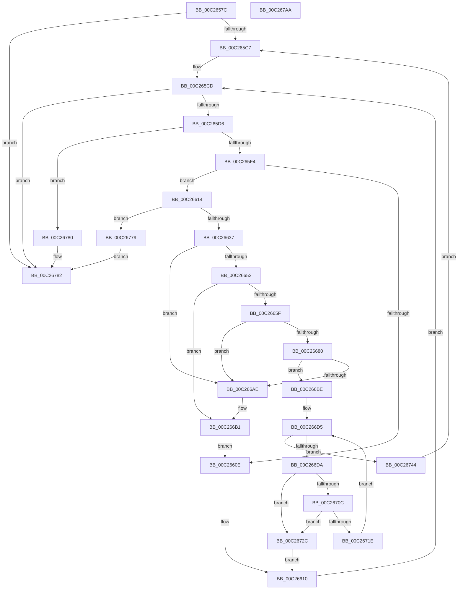

# EmpParseCallbacks

- RVA: `0x00C2657C`–`0x00C267AB` (길이 `559` bytes)
- VA: `0x0000000140C2657C`
- 실행 섹션: `INIT`
- PDB 이름 있음: `예`; PDB Function 태그: `아니요`
- unwind 정보 RVA: `0x000C5B6C`
- 디코드: `151`개 명령, `559/559` bytes 표시
- 미해석 바이트: `0` (있으면 어셈블리에 `.byte`로 보존)

> 이 문서는 커널 이미지의 기계어와 PDB 기호를 분석해 생성했습니다. 4번과 5번은 함수 원형과 자료형을 바이너리 사용 방식에서 추정한 C 해석이며 원본 소스 복구 결과는 아닙니다.

## 1. Dependencies

- 직접 호출 지점: **16**; 고유 호출 대상: **11**
- 직접 호출자로 확인된 함수: **1**
- RIP 상대 이미지 참조: **7**

### Outgoing calls
- `0x00C265B7` → [EmpInfParseGetSectionLineCount](EmpInfParseGetSectionLineCount_function_00C26460.md) (function, `0x00C26460`)
- `0x00C265E3` → [CmpGetKeyName](CmpGetKeyName_function_00C2838C.md) (function, `0x00C2838C`)
- `0x00C26601` → [CmpGetSectionLineIndexValueCount](CmpGetSectionLineIndexValueCount_function_00C2843C.md) (function, `0x00C2843C`)
- `0x00C26626` → [ExAllocatePool2](../../poolcode/B8/ExAllocatePool2_function_00B820F0.md) (function, `0x00B820F0`)
- `0x00C26647` → [EmpInfParseGetGuidFromName](EmpInfParseGetGuidFromName_function_00C263B4.md) (function, `0x00C263B4`)
- `0x00C26655` → [EmpSearchCallbackDatabase](../../text/58/EmpSearchCallbackDatabase_function_00580CB0.md) (function, `0x00580CB0`)
- `0x00C26676` → [CmpGetSectionLineIndex](CmpGetSectionLineIndex_function_00C283C4.md) (function, `0x00C283C4`)
- `0x00C26689` → [strtoul](../../text/4F/strtoul_function_004FF3B8.md) (function, `0x004FF3B8`)
- `0x00C266A4` → [CmpGetSectionLineIndex](CmpGetSectionLineIndex_function_00C283C4.md) (function, `0x00C283C4`)
- `0x00C266B4` → [ExFreePoolWithTag](../../poolcode/B8/ExFreePoolWithTag_function_00B82870.md) (function, `0x00B82870`)
- `0x00C266C7` → [strtoul](../../text/4F/strtoul_function_004FF3B8.md) (function, `0x004FF3B8`)
- `0x00C266EA` → [CmpGetSectionLineIndex](CmpGetSectionLineIndex_function_00C283C4.md) (function, `0x00C283C4`)
- `0x00C26701` → [EmpInfParseGetGuidFromName](EmpInfParseGetGuidFromName_function_00C263B4.md) (function, `0x00C263B4`)
- `0x00C26711` → [EmpSearchEntryDatabase](../../text/58/EmpSearchEntryDatabase_function_00580CE8.md) (function, `0x00580CE8`)
- `0x00C2673A` → [ExFreePoolWithTag](../../poolcode/B8/ExFreePoolWithTag_function_00B82870.md) (function, `0x00B82870`)
- `0x00C2678C` → [_security_check_cookie](../../text/6A/_security_check_cookie_function_006AC640.md) (function, `0x006AC640`)

### Direct callers
- [EmpParseInfDatabase](EmpParseInfDatabase_function_00C26934.md) at `0x00C269B8`

### Static image references
- `0x00C26592` → RVA `0x00E0A740` (`.data`; read)
- `0x00C265A4` → RVA `0x00C79700` (` ?? ::PBOPGDP::`string'`; read)
- `0x00C2663A` → RVA `0x00C796D0` (` ?? ::PBOPGDP::`string'`; read)
- `0x00C266F7` → RVA `0x00C796B0` (` ?? ::PBOPGDP::`string'`; read)
- `0x00C2675D` → RVA `0x00F8F1A0` (`.data`; read)
- `0x00C26764` → RVA `0x00E65BEC` (`.data`; read/write)
- `0x00C2676D` → RVA `0x00F8F1A0` (`.data`; write)

## 2. Other-region calls and transfers

- 다른 실행 섹션으로 향하는 call: **8**
  - `0x00C26626` → [ExAllocatePool2](../../poolcode/B8/ExAllocatePool2_function_00B820F0.md) (`INIT` → `POOLCODE`)
  - `0x00C26655` → [EmpSearchCallbackDatabase](../../text/58/EmpSearchCallbackDatabase_function_00580CB0.md) (`INIT` → `.text`)
  - `0x00C26689` → [strtoul](../../text/4F/strtoul_function_004FF3B8.md) (`INIT` → `.text`)
  - `0x00C266B4` → [ExFreePoolWithTag](../../poolcode/B8/ExFreePoolWithTag_function_00B82870.md) (`INIT` → `POOLCODE`)
  - `0x00C266C7` → [strtoul](../../text/4F/strtoul_function_004FF3B8.md) (`INIT` → `.text`)
  - `0x00C26711` → [EmpSearchEntryDatabase](../../text/58/EmpSearchEntryDatabase_function_00580CE8.md) (`INIT` → `.text`)
  - `0x00C2673A` → [ExFreePoolWithTag](../../poolcode/B8/ExFreePoolWithTag_function_00B82870.md) (`INIT` → `POOLCODE`)
  - `0x00C2678C` → [_security_check_cookie](../../text/6A/_security_check_cookie_function_006AC640.md) (`INIT` → `.text`)
- 별도 외부 분기/꼬리 이동을 확인하지 못했습니다.

## 3. Assembly (complete function range)

```asm
00C2657C  48 89 5C 24 10                  mov qword ptr [rsp + 0x10], rbx
00C26581  48 89 6C 24 18                  mov qword ptr [rsp + 0x18], rbp
00C26586  56                              push rsi
00C26587  57                              push rdi
00C26588  41 54                           push r12
00C2658A  41 56                           push r14
00C2658C  41 57                           push r15
00C2658E  48 83 EC 40                     sub rsp, 0x40
00C26592  48 8B 05 A7 41 1E 00            mov rax, qword ptr [rip + 0x1e41a7]
00C26599  48 33 C4                        xor rax, rsp
00C2659C  48 89 44 24 30                  mov qword ptr [rsp + 0x30], rax
00C265A1  0F 57 C0                        xorps xmm0, xmm0
00C265A4  48 8D 15 55 31 05 00            lea rdx, [rip + 0x53155]
00C265AB  0F 11 44 24 20                  movups xmmword ptr [rsp + 0x20], xmm0
00C265B0  48 8B E9                        mov rbp, rcx
00C265B3  33 DB                           xor ebx, ebx
00C265B5  33 FF                           xor edi, edi
00C265B7  E8 A4 FE FF FF                  call 0x140c26460
00C265BC  44 8B E0                        mov r12d, eax
00C265BF  85 C0                           test eax, eax
00C265C1  0F 84 BB 01 00 00               je 0x140c26782
00C265C7  41 BE 45 4D 69 74               mov r14d, 0x74694d45
00C265CD  41 3B DC                        cmp ebx, r12d
00C265D0  0F 83 AC 01 00 00               jae 0x140c26782
00C265D6  44 8B C3                        mov r8d, ebx
00C265D9  48 8D 15 20 31 05 00            lea rdx, [rip + 0x53120]
00C265E0  48 8B CD                        mov rcx, rbp
00C265E3  E8 A4 1D 00 00                  call 0x140c2838c
00C265E8  48 8B F8                        mov rdi, rax
00C265EB  48 85 C0                        test rax, rax
00C265EE  0F 84 8C 01 00 00               je 0x140c26780
00C265F4  44 8B C3                        mov r8d, ebx
00C265F7  48 8D 15 02 31 05 00            lea rdx, [rip + 0x53102]
00C265FE  48 8B CD                        mov rcx, rbp
00C26601  E8 36 1E 00 00                  call 0x140c2843c
00C26606  44 8B F8                        mov r15d, eax
00C26609  83 F8 02                        cmp eax, 2
00C2660C  73 06                           jae 0x140c26614
00C2660E  FF C3                           inc ebx
00C26610  33 FF                           xor edi, edi
00C26612  EB B9                           jmp 0x140c265cd
00C26614  8D 04 C5 38 00 00 00            lea eax, [rax*8 + 0x38]
00C2661B  45 8B C6                        mov r8d, r14d
00C2661E  48 63 D0                        movsxd rdx, eax
00C26621  B9 00 01 00 00                  mov ecx, 0x100
00C26626  E8 C5 BA F5 FF                  call 0x140b820f0
00C2662B  48 8B F0                        mov rsi, rax
00C2662E  48 85 C0                        test rax, rax
00C26631  0F 84 42 01 00 00               je 0x140c26779
00C26637  4C 8B C8                        mov r9, rax
00C2663A  48 8D 15 8F 30 05 00            lea rdx, [rip + 0x5308f]
00C26641  4C 8B C7                        mov r8, rdi
00C26644  48 8B CD                        mov rcx, rbp
00C26647  E8 68 FD FF FF                  call 0x140c263b4
00C2664C  8B F8                           mov edi, eax
00C2664E  85 C0                           test eax, eax
00C26650  78 5C                           js 0x140c266ae
00C26652  48 8B CE                        mov rcx, rsi
00C26655  E8 56 A6 95 FF                  call 0x140580cb0
00C2665A  48 85 C0                        test rax, rax
00C2665D  75 52                           jne 0x140c266b1
00C2665F  41 8D 47 FE                     lea eax, [r15 - 2]
00C26663  45 33 C9                        xor r9d, r9d
00C26666  44 8B C3                        mov r8d, ebx
00C26669  89 46 40                        mov dword ptr [rsi + 0x40], eax
00C2666C  48 8D 15 8D 30 05 00            lea rdx, [rip + 0x5308d]
00C26673  48 8B CD                        mov rcx, rbp
00C26676  E8 49 1D 00 00                  call 0x140c283c4
00C2667B  48 85 C0                        test rax, rax
00C2667E  74 2E                           je 0x140c266ae
00C26680  33 D2                           xor edx, edx
00C26682  48 8B C8                        mov rcx, rax
00C26685  44 8D 42 0A                     lea r8d, [rdx + 0xa]
00C26689  E8 2A 8D 8D FF                  call 0x1404ff3b8
00C2668E  41 B9 01 00 00 00               mov r9d, 1
00C26694  89 46 38                        mov dword ptr [rsi + 0x38], eax
00C26697  44 8B C3                        mov r8d, ebx
00C2669A  48 8D 15 5F 30 05 00            lea rdx, [rip + 0x5305f]
00C266A1  48 8B CD                        mov rcx, rbp
00C266A4  E8 1B 1D 00 00                  call 0x140c283c4
00C266A9  48 85 C0                        test rax, rax
00C266AC  75 10                           jne 0x140c266be
00C266AE  48 8B CE                        mov rcx, rsi
00C266B1  41 8B D6                        mov edx, r14d
00C266B4  E8 B7 C1 F5 FF                  call 0x140b82870
00C266B9  E9 50 FF FF FF                  jmp 0x140c2660e
00C266BE  33 D2                           xor edx, edx
00C266C0  48 8B C8                        mov rcx, rax
00C266C3  44 8D 42 0A                     lea r8d, [rdx + 0xa]
00C266C7  E8 EC 8C 8D FF                  call 0x1404ff3b8
00C266CC  89 46 3C                        mov dword ptr [rsi + 0x3c], eax
00C266CF  41 BE 02 00 00 00               mov r14d, 2
00C266D5  45 3B F7                        cmp r14d, r15d
00C266D8  73 6A                           jae 0x140c26744
00C266DA  45 8B CE                        mov r9d, r14d
00C266DD  48 8D 15 1C 30 05 00            lea rdx, [rip + 0x5301c]
00C266E4  44 8B C3                        mov r8d, ebx
00C266E7  48 8B CD                        mov rcx, rbp
00C266EA  E8 D5 1C 00 00                  call 0x140c283c4
00C266EF  4C 8D 4C 24 20                  lea r9, [rsp + 0x20]
00C266F4  4C 8B C0                        mov r8, rax
00C266F7  48 8D 15 B2 2F 05 00            lea rdx, [rip + 0x52fb2]
00C266FE  48 8B CD                        mov rcx, rbp
00C26701  E8 AE FC FF FF                  call 0x140c263b4
00C26706  8B F8                           mov edi, eax
00C26708  85 C0                           test eax, eax
00C2670A  78 20                           js 0x140c2672c
00C2670C  48 8D 4C 24 20                  lea rcx, [rsp + 0x20]
00C26711  E8 D2 A5 95 FF                  call 0x140580ce8
00C26716  4C 8B D0                        mov r10, rax
00C26719  48 85 C0                        test rax, rax
00C2671C  74 0E                           je 0x140c2672c
00C2671E  41 8D 46 FE                     lea eax, [r14 - 2]
00C26722  41 FF C6                        inc r14d
00C26725  4C 89 54 C6 48                  mov qword ptr [rsi + rax*8 + 0x48], r10
00C2672A  EB A9                           jmp 0x140c266d5
00C2672C  41 BE 45 4D 69 74               mov r14d, 0x74694d45
00C26732  FF C3                           inc ebx
00C26734  41 8B D6                        mov edx, r14d
00C26737  48 8B CE                        mov rcx, rsi
00C2673A  E8 31 C1 F5 FF                  call 0x140b82870
00C2673F  E9 CC FE FF FF                  jmp 0x140c26610
00C26744  48 83 66 30 00                  and qword ptr [rsi + 0x30], 0
00C26749  48 8D 4E 28                     lea rcx, [rsi + 0x28]
00C2674D  48 83 66 10 00                  and qword ptr [rsi + 0x10], 0
00C26752  FF C3                           inc ebx
00C26754  83 66 18 00                     and dword ptr [rsi + 0x18], 0
00C26758  48 83 66 20 00                  and qword ptr [rsi + 0x20], 0
00C2675D  48 8B 05 3C 8A 36 00            mov rax, qword ptr [rip + 0x368a3c]
00C26764  FF 05 82 F4 23 00               inc dword ptr [rip + 0x23f482]
00C2676A  48 89 01                        mov qword ptr [rcx], rax
00C2676D  48 89 0D 2C 8A 36 00            mov qword ptr [rip + 0x368a2c], rcx
00C26774  E9 4E FE FF FF                  jmp 0x140c265c7
00C26779  BF 9A 00 00 C0                  mov edi, 0xc000009a
00C2677E  EB 02                           jmp 0x140c26782
00C26780  33 FF                           xor edi, edi
00C26782  8B C7                           mov eax, edi
00C26784  48 8B 4C 24 30                  mov rcx, qword ptr [rsp + 0x30]
00C26789  48 33 CC                        xor rcx, rsp
00C2678C  E8 AF 5E A8 FF                  call 0x1406ac640
00C26791  4C 8D 5C 24 40                  lea r11, [rsp + 0x40]
00C26796  49 8B 5B 38                     mov rbx, qword ptr [r11 + 0x38]
00C2679A  49 8B 6B 40                     mov rbp, qword ptr [r11 + 0x40]
00C2679E  49 8B E3                        mov rsp, r11
00C267A1  41 5F                           pop r15
00C267A3  41 5E                           pop r14
00C267A5  41 5C                           pop r12
00C267A7  5F                              pop rdi
00C267A8  5E                              pop rsi
00C267A9  C3                              ret
00C267AA  CC                              int3
```

## 4. C-style interpretation (structured pseudocode)

```c
__int64 __fastcall EmpParseCallbacks(__int64 a1)
{
    __int64 result;
    __int64 v_r14;
    __int64 v_rbx;
    __int64 v_rdi;
    __int64 v_rsp;
    unsigned __int64 v_stack_m28;
    unsigned __int64 v_stack_m38;
    unsigned __int64 v_stack_m48;
    unsigned __int64 v_stack_p10;
    unsigned __int64 v_stack_p18;

    v_stack_p10 = v_rbx;
    v_stack_p18 = v_rbp;
    v_rsp = (v_rsp) - (64);
    result = (*(unsigned __int64 *)(v_rip + 1982887)) ^ (v_rsp);
    v_stack_m38 = result;
    v_stack_m48 = v_xmm0;
    v_rbx = 0;
    v_rdi = 0;
    result = EmpInfParseGetSectionLineCount(a1, v_rip + 340309, a3, a4);
    if ((unsigned int)(result) == 0) goto loc_00C26782;
loc_00C265C7:
loc_00C265CD:
    if (0 >= ((unsigned int)((unsigned int)((unsigned int)(result))))) goto loc_00C26782;
    result = CmpGetKeyName(a1, v_rip + 340256, 0, a4);
    if (result == 0) goto loc_00C26780;
    result = CmpGetSectionLineIndexValueCount(a1, v_rip + 340226, 0, a4);
    if (((unsigned int)(result)) >= 2) goto loc_00C26614;
loc_00C2660E:
    v_rbx = (unsigned int)((v_rbx) + 1);
loc_00C26610:
    v_rdi = 0;
    goto loc_00C265CD;
loc_00C26614:
    result = ExAllocatePool2(256, (int)((unsigned int)(result * 8 + 56)), (unsigned int)((unsigned int)((unsigned int)(0x74694D45ULL))), a4);
    if (result == 0) goto loc_00C26779;
    result = EmpInfParseGetGuidFromName(a1, v_rip + 340111, 0, result);
    if (sign_flag) goto loc_00C266AE;
    result = EmpSearchCallbackDatabase(result, v_rip + 340111, 0, result);
    if (result != 0) goto loc_00C266B1;
    a4 = 0;
    *(unsigned int *)(result + 64) = (unsigned int)((unsigned int)((unsigned int)(result)) - 2);
    result = CmpGetSectionLineIndex(a1, v_rip + 340109, (unsigned int)((unsigned int)(v_rbx)), a4);
    if (result == 0) goto loc_00C266AE;
    a2 = 0;
    result = strtoul(result, a2, a2 + 10, a4);
    *(unsigned int *)(result + 56) = (unsigned int)(result);
    result = CmpGetSectionLineIndex(a1, v_rip + 340063, (unsigned int)((unsigned int)(v_rbx)), 1);
    if (result != 0) goto loc_00C266BE;
loc_00C266AE:
loc_00C266B1:
    result = ExFreePoolWithTag(result, (unsigned int)((unsigned int)((unsigned int)(0x74694D45ULL))), (unsigned int)((unsigned int)(v_rbx)), 1);
    goto loc_00C2660E;
loc_00C266BE:
    a2 = 0;
    result = strtoul(result, a2, a2 + 10, 1);
    *(unsigned int *)(result + 60) = (unsigned int)(result);
loc_00C266D5:
    if (2 >= ((unsigned int)((unsigned int)((unsigned int)(result))))) goto loc_00C26744;
    result = CmpGetSectionLineIndex(a1, v_rip + 339996, (unsigned int)((unsigned int)(v_rbx)), 2);
    result = EmpInfParseGetGuidFromName(a1, v_rip + 339890, result, v_stack_m48);
    if (sign_flag) goto loc_00C2672C;
    result = EmpSearchEntryDatabase(v_stack_m48, v_rip + 339890, result, v_stack_m48);
    if (result == 0) goto loc_00C2672C;
    v_r14 = (unsigned int)((2) + 1);
    *(unsigned __int64 *)(result + 2 - 2 * 8 + 72) = result;
    goto loc_00C266D5;
loc_00C2672C:
    v_rbx = (unsigned int)((v_rbx) + 1);
    result = ExFreePoolWithTag(result, (unsigned int)((unsigned int)((unsigned int)(0x74694D45ULL))), result, v_stack_m48);
    goto loc_00C26610;
loc_00C26744:
    v_rbx = (unsigned int)((v_rbx) + 1);
    *(unsigned __int64 *)(result + 40) = *(unsigned __int64 *)(v_rip + 3574332);
    *(unsigned __int64 *)(v_rip + 3574316) = result + 40;
    goto loc_00C265C7;
loc_00C26779:
    goto loc_00C26782;
loc_00C26780:
    v_rdi = 0;
loc_00C26782:
    a1 = (v_stack_m38) ^ (v_rsp);
    result = _security_check_cookie(a1, (unsigned int)((unsigned int)((unsigned int)(0x74694D45ULL))), result, v_stack_m48);
    return result;
}
```

## 5. (Beta) C Style

```c
int64_t EmpParseCallbacks(int64_t Arg1)
{
    int64_t result;
    int64_t local_r14;
    int64_t local_rbx;
    int64_t local_rdi;
    int64_t local_rsp;
    uint64_t v_stack_m28;
    uint64_t v_stack_m38;
    uint64_t v_stack_m48;
    uint64_t v_stack_p10;
    uint64_t v_stack_p18;

    v_stack_p10 = local_rbx;
    v_stack_p18 = local_rbp;
    local_rsp = (local_rsp) - (64);
    result = (*(uint64_t *)(v_rip + 0x1E41A7)) ^ (local_rsp);
    v_stack_m38 = result;
    v_stack_m48 = v_xmm0;
    local_rbx = 0;
    local_rdi = 0;
    result = EmpInfParseGetSectionLineCount(Arg1, v_rip + 340309, a3, a4);
    if ((uint32_t)(result) == 0) goto loc_00C26782;
loc_00C265C7:
loc_00C265CD:
    if (0 >= ((uint32_t)((uint32_t)((uint32_t)(result))))) goto loc_00C26782;
    result = CmpGetKeyName(Arg1, v_rip + 340256, 0, a4);
    if (result == 0) goto loc_00C26780;
    result = CmpGetSectionLineIndexValueCount(Arg1, v_rip + 340226, 0, a4);
    if (((uint32_t)(result)) >= 2) goto loc_00C26614;
loc_00C2660E:
    local_rbx = (uint32_t)((local_rbx) + 1);
loc_00C26610:
    local_rdi = 0;
    goto loc_00C265CD;
loc_00C26614:
    result = ExAllocatePool2(256, (int32_t)((uint32_t)(result * 8 + 56)), (uint32_t)((uint32_t)((uint32_t)(0x74694D45ULL))), a4);
    if (result == 0) goto loc_00C26779;
    result = EmpInfParseGetGuidFromName(Arg1, v_rip + 340111, 0, result);
    if (sign_flag) goto loc_00C266AE;
    result = EmpSearchCallbackDatabase(result, v_rip + 340111, 0, result);
    if (result != 0) goto loc_00C266B1;
    a4 = 0;
    *(uint32_t *)(result + 0x40) = (uint32_t)((uint32_t)((uint32_t)(result)) - 2);
    result = CmpGetSectionLineIndex(Arg1, v_rip + 340109, (uint32_t)((uint32_t)(local_rbx)), a4);
    if (result == 0) goto loc_00C266AE;
    a2 = 0;
    result = strtoul(result, a2, a2 + 10, a4);
    *(uint32_t *)(result + 0x38) = (uint32_t)(result);
    result = CmpGetSectionLineIndex(Arg1, v_rip + 340063, (uint32_t)((uint32_t)(local_rbx)), 1);
    if (result != 0) goto loc_00C266BE;
loc_00C266AE:
loc_00C266B1:
    result = ExFreePoolWithTag(result, (uint32_t)((uint32_t)((uint32_t)(0x74694D45ULL))), (uint32_t)((uint32_t)(local_rbx)), 1);
    goto loc_00C2660E;
loc_00C266BE:
    a2 = 0;
    result = strtoul(result, a2, a2 + 10, 1);
    *(uint32_t *)(result + 0x3C) = (uint32_t)(result);
loc_00C266D5:
    if (2 >= ((uint32_t)((uint32_t)((uint32_t)(result))))) goto loc_00C26744;
    result = CmpGetSectionLineIndex(Arg1, v_rip + 339996, (uint32_t)((uint32_t)(local_rbx)), 2);
    result = EmpInfParseGetGuidFromName(Arg1, v_rip + 339890, result, v_stack_m48);
    if (sign_flag) goto loc_00C2672C;
    result = EmpSearchEntryDatabase(v_stack_m48, v_rip + 339890, result, v_stack_m48);
    if (result == 0) goto loc_00C2672C;
    local_r14 = (uint32_t)((2) + 1);
    *(uint64_t *)(result + 0x2 - 0x2 * 8 + 0x48) = result;
    goto loc_00C266D5;
loc_00C2672C:
    local_rbx = (uint32_t)((local_rbx) + 1);
    result = ExFreePoolWithTag(result, (uint32_t)((uint32_t)((uint32_t)(0x74694D45ULL))), result, v_stack_m48);
    goto loc_00C26610;
loc_00C26744:
    local_rbx = (uint32_t)((local_rbx) + 1);
    *(uint64_t *)(result + 0x28) = *(uint64_t *)(v_rip + 0x368A3C);
    *(uint64_t *)(v_rip + 0x368A2C) = result + 40;
    goto loc_00C265C7;
loc_00C26779:
    goto loc_00C26782;
loc_00C26780:
    local_rdi = 0;
loc_00C26782:
    Arg1 = (v_stack_m38) ^ (local_rsp);
    result = _security_check_cookie(Arg1, (uint32_t)((uint32_t)((uint32_t)(0x74694D45ULL))), result, v_stack_m48);
    return result;
}
```

## 6. Execution-region graph

[열기: 2D/3D 그래프와 함수 탐색 컨트롤 패널](../../../control-panel.html?section=init&rva=0x00C2657C&view=graph)

- 2D 그래프는 위에서 아래로 흐르고, 3D 그래프는 빈 공간을 드래그해 회전합니다. Shift+드래그는 이동, 휠은 확대·축소, 함수 노드 선택은 대상 보고서 이동입니다.

### Static fallback


