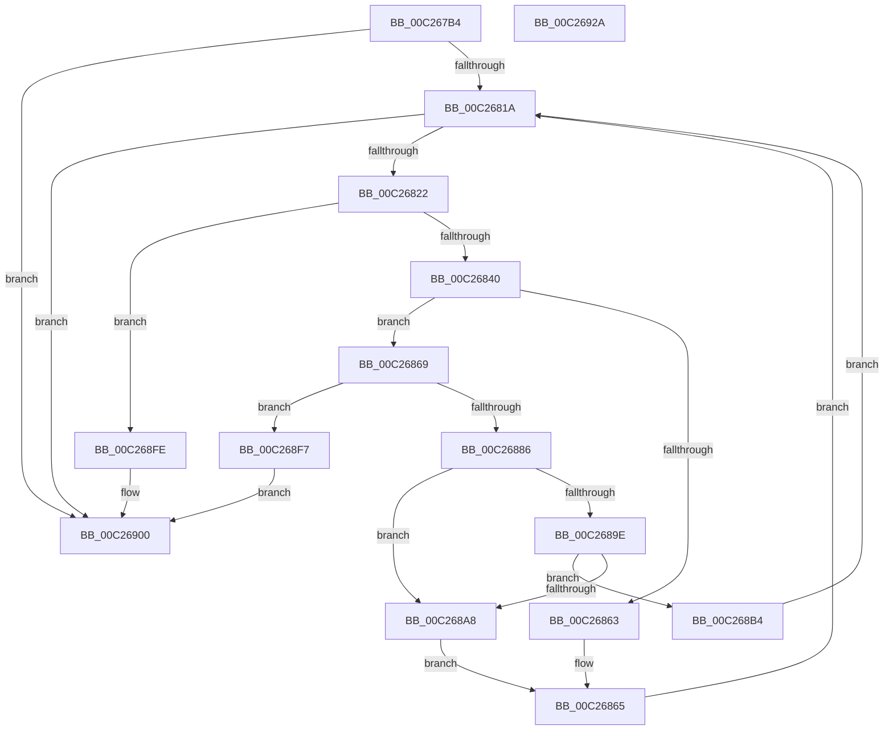

# EmpParseEntryTypes

- RVA: `0x00C267B4`–`0x00C2692B` (길이 `375` bytes)
- VA: `0x0000000140C267B4`
- 실행 섹션: `INIT`
- PDB 이름 있음: `예`; PDB Function 태그: `아니요`
- unwind 정보 RVA: `0x000C5B90`
- 디코드: `98`개 명령, `375/375` bytes 표시
- 미해석 바이트: `0` (있으면 어셈블리에 `.byte`로 보존)

> 이 문서는 커널 이미지의 기계어와 PDB 기호를 분석해 생성했습니다. 4번과 5번은 함수 원형과 자료형을 바이너리 사용 방식에서 추정한 C 해석이며 원본 소스 복구 결과는 아닙니다.

## 1. Dependencies

- 직접 호출 지점: **9**; 고유 호출 대상: **9**
- 직접 호출자로 확인된 함수: **1**
- RIP 상대 이미지 참조: **5**

### Outgoing calls
- `0x00C2680B` → [EmpInfParseGetSectionLineCount](EmpInfParseGetSectionLineCount_function_00C26460.md) (function, `0x00C26460`)
- `0x00C26832` → [CmpGetSectionLineIndex](CmpGetSectionLineIndex_function_00C283C4.md) (function, `0x00C283C4`)
- `0x00C26848` → [RtlInitAnsiString](../../text/47/RtlInitAnsiString_function_00470F40.md) (function, `0x00470F40`)
- `0x00C2685A` → [RtlAnsiStringToUnicodeString](../../page/90/RtlAnsiStringToUnicodeString_function_0090BEA0.md) (function, `0x0090BEA0`)
- `0x00C26879` → [ExAllocatePool2](../../poolcode/B8/ExAllocatePool2_function_00B820F0.md) (function, `0x00B820F0`)
- `0x00C2688E` → [RtlGUIDFromString](../../page/8F/RtlGUIDFromString_function_008F1EF0.md) (function, `0x008F1EF0`)
- `0x00C2689E` → [EmpSearchEntryDatabase](../../text/58/EmpSearchEntryDatabase_function_00580CE8.md) (function, `0x00580CE8`)
- `0x00C268AD` → [ExFreePoolWithTag](../../poolcode/B8/ExFreePoolWithTag_function_00B82870.md) (function, `0x00B82870`)
- `0x00C2690D` → [_security_check_cookie](../../text/6A/_security_check_cookie_function_006AC640.md) (function, `0x006AC640`)

### Direct callers
- [EmpParseInfDatabase](EmpParseInfDatabase_function_00C26934.md) at `0x00C269AA`

### Static image references
- `0x00C267C9` → RVA `0x00E0A740` (`.data`; read)
- `0x00C267ED` → RVA `0x00C796B0` (` ?? ::PBOPGDP::`string'`; read)
- `0x00C268D3` → RVA `0x00E65BE8` (`.data`; read/write)
- `0x00C268E1` → RVA `0x00F8F198` (`.data`; read)
- `0x00C268EB` → RVA `0x00F8F198` (`.data`; write)

## 2. Other-region calls and transfers

- 다른 실행 섹션으로 향하는 call: **7**
  - `0x00C26848` → [RtlInitAnsiString](../../text/47/RtlInitAnsiString_function_00470F40.md) (`INIT` → `.text`)
  - `0x00C2685A` → [RtlAnsiStringToUnicodeString](../../page/90/RtlAnsiStringToUnicodeString_function_0090BEA0.md) (`INIT` → `PAGE`)
  - `0x00C26879` → [ExAllocatePool2](../../poolcode/B8/ExAllocatePool2_function_00B820F0.md) (`INIT` → `POOLCODE`)
  - `0x00C2688E` → [RtlGUIDFromString](../../page/8F/RtlGUIDFromString_function_008F1EF0.md) (`INIT` → `PAGE`)
  - `0x00C2689E` → [EmpSearchEntryDatabase](../../text/58/EmpSearchEntryDatabase_function_00580CE8.md) (`INIT` → `.text`)
  - `0x00C268AD` → [ExFreePoolWithTag](../../poolcode/B8/ExFreePoolWithTag_function_00B82870.md) (`INIT` → `POOLCODE`)
  - `0x00C2690D` → [_security_check_cookie](../../text/6A/_security_check_cookie_function_006AC640.md) (`INIT` → `.text`)
- 별도 외부 분기/꼬리 이동을 확인하지 못했습니다.

## 3. Assembly (complete function range)

```asm
00C267B4  48 89 5C 24 10                  mov qword ptr [rsp + 0x10], rbx
00C267B9  48 89 6C 24 18                  mov qword ptr [rsp + 0x18], rbp
00C267BE  56                              push rsi
00C267BF  57                              push rdi
00C267C0  41 56                           push r14
00C267C2  48 81 EC A0 00 00 00            sub rsp, 0xa0
00C267C9  48 8B 05 70 3F 1E 00            mov rax, qword ptr [rip + 0x1e3f70]
00C267D0  48 33 C4                        xor rax, rsp
00C267D3  48 89 84 24 90 00 00 00         mov qword ptr [rsp + 0x90], rax
00C267DB  48 8D 44 24 40                  lea rax, [rsp + 0x40]
00C267E0  0F 57 C9                        xorps xmm1, xmm1
00C267E3  0F 11 4C 24 20                  movups xmmword ptr [rsp + 0x20], xmm1
00C267E8  48 89 44 24 28                  mov qword ptr [rsp + 0x28], rax
00C267ED  48 8D 15 BC 2E 05 00            lea rdx, [rip + 0x52ebc]
00C267F4  0F 57 C0                        xorps xmm0, xmm0
00C267F7  33 DB                           xor ebx, ebx
00C267F9  4C 8B F1                        mov r14, rcx
00C267FC  33 FF                           xor edi, edi
00C267FE  0F 11 44 24 30                  movups xmmword ptr [rsp + 0x30], xmm0
00C26803  8D 43 4E                        lea eax, [rbx + 0x4e]
00C26806  66 89 44 24 22                  mov word ptr [rsp + 0x22], ax
00C2680B  E8 50 FC FF FF                  call 0x140c26460
00C26810  8B E8                           mov ebp, eax
00C26812  85 C0                           test eax, eax
00C26814  0F 84 E6 00 00 00               je 0x140c26900
00C2681A  3B FD                           cmp edi, ebp
00C2681C  0F 83 DE 00 00 00               jae 0x140c26900
00C26822  45 33 C9                        xor r9d, r9d
00C26825  48 8D 15 84 2E 05 00            lea rdx, [rip + 0x52e84]
00C2682C  44 8B C7                        mov r8d, edi
00C2682F  49 8B CE                        mov rcx, r14
00C26832  E8 8D 1B 00 00                  call 0x140c283c4
00C26837  48 85 C0                        test rax, rax
00C2683A  0F 84 BE 00 00 00               je 0x140c268fe
00C26840  48 8B D0                        mov rdx, rax
00C26843  48 8D 4C 24 30                  lea rcx, [rsp + 0x30]
00C26848  E8 F3 A6 84 FF                  call 0x140470f40
00C2684D  45 33 C0                        xor r8d, r8d
00C26850  48 8D 54 24 30                  lea rdx, [rsp + 0x30]
00C26855  48 8D 4C 24 20                  lea rcx, [rsp + 0x20]
00C2685A  E8 41 56 CE FF                  call 0x14090bea0
00C2685F  85 C0                           test eax, eax
00C26861  79 06                           jns 0x140c26869
00C26863  FF C7                           inc edi
00C26865  33 DB                           xor ebx, ebx
00C26867  EB B1                           jmp 0x140c2681a
00C26869  BA 50 00 00 00                  mov edx, 0x50
00C2686E  B9 00 01 00 00                  mov ecx, 0x100
00C26873  41 B8 45 4D 69 74               mov r8d, 0x74694d45
00C26879  E8 72 B8 F5 FF                  call 0x140b820f0
00C2687E  48 8B F0                        mov rsi, rax
00C26881  48 85 C0                        test rax, rax
00C26884  74 71                           je 0x140c268f7
00C26886  48 8B D0                        mov rdx, rax
00C26889  48 8D 4C 24 20                  lea rcx, [rsp + 0x20]
00C2688E  E8 5D B6 CC FF                  call 0x1408f1ef0
00C26893  FF C7                           inc edi
00C26895  8B D8                           mov ebx, eax
00C26897  48 8B CE                        mov rcx, rsi
00C2689A  85 C0                           test eax, eax
00C2689C  78 0A                           js 0x140c268a8
00C2689E  E8 45 A4 95 FF                  call 0x140580ce8
00C268A3  48 85 C0                        test rax, rax
00C268A6  74 0C                           je 0x140c268b4
00C268A8  BA 45 4D 69 74                  mov edx, 0x74694d45
00C268AD  E8 BE BF F5 FF                  call 0x140b82870
00C268B2  EB B1                           jmp 0x140c26865
00C268B4  48 8D 4E 28                     lea rcx, [rsi + 0x28]
00C268B8  48 89 49 08                     mov qword ptr [rcx + 8], rcx
00C268BC  48 8D 46 38                     lea rax, [rsi + 0x38]
00C268C0  48 89 09                        mov qword ptr [rcx], rcx
00C268C3  48 83 66 48 00                  and qword ptr [rsi + 0x48], 0
00C268C8  48 89 40 08                     mov qword ptr [rax + 8], rax
00C268CC  48 89 00                        mov qword ptr [rax], rax
00C268CF  83 66 10 00                     and dword ptr [rsi + 0x10], 0
00C268D3  FF 05 0F F3 23 00               inc dword ptr [rip + 0x23f30f]
00C268D9  48 89 4E 20                     mov qword ptr [rsi + 0x20], rcx
00C268DD  48 8D 4E 18                     lea rcx, [rsi + 0x18]
00C268E1  48 8B 05 B0 88 36 00            mov rax, qword ptr [rip + 0x3688b0]
00C268E8  48 89 01                        mov qword ptr [rcx], rax
00C268EB  48 89 0D A6 88 36 00            mov qword ptr [rip + 0x3688a6], rcx
00C268F2  E9 23 FF FF FF                  jmp 0x140c2681a
00C268F7  BB 9A 00 00 C0                  mov ebx, 0xc000009a
00C268FC  EB 02                           jmp 0x140c26900
00C268FE  33 DB                           xor ebx, ebx
00C26900  8B C3                           mov eax, ebx
00C26902  48 8B 8C 24 90 00 00 00         mov rcx, qword ptr [rsp + 0x90]
00C2690A  48 33 CC                        xor rcx, rsp
00C2690D  E8 2E 5D A8 FF                  call 0x1406ac640
00C26912  4C 8D 9C 24 A0 00 00 00         lea r11, [rsp + 0xa0]
00C2691A  49 8B 5B 28                     mov rbx, qword ptr [r11 + 0x28]
00C2691E  49 8B 6B 30                     mov rbp, qword ptr [r11 + 0x30]
00C26922  49 8B E3                        mov rsp, r11
00C26925  41 5E                           pop r14
00C26927  5F                              pop rdi
00C26928  5E                              pop rsi
00C26929  C3                              ret
00C2692A  CC                              int3
```

## 4. C-style interpretation (structured pseudocode)

```c
__int64 __fastcall EmpParseEntryTypes(__int64 a1, __int64 a2, __int64 a3, int a4)
{
    __int64 result;
    __int64 v_rbx;
    __int64 v_rdi;
    __int64 v_rsp;
    unsigned __int64 v_stack_m18;
    unsigned __int64 v_stack_m28;
    unsigned __int64 v_stack_m78;
    unsigned __int64 v_stack_m88;
    unsigned __int64 v_stack_m90;
    unsigned __int16 v_stack_m96;
    unsigned __int64 v_stack_m98;
    unsigned __int64 v_stack_p10;
    unsigned __int64 v_stack_p18;

    v_stack_p10 = v_rbx;
    v_stack_p18 = v_rbp;
    v_rsp = (v_rsp) - (160);
    result = (*(unsigned __int64 *)(v_rip + 1982320)) ^ (v_rsp);
    v_stack_m28 = result;
    v_stack_m98 = v_xmm1;
    v_stack_m90 = v_stack_m78;
    v_rbx = 0;
    v_rdi = 0;
    v_stack_m88 = v_xmm0;
    v_stack_m96 = (unsigned __int16)(v_rbx + 78);
    result = EmpInfParseGetSectionLineCount(a1, v_rip + 339644, a3, a4);
    if ((unsigned int)(result) == 0) goto loc_00C26900;
loc_00C2681A:
    if (0 >= ((unsigned int)((unsigned int)((unsigned int)(result))))) goto loc_00C26900;
    a4 = 0;
    result = CmpGetSectionLineIndex(a1, v_rip + 339588, 0, a4);
    if (result == 0) goto loc_00C268FE;
    result = RtlInitAnsiString(v_stack_m88, result, 0, a4);
    a3 = 0;
    result = RtlAnsiStringToUnicodeString(v_stack_m98, v_stack_m88, a3, a4);
    if (!sign_flag) goto loc_00C26869;
    v_rdi = (unsigned int)((v_rdi) + 1);
loc_00C26865:
    v_rbx = 0;
    goto loc_00C2681A;
loc_00C26869:
    result = ExAllocatePool2(256, 80, (unsigned int)(0x74694D45ULL), a4);
    if (result == 0) goto loc_00C268F7;
    result = RtlGUIDFromString(v_stack_m98, result, (unsigned int)(0x74694D45ULL), a4);
    v_rdi = (unsigned int)((v_rdi) + 1);
    if (sign_flag) goto loc_00C268A8;
    result = EmpSearchEntryDatabase(result, result, (unsigned int)(0x74694D45ULL), a4);
    if (result == 0) goto loc_00C268B4;
loc_00C268A8:
    result = ExFreePoolWithTag(result, (unsigned int)(0x74694D45ULL), (unsigned int)(0x74694D45ULL), a4);
    goto loc_00C26865;
loc_00C268B4:
    *(unsigned __int64 *)(result + 40 + 8) = result + 40;
    *(unsigned __int64 *)(result + 40) = result + 40;
    *(unsigned __int64 *)(result + 56 + 8) = result + 56;
    *(unsigned __int64 *)(result + 56) = result + 56;
    *(unsigned __int64 *)(result + 32) = result + 40;
    *(unsigned __int64 *)(result + 24) = *(unsigned __int64 *)(v_rip + 3573936);
    *(unsigned __int64 *)(v_rip + 3573926) = result + 24;
    goto loc_00C2681A;
loc_00C268F7:
    goto loc_00C26900;
loc_00C268FE:
    v_rbx = 0;
loc_00C26900:
    a1 = (v_stack_m28) ^ (v_rsp);
    result = _security_check_cookie(a1, (unsigned int)(0x74694D45ULL), (unsigned int)(0x74694D45ULL), a4);
    return result;
}
```

## 5. (Beta) C Style

```c
int64_t EmpParseEntryTypes(int64_t Arg1, int64_t Arg2, int64_t Arg3, int32_t Arg4)
{
    int64_t result;
    int64_t local_rbx;
    int64_t local_rdi;
    int64_t local_rsp;
    uint64_t v_stack_m18;
    uint64_t v_stack_m28;
    uint64_t v_stack_m78;
    uint64_t v_stack_m88;
    uint64_t v_stack_m90;
    uint16_t v_stack_m96;
    uint64_t v_stack_m98;
    uint64_t v_stack_p10;
    uint64_t v_stack_p18;

    v_stack_p10 = local_rbx;
    v_stack_p18 = local_rbp;
    local_rsp = (local_rsp) - (160);
    result = (*(uint64_t *)(v_rip + 0x1E3F70)) ^ (local_rsp);
    v_stack_m28 = result;
    v_stack_m98 = v_xmm1;
    v_stack_m90 = v_stack_m78;
    local_rbx = 0;
    local_rdi = 0;
    v_stack_m88 = v_xmm0;
    v_stack_m96 = (uint16_t)(local_rbx + 78);
    result = EmpInfParseGetSectionLineCount(Arg1, v_rip + 339644, Arg3, Arg4);
    if ((uint32_t)(result) == 0) goto loc_00C26900;
loc_00C2681A:
    if (0 >= ((uint32_t)((uint32_t)((uint32_t)(result))))) goto loc_00C26900;
    Arg4 = 0;
    result = CmpGetSectionLineIndex(Arg1, v_rip + 339588, 0, Arg4);
    if (result == 0) goto loc_00C268FE;
    result = RtlInitAnsiString(v_stack_m88, result, 0, Arg4);
    Arg3 = 0;
    result = RtlAnsiStringToUnicodeString(v_stack_m98, v_stack_m88, Arg3, Arg4);
    if (!sign_flag) goto loc_00C26869;
    local_rdi = (uint32_t)((local_rdi) + 1);
loc_00C26865:
    local_rbx = 0;
    goto loc_00C2681A;
loc_00C26869:
    result = ExAllocatePool2(256, 80, (uint32_t)(0x74694D45ULL), Arg4);
    if (result == 0) goto loc_00C268F7;
    result = RtlGUIDFromString(v_stack_m98, result, (uint32_t)(0x74694D45ULL), Arg4);
    local_rdi = (uint32_t)((local_rdi) + 1);
    if (sign_flag) goto loc_00C268A8;
    result = EmpSearchEntryDatabase(result, result, (uint32_t)(0x74694D45ULL), Arg4);
    if (result == 0) goto loc_00C268B4;
loc_00C268A8:
    result = ExFreePoolWithTag(result, (uint32_t)(0x74694D45ULL), (uint32_t)(0x74694D45ULL), Arg4);
    goto loc_00C26865;
loc_00C268B4:
    *(uint64_t *)(result + 0x28 + 0x8) = result + 40;
    *(uint64_t *)(result + 0x28) = result + 40;
    *(uint64_t *)(result + 0x38 + 0x8) = result + 56;
    *(uint64_t *)(result + 0x38) = result + 56;
    *(uint64_t *)(result + 0x20) = result + 40;
    *(uint64_t *)(result + 0x18) = *(uint64_t *)(v_rip + 0x3688B0);
    *(uint64_t *)(v_rip + 0x3688A6) = result + 24;
    goto loc_00C2681A;
loc_00C268F7:
    goto loc_00C26900;
loc_00C268FE:
    local_rbx = 0;
loc_00C26900:
    Arg1 = (v_stack_m28) ^ (local_rsp);
    result = _security_check_cookie(Arg1, (uint32_t)(0x74694D45ULL), (uint32_t)(0x74694D45ULL), Arg4);
    return result;
}
```

## 6. Execution-region graph

[열기: 2D/3D 그래프와 함수 탐색 컨트롤 패널](../../../control-panel.html?section=init&rva=0x00C267B4&view=graph)

- 2D 그래프는 위에서 아래로 흐르고, 3D 그래프는 빈 공간을 드래그해 회전합니다. Shift+드래그는 이동, 휠은 확대·축소, 함수 노드 선택은 대상 보고서 이동입니다.

### Static fallback


