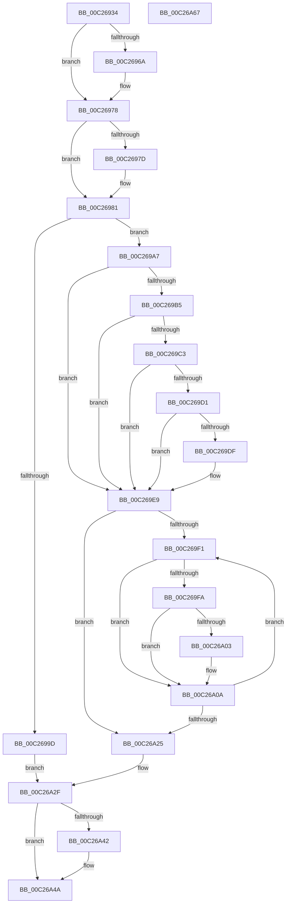

# EmpParseInfDatabase

- RVA: `0x00C26934`–`0x00C26A68` (길이 `308` bytes)
- VA: `0x0000000140C26934`
- 실행 섹션: `INIT`
- PDB 이름 있음: `예`; PDB Function 태그: `아니요`
- unwind 정보 RVA: `0x000BD140`
- 디코드: `96`개 명령, `308/308` bytes 표시
- 미해석 바이트: `0` (있으면 어셈블리에 `.byte`로 보존)

> 이 문서는 커널 이미지의 기계어와 PDB 기호를 분석해 생성했습니다. 4번과 5번은 함수 원형과 자료형을 바이너리 사용 방식에서 추정한 C 해석이며 원본 소스 복구 결과는 아닙니다.

## 1. Dependencies

- 직접 호출 지점: **14**; 고유 호출 대상: **12**
- 직접 호출자로 확인된 함수: **1**
- RIP 상대 이미지 참조: **2**

### Outgoing calls
- `0x00C2695A` → [KeAbPreAcquire](../../text/21/KeAbPreAcquire_function_00210230.md) (function, `0x00210230`)
- `0x00C26973` → [ExfAcquirePushLockExclusiveEx](../../text/20/ExfAcquirePushLockExclusiveEx_function_0020FC90.md) (function, `0x0020FC90`)
- `0x00C26990` → [CmpParseInfBuffer](CmpParseInfBuffer_function_00C28734.md) (function, `0x00C28734`)
- `0x00C269AA` → [EmpParseEntryTypes](EmpParseEntryTypes_function_00C267B4.md) (function, `0x00C267B4`)
- `0x00C269B8` → [EmpParseCallbacks](EmpParseCallbacks_function_00C2657C.md) (function, `0x00C2657C`)
- `0x00C269C6` → [EmpParseRules](EmpParseRules_function_00C2745C.md) (function, `0x00C2745C`)
- `0x00C269D4` → [EmpParseStrings](EmpParseStrings_function_00C277E0.md) (function, `0x00C277E0`)
- `0x00C269E2` → [EmpParseTargetRules](EmpParseTargetRules_function_00C27C78.md) (function, `0x00C27C78`)
- `0x00C26A05` → [ExFreePoolWithTag](../../poolcode/B8/ExFreePoolWithTag_function_00B82870.md) (function, `0x00B82870`)
- `0x00C26A0E` → [CmpFreeLineList](CmpFreeLineList_function_00C282F0.md) (function, `0x00C282F0`)
- `0x00C26A18` → [ExFreePoolWithTag](../../poolcode/B8/ExFreePoolWithTag_function_00B82870.md) (function, `0x00B82870`)
- `0x00C26A2A` → [ExFreePoolWithTag](../../poolcode/B8/ExFreePoolWithTag_function_00B82870.md) (function, `0x00B82870`)
- `0x00C26A45` → [ExfTryToWakePushLock](../../text/26/ExfTryToWakePushLock_function_00265DD0.md) (function, `0x00265DD0`)
- `0x00C26A4D` → [KeAbPostRelease](../../text/2E/KeAbPostRelease_function_002E1600.md) (function, `0x002E1600`)

### Direct callers
- [EmInitSystem](../C7/EmInitSystem_function_00C71150.md) at `0x00C71276`
- [EmInitSystem](../C7/EmInitSystem_function_00C71150.md) at `0x00C7160A`

### Static image references
- `0x00C26948` → RVA `0x00F8F188` (`.data`; read)
- `0x00C26A33` → RVA `0x00F8F188` (`.data`; read/write)

## 2. Other-region calls and transfers

- 다른 실행 섹션으로 향하는 call: **7**
  - `0x00C2695A` → [KeAbPreAcquire](../../text/21/KeAbPreAcquire_function_00210230.md) (`INIT` → `.text`)
  - `0x00C26973` → [ExfAcquirePushLockExclusiveEx](../../text/20/ExfAcquirePushLockExclusiveEx_function_0020FC90.md) (`INIT` → `.text`)
  - `0x00C26A05` → [ExFreePoolWithTag](../../poolcode/B8/ExFreePoolWithTag_function_00B82870.md) (`INIT` → `POOLCODE`)
  - `0x00C26A18` → [ExFreePoolWithTag](../../poolcode/B8/ExFreePoolWithTag_function_00B82870.md) (`INIT` → `POOLCODE`)
  - `0x00C26A2A` → [ExFreePoolWithTag](../../poolcode/B8/ExFreePoolWithTag_function_00B82870.md) (`INIT` → `POOLCODE`)
  - `0x00C26A45` → [ExfTryToWakePushLock](../../text/26/ExfTryToWakePushLock_function_00265DD0.md) (`INIT` → `.text`)
  - `0x00C26A4D` → [KeAbPostRelease](../../text/2E/KeAbPostRelease_function_002E1600.md) (`INIT` → `.text`)
- 별도 외부 분기/꼬리 이동을 확인하지 못했습니다.

## 3. Assembly (complete function range)

```asm
00C26934  48 89 5C 24 08                  mov qword ptr [rsp + 8], rbx
00C26939  48 89 6C 24 10                  mov qword ptr [rsp + 0x10], rbp
00C2693E  56                              push rsi
00C2693F  57                              push rdi
00C26940  41 56                           push r14
00C26942  48 83 EC 20                     sub rsp, 0x20
00C26946  8B FA                           mov edi, edx
00C26948  4C 8D 35 39 88 36 00            lea r14, [rip + 0x368839]
00C2694F  48 8B F1                        mov rsi, rcx
00C26952  45 33 C0                        xor r8d, r8d
00C26955  49 8B CE                        mov rcx, r14
00C26958  33 D2                           xor edx, edx
00C2695A  E8 D1 98 5E FF                  call 0x140210230
00C2695F  F0 49 0F BA 2E 00               lock bts qword ptr [r14], 0
00C26965  48 8B D8                        mov rbx, rax
00C26968  73 0E                           jae 0x140c26978
00C2696A  4D 8B C6                        mov r8, r14
00C2696D  48 8B D0                        mov rdx, rax
00C26970  49 8B CE                        mov rcx, r14
00C26973  E8 18 93 5E FF                  call 0x14020fc90
00C26978  48 85 DB                        test rbx, rbx
00C2697B  74 04                           je 0x140c26981
00C2697D  C6 43 0A 01                     mov byte ptr [rbx + 0xa], 1
00C26981  83 64 24 50 00                  and dword ptr [rsp + 0x50], 0
00C26986  4C 8D 44 24 50                  lea r8, [rsp + 0x50]
00C2698B  8B D7                           mov edx, edi
00C2698D  48 8B CE                        mov rcx, rsi
00C26990  E8 9F 1D 00 00                  call 0x140c28734
00C26995  48 8B F8                        mov rdi, rax
00C26998  48 85 C0                        test rax, rax
00C2699B  75 0A                           jne 0x140c269a7
00C2699D  BB 08 00 00 C0                  mov ebx, 0xc0000008
00C269A2  E9 88 00 00 00                  jmp 0x140c26a2f
00C269A7  48 8B CF                        mov rcx, rdi
00C269AA  E8 05 FE FF FF                  call 0x140c267b4
00C269AF  8B D8                           mov ebx, eax
00C269B1  85 C0                           test eax, eax
00C269B3  78 34                           js 0x140c269e9
00C269B5  48 8B CF                        mov rcx, rdi
00C269B8  E8 BF FB FF FF                  call 0x140c2657c
00C269BD  8B D8                           mov ebx, eax
00C269BF  85 C0                           test eax, eax
00C269C1  78 26                           js 0x140c269e9
00C269C3  48 8B CF                        mov rcx, rdi
00C269C6  E8 91 0A 00 00                  call 0x140c2745c
00C269CB  8B D8                           mov ebx, eax
00C269CD  85 C0                           test eax, eax
00C269CF  78 18                           js 0x140c269e9
00C269D1  48 8B CF                        mov rcx, rdi
00C269D4  E8 07 0E 00 00                  call 0x140c277e0
00C269D9  8B D8                           mov ebx, eax
00C269DB  85 C0                           test eax, eax
00C269DD  78 0A                           js 0x140c269e9
00C269DF  48 8B CF                        mov rcx, rdi
00C269E2  E8 91 12 00 00                  call 0x140c27c78
00C269E7  8B D8                           mov ebx, eax
00C269E9  48 8B 37                        mov rsi, qword ptr [rdi]
00C269EC  48 85 F6                        test rsi, rsi
00C269EF  74 34                           je 0x140c26a25
00C269F1  80 7E 18 00                     cmp byte ptr [rsi + 0x18], 0
00C269F5  48 8B 2E                        mov rbp, qword ptr [rsi]
00C269F8  74 10                           je 0x140c26a0a
00C269FA  48 8B 4E 08                     mov rcx, qword ptr [rsi + 8]
00C269FE  48 85 C9                        test rcx, rcx
00C26A01  74 07                           je 0x140c26a0a
00C26A03  33 D2                           xor edx, edx
00C26A05  E8 66 BE F5 FF                  call 0x140b82870
00C26A0A  48 8B 4E 10                     mov rcx, qword ptr [rsi + 0x10]
00C26A0E  E8 DD 18 00 00                  call 0x140c282f0
00C26A13  33 D2                           xor edx, edx
00C26A15  48 8B CE                        mov rcx, rsi
00C26A18  E8 53 BE F5 FF                  call 0x140b82870
00C26A1D  48 8B F5                        mov rsi, rbp
00C26A20  48 85 ED                        test rbp, rbp
00C26A23  75 CC                           jne 0x140c269f1
00C26A25  33 D2                           xor edx, edx
00C26A27  48 8B CF                        mov rcx, rdi
00C26A2A  E8 41 BE F5 FF                  call 0x140b82870
00C26A2F  48 83 C8 FF                     or rax, 0xffffffffffffffff
00C26A33  F0 48 0F C1 05 4C 87 36 00      lock xadd qword ptr [rip + 0x36874c], rax
00C26A3C  24 06                           and al, 6
00C26A3E  3C 02                           cmp al, 2
00C26A40  75 08                           jne 0x140c26a4a
00C26A42  49 8B CE                        mov rcx, r14
00C26A45  E8 86 F3 63 FF                  call 0x140265dd0
00C26A4A  49 8B CE                        mov rcx, r14
00C26A4D  E8 AE AB 6B FF                  call 0x1402e1600
00C26A52  48 8B 6C 24 48                  mov rbp, qword ptr [rsp + 0x48]
00C26A57  8B C3                           mov eax, ebx
00C26A59  48 8B 5C 24 40                  mov rbx, qword ptr [rsp + 0x40]
00C26A5E  48 83 C4 20                     add rsp, 0x20
00C26A62  41 5E                           pop r14
00C26A64  5F                              pop rdi
00C26A65  5E                              pop rsi
00C26A66  C3                              ret
00C26A67  CC                              int3
```

## 4. C-style interpretation (structured pseudocode)

```c
__int64 __fastcall EmpParseInfDatabase(__int64 a1, int a2, int a3)
{
    __int64 result;
    __int64 v_rbx;
    __int64 v_rsp;
    unsigned __int64 v_stack_p10;
    unsigned int v_stack_p18;
    unsigned __int64 v_stack_p8;

    v_stack_p8 = v_rbx;
    v_stack_p10 = v_rbp;
    v_rsp = (v_rsp) - (32);
    a3 = 0;
    a2 = 0;
    result = KeAbPreAcquire(v_rip + 3573817, a2, a3, a4);
    if (!(condition_is_above_or_equal)) {
        a3 = v_rip + 3573817;
        a2 = result;
        a1 = v_rip + 3573817;
        result = ExfAcquirePushLockExclusiveEx(a1, a2, a3, a4);
    }
    if (result != 0) {
        *(unsigned __int8 *)(result + 10) = 1;
    }
    result = CmpParseInfBuffer(a1, (unsigned int)((unsigned int)((unsigned int)(a2))), v_stack_p18, a4);
    if (result != 0) goto loc_00C269A7;
    goto loc_00C26A2F;
loc_00C269A7:
    result = EmpParseEntryTypes(result, (unsigned int)((unsigned int)((unsigned int)(a2))), v_stack_p18, a4);
    if (sign_flag) goto loc_00C269E9;
    result = EmpParseCallbacks(result, (unsigned int)((unsigned int)((unsigned int)(a2))), v_stack_p18, a4);
    if (sign_flag) goto loc_00C269E9;
    result = EmpParseRules(result, (unsigned int)((unsigned int)((unsigned int)(a2))), v_stack_p18, a4);
    if (sign_flag) goto loc_00C269E9;
    result = EmpParseStrings(result, (unsigned int)((unsigned int)((unsigned int)(a2))), v_stack_p18, a4);
    v_rbx = (unsigned int)((unsigned int)(result));
    if (!(sign_flag)) {
        a1 = result;
        result = EmpParseTargetRules(a1, (unsigned int)((unsigned int)((unsigned int)(a2))), v_stack_p18, a4);
        v_rbx = (unsigned int)(result);
    }
    if (*(unsigned __int64 *)(result) == 0) goto loc_00C26A25;
loc_00C269F1:
    if ((*(unsigned __int8 *)(*(unsigned __int64 *)(result) + 24)) == 0) goto loc_00C26A0A;
    if (*(unsigned __int64 *)(*(unsigned __int64 *)(result) + 8) != 0) {
        a2 = 0;
        result = ExFreePoolWithTag(*(unsigned __int64 *)(*(unsigned __int64 *)(result) + 8), a2, v_stack_p18, a4);
    }
    result = CmpFreeLineList(*(unsigned __int64 *)(*(unsigned __int64 *)(result) + 16), a2, v_stack_p18, a4);
    a2 = 0;
    result = ExFreePoolWithTag(*(unsigned __int64 *)(result), a2, v_stack_p18, a4);
    if (*(unsigned __int64 *)(*(unsigned __int64 *)(result)) != 0) goto loc_00C269F1;
loc_00C26A25:
    a2 = 0;
    result = ExFreePoolWithTag(result, a2, v_stack_p18, a4);
loc_00C26A2F:
    result = (result) | (-1);
    result = (unsigned __int8)((result) & (6));
    if (((unsigned __int8)(result)) == 2) {
        a1 = v_rip + 3573817;
        result = ExfTryToWakePushLock(a1, a2, v_stack_p18, a4);
    }
    result = KeAbPostRelease(v_rip + 3573817, a2, v_stack_p18, a4);
    v_rsp = (v_rsp) + (32);
    return (unsigned int)((unsigned int)(v_rbx));
}
```

## 5. (Beta) C Style

```c
int64_t EmpParseInfDatabase(int64_t Arg1, int32_t Arg2, int32_t Arg3)
{
    int64_t result;
    int64_t local_rbx;
    int64_t local_rsp;
    uint64_t v_stack_p10;
    uint32_t v_stack_p18;
    uint64_t v_stack_p8;

    v_stack_p8 = local_rbx;
    v_stack_p10 = local_rbp;
    local_rsp = (local_rsp) - (32);
    Arg3 = 0;
    Arg2 = 0;
    result = KeAbPreAcquire(v_rip + 3573817, Arg2, Arg3, a4);
    if (!(condition_is_above_or_equal)) {
        Arg3 = v_rip + 3573817;
        Arg2 = result;
        Arg1 = v_rip + 3573817;
        result = ExfAcquirePushLockExclusiveEx(Arg1, Arg2, Arg3, a4);
    }
    if (result != 0) {
        *(uint8_t *)(result + 0xA) = 1;
    }
    result = CmpParseInfBuffer(Arg1, (uint32_t)((uint32_t)((uint32_t)(Arg2))), v_stack_p18, a4);
    if (result != 0) goto loc_00C269A7;
    goto loc_00C26A2F;
loc_00C269A7:
    result = EmpParseEntryTypes(result, (uint32_t)((uint32_t)((uint32_t)(Arg2))), v_stack_p18, a4);
    if (sign_flag) goto loc_00C269E9;
    result = EmpParseCallbacks(result, (uint32_t)((uint32_t)((uint32_t)(Arg2))), v_stack_p18, a4);
    if (sign_flag) goto loc_00C269E9;
    result = EmpParseRules(result, (uint32_t)((uint32_t)((uint32_t)(Arg2))), v_stack_p18, a4);
    if (sign_flag) goto loc_00C269E9;
    result = EmpParseStrings(result, (uint32_t)((uint32_t)((uint32_t)(Arg2))), v_stack_p18, a4);
    local_rbx = (uint32_t)((uint32_t)(result));
    if (!(sign_flag)) {
        Arg1 = result;
        result = EmpParseTargetRules(Arg1, (uint32_t)((uint32_t)((uint32_t)(Arg2))), v_stack_p18, a4);
        local_rbx = (uint32_t)(result);
    }
    if (*(uint64_t *)(result) == 0) goto loc_00C26A25;
loc_00C269F1:
    if ((*(uint8_t *)(*(uint64_t *)(result) + 0x18)) == 0) goto loc_00C26A0A;
    if (*(uint64_t *)(*(uint64_t *)(result) + 0x8) != 0) {
        Arg2 = 0;
        result = ExFreePoolWithTag(*(uint64_t *)(*(uint64_t *)(result) + 0x8), Arg2, v_stack_p18, a4);
    }
    result = CmpFreeLineList(*(uint64_t *)(*(uint64_t *)(result) + 0x10), Arg2, v_stack_p18, a4);
    Arg2 = 0;
    result = ExFreePoolWithTag(*(uint64_t *)(result), Arg2, v_stack_p18, a4);
    if (*(uint64_t *)(*(uint64_t *)(result)) != 0) goto loc_00C269F1;
loc_00C26A25:
    Arg2 = 0;
    result = ExFreePoolWithTag(result, Arg2, v_stack_p18, a4);
loc_00C26A2F:
    result = (result) | (-1);
    result = (uint8_t)((result) & (6));
    if (((uint8_t)(result)) == 2) {
        Arg1 = v_rip + 3573817;
        result = ExfTryToWakePushLock(Arg1, Arg2, v_stack_p18, a4);
    }
    result = KeAbPostRelease(v_rip + 3573817, Arg2, v_stack_p18, a4);
    local_rsp = (local_rsp) + (32);
    return (uint32_t)((uint32_t)(local_rbx));
}
```

## 6. Execution-region graph

[열기: 2D/3D 그래프와 함수 탐색 컨트롤 패널](../../../control-panel.html?section=init&rva=0x00C26934&view=graph)

- 2D 그래프는 위에서 아래로 흐르고, 3D 그래프는 빈 공간을 드래그해 회전합니다. Shift+드래그는 이동, 휠은 확대·축소, 함수 노드 선택은 대상 보고서 이동입니다.

### Static fallback


