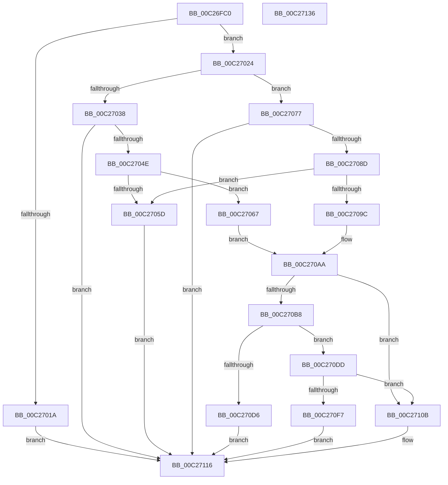

# EmpParseRuleTerm

- RVA: `0x00C26FC0`–`0x00C27137` (길이 `375` bytes)
- VA: `0x0000000140C26FC0`
- 실행 섹션: `INIT`
- PDB 이름 있음: `예`; PDB Function 태그: `아니요`
- unwind 정보 RVA: `0x000C5BD0`
- 디코드: `110`개 명령, `375/375` bytes 표시
- 미해석 바이트: `0` (있으면 어셈블리에 `.byte`로 보존)

> 이 문서는 커널 이미지의 기계어와 PDB 기호를 분석해 생성했습니다. 4번과 5번은 함수 원형과 자료형을 바이너리 사용 방식에서 추정한 C 해석이며 원본 소스 복구 결과는 아닙니다.

## 1. Dependencies

- 직접 호출 지점: **9**; 고유 호출 대상: **8**
- 직접 호출자로 확인된 함수: **1**
- RIP 상대 이미지 참조: **3**

### Outgoing calls
- `0x00C2700D` → [strchr](../../text/50/strchr_function_005014F0.md) (function, `0x005014F0`)
- `0x00C2703F` → [EmpInfParseGetGuidFromName](EmpInfParseGetGuidFromName_function_00C263B4.md) (function, `0x00C263B4`)
- `0x00C27053` → [EmpSearchCallbackDatabase](../../text/58/EmpSearchCallbackDatabase_function_00580CB0.md) (function, `0x00580CB0`)
- `0x00C2707E` → [EmpInfParseGetGuidFromName](EmpInfParseGetGuidFromName_function_00C263B4.md) (function, `0x00C263B4`)
- `0x00C27092` → [EmpSearchRuleDatabase](../../text/45/EmpSearchRuleDatabase_function_00458A9C.md) (function, `0x00458A9C`)
- `0x00C270C9` → [ExAllocatePool2](../../poolcode/B8/ExAllocatePool2_function_00B820F0.md) (function, `0x00B820F0`)
- `0x00C270EE` → [EmpParseRuleTermArgMapping](EmpParseRuleTermArgMapping_function_00C27140.md) (function, `0x00C27140`)
- `0x00C27104` → [ExFreePoolWithTag](../../poolcode/B8/ExFreePoolWithTag_function_00B82870.md) (function, `0x00B82870`)
- `0x00C27120` → [_security_check_cookie](../../text/6A/_security_check_cookie_function_006AC640.md) (function, `0x006AC640`)

### Direct callers
- [EmpParseRuleExpression](EmpParseRuleExpression_function_00C26A70.md) at `0x00C26C35`

### Static image references
- `0x00C26FD1` → RVA `0x00E0A740` (`.data`; read)
- `0x00C27038` → RVA `0x00C796D0` (` ?? ::PBOPGDP::`string'`; read)
- `0x00C27077` → RVA `0x00C796E0` (` ?? ::PBOPGDP::`string'`; read)

## 2. Other-region calls and transfers

- 다른 실행 섹션으로 향하는 call: **6**
  - `0x00C2700D` → [strchr](../../text/50/strchr_function_005014F0.md) (`INIT` → `.text`)
  - `0x00C27053` → [EmpSearchCallbackDatabase](../../text/58/EmpSearchCallbackDatabase_function_00580CB0.md) (`INIT` → `.text`)
  - `0x00C27092` → [EmpSearchRuleDatabase](../../text/45/EmpSearchRuleDatabase_function_00458A9C.md) (`INIT` → `.text`)
  - `0x00C270C9` → [ExAllocatePool2](../../poolcode/B8/ExAllocatePool2_function_00B820F0.md) (`INIT` → `POOLCODE`)
  - `0x00C27104` → [ExFreePoolWithTag](../../poolcode/B8/ExFreePoolWithTag_function_00B82870.md) (`INIT` → `POOLCODE`)
  - `0x00C27120` → [_security_check_cookie](../../text/6A/_security_check_cookie_function_006AC640.md) (`INIT` → `.text`)
- 별도 외부 분기/꼬리 이동을 확인하지 못했습니다.

## 3. Assembly (complete function range)

```asm
00C26FC0  40 53                           push rbx
00C26FC2  55                              push rbp
00C26FC3  56                              push rsi
00C26FC4  57                              push rdi
00C26FC5  41 54                           push r12
00C26FC7  41 55                           push r13
00C26FC9  41 56                           push r14
00C26FCB  41 57                           push r15
00C26FCD  48 83 EC 58                     sub rsp, 0x58
00C26FD1  48 8B 05 68 37 1E 00            mov rax, qword ptr [rip + 0x1e3768]
00C26FD8  48 33 C4                        xor rax, rsp
00C26FDB  48 89 44 24 48                  mov qword ptr [rsp + 0x48], rax
00C26FE0  48 8B 84 24 C0 00 00 00         mov rax, qword ptr [rsp + 0xc0]
00C26FE8  48 8D 5A 01                     lea rbx, [rdx + 1]
00C26FEC  48 8B EA                        mov rbp, rdx
00C26FEF  48 89 44 24 30                  mov qword ptr [rsp + 0x30], rax
00C26FF4  48 8B F9                        mov rdi, rcx
00C26FF7  0F 57 C0                        xorps xmm0, xmm0
00C26FFA  33 F6                           xor esi, esi
00C26FFC  48 8B CB                        mov rcx, rbx
00C26FFF  4D 8B E9                        mov r13, r9
00C27002  4D 8B F0                        mov r14, r8
00C27005  0F 11 44 24 38                  movups xmmword ptr [rsp + 0x38], xmm0
00C2700A  8D 56 28                        lea edx, [rsi + 0x28]
00C2700D  E8 DE A4 8D FF                  call 0x1405014f0
00C27012  4C 8B E0                        mov r12, rax
00C27015  48 85 C0                        test rax, rax
00C27018  75 0A                           jne 0x140c27024
00C2701A  BB 0D 00 00 C0                  mov ebx, 0xc000000d
00C2701F  E9 F2 00 00 00                  jmp 0x140c27116
00C27024  40 88 30                        mov byte ptr [rax], sil
00C27027  4C 8D 4C 24 38                  lea r9, [rsp + 0x38]
00C2702C  80 7D 00 3F                     cmp byte ptr [rbp], 0x3f
00C27030  4C 8B C3                        mov r8, rbx
00C27033  48 8B CF                        mov rcx, rdi
00C27036  75 3F                           jne 0x140c27077
00C27038  48 8D 15 91 26 05 00            lea rdx, [rip + 0x52691]
00C2703F  E8 70 F3 FF FF                  call 0x140c263b4
00C27044  8B D8                           mov ebx, eax
00C27046  85 C0                           test eax, eax
00C27048  0F 88 C8 00 00 00               js 0x140c27116
00C2704E  48 8D 4C 24 38                  lea rcx, [rsp + 0x38]
00C27053  E8 58 9C 95 FF                  call 0x140580cb0
00C27058  48 85 C0                        test rax, rax
00C2705B  75 0A                           jne 0x140c27067
00C2705D  BB 25 02 00 C0                  mov ebx, 0xc0000225
00C27062  E9 AF 00 00 00                  jmp 0x140c27116
00C27067  49 89 06                        mov qword ptr [r14], rax
00C2706A  44 8B 70 38                     mov r14d, dword ptr [rax + 0x38]
00C2706E  8B 68 3C                        mov ebp, dword ptr [rax + 0x3c]
00C27071  44 8B 78 40                     mov r15d, dword ptr [rax + 0x40]
00C27075  EB 33                           jmp 0x140c270aa
00C27077  48 8D 15 62 26 05 00            lea rdx, [rip + 0x52662]
00C2707E  E8 31 F3 FF FF                  call 0x140c263b4
00C27083  8B D8                           mov ebx, eax
00C27085  85 C0                           test eax, eax
00C27087  0F 88 89 00 00 00               js 0x140c27116
00C2708D  48 8D 4C 24 38                  lea rcx, [rsp + 0x38]
00C27092  E8 05 1A 83 FF                  call 0x140458a9c
00C27097  48 85 C0                        test rax, rax
00C2709A  74 C1                           je 0x140c2705d
00C2709C  49 89 06                        mov qword ptr [r14], rax
00C2709F  44 8B 70 28                     mov r14d, dword ptr [rax + 0x28]
00C270A3  8B 68 2C                        mov ebp, dword ptr [rax + 0x2c]
00C270A6  44 8B 78 30                     mov r15d, dword ptr [rax + 0x30]
00C270AA  41 8D 3C 2E                     lea edi, [r14 + rbp]
00C270AE  41 C6 04 24 28                  mov byte ptr [r12], 0x28
00C270B3  41 03 FF                        add edi, r15d
00C270B6  74 53                           je 0x140c2710b
00C270B8  8B D7                           mov edx, edi
00C270BA  B9 00 01 00 00                  mov ecx, 0x100
00C270BF  48 C1 E2 02                     shl rdx, 2
00C270C3  41 B8 45 4D 73 74               mov r8d, 0x74734d45
00C270C9  E8 22 B0 F5 FF                  call 0x140b820f0
00C270CE  48 8B F0                        mov rsi, rax
00C270D1  48 85 C0                        test rax, rax
00C270D4  75 07                           jne 0x140c270dd
00C270D6  BB 9A 00 00 C0                  mov ebx, 0xc000009a
00C270DB  EB 39                           jmp 0x140c27116
00C270DD  44 8B CD                        mov r9d, ebp
00C270E0  44 89 7C 24 20                  mov dword ptr [rsp + 0x20], r15d
00C270E5  45 8B C6                        mov r8d, r14d
00C270E8  48 8B D6                        mov rdx, rsi
00C270EB  49 8B CC                        mov rcx, r12
00C270EE  E8 4D 00 00 00                  call 0x140c27140
00C270F3  84 C0                           test al, al
00C270F5  75 14                           jne 0x140c2710b
00C270F7  BA 45 4D 73 74                  mov edx, 0x74734d45
00C270FC  48 8B CE                        mov rcx, rsi
00C270FF  BB 0D 00 00 C0                  mov ebx, 0xc000000d
00C27104  E8 67 B7 F5 FF                  call 0x140b82870
00C27109  EB 0B                           jmp 0x140c27116
00C2710B  48 8B 44 24 30                  mov rax, qword ptr [rsp + 0x30]
00C27110  49 89 75 00                     mov qword ptr [r13], rsi
00C27114  89 38                           mov dword ptr [rax], edi
00C27116  8B C3                           mov eax, ebx
00C27118  48 8B 4C 24 48                  mov rcx, qword ptr [rsp + 0x48]
00C2711D  48 33 CC                        xor rcx, rsp
00C27120  E8 1B 55 A8 FF                  call 0x1406ac640
00C27125  48 83 C4 58                     add rsp, 0x58
00C27129  41 5F                           pop r15
00C2712B  41 5E                           pop r14
00C2712D  41 5D                           pop r13
00C2712F  41 5C                           pop r12
00C27131  5F                              pop rdi
00C27132  5E                              pop rsi
00C27133  5D                              pop rbp
00C27134  5B                              pop rbx
00C27135  C3                              ret
00C27136  CC                              int3
```

## 4. C-style interpretation (structured pseudocode)

```c
__int64 __fastcall EmpParseRuleTerm(__int64 a1, __int64 a2, __int64 a3, __int64 a4, __int64 a5)
{
    __int64 result;
    __int64 v_rdi;
    __int64 v_rsi;
    __int64 v_rsp;
    unsigned __int64 v_stack_m50;
    unsigned __int64 v_stack_m60;
    unsigned __int64 v_stack_m68;
    unsigned int v_stack_m78;

    v_rsp = (v_rsp) - (88);
    result = (*(unsigned __int64 *)(v_rip + 1980264)) ^ (v_rsp);
    v_stack_m50 = result;
    v_stack_m68 = a5;
    v_rsi = 0;
    v_stack_m60 = v_xmm0;
    result = strchr(a2 + 1, v_rsi + 40, a3, a4);
    if (result != 0) goto loc_00C27024;
    goto loc_00C27116;
loc_00C27024:
    *(unsigned __int8 *)(result) = 0;
    if ((*(unsigned __int8 *)(a2)) != 63) goto loc_00C27077;
    result = EmpInfParseGetGuidFromName(a1, v_rip + 337553, (unsigned int)(0xC000000DULL), v_stack_m60);
    if (sign_flag) goto loc_00C27116;
    result = EmpSearchCallbackDatabase(v_stack_m60, v_rip + 337553, (unsigned int)(0xC000000DULL), v_stack_m60);
    if (result != 0) goto loc_00C27067;
loc_00C2705D:
    goto loc_00C27116;
loc_00C27067:
    *(unsigned __int64 *)(a3) = result;
    goto loc_00C270AA;
loc_00C27077:
    result = EmpInfParseGetGuidFromName(v_stack_m60, v_rip + 337506, (unsigned int)(0xC000000DULL), v_stack_m60);
    if (sign_flag) goto loc_00C27116;
    result = EmpSearchRuleDatabase(v_stack_m60, v_rip + 337506, (unsigned int)(0xC000000DULL), v_stack_m60);
    if (result == 0) goto loc_00C2705D;
    *(unsigned __int64 *)((unsigned int)(*(unsigned int *)(result + 56))) = result;
loc_00C270AA:
    *(unsigned __int8 *)(result) = 40;
    v_rdi = (unsigned int)(((unsigned int)(*(unsigned int *)(result + 40)) + (unsigned int)(*(unsigned int *)(result + 44)) * 1) + ((unsigned int)((unsigned int)(*(unsigned int *)(result + 48)))));
    if (condition_is_equal) goto loc_00C2710B;
    a2 = ((unsigned int)((unsigned int)(v_rdi))) << (2);
    result = ExAllocatePool2(256, a2, (unsigned int)(0x74734D45ULL), v_stack_m60);
    if (result != 0) goto loc_00C270DD;
    goto loc_00C27116;
loc_00C270DD:
    v_stack_m78 = (unsigned int)((unsigned int)(*(unsigned int *)(result + 48)));
    result = EmpParseRuleTermArgMapping(result, result, (unsigned int)((unsigned int)((unsigned int)(*(unsigned int *)(result + 40)))), (unsigned int)((unsigned int)((unsigned int)(*(unsigned int *)(result + 44)))));
    if ((unsigned __int8)(result) != 0) goto loc_00C2710B;
    result = ExFreePoolWithTag(result, (unsigned int)(0x74734D45ULL), (unsigned int)((unsigned int)((unsigned int)(*(unsigned int *)(result + 40)))), (unsigned int)((unsigned int)((unsigned int)(*(unsigned int *)(result + 44)))));
    goto loc_00C27116;
loc_00C2710B:
    *(unsigned __int64 *)(a4) = result;
    *(unsigned int *)(v_stack_m68) = (unsigned int)(v_rdi);
loc_00C27116:
    a1 = (v_stack_m50) ^ (v_rsp);
    result = _security_check_cookie(a1, (unsigned int)(0x74734D45ULL), (unsigned int)((unsigned int)((unsigned int)(*(unsigned int *)(result + 40)))), (unsigned int)((unsigned int)((unsigned int)(*(unsigned int *)(result + 44)))));
    v_rsp = (v_rsp) + (88);
    return result;
}
```

## 5. (Beta) C Style

```c
int64_t EmpParseRuleTerm(int64_t Arg1, void *Arg2, void *Arg3, void *Arg4, int64_t Arg5)
{
    uint8_t *arg2 = (uint8_t *)Arg2;
    uint8_t *arg3 = (uint8_t *)Arg3;
    uint8_t *arg4 = (uint8_t *)Arg4;

    int64_t result;
    int64_t local_rdi;
    int64_t local_rsi;
    int64_t local_rsp;
    uint64_t v_stack_m50;
    uint64_t v_stack_m60;
    uint64_t v_stack_m68;
    uint32_t v_stack_m78;

    local_rsp = (local_rsp) - (88);
    result = (*(uint64_t *)(v_rip + 0x1E3768)) ^ (local_rsp);
    v_stack_m50 = result;
    v_stack_m68 = Arg5;
    local_rsi = 0;
    v_stack_m60 = v_xmm0;
    result = strchr(Arg2 + 1, local_rsi + 40, Arg3, Arg4);
    if (result != 0) goto loc_00C27024;
    goto loc_00C27116;
loc_00C27024:
    *(uint8_t *)(result) = 0;
    if ((*(uint8_t *)(arg2)) != 63) goto loc_00C27077;
    result = EmpInfParseGetGuidFromName(Arg1, v_rip + 337553, (uint32_t)(0xC000000DULL), v_stack_m60);
    if (sign_flag) goto loc_00C27116;
    result = EmpSearchCallbackDatabase(v_stack_m60, v_rip + 337553, (uint32_t)(0xC000000DULL), v_stack_m60);
    if (result != 0) goto loc_00C27067;
loc_00C2705D:
    goto loc_00C27116;
loc_00C27067:
    *(uint64_t *)(arg3) = result;
    goto loc_00C270AA;
loc_00C27077:
    result = EmpInfParseGetGuidFromName(v_stack_m60, v_rip + 337506, (uint32_t)(0xC000000DULL), v_stack_m60);
    if (sign_flag) goto loc_00C27116;
    result = EmpSearchRuleDatabase(v_stack_m60, v_rip + 337506, (uint32_t)(0xC000000DULL), v_stack_m60);
    if (result == 0) goto loc_00C2705D;
    *(uint64_t *)((uint32_t)(*(uint32_t *)(result + 0x38))) = result;
loc_00C270AA:
    *(uint8_t *)(result) = 40;
    local_rdi = (uint32_t)(((uint32_t)(*(uint32_t *)(result + 0x28)) + (uint32_t)(*(uint32_t *)(result + 0x2C)) * 1) + ((uint32_t)((uint32_t)(*(uint32_t *)(result + 0x30)))));
    if (condition_is_equal) goto loc_00C2710B;
    Arg2 = ((uint32_t)((uint32_t)(local_rdi))) << (2);
    result = ExAllocatePool2(256, Arg2, (uint32_t)(0x74734D45ULL), v_stack_m60);
    if (result != 0) goto loc_00C270DD;
    goto loc_00C27116;
loc_00C270DD:
    v_stack_m78 = (uint32_t)((uint32_t)(*(uint32_t *)(result + 0x30)));
    result = EmpParseRuleTermArgMapping(result, result, (uint32_t)((uint32_t)((uint32_t)(*(uint32_t *)(result + 0x28)))), (uint32_t)((uint32_t)((uint32_t)(*(uint32_t *)(result + 0x2C)))));
    if ((uint8_t)(result) != 0) goto loc_00C2710B;
    result = ExFreePoolWithTag(result, (uint32_t)(0x74734D45ULL), (uint32_t)((uint32_t)((uint32_t)(*(uint32_t *)(result + 0x28)))), (uint32_t)((uint32_t)((uint32_t)(*(uint32_t *)(result + 0x2C)))));
    goto loc_00C27116;
loc_00C2710B:
    *(uint64_t *)(arg4) = result;
    *(uint32_t *)(v_stack_m68) = (uint32_t)(local_rdi);
loc_00C27116:
    Arg1 = (v_stack_m50) ^ (local_rsp);
    result = _security_check_cookie(Arg1, (uint32_t)(0x74734D45ULL), (uint32_t)((uint32_t)((uint32_t)(*(uint32_t *)(result + 0x28)))), (uint32_t)((uint32_t)((uint32_t)(*(uint32_t *)(result + 0x2C)))));
    local_rsp = (local_rsp) + (88);
    return result;
}
```

### 관측된 메모리 오프셋

구조체 형식이 확인되지 않은 접근은 인자 기준의 오프셋으로만 기록했습니다.

| 기준 인자 | 오프셋 표현 | 폭 (bit) | 접근 |
|---|---:|---:|---|
| `Arg2` | `+ 0x0` | `8` | `R` |
| `Arg2` | `+ 0x1` | `64` | `R` |
| `Arg3` | `+ 0x0` | `64` | `W` |
| `Arg4` | `+ 0x0` | `64` | `W` |

## 6. Execution-region graph

[열기: 2D/3D 그래프와 함수 탐색 컨트롤 패널](../../../control-panel.html?section=init&rva=0x00C26FC0&view=graph)

- 2D 그래프는 위에서 아래로 흐르고, 3D 그래프는 빈 공간을 드래그해 회전합니다. Shift+드래그는 이동, 휠은 확대·축소, 함수 노드 선택은 대상 보고서 이동입니다.

### Static fallback


