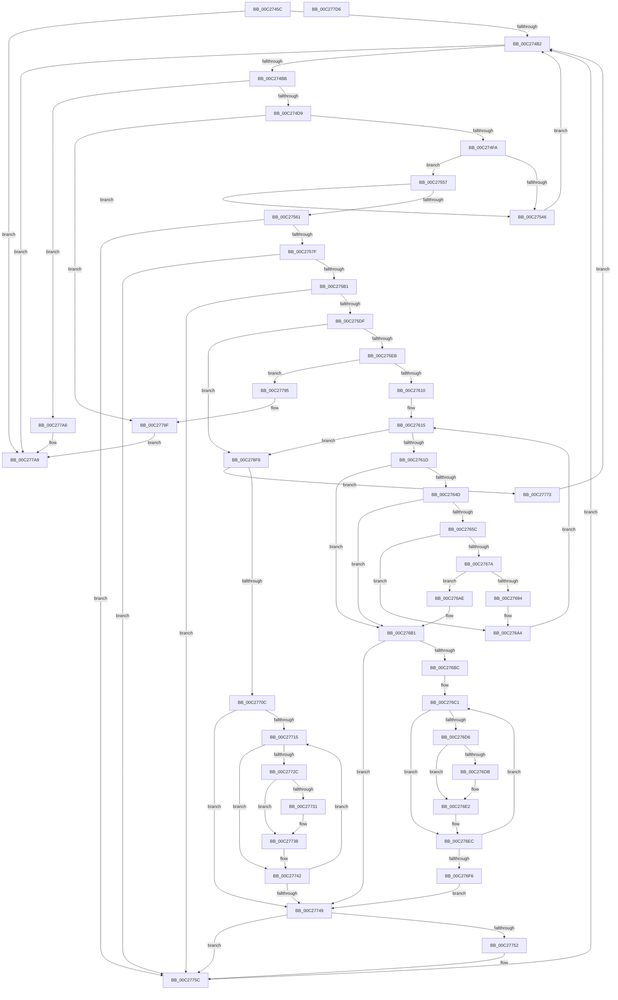

# EmpParseRules

- RVA: `0x00C2745C`–`0x00C277D7` (길이 `891` bytes)
- VA: `0x0000000140C2745C`
- 실행 섹션: `INIT`
- PDB 이름 있음: `예`; PDB Function 태그: `아니요`
- unwind 정보 RVA: `0x000C5B44`
- 디코드: `239`개 명령, `891/891` bytes 표시
- 미해석 바이트: `0` (있으면 어셈블리에 `.byte`로 보존)

> 이 문서는 커널 이미지의 기계어와 PDB 기호를 분석해 생성했습니다. 4번과 5번은 함수 원형과 자료형을 바이너리 사용 방식에서 추정한 C 해석이며 원본 소스 복구 결과는 아닙니다.

## 1. Dependencies

- 직접 호출 지점: **24**; 고유 호출 대상: **13**
- 직접 호출자로 확인된 함수: **1**
- RIP 상대 이미지 참조: **7**

### Outgoing calls
- `0x00C274A2` → [EmpInfParseGetSectionLineCount](EmpInfParseGetSectionLineCount_function_00C26460.md) (function, `0x00C26460`)
- `0x00C274C8` → [CmpGetKeyName](CmpGetKeyName_function_00C2838C.md) (function, `0x00C2838C`)
- `0x00C274E9` → [ExAllocatePool2](../../poolcode/B8/ExAllocatePool2_function_00B820F0.md) (function, `0x00B820F0`)
- `0x00C27538` → [EmpInfParseGetGuidFromName](EmpInfParseGetGuidFromName_function_00C263B4.md) (function, `0x00C263B4`)
- `0x00C2754B` → [ExFreePoolWithTag](../../poolcode/B8/ExFreePoolWithTag_function_00B82870.md) (function, `0x00B82870`)
- `0x00C27557` → [EmpSearchRuleDatabase](../../text/45/EmpSearchRuleDatabase_function_00458A9C.md) (function, `0x00458A9C`)
- `0x00C27571` → [CmpGetSectionLineIndex](CmpGetSectionLineIndex_function_00C283C4.md) (function, `0x00C283C4`)
- `0x00C27588` → [strtoul](../../text/4F/strtoul_function_004FF3B8.md) (function, `0x004FF3B8`)
- `0x00C275A3` → [CmpGetSectionLineIndex](CmpGetSectionLineIndex_function_00C283C4.md) (function, `0x00C283C4`)
- `0x00C275BA` → [strtoul](../../text/4F/strtoul_function_004FF3B8.md) (function, `0x004FF3B8`)
- `0x00C275CF` → [CmpGetSectionLineIndexValueCount](CmpGetSectionLineIndexValueCount_function_00C2843C.md) (function, `0x00C2843C`)
- `0x00C275FE` → [ExAllocatePool2](../../poolcode/B8/ExAllocatePool2_function_00B820F0.md) (function, `0x00B820F0`)
- `0x00C2762D` → [CmpGetSectionLineIndex](CmpGetSectionLineIndex_function_00C283C4.md) (function, `0x00C283C4`)
- `0x00C27644` → [EmpInfParseGetGuidFromName](EmpInfParseGetGuidFromName_function_00C263B4.md) (function, `0x00C263B4`)
- `0x00C27652` → [EmpSearchEntryDatabase](../../text/58/EmpSearchEntryDatabase_function_00580CE8.md) (function, `0x00580CE8`)
- `0x00C27671` → [EmpInfParseSearchDependencyList](EmpInfParseSearchDependencyList_function_00C26558.md) (function, `0x00C26558`)
- `0x00C2768A` → [ExAllocatePool2](../../poolcode/B8/ExAllocatePool2_function_00B820F0.md) (function, `0x00B820F0`)
- `0x00C276E7` → [ExFreePoolWithTag](../../poolcode/B8/ExFreePoolWithTag_function_00B82870.md) (function, `0x00B82870`)
- `0x00C27701` → [EmpParseRuleExpression](EmpParseRuleExpression_function_00C26A70.md) (function, `0x00C26A70`)
- `0x00C2773D` → [ExFreePoolWithTag](../../poolcode/B8/ExFreePoolWithTag_function_00B82870.md) (function, `0x00B82870`)
- `0x00C27757` → [ExFreePoolWithTag](../../poolcode/B8/ExFreePoolWithTag_function_00B82870.md) (function, `0x00B82870`)
- `0x00C27764` → [ExFreePoolWithTag](../../poolcode/B8/ExFreePoolWithTag_function_00B82870.md) (function, `0x00B82870`)
- `0x00C2779A` → [ExFreePoolWithTag](../../poolcode/B8/ExFreePoolWithTag_function_00B82870.md) (function, `0x00B82870`)
- `0x00C277B3` → [_security_check_cookie](../../text/6A/_security_check_cookie_function_006AC640.md) (function, `0x006AC640`)

### Direct callers
- [EmpParseInfDatabase](EmpParseInfDatabase_function_00C26934.md) at `0x00C269C6`

### Static image references
- `0x00C27478` → RVA `0x00E0A740` (`.data`; read)
- `0x00C2748A` → RVA `0x00C79710` (` ?? ::PBOPGDP::`string'`; read)
- `0x00C27501` → RVA `0x00C796E0` (` ?? ::PBOPGDP::`string'`; read)
- `0x00C2763A` → RVA `0x00C796B0` (` ?? ::PBOPGDP::`string'`; read)
- `0x00C27773` → RVA `0x00F8F178` (`.data`; read)
- `0x00C27783` → RVA `0x00E65BD4` (`.data`; read/write)
- `0x00C27789` → RVA `0x00F8F178` (`.data`; write)

## 2. Other-region calls and transfers

- 다른 실행 섹션으로 향하는 call: **14**
  - `0x00C274E9` → [ExAllocatePool2](../../poolcode/B8/ExAllocatePool2_function_00B820F0.md) (`INIT` → `POOLCODE`)
  - `0x00C2754B` → [ExFreePoolWithTag](../../poolcode/B8/ExFreePoolWithTag_function_00B82870.md) (`INIT` → `POOLCODE`)
  - `0x00C27557` → [EmpSearchRuleDatabase](../../text/45/EmpSearchRuleDatabase_function_00458A9C.md) (`INIT` → `.text`)
  - `0x00C27588` → [strtoul](../../text/4F/strtoul_function_004FF3B8.md) (`INIT` → `.text`)
  - `0x00C275BA` → [strtoul](../../text/4F/strtoul_function_004FF3B8.md) (`INIT` → `.text`)
  - `0x00C275FE` → [ExAllocatePool2](../../poolcode/B8/ExAllocatePool2_function_00B820F0.md) (`INIT` → `POOLCODE`)
  - `0x00C27652` → [EmpSearchEntryDatabase](../../text/58/EmpSearchEntryDatabase_function_00580CE8.md) (`INIT` → `.text`)
  - `0x00C2768A` → [ExAllocatePool2](../../poolcode/B8/ExAllocatePool2_function_00B820F0.md) (`INIT` → `POOLCODE`)
  - `0x00C276E7` → [ExFreePoolWithTag](../../poolcode/B8/ExFreePoolWithTag_function_00B82870.md) (`INIT` → `POOLCODE`)
  - `0x00C2773D` → [ExFreePoolWithTag](../../poolcode/B8/ExFreePoolWithTag_function_00B82870.md) (`INIT` → `POOLCODE`)
  - `0x00C27757` → [ExFreePoolWithTag](../../poolcode/B8/ExFreePoolWithTag_function_00B82870.md) (`INIT` → `POOLCODE`)
  - `0x00C27764` → [ExFreePoolWithTag](../../poolcode/B8/ExFreePoolWithTag_function_00B82870.md) (`INIT` → `POOLCODE`)
  - `0x00C2779A` → [ExFreePoolWithTag](../../poolcode/B8/ExFreePoolWithTag_function_00B82870.md) (`INIT` → `POOLCODE`)
  - `0x00C277B3` → [_security_check_cookie](../../text/6A/_security_check_cookie_function_006AC640.md) (`INIT` → `.text`)
- 별도 외부 분기/꼬리 이동을 확인하지 못했습니다.

## 3. Assembly (complete function range)

```asm
00C2745C  48 89 5C 24 10                  mov qword ptr [rsp + 0x10], rbx
00C27461  48 89 6C 24 18                  mov qword ptr [rsp + 0x18], rbp
00C27466  48 89 74 24 20                  mov qword ptr [rsp + 0x20], rsi
00C2746B  57                              push rdi
00C2746C  41 54                           push r12
00C2746E  41 55                           push r13
00C27470  41 56                           push r14
00C27472  41 57                           push r15
00C27474  48 83 EC 40                     sub rsp, 0x40
00C27478  48 8B 05 C1 32 1E 00            mov rax, qword ptr [rip + 0x1e32c1]
00C2747F  48 33 C4                        xor rax, rsp
00C27482  48 89 44 24 30                  mov qword ptr [rsp + 0x30], rax
00C27487  0F 57 C0                        xorps xmm0, xmm0
00C2748A  48 8D 15 7F 22 05 00            lea rdx, [rip + 0x5227f]
00C27491  45 33 F6                        xor r14d, r14d
00C27494  4C 8B F9                        mov r15, rcx
00C27497  0F 11 44 24 20                  movups xmmword ptr [rsp + 0x20], xmm0
00C2749C  41 8B F6                        mov esi, r14d
00C2749F  41 8B FE                        mov edi, r14d
00C274A2  E8 B9 EF FF FF                  call 0x140c26460
00C274A7  44 8B E8                        mov r13d, eax
00C274AA  85 C0                           test eax, eax
00C274AC  0F 84 F7 02 00 00               je 0x140c277a9
00C274B2  41 3B F5                        cmp esi, r13d
00C274B5  0F 83 EE 02 00 00               jae 0x140c277a9
00C274BB  44 8B C6                        mov r8d, esi
00C274BE  48 8D 15 4B 22 05 00            lea rdx, [rip + 0x5224b]
00C274C5  49 8B CF                        mov rcx, r15
00C274C8  E8 BF 0E 00 00                  call 0x140c2838c
00C274CD  4C 8B E0                        mov r12, rax
00C274D0  48 85 C0                        test rax, rax
00C274D3  0F 84 CD 02 00 00               je 0x140c277a6
00C274D9  BA 68 00 00 00                  mov edx, 0x68
00C274DE  B9 00 01 00 00                  mov ecx, 0x100
00C274E3  41 B8 45 4D 69 74               mov r8d, 0x74694d45
00C274E9  E8 02 AC F5 FF                  call 0x140b820f0
00C274EE  48 8B D8                        mov rbx, rax
00C274F1  48 85 C0                        test rax, rax
00C274F4  0F 84 A5 02 00 00               je 0x140c2779f
00C274FA  C7 40 10 01 00 00 00            mov dword ptr [rax + 0x10], 1
00C27501  48 8D 15 D8 21 05 00            lea rdx, [rip + 0x521d8]
00C27508  44 88 70 14                     mov byte ptr [rax + 0x14], r14b
00C2750C  4C 8B CB                        mov r9, rbx
00C2750F  4C 89 70 38                     mov qword ptr [rax + 0x38], r14
00C27513  4D 8B C4                        mov r8, r12
00C27516  4C 89 70 40                     mov qword ptr [rax + 0x40], r14
00C2751A  49 8B CF                        mov rcx, r15
00C2751D  4C 89 70 48                     mov qword ptr [rax + 0x48], r14
00C27521  4C 89 70 20                     mov qword ptr [rax + 0x20], r14
00C27525  48 83 C0 50                     add rax, 0x50
00C27529  48 89 40 08                     mov qword ptr [rax + 8], rax
00C2752D  48 89 00                        mov qword ptr [rax], rax
00C27530  44 89 73 30                     mov dword ptr [rbx + 0x30], r14d
00C27534  44 89 73 28                     mov dword ptr [rbx + 0x28], r14d
00C27538  E8 77 EE FF FF                  call 0x140c263b4
00C2753D  8B F8                           mov edi, eax
00C2753F  48 8B CB                        mov rcx, rbx
00C27542  85 C0                           test eax, eax
00C27544  79 11                           jns 0x140c27557
00C27546  BA 45 4D 69 74                  mov edx, 0x74694d45
00C2754B  E8 20 B3 F5 FF                  call 0x140b82870
00C27550  FF C6                           inc esi
00C27552  E9 5B FF FF FF                  jmp 0x140c274b2
00C27557  E8 40 15 83 FF                  call 0x140458a9c
00C2755C  48 85 C0                        test rax, rax
00C2755F  75 E5                           jne 0x140c27546
00C27561  45 33 C9                        xor r9d, r9d
00C27564  48 8D 15 A5 21 05 00            lea rdx, [rip + 0x521a5]
00C2756B  44 8B C6                        mov r8d, esi
00C2756E  49 8B CF                        mov rcx, r15
00C27571  E8 4E 0E 00 00                  call 0x140c283c4
00C27576  48 85 C0                        test rax, rax
00C27579  0F 84 DD 01 00 00               je 0x140c2775c
00C2757F  33 D2                           xor edx, edx
00C27581  48 8B C8                        mov rcx, rax
00C27584  44 8D 42 0A                     lea r8d, [rdx + 0xa]
00C27588  E8 2B 7E 8D FF                  call 0x1404ff3b8
00C2758D  41 B9 01 00 00 00               mov r9d, 1
00C27593  89 43 28                        mov dword ptr [rbx + 0x28], eax
00C27596  44 8B C6                        mov r8d, esi
00C27599  48 8D 15 70 21 05 00            lea rdx, [rip + 0x52170]
00C275A0  49 8B CF                        mov rcx, r15
00C275A3  E8 1C 0E 00 00                  call 0x140c283c4
00C275A8  48 85 C0                        test rax, rax
00C275AB  0F 84 AB 01 00 00               je 0x140c2775c
00C275B1  33 D2                           xor edx, edx
00C275B3  48 8B C8                        mov rcx, rax
00C275B6  44 8D 42 0A                     lea r8d, [rdx + 0xa]
00C275BA  E8 F9 7D 8D FF                  call 0x1404ff3b8
00C275BF  44 8B C6                        mov r8d, esi
00C275C2  89 43 2C                        mov dword ptr [rbx + 0x2c], eax
00C275C5  48 8D 15 44 21 05 00            lea rdx, [rip + 0x52144]
00C275CC  49 8B CF                        mov rcx, r15
00C275CF  E8 68 0E 00 00                  call 0x140c2843c
00C275D4  8B E8                           mov ebp, eax
00C275D6  83 F8 02                        cmp eax, 2
00C275D9  0F 82 7D 01 00 00               jb 0x140c2775c
00C275DF  83 C0 FE                        add eax, -2
00C275E2  89 43 30                        mov dword ptr [rbx + 0x30], eax
00C275E5  0F 84 0D 01 00 00               je 0x140c276f8
00C275EB  8B D0                           mov edx, eax
00C275ED  BF 45 4D 69 74                  mov edi, 0x74694d45
00C275F2  48 C1 E2 03                     shl rdx, 3
00C275F6  44 8B C7                        mov r8d, edi
00C275F9  B9 00 01 00 00                  mov ecx, 0x100
00C275FE  E8 ED AA F5 FF                  call 0x140b820f0
00C27603  48 89 43 38                     mov qword ptr [rbx + 0x38], rax
00C27607  48 85 C0                        test rax, rax
00C2760A  0F 84 85 01 00 00               je 0x140c27795
00C27610  BF 02 00 00 00                  mov edi, 2
00C27615  3B FD                           cmp edi, ebp
00C27617  0F 83 DB 00 00 00               jae 0x140c276f8
00C2761D  44 8B CF                        mov r9d, edi
00C27620  48 8D 15 E9 20 05 00            lea rdx, [rip + 0x520e9]
00C27627  44 8B C6                        mov r8d, esi
00C2762A  49 8B CF                        mov rcx, r15
00C2762D  E8 92 0D 00 00                  call 0x140c283c4
00C27632  4C 8D 4C 24 20                  lea r9, [rsp + 0x20]
00C27637  4C 8B C0                        mov r8, rax
00C2763A  48 8D 15 6F 20 05 00            lea rdx, [rip + 0x5206f]
00C27641  49 8B CF                        mov rcx, r15
00C27644  E8 6B ED FF FF                  call 0x140c263b4
00C27649  85 C0                           test eax, eax
00C2764B  78 64                           js 0x140c276b1
00C2764D  48 8D 4C 24 20                  lea rcx, [rsp + 0x20]
00C27652  E8 91 96 95 FF                  call 0x140580ce8
00C27657  48 85 C0                        test rax, rax
00C2765A  74 55                           je 0x140c276b1
00C2765C  48 8B 4B 38                     mov rcx, qword ptr [rbx + 0x38]
00C27660  8D 57 FE                        lea edx, [rdi - 2]
00C27663  4C 8D 70 48                     lea r14, [rax + 0x48]
00C27667  48 89 04 D1                     mov qword ptr [rcx + rdx*8], rax
00C2766B  48 8B D3                        mov rdx, rbx
00C2766E  49 8B CE                        mov rcx, r14
00C27671  E8 E2 EE FF FF                  call 0x140c26558
00C27676  84 C0                           test al, al
00C27678  75 2A                           jne 0x140c276a4
00C2767A  BA 18 00 00 00                  mov edx, 0x18
00C2767F  B9 00 01 00 00                  mov ecx, 0x100
00C27684  41 B8 45 4D 69 74               mov r8d, 0x74694d45
00C2768A  E8 61 AA F5 FF                  call 0x140b820f0
00C2768F  48 85 C0                        test rax, rax
00C27692  74 1A                           je 0x140c276ae
00C27694  48 89 18                        mov qword ptr [rax], rbx
00C27697  48 8D 48 08                     lea rcx, [rax + 8]
00C2769B  49 8B 06                        mov rax, qword ptr [r14]
00C2769E  48 89 01                        mov qword ptr [rcx], rax
00C276A1  49 89 0E                        mov qword ptr [r14], rcx
00C276A4  FF C7                           inc edi
00C276A6  45 33 F6                        xor r14d, r14d
00C276A9  E9 67 FF FF FF                  jmp 0x140c27615
00C276AE  45 33 F6                        xor r14d, r14d
00C276B1  8D 47 FE                        lea eax, [rdi - 2]
00C276B4  85 C0                           test eax, eax
00C276B6  0F 84 8D 00 00 00               je 0x140c27749
00C276BC  49 8B FE                        mov rdi, r14
00C276BF  8B E8                           mov ebp, eax
00C276C1  48 8B 43 38                     mov rax, qword ptr [rbx + 0x38]
00C276C5  48 8B 14 07                     mov rdx, qword ptr [rdi + rax]
00C276C9  48 8B 42 48                     mov rax, qword ptr [rdx + 0x48]
00C276CD  48 8D 48 F8                     lea rcx, [rax - 8]
00C276D1  48 39 19                        cmp qword ptr [rcx], rbx
00C276D4  75 16                           jne 0x140c276ec
00C276D6  48 85 C0                        test rax, rax
00C276D9  74 07                           je 0x140c276e2
00C276DB  48 8B 00                        mov rax, qword ptr [rax]
00C276DE  48 89 42 48                     mov qword ptr [rdx + 0x48], rax
00C276E2  BA 45 4D 69 74                  mov edx, 0x74694d45
00C276E7  E8 84 B1 F5 FF                  call 0x140b82870
00C276EC  48 83 C7 08                     add rdi, 8
00C276F0  48 83 ED 01                     sub rbp, 1
00C276F4  75 CB                           jne 0x140c276c1
00C276F6  EB 51                           jmp 0x140c27749
00C276F8  4C 8B C3                        mov r8, rbx
00C276FB  49 8B D4                        mov rdx, r12
00C276FE  49 8B CF                        mov rcx, r15
00C27701  E8 6A F3 FF FF                  call 0x140c26a70
00C27706  8B F8                           mov edi, eax
00C27708  85 C0                           test eax, eax
00C2770A  79 67                           jns 0x140c27773
00C2770C  41 8B FE                        mov edi, r14d
00C2770F  44 39 73 30                     cmp dword ptr [rbx + 0x30], r14d
00C27713  76 34                           jbe 0x140c27749
00C27715  48 8B 43 38                     mov rax, qword ptr [rbx + 0x38]
00C27719  8B CF                           mov ecx, edi
00C2771B  48 8B 14 C8                     mov rdx, qword ptr [rax + rcx*8]
00C2771F  48 8B 42 48                     mov rax, qword ptr [rdx + 0x48]
00C27723  48 8D 48 F8                     lea rcx, [rax - 8]
00C27727  48 39 19                        cmp qword ptr [rcx], rbx
00C2772A  75 16                           jne 0x140c27742
00C2772C  48 85 C0                        test rax, rax
00C2772F  74 07                           je 0x140c27738
00C27731  48 8B 00                        mov rax, qword ptr [rax]
00C27734  48 89 42 48                     mov qword ptr [rdx + 0x48], rax
00C27738  BA 45 4D 69 74                  mov edx, 0x74694d45
00C2773D  E8 2E B1 F5 FF                  call 0x140b82870
00C27742  FF C7                           inc edi
00C27744  3B 7B 30                        cmp edi, dword ptr [rbx + 0x30]
00C27747  72 CC                           jb 0x140c27715
00C27749  48 8B 4B 38                     mov rcx, qword ptr [rbx + 0x38]
00C2774D  48 85 C9                        test rcx, rcx
00C27750  74 0A                           je 0x140c2775c
00C27752  BA 45 4D 69 74                  mov edx, 0x74694d45
00C27757  E8 14 B1 F5 FF                  call 0x140b82870
00C2775C  BA 45 4D 69 74                  mov edx, 0x74694d45
00C27761  48 8B CB                        mov rcx, rbx
00C27764  E8 07 B1 F5 FF                  call 0x140b82870
00C27769  FF C6                           inc esi
00C2776B  41 8B FE                        mov edi, r14d
00C2776E  E9 3F FD FF FF                  jmp 0x140c274b2
00C27773  48 8B 05 FE 79 36 00            mov rax, qword ptr [rip + 0x3679fe]
00C2777A  48 8D 4B 18                     lea rcx, [rbx + 0x18]
00C2777E  FF C6                           inc esi
00C27780  48 89 01                        mov qword ptr [rcx], rax
00C27783  FF 05 4B E4 23 00               inc dword ptr [rip + 0x23e44b]
00C27789  48 89 0D E8 79 36 00            mov qword ptr [rip + 0x3679e8], rcx
00C27790  E9 1D FD FF FF                  jmp 0x140c274b2
00C27795  8B D7                           mov edx, edi
00C27797  48 8B CB                        mov rcx, rbx
00C2779A  E8 D1 B0 F5 FF                  call 0x140b82870
00C2779F  BF 9A 00 00 C0                  mov edi, 0xc000009a
00C277A4  EB 03                           jmp 0x140c277a9
00C277A6  41 8B FE                        mov edi, r14d
00C277A9  8B C7                           mov eax, edi
00C277AB  48 8B 4C 24 30                  mov rcx, qword ptr [rsp + 0x30]
00C277B0  48 33 CC                        xor rcx, rsp
00C277B3  E8 88 4E A8 FF                  call 0x1406ac640
00C277B8  4C 8D 5C 24 40                  lea r11, [rsp + 0x40]
00C277BD  49 8B 5B 38                     mov rbx, qword ptr [r11 + 0x38]
00C277C1  49 8B 6B 40                     mov rbp, qword ptr [r11 + 0x40]
00C277C5  49 8B 73 48                     mov rsi, qword ptr [r11 + 0x48]
00C277C9  49 8B E3                        mov rsp, r11
00C277CC  41 5F                           pop r15
00C277CE  41 5E                           pop r14
00C277D0  41 5D                           pop r13
00C277D2  41 5C                           pop r12
00C277D4  5F                              pop rdi
00C277D5  C3                              ret
00C277D6  CC                              int3
```

## 4. C-style interpretation (structured pseudocode)

```c
__int64 __fastcall EmpParseRules(__int64 a1)
{
    __int64 result;
    __int64 v_r14;
    __int64 v_rbp;
    __int64 v_rdi;
    __int64 v_rsi;
    __int64 v_rsp;
    unsigned __int64 v_stack_m28;
    unsigned __int64 v_stack_m38;
    unsigned __int64 v_stack_m48;
    unsigned __int64 v_stack_p10;
    unsigned __int64 v_stack_p18;
    unsigned __int64 v_stack_p20;

    v_stack_p10 = v_rbx;
    v_stack_p18 = v_rbp;
    v_stack_p20 = v_rsi;
    v_rsp = (v_rsp) - (64);
    result = (*(unsigned __int64 *)(v_rip + 1979073)) ^ (v_rsp);
    v_stack_m38 = result;
    v_r14 = 0;
    v_stack_m48 = v_xmm0;
    result = EmpInfParseGetSectionLineCount(a1, v_rip + 336511, a3, a4);
    if ((unsigned int)(result) == 0) goto loc_00C277A9;
loc_00C274B2:
    if (0 >= ((unsigned int)((unsigned int)((unsigned int)(result))))) goto loc_00C277A9;
    result = CmpGetKeyName(a1, v_rip + 336459, 0, a4);
    if (result == 0) goto loc_00C277A6;
    result = ExAllocatePool2(256, 104, (unsigned int)(0x74694D45ULL), a4);
    if (result == 0) goto loc_00C2779F;
    *(unsigned int *)(result + 16) = 1;
    *(unsigned __int8 *)(result + 20) = 0;
    *(unsigned __int64 *)(result + 56) = 0;
    *(unsigned __int64 *)(result + 64) = 0;
    *(unsigned __int64 *)(result + 72) = 0;
    *(unsigned __int64 *)(result + 32) = 0;
    result = (result) + (80);
    *(unsigned __int64 *)(result + 8) = result;
    *(unsigned __int64 *)(result) = result;
    *(unsigned int *)(result + 48) = 0;
    *(unsigned int *)(result + 40) = 0;
    result = EmpInfParseGetGuidFromName(a1, v_rip + 336344, result, result);
    if (!sign_flag) goto loc_00C27557;
loc_00C27546:
    result = ExFreePoolWithTag(result, (unsigned int)(0x74694D45ULL), result, result);
    v_rsi = (unsigned int)((0) + 1);
    goto loc_00C274B2;
loc_00C27557:
    result = EmpSearchRuleDatabase(result, (unsigned int)(0x74694D45ULL), result, result);
    if (result != 0) goto loc_00C27546;
    a4 = 0;
    result = CmpGetSectionLineIndex(a1, v_rip + 336293, (unsigned int)((unsigned int)(v_rsi)), a4);
    if (result == 0) goto loc_00C2775C;
    a2 = 0;
    result = strtoul(result, a2, a2 + 10, a4);
    *(unsigned int *)(result + 40) = (unsigned int)(result);
    result = CmpGetSectionLineIndex(a1, v_rip + 336240, (unsigned int)((unsigned int)(v_rsi)), 1);
    if (result == 0) goto loc_00C2775C;
    a2 = 0;
    result = strtoul(result, a2, a2 + 10, 1);
    *(unsigned int *)(result + 44) = (unsigned int)(result);
    result = CmpGetSectionLineIndexValueCount(a1, v_rip + 336196, (unsigned int)((unsigned int)(v_rsi)), 1);
    if (((unsigned int)(result)) < 2) goto loc_00C2775C;
    result = (unsigned int)((result) + (-2));
    *(unsigned int *)(result + 48) = (unsigned int)(result);
    if (condition_is_equal) goto loc_00C276F8;
    a2 = ((unsigned int)((unsigned int)(result))) << (3);
    result = ExAllocatePool2(256, a2, (unsigned int)((unsigned int)((unsigned int)(0x74694D45ULL))), 1);
    *(unsigned __int64 *)(result + 56) = result;
    if (result == 0) goto loc_00C27795;
loc_00C27615:
    if (2 >= ((unsigned int)((unsigned int)((unsigned int)(result))))) goto loc_00C276F8;
    result = CmpGetSectionLineIndex(a1, v_rip + 336105, (unsigned int)((unsigned int)(v_rsi)), 2);
    result = EmpInfParseGetGuidFromName(a1, v_rip + 335983, result, v_stack_m48);
    if (sign_flag) goto loc_00C276B1;
    result = EmpSearchEntryDatabase(v_stack_m48, v_rip + 335983, result, v_stack_m48);
    if (result == 0) goto loc_00C276B1;
    *(unsigned __int64 *)(*(unsigned __int64 *)(result + 56) + 2 - 2 * 8) = result;
    result = EmpInfParseSearchDependencyList(result + 72, result, result, v_stack_m48);
    if ((unsigned __int8)(result) != 0) goto loc_00C276A4;
    result = ExAllocatePool2(256, 24, (unsigned int)(0x74694D45ULL), v_stack_m48);
    if (result == 0) goto loc_00C276AE;
    *(unsigned __int64 *)(result) = result;
    *(unsigned __int64 *)(result + 8) = *(unsigned __int64 *)(result + 72);
    *(unsigned __int64 *)(result + 72) = result + 8;
loc_00C276A4:
    v_rdi = (unsigned int)((2) + 1);
    v_r14 = 0;
    goto loc_00C27615;
loc_00C276AE:
    v_r14 = 0;
loc_00C276B1:
    if ((unsigned int)(v_rdi - 2) == 0) goto loc_00C27749;
loc_00C276C1:
    if ((*(unsigned __int64 *)(*(unsigned __int64 *)(*(unsigned __int64 *)(0 + *(unsigned __int64 *)(result + 56) * 1) + 72) - 8)) != result) goto loc_00C276EC;
    result = *(unsigned __int64 *)(*(unsigned __int64 *)(0 + *(unsigned __int64 *)(result + 56) * 1) + 72);
    if (*(unsigned __int64 *)(*(unsigned __int64 *)(0 + *(unsigned __int64 *)(result + 56) * 1) + 72) != 0) {
        result = *(unsigned __int64 *)(*(unsigned __int64 *)(*(unsigned __int64 *)(0 + *(unsigned __int64 *)(result + 56) * 1) + 72));
        *(unsigned __int64 *)(*(unsigned __int64 *)(0 + *(unsigned __int64 *)(result + 56) * 1) + 72) = result;
    }
    result = ExFreePoolWithTag(*(unsigned __int64 *)(*(unsigned __int64 *)(0 + *(unsigned __int64 *)(result + 56) * 1) + 72) - 8, (unsigned int)(0x74694D45ULL), (unsigned int)(0x74694D45ULL), v_stack_m48);
loc_00C276EC:
    v_rdi = (0) + (8);
    v_rbp = ((unsigned int)((unsigned int)(v_rdi - 2))) - (1);
    if (condition_is_not_equal) goto loc_00C276C1;
    goto loc_00C27749;
loc_00C276F8:
    result = EmpParseRuleExpression(a1, result, result, v_stack_m48);
    if (!sign_flag) goto loc_00C27773;
    if ((*(unsigned int *)(result + 48)) <= 0) goto loc_00C27749;
loc_00C27715:
    if ((*(unsigned __int64 *)(*(unsigned __int64 *)(*(unsigned __int64 *)(*(unsigned __int64 *)(result + 56) + 0 * 8) + 72) - 8)) != result) goto loc_00C27742;
    result = *(unsigned __int64 *)(*(unsigned __int64 *)(*(unsigned __int64 *)(result + 56) + 0 * 8) + 72);
    if (*(unsigned __int64 *)(*(unsigned __int64 *)(*(unsigned __int64 *)(result + 56) + 0 * 8) + 72) != 0) {
        result = *(unsigned __int64 *)(*(unsigned __int64 *)(*(unsigned __int64 *)(*(unsigned __int64 *)(result + 56) + 0 * 8) + 72));
        *(unsigned __int64 *)(*(unsigned __int64 *)(*(unsigned __int64 *)(result + 56) + 0 * 8) + 72) = result;
    }
    result = ExFreePoolWithTag(*(unsigned __int64 *)(*(unsigned __int64 *)(*(unsigned __int64 *)(result + 56) + 0 * 8) + 72) - 8, (unsigned int)(0x74694D45ULL), result, v_stack_m48);
loc_00C27742:
    v_rdi = (unsigned int)((0) + 1);
    if (((unsigned int)(v_rdi)) < (*(unsigned int *)(result + 48))) goto loc_00C27715;
loc_00C27749:
    if (*(unsigned __int64 *)(result + 56) != 0) {
        a2 = 0x74694D45ULL;
        result = ExFreePoolWithTag(*(unsigned __int64 *)(result + 56), a2, result, v_stack_m48);
    }
    result = ExFreePoolWithTag(result, (unsigned int)(0x74694D45ULL), result, v_stack_m48);
    v_rsi = (unsigned int)((v_rsi) + 1);
    goto loc_00C274B2;
loc_00C27773:
    v_rsi = (unsigned int)((v_rsi) + 1);
    *(unsigned __int64 *)(result + 24) = *(unsigned __int64 *)(v_rip + 3570174);
    *(unsigned __int64 *)(v_rip + 3570152) = result + 24;
    goto loc_00C274B2;
loc_00C27795:
    result = ExFreePoolWithTag(result, 0, result, v_stack_m48);
loc_00C2779F:
    goto loc_00C277A9;
loc_00C277A6:
loc_00C277A9:
    a1 = (v_stack_m38) ^ (v_rsp);
    result = _security_check_cookie(a1, 0, result, v_stack_m48);
    return result;
}
```

## 5. (Beta) C Style

```c
int64_t EmpParseRules(int64_t Arg1)
{
    int64_t result;
    int64_t local_r14;
    int64_t local_rbp;
    int64_t local_rdi;
    int64_t local_rsi;
    int64_t local_rsp;
    uint64_t v_stack_m28;
    uint64_t v_stack_m38;
    uint64_t v_stack_m48;
    uint64_t v_stack_p10;
    uint64_t v_stack_p18;
    uint64_t v_stack_p20;

    v_stack_p10 = local_rbx;
    v_stack_p18 = local_rbp;
    v_stack_p20 = local_rsi;
    local_rsp = (local_rsp) - (64);
    result = (*(uint64_t *)(v_rip + 0x1E32C1)) ^ (local_rsp);
    v_stack_m38 = result;
    local_r14 = 0;
    v_stack_m48 = v_xmm0;
    result = EmpInfParseGetSectionLineCount(Arg1, v_rip + 336511, a3, a4);
    if ((uint32_t)(result) == 0) goto loc_00C277A9;
loc_00C274B2:
    if (0 >= ((uint32_t)((uint32_t)((uint32_t)(result))))) goto loc_00C277A9;
    result = CmpGetKeyName(Arg1, v_rip + 336459, 0, a4);
    if (result == 0) goto loc_00C277A6;
    result = ExAllocatePool2(256, 104, (uint32_t)(0x74694D45ULL), a4);
    if (result == 0) goto loc_00C2779F;
    *(uint32_t *)(result + 0x10) = 1;
    *(uint8_t *)(result + 0x14) = 0;
    *(uint64_t *)(result + 0x38) = 0;
    *(uint64_t *)(result + 0x40) = 0;
    *(uint64_t *)(result + 0x48) = 0;
    *(uint64_t *)(result + 0x20) = 0;
    result = (result) + (80);
    *(uint64_t *)(result + 0x8) = result;
    *(uint64_t *)(result) = result;
    *(uint32_t *)(result + 0x30) = 0;
    *(uint32_t *)(result + 0x28) = 0;
    result = EmpInfParseGetGuidFromName(Arg1, v_rip + 336344, result, result);
    if (!sign_flag) goto loc_00C27557;
loc_00C27546:
    result = ExFreePoolWithTag(result, (uint32_t)(0x74694D45ULL), result, result);
    local_rsi = (uint32_t)((0) + 1);
    goto loc_00C274B2;
loc_00C27557:
    result = EmpSearchRuleDatabase(result, (uint32_t)(0x74694D45ULL), result, result);
    if (result != 0) goto loc_00C27546;
    a4 = 0;
    result = CmpGetSectionLineIndex(Arg1, v_rip + 336293, (uint32_t)((uint32_t)(local_rsi)), a4);
    if (result == 0) goto loc_00C2775C;
    a2 = 0;
    result = strtoul(result, a2, a2 + 10, a4);
    *(uint32_t *)(result + 0x28) = (uint32_t)(result);
    result = CmpGetSectionLineIndex(Arg1, v_rip + 336240, (uint32_t)((uint32_t)(local_rsi)), 1);
    if (result == 0) goto loc_00C2775C;
    a2 = 0;
    result = strtoul(result, a2, a2 + 10, 1);
    *(uint32_t *)(result + 0x2C) = (uint32_t)(result);
    result = CmpGetSectionLineIndexValueCount(Arg1, v_rip + 336196, (uint32_t)((uint32_t)(local_rsi)), 1);
    if (((uint32_t)(result)) < 2) goto loc_00C2775C;
    result = (uint32_t)((result) + (-2));
    *(uint32_t *)(result + 0x30) = (uint32_t)(result);
    if (condition_is_equal) goto loc_00C276F8;
    a2 = ((uint32_t)((uint32_t)(result))) << (3);
    result = ExAllocatePool2(256, a2, (uint32_t)((uint32_t)((uint32_t)(0x74694D45ULL))), 1);
    *(uint64_t *)(result + 0x38) = result;
    if (result == 0) goto loc_00C27795;
loc_00C27615:
    if (2 >= ((uint32_t)((uint32_t)((uint32_t)(result))))) goto loc_00C276F8;
    result = CmpGetSectionLineIndex(Arg1, v_rip + 336105, (uint32_t)((uint32_t)(local_rsi)), 2);
    result = EmpInfParseGetGuidFromName(Arg1, v_rip + 335983, result, v_stack_m48);
    if (sign_flag) goto loc_00C276B1;
    result = EmpSearchEntryDatabase(v_stack_m48, v_rip + 335983, result, v_stack_m48);
    if (result == 0) goto loc_00C276B1;
    *(uint64_t *)(*(uint64_t *)(result + 0x38) + 0x2 - 0x2 * 8) = result;
    result = EmpInfParseSearchDependencyList(result + 72, result, result, v_stack_m48);
    if ((uint8_t)(result) != 0) goto loc_00C276A4;
    result = ExAllocatePool2(256, 24, (uint32_t)(0x74694D45ULL), v_stack_m48);
    if (result == 0) goto loc_00C276AE;
    *(uint64_t *)(result) = result;
    *(uint64_t *)(result + 0x8) = *(uint64_t *)(result + 0x48);
    *(uint64_t *)(result + 0x48) = result + 8;
loc_00C276A4:
    local_rdi = (uint32_t)((2) + 1);
    local_r14 = 0;
    goto loc_00C27615;
loc_00C276AE:
    local_r14 = 0;
loc_00C276B1:
    if ((uint32_t)(local_rdi - 2) == 0) goto loc_00C27749;
loc_00C276C1:
    if ((*(uint64_t *)(*(uint64_t *)(*(uint64_t *)(0 + *(uint64_t *)(result + 0x38) * 1) + 0x48) - 0x8)) != result) goto loc_00C276EC;
    result = *(uint64_t *)(*(uint64_t *)(0 + *(uint64_t *)(result + 0x38) * 1) + 0x48);
    if (*(uint64_t *)(*(uint64_t *)(0 + *(uint64_t *)(result + 0x38) * 1) + 0x48) != 0) {
        result = *(uint64_t *)(*(uint64_t *)(*(uint64_t *)(0 + *(uint64_t *)(result + 0x38) * 1) + 0x48));
        *(uint64_t *)(*(uint64_t *)(0 + *(uint64_t *)(result + 0x38) * 1) + 0x48) = result;
    }
    result = ExFreePoolWithTag(*(uint64_t *)(*(uint64_t *)(0 + *(uint64_t *)(result + 0x38) * 1) + 0x48) - 8, (uint32_t)(0x74694D45ULL), (uint32_t)(0x74694D45ULL), v_stack_m48);
loc_00C276EC:
    local_rdi = (0) + (8);
    local_rbp = ((uint32_t)((uint32_t)(local_rdi - 2))) - (1);
    if (condition_is_not_equal) goto loc_00C276C1;
    goto loc_00C27749;
loc_00C276F8:
    result = EmpParseRuleExpression(Arg1, result, result, v_stack_m48);
    if (!sign_flag) goto loc_00C27773;
    if ((*(uint32_t *)(result + 0x30)) <= 0) goto loc_00C27749;
loc_00C27715:
    if ((*(uint64_t *)(*(uint64_t *)(*(uint64_t *)(*(uint64_t *)(result + 0x38) + 0x0 * 8) + 0x48) - 0x8)) != result) goto loc_00C27742;
    result = *(uint64_t *)(*(uint64_t *)(*(uint64_t *)(result + 0x38) + 0x0 * 8) + 0x48);
    if (*(uint64_t *)(*(uint64_t *)(*(uint64_t *)(result + 0x38) + 0x0 * 8) + 0x48) != 0) {
        result = *(uint64_t *)(*(uint64_t *)(*(uint64_t *)(*(uint64_t *)(result + 0x38) + 0x0 * 8) + 0x48));
        *(uint64_t *)(*(uint64_t *)(*(uint64_t *)(result + 0x38) + 0x0 * 8) + 0x48) = result;
    }
    result = ExFreePoolWithTag(*(uint64_t *)(*(uint64_t *)(*(uint64_t *)(result + 0x38) + 0x0 * 8) + 0x48) - 8, (uint32_t)(0x74694D45ULL), result, v_stack_m48);
loc_00C27742:
    local_rdi = (uint32_t)((0) + 1);
    if (((uint32_t)(local_rdi)) < (*(uint32_t *)(result + 0x30))) goto loc_00C27715;
loc_00C27749:
    if (*(uint64_t *)(result + 0x38) != 0) {
        a2 = 0x74694D45ULL;
        result = ExFreePoolWithTag(*(uint64_t *)(result + 0x38), a2, result, v_stack_m48);
    }
    result = ExFreePoolWithTag(result, (uint32_t)(0x74694D45ULL), result, v_stack_m48);
    local_rsi = (uint32_t)((local_rsi) + 1);
    goto loc_00C274B2;
loc_00C27773:
    local_rsi = (uint32_t)((local_rsi) + 1);
    *(uint64_t *)(result + 0x18) = *(uint64_t *)(v_rip + 0x3679FE);
    *(uint64_t *)(v_rip + 0x3679E8) = result + 24;
    goto loc_00C274B2;
loc_00C27795:
    result = ExFreePoolWithTag(result, 0, result, v_stack_m48);
loc_00C2779F:
    goto loc_00C277A9;
loc_00C277A6:
loc_00C277A9:
    Arg1 = (v_stack_m38) ^ (local_rsp);
    result = _security_check_cookie(Arg1, 0, result, v_stack_m48);
    return result;
}
```

## 6. Execution-region graph

[열기: 2D/3D 그래프와 함수 탐색 컨트롤 패널](../../../control-panel.html?section=init&rva=0x00C2745C&view=graph)

- 2D 그래프는 위에서 아래로 흐르고, 3D 그래프는 빈 공간을 드래그해 회전합니다. Shift+드래그는 이동, 휠은 확대·축소, 함수 노드 선택은 대상 보고서 이동입니다.

### Static fallback


