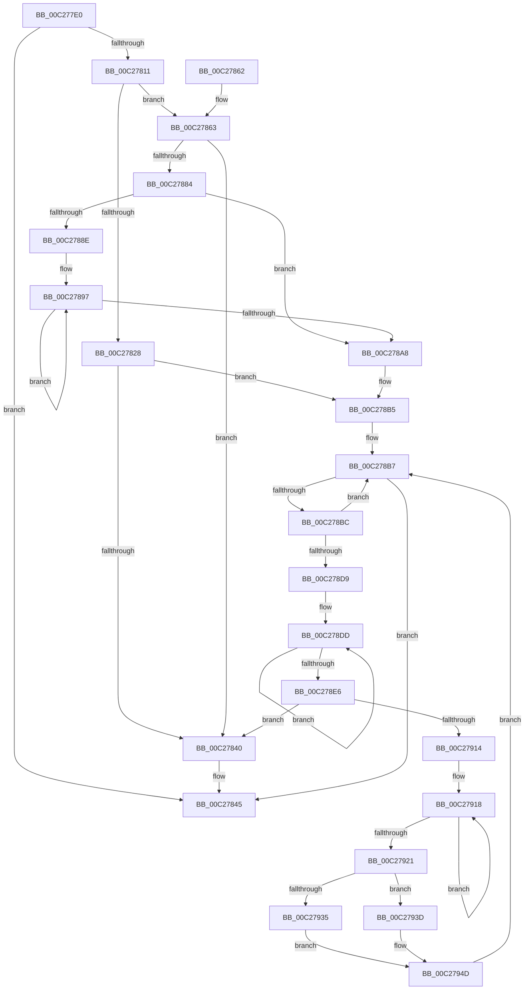

# EmpParseStrings

- RVA: `0x00C277E0`–`0x00C27954` (길이 `372` bytes)
- VA: `0x0000000140C277E0`
- 실행 섹션: `INIT`
- PDB 이름 있음: `예`; PDB Function 태그: `아니요`
- unwind 정보 RVA: `0x000C5B00`
- 디코드: `100`개 명령, `372/372` bytes 표시
- 미해석 바이트: `0` (있으면 어셈블리에 `.byte`로 보존)

> 이 문서는 커널 이미지의 기계어와 PDB 기호를 분석해 생성했습니다. 4번과 5번은 함수 원형과 자료형을 바이너리 사용 방식에서 추정한 C 해석이며 원본 소스 복구 결과는 아닙니다.

## 1. Dependencies

- 직접 호출 지점: **8**; 고유 호출 대상: **5**
- 직접 호출자로 확인된 함수: **1**
- RIP 상대 이미지 참조: **5**

### Outgoing calls
- `0x00C27805` → [EmpInfParseGetSectionLineCount](EmpInfParseGetSectionLineCount_function_00C26460.md) (function, `0x00C26460`)
- `0x00C2782F` → [ExAllocatePool2](../../poolcode/B8/ExAllocatePool2_function_00B820F0.md) (function, `0x00B820F0`)
- `0x00C27870` → [ExAllocatePool2](../../poolcode/B8/ExAllocatePool2_function_00B820F0.md) (function, `0x00B820F0`)
- `0x00C278B0` → [ExFreePoolWithTag](../../poolcode/B8/ExFreePoolWithTag_function_00B82870.md) (function, `0x00B82870`)
- `0x00C278CC` → [CmpGetSectionLineIndex](CmpGetSectionLineIndex_function_00C283C4.md) (function, `0x00C283C4`)
- `0x00C278F4` → [ExAllocatePool2](../../poolcode/B8/ExAllocatePool2_function_00B820F0.md) (function, `0x00B820F0`)
- `0x00C2792A` → [RtlStringCchCopyA](../../text/46/RtlStringCchCopyA_function_00460628.md) (function, `0x00460628`)
- `0x00C27946` → [ExFreePoolWithTag](../../poolcode/B8/ExFreePoolWithTag_function_00B82870.md) (function, `0x00B82870`)

### Direct callers
- [EmpParseInfDatabase](EmpParseInfDatabase_function_00C26934.md) at `0x00C269D4`

### Static image references
- `0x00C277F9` → RVA `0x00C79680` (` ?? ::PBOPGDP::`string'`; read)
- `0x00C27811` → RVA `0x00E65BE0` (`.data`; read)
- `0x00C27834` → RVA `0x00E65BE0` (`.data`; write)
- `0x00C27863` → RVA `0x00E65BDC` (`.data`; read)
- `0x00C27935` → RVA `0x00E65BDC` (`.data`; read/write)

## 2. Other-region calls and transfers

- 다른 실행 섹션으로 향하는 call: **6**
  - `0x00C2782F` → [ExAllocatePool2](../../poolcode/B8/ExAllocatePool2_function_00B820F0.md) (`INIT` → `POOLCODE`)
  - `0x00C27870` → [ExAllocatePool2](../../poolcode/B8/ExAllocatePool2_function_00B820F0.md) (`INIT` → `POOLCODE`)
  - `0x00C278B0` → [ExFreePoolWithTag](../../poolcode/B8/ExFreePoolWithTag_function_00B82870.md) (`INIT` → `POOLCODE`)
  - `0x00C278F4` → [ExAllocatePool2](../../poolcode/B8/ExAllocatePool2_function_00B820F0.md) (`INIT` → `POOLCODE`)
  - `0x00C2792A` → [RtlStringCchCopyA](../../text/46/RtlStringCchCopyA_function_00460628.md) (`INIT` → `.text`)
  - `0x00C27946` → [ExFreePoolWithTag](../../poolcode/B8/ExFreePoolWithTag_function_00B82870.md) (`INIT` → `POOLCODE`)
- 별도 외부 분기/꼬리 이동을 확인하지 못했습니다.

## 3. Assembly (complete function range)

```asm
00C277E0  48 8B C4                        mov rax, rsp
00C277E3  48 89 58 08                     mov qword ptr [rax + 8], rbx
00C277E7  48 89 68 10                     mov qword ptr [rax + 0x10], rbp
00C277EB  48 89 78 18                     mov qword ptr [rax + 0x18], rdi
00C277EF  4C 89 60 20                     mov qword ptr [rax + 0x20], r12
00C277F3  41 56                           push r14
00C277F5  48 83 EC 20                     sub rsp, 0x20
00C277F9  48 8D 15 80 1E 05 00            lea rdx, [rip + 0x51e80]
00C27800  4C 8B E1                        mov r12, rcx
00C27803  33 DB                           xor ebx, ebx
00C27805  E8 56 EC FF FF                  call 0x140c26460
00C2780A  44 8B F0                        mov r14d, eax
00C2780D  85 C0                           test eax, eax
00C2780F  74 34                           je 0x140c27845
00C27811  48 8B 3D C8 E3 23 00            mov rdi, qword ptr [rip + 0x23e3c8]
00C27818  B9 00 01 00 00                  mov ecx, 0x100
00C2781D  41 B8 45 4D 69 74               mov r8d, 0x74694d45
00C27823  48 85 FF                        test rdi, rdi
00C27826  75 3B                           jne 0x140c27863
00C27828  41 8B D6                        mov edx, r14d
00C2782B  48 C1 E2 03                     shl rdx, 3
00C2782F  E8 BC A8 F5 FF                  call 0x140b820f0
00C27834  48 89 05 A5 E3 23 00            mov qword ptr [rip + 0x23e3a5], rax
00C2783B  48 85 C0                        test rax, rax
00C2783E  75 75                           jne 0x140c278b5
00C27840  BB 9A 00 00 C0                  mov ebx, 0xc000009a
00C27845  48 8B 6C 24 38                  mov rbp, qword ptr [rsp + 0x38]
00C2784A  8B C3                           mov eax, ebx
00C2784C  48 8B 5C 24 30                  mov rbx, qword ptr [rsp + 0x30]
00C27851  48 8B 7C 24 40                  mov rdi, qword ptr [rsp + 0x40]
00C27856  4C 8B 64 24 48                  mov r12, qword ptr [rsp + 0x48]
00C2785B  48 83 C4 20                     add rsp, 0x20
00C2785F  41 5E                           pop r14
00C27861  C3                              ret
00C27862  CC                              int3
00C27863  8B 15 73 E3 23 00               mov edx, dword ptr [rip + 0x23e373]
00C27869  41 03 D6                        add edx, r14d
00C2786C  48 C1 E2 03                     shl rdx, 3
00C27870  E8 7B A8 F5 FF                  call 0x140b820f0
00C27875  48 89 05 64 E3 23 00            mov qword ptr [rip + 0x23e364], rax
00C2787C  48 8B C8                        mov rcx, rax
00C2787F  48 85 C0                        test rax, rax
00C27882  74 BC                           je 0x140c27840
00C27884  8B 05 52 E3 23 00               mov eax, dword ptr [rip + 0x23e352]
00C2788A  85 C0                           test eax, eax
00C2788C  74 1A                           je 0x140c278a8
00C2788E  48 8B D7                        mov rdx, rdi
00C27891  44 8B C0                        mov r8d, eax
00C27894  48 2B D1                        sub rdx, rcx
00C27897  48 8B 04 11                     mov rax, qword ptr [rcx + rdx]
00C2789B  48 89 01                        mov qword ptr [rcx], rax
00C2789E  48 8D 49 08                     lea rcx, [rcx + 8]
00C278A2  49 83 E8 01                     sub r8, 1
00C278A6  75 EF                           jne 0x140c27897
00C278A8  BA 45 4D 69 74                  mov edx, 0x74694d45
00C278AD  48 8B CF                        mov rcx, rdi
00C278B0  E8 BB AF F5 FF                  call 0x140b82870
00C278B5  33 FF                           xor edi, edi
00C278B7  41 3B FE                        cmp edi, r14d
00C278BA  73 89                           jae 0x140c27845
00C278BC  45 33 C9                        xor r9d, r9d
00C278BF  48 8D 15 BA 1D 05 00            lea rdx, [rip + 0x51dba]
00C278C6  44 8B C7                        mov r8d, edi
00C278C9  49 8B CC                        mov rcx, r12
00C278CC  E8 F3 0A 00 00                  call 0x140c283c4
00C278D1  48 8B E8                        mov rbp, rax
00C278D4  48 85 C0                        test rax, rax
00C278D7  74 DE                           je 0x140c278b7
00C278D9  48 83 CA FF                     or rdx, 0xffffffffffffffff
00C278DD  48 FF C2                        inc rdx
00C278E0  80 3C 02 00                     cmp byte ptr [rdx + rax], 0
00C278E4  75 F7                           jne 0x140c278dd
00C278E6  48 FF C2                        inc rdx
00C278E9  B9 00 01 00 00                  mov ecx, 0x100
00C278EE  41 B8 45 4D 69 74               mov r8d, 0x74694d45
00C278F4  E8 F7 A7 F5 FF                  call 0x140b820f0
00C278F9  44 8B 15 DC E2 23 00            mov r10d, dword ptr [rip + 0x23e2dc]
00C27900  4C 8B 1D D9 E2 23 00            mov r11, qword ptr [rip + 0x23e2d9]
00C27907  4B 89 04 D3                     mov qword ptr [r11 + r10*8], rax
00C2790B  48 85 C0                        test rax, rax
00C2790E  0F 84 2C FF FF FF               je 0x140c27840
00C27914  48 83 CA FF                     or rdx, 0xffffffffffffffff
00C27918  48 FF C2                        inc rdx
00C2791B  80 3C 2A 00                     cmp byte ptr [rdx + rbp], 0
00C2791F  75 F7                           jne 0x140c27918
00C27921  48 FF C2                        inc rdx
00C27924  4C 8B C5                        mov r8, rbp
00C27927  48 8B C8                        mov rcx, rax
00C2792A  E8 F9 8C 83 FF                  call 0x140460628
00C2792F  8B D8                           mov ebx, eax
00C27931  85 C0                           test eax, eax
00C27933  78 08                           js 0x140c2793d
00C27935  FF 05 A1 E2 23 00               inc dword ptr [rip + 0x23e2a1]
00C2793B  EB 10                           jmp 0x140c2794d
00C2793D  4B 8B 0C D3                     mov rcx, qword ptr [r11 + r10*8]
00C27941  BA 45 4D 69 74                  mov edx, 0x74694d45
00C27946  E8 25 AF F5 FF                  call 0x140b82870
00C2794B  33 DB                           xor ebx, ebx
00C2794D  FF C7                           inc edi
00C2794F  E9 63 FF FF FF                  jmp 0x140c278b7
```

## 4. C-style interpretation (structured pseudocode)

```c
__int64 __fastcall EmpParseStrings(__int64 a1, __int64 a2, __int64 a3, int a4)
{
    __int64 result;
    __int64 v_rbx;
    __int64 v_rdi;
    __int64 v_rsp;
    unsigned __int64 v_stack_p10;
    unsigned __int64 v_stack_p18;
    unsigned __int64 v_stack_p20;
    unsigned __int64 v_stack_p8;

    *(unsigned __int64 *)(v_rsp + 8) = v_rbx;
    *(unsigned __int64 *)(v_rsp + 16) = v_rbp;
    *(unsigned __int64 *)(v_rsp + 24) = v_rdi;
    *(unsigned __int64 *)(v_rsp + 32) = v_r12;
    v_rsp = (v_rsp) - (32);
    v_rbx = 0;
    result = EmpInfParseGetSectionLineCount(a1, v_rip + 335488, a3, a4);
    if ((unsigned int)(result) == 0) goto loc_00C27845;
    if (*(unsigned __int64 *)(v_rip + 2352072) != 0) goto loc_00C27863;
    a2 = ((unsigned int)((unsigned int)((unsigned int)((unsigned int)(result))))) << (3);
    result = ExAllocatePool2(256, a2, (unsigned int)(0x74694D45ULL), a4);
    *(unsigned __int64 *)(v_rip + 2352037) = result;
    if (result != 0) goto loc_00C278B5;
loc_00C27840:
loc_00C27845:
    v_rsp = (v_rsp) + (32);
    return (unsigned int)((unsigned int)((unsigned int)(0xC000009AULL)));
loc_00C27863:
    a2 = (unsigned int)(((unsigned int)(*(unsigned int *)(v_rip + 2351987))) + ((unsigned int)((unsigned int)((unsigned int)(result)))));
    a2 = (a2) << (3);
    result = ExAllocatePool2(256, a2, (unsigned int)(0x74694D45ULL), a4);
    *(unsigned __int64 *)(v_rip + 2351972) = result;
    if (result == 0) goto loc_00C27840;
    if ((unsigned int)((unsigned int)(*(unsigned int *)(v_rip + 2351954))) == 0) goto loc_00C278A8;
    a2 = (v_stack_p18) - (result);
loc_00C27897:
    *(unsigned __int64 *)(result) = *(unsigned __int64 *)(result + a2 * 1);
    a3 = ((unsigned int)((unsigned int)((unsigned int)(*(unsigned int *)(v_rip + 2351954))))) - (1);
    if (condition_is_not_equal) goto loc_00C27897;
loc_00C278A8:
    result = ExFreePoolWithTag(v_stack_p18, (unsigned int)(0x74694D45ULL), a3, a4);
loc_00C278B5:
    v_rdi = 0;
loc_00C278B7:
    if (0 >= ((unsigned int)((unsigned int)((unsigned int)(result))))) goto loc_00C27845;
    a4 = 0;
    result = CmpGetSectionLineIndex(v_stack_p20, v_rip + 335290, 0, a4);
    if (result == 0) goto loc_00C278B7;
    a2 = (v_rip + 335290) | (-1);
loc_00C278DD:
    a2 = (a2) + 1;
    if ((*(unsigned __int8 *)(a2 + result * 1)) != 0) goto loc_00C278DD;
    a2 = (a2) + 1;
    result = ExAllocatePool2(256, a2, (unsigned int)(0x74694D45ULL), a4);
    *(unsigned __int64 *)(*(unsigned __int64 *)(v_rip + 2351833) + (unsigned int)(*(unsigned int *)(v_rip + 2351836)) * 8) = result;
    if (result == 0) goto loc_00C27840;
    a2 = (a2) | (-1);
loc_00C27918:
    a2 = (a2) + 1;
    if ((*(unsigned __int8 *)(a2 + result * 1)) != 0) goto loc_00C27918;
    a2 = (a2) + 1;
    result = RtlStringCchCopyA(result, a2, result, a4);
    if (sign_flag) goto loc_00C2793D;
    goto loc_00C2794D;
loc_00C2793D:
    result = ExFreePoolWithTag(*(unsigned __int64 *)(*(unsigned __int64 *)(v_rip + 2351833) + (unsigned int)(*(unsigned int *)(v_rip + 2351836)) * 8), (unsigned int)(0x74694D45ULL), result, a4);
    v_rbx = 0;
loc_00C2794D:
    v_rdi = (unsigned int)((v_rdi) + 1);
    goto loc_00C278B7;
}
```

## 5. (Beta) C Style

```c
int64_t EmpParseStrings(int64_t Arg1, int64_t Arg2, int64_t Arg3, int32_t Arg4)
{
    int64_t result;
    int64_t local_rbx;
    int64_t local_rdi;
    int64_t local_rsp;
    uint64_t v_stack_p10;
    uint64_t v_stack_p18;
    uint64_t v_stack_p20;
    uint64_t v_stack_p8;

    *(uint64_t *)(local_rsp + 0x8) = local_rbx;
    *(uint64_t *)(local_rsp + 0x10) = local_rbp;
    *(uint64_t *)(local_rsp + 0x18) = local_rdi;
    *(uint64_t *)(local_rsp + 0x20) = local_r12;
    local_rsp = (local_rsp) - (32);
    local_rbx = 0;
    result = EmpInfParseGetSectionLineCount(Arg1, v_rip + 335488, Arg3, Arg4);
    if ((uint32_t)(result) == 0) goto loc_00C27845;
    if (*(uint64_t *)(v_rip + 0x23E3C8) != 0) goto loc_00C27863;
    Arg2 = ((uint32_t)((uint32_t)((uint32_t)((uint32_t)(result))))) << (3);
    result = ExAllocatePool2(256, Arg2, (uint32_t)(0x74694D45ULL), Arg4);
    *(uint64_t *)(v_rip + 0x23E3A5) = result;
    if (result != 0) goto loc_00C278B5;
loc_00C27840:
loc_00C27845:
    local_rsp = (local_rsp) + (32);
    return (uint32_t)((uint32_t)((uint32_t)(0xC000009AULL)));
loc_00C27863:
    Arg2 = (uint32_t)(((uint32_t)(*(uint32_t *)(v_rip + 0x23E373))) + ((uint32_t)((uint32_t)((uint32_t)(result)))));
    Arg2 = (Arg2) << (3);
    result = ExAllocatePool2(256, Arg2, (uint32_t)(0x74694D45ULL), Arg4);
    *(uint64_t *)(v_rip + 0x23E364) = result;
    if (result == 0) goto loc_00C27840;
    if ((uint32_t)((uint32_t)(*(uint32_t *)(v_rip + 0x23E352))) == 0) goto loc_00C278A8;
    Arg2 = (v_stack_p18) - (result);
loc_00C27897:
    *(uint64_t *)(result) = *(uint64_t *)(result + Arg2 * 1);
    Arg3 = ((uint32_t)((uint32_t)((uint32_t)(*(uint32_t *)(v_rip + 0x23E352))))) - (1);
    if (condition_is_not_equal) goto loc_00C27897;
loc_00C278A8:
    result = ExFreePoolWithTag(v_stack_p18, (uint32_t)(0x74694D45ULL), Arg3, Arg4);
loc_00C278B5:
    local_rdi = 0;
loc_00C278B7:
    if (0 >= ((uint32_t)((uint32_t)((uint32_t)(result))))) goto loc_00C27845;
    Arg4 = 0;
    result = CmpGetSectionLineIndex(v_stack_p20, v_rip + 335290, 0, Arg4);
    if (result == 0) goto loc_00C278B7;
    Arg2 = (v_rip + 335290) | (-1);
loc_00C278DD:
    Arg2 = (Arg2) + 1;
    if ((*(uint8_t *)(Arg2 + result * 1)) != 0) goto loc_00C278DD;
    Arg2 = (Arg2) + 1;
    result = ExAllocatePool2(256, Arg2, (uint32_t)(0x74694D45ULL), Arg4);
    *(uint64_t *)(*(uint64_t *)(v_rip + 0x23E2D9) + (uint32_t)(*(uint32_t *)(v_rip + 0x23E2DC)) * 8) = result;
    if (result == 0) goto loc_00C27840;
    Arg2 = (Arg2) | (-1);
loc_00C27918:
    Arg2 = (Arg2) + 1;
    if ((*(uint8_t *)(Arg2 + result * 1)) != 0) goto loc_00C27918;
    Arg2 = (Arg2) + 1;
    result = RtlStringCchCopyA(result, Arg2, result, Arg4);
    if (sign_flag) goto loc_00C2793D;
    goto loc_00C2794D;
loc_00C2793D:
    result = ExFreePoolWithTag(*(uint64_t *)(*(uint64_t *)(v_rip + 0x23E2D9) + (uint32_t)(*(uint32_t *)(v_rip + 0x23E2DC)) * 8), (uint32_t)(0x74694D45ULL), result, Arg4);
    local_rbx = 0;
loc_00C2794D:
    local_rdi = (uint32_t)((local_rdi) + 1);
    goto loc_00C278B7;
}
```

## 6. Execution-region graph

[열기: 2D/3D 그래프와 함수 탐색 컨트롤 패널](../../../control-panel.html?section=init&rva=0x00C277E0&view=graph)

- 2D 그래프는 위에서 아래로 흐르고, 3D 그래프는 빈 공간을 드래그해 회전합니다. Shift+드래그는 이동, 휠은 확대·축소, 함수 노드 선택은 대상 보고서 이동입니다.

### Static fallback


