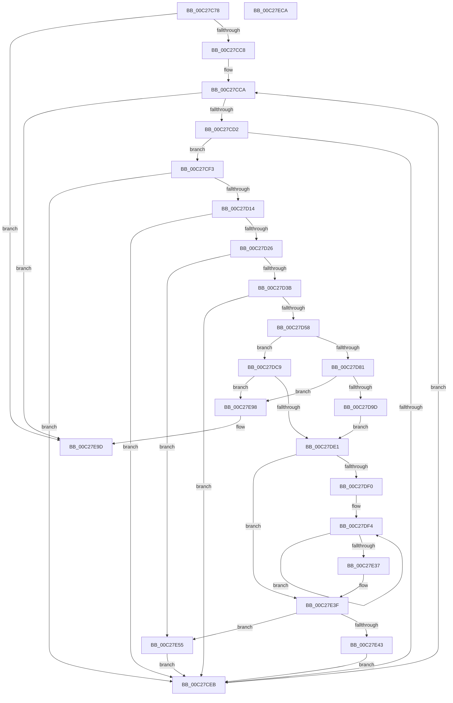

# EmpParseTargetRules

- RVA: `0x00C27C78`–`0x00C27ECB` (길이 `595` bytes)
- VA: `0x0000000140C27C78`
- 실행 섹션: `INIT`
- PDB 이름 있음: `예`; PDB Function 태그: `아니요`
- unwind 정보 RVA: `0x000C5B1C`
- 디코드: `158`개 명령, `595/595` bytes 표시
- 미해석 바이트: `0` (있으면 어셈블리에 `.byte`로 보존)

> 이 문서는 커널 이미지의 기계어와 PDB 기호를 분석해 생성했습니다. 4번과 5번은 함수 원형과 자료형을 바이너리 사용 방식에서 추정한 C 해석이며 원본 소스 복구 결과는 아닙니다.

## 1. Dependencies

- 직접 호출 지점: **15**; 고유 호출 대상: **12**
- 직접 호출자로 확인된 함수: **1**
- RIP 상대 이미지 참조: **6**

### Outgoing calls
- `0x00C27CB7` → [EmpInfParseGetSectionLineCount](EmpInfParseGetSectionLineCount_function_00C26460.md) (function, `0x00C26460`)
- `0x00C27CE1` → [CmpGetKeyName](CmpGetKeyName_function_00C2838C.md) (function, `0x00C2838C`)
- `0x00C27D05` → [EmpInfParseGetGuidFromName](EmpInfParseGetGuidFromName_function_00C263B4.md) (function, `0x00C263B4`)
- `0x00C27D19` → [EmpSearchRuleDatabase](../../text/45/EmpSearchRuleDatabase_function_00458A9C.md) (function, `0x00458A9C`)
- `0x00C27D48` → [CmpGetSectionLineIndexValueCount](CmpGetSectionLineIndexValueCount_function_00C2843C.md) (function, `0x00C2843C`)
- `0x00C27D5B` → [EmpSearchTargetRuleList](../../text/45/EmpSearchTargetRuleList_function_00456CE0.md) (function, `0x00456CE0`)
- `0x00C27D8C` → [ExAllocatePool2](../../poolcode/B8/ExAllocatePool2_function_00B820F0.md) (function, `0x00B820F0`)
- `0x00C27DAC` → [memcpy](../../text/6C/memcpy_function_006C6840.md) (function, `0x006C6840`)
- `0x00C27DC2` → [ExFreePoolWithTag](../../poolcode/B8/ExFreePoolWithTag_function_00B82870.md) (function, `0x00B82870`)
- `0x00C27DD0` → [ExAllocatePool2](../../poolcode/B8/ExAllocatePool2_function_00B820F0.md) (function, `0x00B820F0`)
- `0x00C27E04` → [CmpGetSectionLineIndex](CmpGetSectionLineIndex_function_00C283C4.md) (function, `0x00C283C4`)
- `0x00C27E2B` → [EmpParseTargetRuleStringIndexList](EmpParseTargetRuleStringIndexList_function_00C2795C.md) (function, `0x00C2795C`)
- `0x00C27E4B` → [ExFreePoolWithTag](../../poolcode/B8/ExFreePoolWithTag_function_00B82870.md) (function, `0x00B82870`)
- `0x00C27E65` → [ExAllocatePool2](../../poolcode/B8/ExAllocatePool2_function_00B820F0.md) (function, `0x00B820F0`)
- `0x00C27EA7` → [_security_check_cookie](../../text/6A/_security_check_cookie_function_006AC640.md) (function, `0x006AC640`)

### Direct callers
- [EmpParseInfDatabase](EmpParseInfDatabase_function_00C26934.md) at `0x00C269E2`

### Static image references
- `0x00C27C94` → RVA `0x00E0A740` (`.data`; read)
- `0x00C27CA6` → RVA `0x00C796F0` (` ?? ::PBOPGDP::`string'`; read)
- `0x00C27CFB` → RVA `0x00C796E0` (` ?? ::PBOPGDP::`string'`; read)
- `0x00C27E71` → RVA `0x00E65BD8` (`.data`; read/write)
- `0x00C27E82` → RVA `0x00F8F168` (`.data`; read)
- `0x00C27E8C` → RVA `0x00F8F168` (`.data`; write)

## 2. Other-region calls and transfers

- 다른 실행 섹션으로 향하는 call: **9**
  - `0x00C27D19` → [EmpSearchRuleDatabase](../../text/45/EmpSearchRuleDatabase_function_00458A9C.md) (`INIT` → `.text`)
  - `0x00C27D5B` → [EmpSearchTargetRuleList](../../text/45/EmpSearchTargetRuleList_function_00456CE0.md) (`INIT` → `.text`)
  - `0x00C27D8C` → [ExAllocatePool2](../../poolcode/B8/ExAllocatePool2_function_00B820F0.md) (`INIT` → `POOLCODE`)
  - `0x00C27DAC` → [memcpy](../../text/6C/memcpy_function_006C6840.md) (`INIT` → `.text`)
  - `0x00C27DC2` → [ExFreePoolWithTag](../../poolcode/B8/ExFreePoolWithTag_function_00B82870.md) (`INIT` → `POOLCODE`)
  - `0x00C27DD0` → [ExAllocatePool2](../../poolcode/B8/ExAllocatePool2_function_00B820F0.md) (`INIT` → `POOLCODE`)
  - `0x00C27E4B` → [ExFreePoolWithTag](../../poolcode/B8/ExFreePoolWithTag_function_00B82870.md) (`INIT` → `POOLCODE`)
  - `0x00C27E65` → [ExAllocatePool2](../../poolcode/B8/ExAllocatePool2_function_00B820F0.md) (`INIT` → `POOLCODE`)
  - `0x00C27EA7` → [_security_check_cookie](../../text/6A/_security_check_cookie_function_006AC640.md) (`INIT` → `.text`)
- 별도 외부 분기/꼬리 이동을 확인하지 못했습니다.

## 3. Assembly (complete function range)

```asm
00C27C78  48 89 5C 24 10                  mov qword ptr [rsp + 0x10], rbx
00C27C7D  48 89 6C 24 18                  mov qword ptr [rsp + 0x18], rbp
00C27C82  48 89 74 24 20                  mov qword ptr [rsp + 0x20], rsi
00C27C87  57                              push rdi
00C27C88  41 54                           push r12
00C27C8A  41 55                           push r13
00C27C8C  41 56                           push r14
00C27C8E  41 57                           push r15
00C27C90  48 83 EC 70                     sub rsp, 0x70
00C27C94  48 8B 05 A5 2A 1E 00            mov rax, qword ptr [rip + 0x1e2aa5]
00C27C9B  48 33 C4                        xor rax, rsp
00C27C9E  48 89 44 24 68                  mov qword ptr [rsp + 0x68], rax
00C27CA3  0F 57 C0                        xorps xmm0, xmm0
00C27CA6  48 8D 15 43 1A 05 00            lea rdx, [rip + 0x51a43]
00C27CAD  0F 11 44 24 58                  movups xmmword ptr [rsp + 0x58], xmm0
00C27CB2  4C 8B F9                        mov r15, rcx
00C27CB5  33 FF                           xor edi, edi
00C27CB7  E8 A4 E7 FF FF                  call 0x140c26460
00C27CBC  89 44 24 40                     mov dword ptr [rsp + 0x40], eax
00C27CC0  85 C0                           test eax, eax
00C27CC2  0F 84 D5 01 00 00               je 0x140c27e9d
00C27CC8  33 DB                           xor ebx, ebx
00C27CCA  3B D8                           cmp ebx, eax
00C27CCC  0F 83 CB 01 00 00               jae 0x140c27e9d
00C27CD2  44 8B C3                        mov r8d, ebx
00C27CD5  48 8D 15 14 1A 05 00            lea rdx, [rip + 0x51a14]
00C27CDC  49 8B CF                        mov rcx, r15
00C27CDF  33 FF                           xor edi, edi
00C27CE1  E8 A6 06 00 00                  call 0x140c2838c
00C27CE6  48 85 C0                        test rax, rax
00C27CE9  75 08                           jne 0x140c27cf3
00C27CEB  8B 44 24 40                     mov eax, dword ptr [rsp + 0x40]
00C27CEF  FF C3                           inc ebx
00C27CF1  EB D7                           jmp 0x140c27cca
00C27CF3  4C 8D 4C 24 58                  lea r9, [rsp + 0x58]
00C27CF8  4C 8B C0                        mov r8, rax
00C27CFB  48 8D 15 DE 19 05 00            lea rdx, [rip + 0x519de]
00C27D02  49 8B CF                        mov rcx, r15
00C27D05  E8 AA E6 FF FF                  call 0x140c263b4
00C27D0A  89 44 24 50                     mov dword ptr [rsp + 0x50], eax
00C27D0E  8B F8                           mov edi, eax
00C27D10  85 C0                           test eax, eax
00C27D12  78 D7                           js 0x140c27ceb
00C27D14  48 8D 4C 24 58                  lea rcx, [rsp + 0x58]
00C27D19  E8 7E 0D 83 FF                  call 0x140458a9c
00C27D1E  48 8B F0                        mov rsi, rax
00C27D21  48 85 C0                        test rax, rax
00C27D24  74 C5                           je 0x140c27ceb
00C27D26  8B 40 28                        mov eax, dword ptr [rax + 0x28]
00C27D29  33 ED                           xor ebp, ebp
00C27D2B  45 33 F6                        xor r14d, r14d
00C27D2E  89 6C 24 44                     mov dword ptr [rsp + 0x44], ebp
00C27D32  03 46 2C                        add eax, dword ptr [rsi + 0x2c]
00C27D35  0F 84 1A 01 00 00               je 0x140c27e55
00C27D3B  44 8B C3                        mov r8d, ebx
00C27D3E  48 8D 15 AB 19 05 00            lea rdx, [rip + 0x519ab]
00C27D45  49 8B CF                        mov rcx, r15
00C27D48  E8 EF 06 00 00                  call 0x140c2843c
00C27D4D  89 44 24 48                     mov dword ptr [rsp + 0x48], eax
00C27D51  44 8B C0                        mov r8d, eax
00C27D54  85 C0                           test eax, eax
00C27D56  74 93                           je 0x140c27ceb
00C27D58  48 8B CE                        mov rcx, rsi
00C27D5B  E8 80 EF 82 FF                  call 0x140456ce0
00C27D60  8B 4E 28                        mov ecx, dword ptr [rsi + 0x28]
00C27D63  4C 8B E8                        mov r13, rax
00C27D66  8B 46 2C                        mov eax, dword ptr [rsi + 0x2c]
00C27D69  44 8D 24 08                     lea r12d, [rax + rcx]
00C27D6D  B9 00 01 00 00                  mov ecx, 0x100
00C27D72  45 0F AF E0                     imul r12d, r8d
00C27D76  41 B8 45 4D 69 74               mov r8d, 0x74694d45
00C27D7C  4D 85 ED                        test r13, r13
00C27D7F  74 48                           je 0x140c27dc9
00C27D81  45 03 65 18                     add r12d, dword ptr [r13 + 0x18]
00C27D85  41 8B D4                        mov edx, r12d
00C27D88  48 C1 E2 02                     shl rdx, 2
00C27D8C  E8 5F A3 F5 FF                  call 0x140b820f0
00C27D91  4C 8B F0                        mov r14, rax
00C27D94  48 85 C0                        test rax, rax
00C27D97  0F 84 FB 00 00 00               je 0x140c27e98
00C27D9D  45 8B 45 18                     mov r8d, dword ptr [r13 + 0x18]
00C27DA1  48 8B C8                        mov rcx, rax
00C27DA4  49 8B 55 10                     mov rdx, qword ptr [r13 + 0x10]
00C27DA8  49 C1 E0 02                     shl r8, 2
00C27DAC  E8 8F EA A9 FF                  call 0x1406c6840
00C27DB1  41 8B 6D 18                     mov ebp, dword ptr [r13 + 0x18]
00C27DB5  BA 45 4D 69 74                  mov edx, 0x74694d45
00C27DBA  49 8B 4D 10                     mov rcx, qword ptr [r13 + 0x10]
00C27DBE  89 6C 24 44                     mov dword ptr [rsp + 0x44], ebp
00C27DC2  E8 A9 AA F5 FF                  call 0x140b82870
00C27DC7  EB 18                           jmp 0x140c27de1
00C27DC9  41 8B D4                        mov edx, r12d
00C27DCC  48 C1 E2 02                     shl rdx, 2
00C27DD0  E8 1B A3 F5 FF                  call 0x140b820f0
00C27DD5  4C 8B F0                        mov r14, rax
00C27DD8  48 85 C0                        test rax, rax
00C27DDB  0F 84 B7 00 00 00               je 0x140c27e98
00C27DE1  83 64 24 4C 00                  and dword ptr [rsp + 0x4c], 0
00C27DE6  44 8B 6C 24 48                  mov r13d, dword ptr [rsp + 0x48]
00C27DEB  45 85 ED                        test r13d, r13d
00C27DEE  74 4F                           je 0x140c27e3f
00C27DF0  8B 7C 24 4C                     mov edi, dword ptr [rsp + 0x4c]
00C27DF4  44 8B CF                        mov r9d, edi
00C27DF7  48 8D 15 F2 18 05 00            lea rdx, [rip + 0x518f2]
00C27DFE  44 8B C3                        mov r8d, ebx
00C27E01  49 8B CF                        mov rcx, r15
00C27E04  E8 BB 05 00 00                  call 0x140c283c4
00C27E09  44 8B 4E 2C                     mov r9d, dword ptr [rsi + 0x2c]
00C27E0D  48 8D 4C 24 44                  lea rcx, [rsp + 0x44]
00C27E12  44 8B 46 28                     mov r8d, dword ptr [rsi + 0x28]
00C27E16  48 8B D0                        mov rdx, rax
00C27E19  48 89 4C 24 30                  mov qword ptr [rsp + 0x30], rcx
00C27E1E  49 8B CF                        mov rcx, r15
00C27E21  44 89 64 24 28                  mov dword ptr [rsp + 0x28], r12d
00C27E26  4C 89 74 24 20                  mov qword ptr [rsp + 0x20], r14
00C27E2B  E8 2C FB FF FF                  call 0x140c2795c
00C27E30  FF C7                           inc edi
00C27E32  41 3B FD                        cmp edi, r13d
00C27E35  72 BD                           jb 0x140c27df4
00C27E37  8B 7C 24 50                     mov edi, dword ptr [rsp + 0x50]
00C27E3B  8B 6C 24 44                     mov ebp, dword ptr [rsp + 0x44]
00C27E3F  85 ED                           test ebp, ebp
00C27E41  75 12                           jne 0x140c27e55
00C27E43  BA 45 4D 69 74                  mov edx, 0x74694d45
00C27E48  49 8B CE                        mov rcx, r14
00C27E4B  E8 20 AA F5 FF                  call 0x140b82870
00C27E50  E9 96 FE FF FF                  jmp 0x140c27ceb
00C27E55  BA 28 00 00 00                  mov edx, 0x28
00C27E5A  B9 00 01 00 00                  mov ecx, 0x100
00C27E5F  41 B8 45 4D 69 74               mov r8d, 0x74694d45
00C27E65  E8 86 A2 F5 FF                  call 0x140b820f0
00C27E6A  83 20 00                        and dword ptr [rax], 0
00C27E6D  48 8D 48 20                     lea rcx, [rax + 0x20]
00C27E71  FF 05 61 DD 23 00               inc dword ptr [rip + 0x23dd61]
00C27E77  48 89 70 08                     mov qword ptr [rax + 8], rsi
00C27E7B  4C 89 70 10                     mov qword ptr [rax + 0x10], r14
00C27E7F  89 68 18                        mov dword ptr [rax + 0x18], ebp
00C27E82  48 8B 05 DF 72 36 00            mov rax, qword ptr [rip + 0x3672df]
00C27E89  48 89 01                        mov qword ptr [rcx], rax
00C27E8C  48 89 0D D5 72 36 00            mov qword ptr [rip + 0x3672d5], rcx
00C27E93  E9 53 FE FF FF                  jmp 0x140c27ceb
00C27E98  BF 9A 00 00 C0                  mov edi, 0xc000009a
00C27E9D  8B C7                           mov eax, edi
00C27E9F  48 8B 4C 24 68                  mov rcx, qword ptr [rsp + 0x68]
00C27EA4  48 33 CC                        xor rcx, rsp
00C27EA7  E8 94 47 A8 FF                  call 0x1406ac640
00C27EAC  4C 8D 5C 24 70                  lea r11, [rsp + 0x70]
00C27EB1  49 8B 5B 38                     mov rbx, qword ptr [r11 + 0x38]
00C27EB5  49 8B 6B 40                     mov rbp, qword ptr [r11 + 0x40]
00C27EB9  49 8B 73 48                     mov rsi, qword ptr [r11 + 0x48]
00C27EBD  49 8B E3                        mov rsp, r11
00C27EC0  41 5F                           pop r15
00C27EC2  41 5E                           pop r14
00C27EC4  41 5D                           pop r13
00C27EC6  41 5C                           pop r12
00C27EC8  5F                              pop rdi
00C27EC9  C3                              ret
00C27ECA  CC                              int3
```

## 4. C-style interpretation (structured pseudocode)

```c
__int64 __fastcall EmpParseTargetRules(__int64 a1)
{
    __int64 result;
    __int64 v_r12;
    __int64 v_r14;
    __int64 v_rbp;
    __int64 v_rbx;
    __int64 v_rdi;
    __int64 v_rsp;
    unsigned __int64 v_stack_m28;
    unsigned __int64 v_stack_m30;
    unsigned __int64 v_stack_m40;
    unsigned int v_stack_m48;
    unsigned int v_stack_m4C;
    unsigned int v_stack_m50;
    unsigned int v_stack_m54;
    unsigned int v_stack_m58;
    unsigned __int64 v_stack_m68;
    unsigned int v_stack_m70;
    unsigned __int64 v_stack_m78;
    unsigned __int64 v_stack_p10;
    unsigned __int64 v_stack_p18;
    unsigned __int64 v_stack_p20;

    v_stack_p10 = v_rbx;
    v_stack_p18 = v_rbp;
    v_stack_p20 = v_rsi;
    v_rsp = (v_rsp) - (112);
    result = (*(unsigned __int64 *)(v_rip + 1976997)) ^ (v_rsp);
    v_stack_m30 = result;
    v_stack_m40 = v_xmm0;
    v_rdi = 0;
    result = EmpInfParseGetSectionLineCount(a1, v_rip + 334403, a3, a4);
    v_stack_m58 = (unsigned int)(result);
    if ((unsigned int)(result) == 0) goto loc_00C27E9D;
    v_rbx = 0;
loc_00C27CCA:
    if (0 >= ((unsigned int)(result))) goto loc_00C27E9D;
    v_rdi = 0;
    result = CmpGetKeyName(a1, v_rip + 334356, 0, a4);
    if (result != 0) goto loc_00C27CF3;
loc_00C27CEB:
    v_rbx = (unsigned int)((v_rbx) + 1);
    goto loc_00C27CCA;
loc_00C27CF3:
    result = EmpInfParseGetGuidFromName(a1, v_rip + 334302, (unsigned int)(v_stack_m58), v_stack_m40);
    v_stack_m48 = (unsigned int)(result);
    if (sign_flag) goto loc_00C27CEB;
    result = EmpSearchRuleDatabase(v_stack_m40, v_rip + 334302, (unsigned int)(v_stack_m58), v_stack_m40);
    if (result == 0) goto loc_00C27CEB;
    v_rbp = 0;
    v_r14 = 0;
    v_stack_m54 = 0;
    result = (unsigned int)(((unsigned int)(*(unsigned int *)(result + 40))) + (*(unsigned int *)(result + 44)));
    if (condition_is_equal) goto loc_00C27E55;
    result = CmpGetSectionLineIndexValueCount(a1, v_rip + 334251, (unsigned int)((unsigned int)(v_rbx)), v_stack_m40);
    v_stack_m50 = (unsigned int)(result);
    if ((unsigned int)(result) == 0) goto loc_00C27CEB;
    result = EmpSearchTargetRuleList(result, v_rip + 334251, (unsigned int)((unsigned int)(result)), v_stack_m40);
    v_r12 = (unsigned int)(((unsigned int)(*(unsigned int *)(result + 44)) + (unsigned int)(*(unsigned int *)(result + 40)) * 1) * ((unsigned int)((unsigned int)((unsigned int)(result)))));
    if (result == 0) goto loc_00C27DC9;
    v_r12 = (unsigned int)((v_r12) + (*(unsigned int *)(result + 24)));
    a2 = ((unsigned int)((unsigned int)(v_r12))) << (2);
    result = ExAllocatePool2(256, a2, (unsigned int)(0x74694D45ULL), v_stack_m40);
    if (result == 0) goto loc_00C27E98;
    a3 = ((unsigned int)(*(unsigned int *)(result + 24))) << (2);
    result = memcpy(result, *(unsigned __int64 *)(result + 16), a3, v_stack_m40);
    v_stack_m54 = (unsigned int)((unsigned int)(*(unsigned int *)(result + 24)));
    result = ExFreePoolWithTag(*(unsigned __int64 *)(result + 16), (unsigned int)(0x74694D45ULL), a3, v_stack_m40);
    goto loc_00C27DE1;
loc_00C27DC9:
    a2 = ((unsigned int)((unsigned int)(v_r12))) << (2);
    result = ExAllocatePool2(*(unsigned __int64 *)(result + 16), a2, a3, v_stack_m40);
    if (result == 0) goto loc_00C27E98;
loc_00C27DE1:
    if ((unsigned int)((unsigned int)(v_stack_m50)) == 0) goto loc_00C27E3F;
loc_00C27DF4:
    result = CmpGetSectionLineIndex(a1, v_rip + 334066, (unsigned int)((unsigned int)(v_rbx)), (unsigned int)((unsigned int)((unsigned int)(v_stack_m4C))));
    v_stack_m68 = v_stack_m54;
    v_stack_m70 = (unsigned int)(v_r12);
    v_stack_m78 = result;
    result = EmpParseTargetRuleStringIndexList(a1, result, (unsigned int)(*(unsigned int *)(result + 40)), (unsigned int)(*(unsigned int *)(result + 44)));
    v_rdi = (unsigned int)(((unsigned int)(v_stack_m4C)) + 1);
    if (((unsigned int)(v_rdi)) < ((unsigned int)((unsigned int)(v_stack_m50)))) goto loc_00C27DF4;
loc_00C27E3F:
    if ((unsigned int)((unsigned int)(v_stack_m54)) != 0) goto loc_00C27E55;
    result = ExFreePoolWithTag(result, (unsigned int)(0x74694D45ULL), (unsigned int)(*(unsigned int *)(result + 40)), (unsigned int)(*(unsigned int *)(result + 44)));
    goto loc_00C27CEB;
loc_00C27E55:
    result = ExAllocatePool2(256, 40, (unsigned int)(0x74694D45ULL), (unsigned int)(*(unsigned int *)(result + 44)));
    *(unsigned __int64 *)(result + 8) = result;
    *(unsigned __int64 *)(result + 16) = result;
    *(unsigned int *)(result + 24) = (unsigned int)((unsigned int)(v_stack_m54));
    *(unsigned __int64 *)(result + 32) = *(unsigned __int64 *)(v_rip + 3568351);
    *(unsigned __int64 *)(v_rip + 3568341) = result + 32;
    goto loc_00C27CEB;
loc_00C27E98:
loc_00C27E9D:
    a1 = (v_stack_m30) ^ (v_rsp);
    result = _security_check_cookie(a1, 40, (unsigned int)(0x74694D45ULL), (unsigned int)(*(unsigned int *)(result + 44)));
    return result;
}
```

## 5. (Beta) C Style

```c
int64_t EmpParseTargetRules(int64_t Arg1)
{
    int64_t result;
    int64_t local_r12;
    int64_t local_r14;
    int64_t local_rbp;
    int64_t local_rbx;
    int64_t local_rdi;
    int64_t local_rsp;
    uint64_t v_stack_m28;
    uint64_t v_stack_m30;
    uint64_t v_stack_m40;
    uint32_t v_stack_m48;
    uint32_t v_stack_m4C;
    uint32_t v_stack_m50;
    uint32_t v_stack_m54;
    uint32_t v_stack_m58;
    uint64_t v_stack_m68;
    uint32_t v_stack_m70;
    uint64_t v_stack_m78;
    uint64_t v_stack_p10;
    uint64_t v_stack_p18;
    uint64_t v_stack_p20;

    v_stack_p10 = local_rbx;
    v_stack_p18 = local_rbp;
    v_stack_p20 = local_rsi;
    local_rsp = (local_rsp) - (112);
    result = (*(uint64_t *)(v_rip + 0x1E2AA5)) ^ (local_rsp);
    v_stack_m30 = result;
    v_stack_m40 = v_xmm0;
    local_rdi = 0;
    result = EmpInfParseGetSectionLineCount(Arg1, v_rip + 334403, a3, a4);
    v_stack_m58 = (uint32_t)(result);
    if ((uint32_t)(result) == 0) goto loc_00C27E9D;
    local_rbx = 0;
loc_00C27CCA:
    if (0 >= ((uint32_t)(result))) goto loc_00C27E9D;
    local_rdi = 0;
    result = CmpGetKeyName(Arg1, v_rip + 334356, 0, a4);
    if (result != 0) goto loc_00C27CF3;
loc_00C27CEB:
    local_rbx = (uint32_t)((local_rbx) + 1);
    goto loc_00C27CCA;
loc_00C27CF3:
    result = EmpInfParseGetGuidFromName(Arg1, v_rip + 334302, (uint32_t)(v_stack_m58), v_stack_m40);
    v_stack_m48 = (uint32_t)(result);
    if (sign_flag) goto loc_00C27CEB;
    result = EmpSearchRuleDatabase(v_stack_m40, v_rip + 334302, (uint32_t)(v_stack_m58), v_stack_m40);
    if (result == 0) goto loc_00C27CEB;
    local_rbp = 0;
    local_r14 = 0;
    v_stack_m54 = 0;
    result = (uint32_t)(((uint32_t)(*(uint32_t *)(result + 0x28))) + (*(uint32_t *)(result + 0x2C)));
    if (condition_is_equal) goto loc_00C27E55;
    result = CmpGetSectionLineIndexValueCount(Arg1, v_rip + 334251, (uint32_t)((uint32_t)(local_rbx)), v_stack_m40);
    v_stack_m50 = (uint32_t)(result);
    if ((uint32_t)(result) == 0) goto loc_00C27CEB;
    result = EmpSearchTargetRuleList(result, v_rip + 334251, (uint32_t)((uint32_t)(result)), v_stack_m40);
    local_r12 = (uint32_t)(((uint32_t)(*(uint32_t *)(result + 0x2C)) + (uint32_t)(*(uint32_t *)(result + 0x28)) * 1) * ((uint32_t)((uint32_t)((uint32_t)(result)))));
    if (result == 0) goto loc_00C27DC9;
    local_r12 = (uint32_t)((local_r12) + (*(uint32_t *)(result + 0x18)));
    a2 = ((uint32_t)((uint32_t)(local_r12))) << (2);
    result = ExAllocatePool2(256, a2, (uint32_t)(0x74694D45ULL), v_stack_m40);
    if (result == 0) goto loc_00C27E98;
    a3 = ((uint32_t)(*(uint32_t *)(result + 0x18))) << (2);
    result = memcpy(result, *(uint64_t *)(result + 0x10), a3, v_stack_m40);
    v_stack_m54 = (uint32_t)((uint32_t)(*(uint32_t *)(result + 0x18)));
    result = ExFreePoolWithTag(*(uint64_t *)(result + 0x10), (uint32_t)(0x74694D45ULL), a3, v_stack_m40);
    goto loc_00C27DE1;
loc_00C27DC9:
    a2 = ((uint32_t)((uint32_t)(local_r12))) << (2);
    result = ExAllocatePool2(*(uint64_t *)(result + 0x10), a2, a3, v_stack_m40);
    if (result == 0) goto loc_00C27E98;
loc_00C27DE1:
    if ((uint32_t)((uint32_t)(v_stack_m50)) == 0) goto loc_00C27E3F;
loc_00C27DF4:
    result = CmpGetSectionLineIndex(Arg1, v_rip + 334066, (uint32_t)((uint32_t)(local_rbx)), (uint32_t)((uint32_t)((uint32_t)(v_stack_m4C))));
    v_stack_m68 = v_stack_m54;
    v_stack_m70 = (uint32_t)(local_r12);
    v_stack_m78 = result;
    result = EmpParseTargetRuleStringIndexList(Arg1, result, (uint32_t)(*(uint32_t *)(result + 0x28)), (uint32_t)(*(uint32_t *)(result + 0x2C)));
    local_rdi = (uint32_t)(((uint32_t)(v_stack_m4C)) + 1);
    if (((uint32_t)(local_rdi)) < ((uint32_t)((uint32_t)(v_stack_m50)))) goto loc_00C27DF4;
loc_00C27E3F:
    if ((uint32_t)((uint32_t)(v_stack_m54)) != 0) goto loc_00C27E55;
    result = ExFreePoolWithTag(result, (uint32_t)(0x74694D45ULL), (uint32_t)(*(uint32_t *)(result + 0x28)), (uint32_t)(*(uint32_t *)(result + 0x2C)));
    goto loc_00C27CEB;
loc_00C27E55:
    result = ExAllocatePool2(256, 40, (uint32_t)(0x74694D45ULL), (uint32_t)(*(uint32_t *)(result + 0x2C)));
    *(uint64_t *)(result + 0x8) = result;
    *(uint64_t *)(result + 0x10) = result;
    *(uint32_t *)(result + 0x18) = (uint32_t)((uint32_t)(v_stack_m54));
    *(uint64_t *)(result + 0x20) = *(uint64_t *)(v_rip + 0x3672DF);
    *(uint64_t *)(v_rip + 0x3672D5) = result + 32;
    goto loc_00C27CEB;
loc_00C27E98:
loc_00C27E9D:
    Arg1 = (v_stack_m30) ^ (local_rsp);
    result = _security_check_cookie(Arg1, 40, (uint32_t)(0x74694D45ULL), (uint32_t)(*(uint32_t *)(result + 0x2C)));
    return result;
}
```

## 6. Execution-region graph

[열기: 2D/3D 그래프와 함수 탐색 컨트롤 패널](../../../control-panel.html?section=init&rva=0x00C27C78&view=graph)

- 2D 그래프는 위에서 아래로 흐르고, 3D 그래프는 빈 공간을 드래그해 회전합니다. Shift+드래그는 이동, 휠은 확대·축소, 함수 노드 선택은 대상 보고서 이동입니다.

### Static fallback


