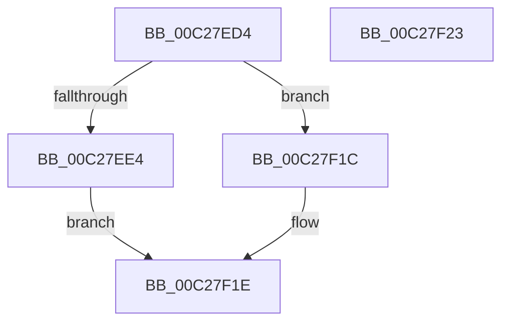

# EmpRuleParserStackPop

- RVA: `0x00C27ED4`–`0x00C27F24` (길이 `80` bytes)
- VA: `0x0000000140C27ED4`
- 실행 섹션: `INIT`
- PDB 이름 있음: `예`; PDB Function 태그: `아니요`
- unwind 정보 RVA: `0x0005C788`
- 디코드: `26`개 명령, `80/80` bytes 표시
- 미해석 바이트: `0` (있으면 어셈블리에 `.byte`로 보존)

> 이 문서는 커널 이미지의 기계어와 PDB 기호를 분석해 생성했습니다. 4번과 5번은 함수 원형과 자료형을 바이너리 사용 방식에서 추정한 C 해석이며 원본 소스 복구 결과는 아닙니다.

## 1. Dependencies

- 직접 호출 지점: **1**; 고유 호출 대상: **1**
- 직접 호출자로 확인된 함수: **1**
- RIP 상대 이미지 참조: **0**

### Outgoing calls
- `0x00C27F13` → [ExFreePoolWithTag](../../poolcode/B8/ExFreePoolWithTag_function_00B82870.md) (function, `0x00B82870`)

### Direct callers
- [EmpParseRuleExpression](EmpParseRuleExpression_function_00C26A70.md) at `0x00C26BCF`
- [EmpParseRuleExpression](EmpParseRuleExpression_function_00C26A70.md) at `0x00C26BF4`
- [EmpParseRuleExpression](EmpParseRuleExpression_function_00C26A70.md) at `0x00C26E5F`
- [EmpParseRuleExpression](EmpParseRuleExpression_function_00C26A70.md) at `0x00C26EDC`

### Static image references
- 디코드된 RIP-relative 메모리 참조가 없습니다.

## 2. Other-region calls and transfers

- 다른 실행 섹션으로 향하는 call: **1**
  - `0x00C27F13` → [ExFreePoolWithTag](../../poolcode/B8/ExFreePoolWithTag_function_00B82870.md) (`INIT` → `POOLCODE`)
- 별도 외부 분기/꼬리 이동을 확인하지 못했습니다.

## 3. Assembly (complete function range)

```asm
00C27ED4  48 83 EC 28                     sub rsp, 0x28
00C27ED8  4C 8B 51 08                     mov r10, qword ptr [rcx + 8]
00C27EDC  4C 8B DA                        mov r11, rdx
00C27EDF  4D 85 D2                        test r10, r10
00C27EE2  74 38                           je 0x140c27f1c
00C27EE4  49 8B 02                        mov rax, qword ptr [r10]
00C27EE7  48 89 41 08                     mov qword ptr [rcx + 8], rax
00C27EEB  FF 09                           dec dword ptr [rcx]
00C27EED  49 8D 4A E0                     lea rcx, [r10 - 0x20]
00C27EF1  48 8B 41 08                     mov rax, qword ptr [rcx + 8]
00C27EF5  49 89 00                        mov qword ptr [r8], rax
00C27EF8  48 8B 41 10                     mov rax, qword ptr [rcx + 0x10]
00C27EFC  49 89 01                        mov qword ptr [r9], rax
00C27EFF  8B 51 18                        mov edx, dword ptr [rcx + 0x18]
00C27F02  48 8B 44 24 50                  mov rax, qword ptr [rsp + 0x50]
00C27F07  89 10                           mov dword ptr [rax], edx
00C27F09  BA 45 4D 73 74                  mov edx, 0x74734d45
00C27F0E  8B 01                           mov eax, dword ptr [rcx]
00C27F10  41 89 03                        mov dword ptr [r11], eax
00C27F13  E8 58 A9 F5 FF                  call 0x140b82870
00C27F18  B0 01                           mov al, 1
00C27F1A  EB 02                           jmp 0x140c27f1e
00C27F1C  32 C0                           xor al, al
00C27F1E  48 83 C4 28                     add rsp, 0x28
00C27F22  C3                              ret
00C27F23  CC                              int3
```

## 4. C-style interpretation (structured pseudocode)

```c
__int64 __fastcall EmpRuleParserStackPop(__int64 a1, __int64 a2, __int64 a3, __int64 a4, __int64 a5)
{
    __int64 result;
    __int64 v_rsp;

    v_rsp = (v_rsp) - (40);
    if (*(unsigned __int64 *)(a1 + 8) == 0) goto loc_00C27F1C;
    *(unsigned __int64 *)(a1 + 8) = *(unsigned __int64 *)(*(unsigned __int64 *)(a1 + 8));
    *(unsigned __int64 *)(a3) = *(unsigned __int64 *)(*(unsigned __int64 *)(a1 + 8) - 32 + 8);
    *(unsigned __int64 *)(a4) = *(unsigned __int64 *)(*(unsigned __int64 *)(a1 + 8) - 32 + 16);
    *(unsigned int *)(a5) = (unsigned int)((unsigned int)(*(unsigned int *)(*(unsigned __int64 *)(a1 + 8) - 32 + 24)));
    *(unsigned int *)(a2) = (unsigned int)((unsigned int)(*(unsigned int *)(*(unsigned __int64 *)(a1 + 8) - 32)));
    result = ExFreePoolWithTag(*(unsigned __int64 *)(a1 + 8) - 32, (unsigned int)(0x74734D45ULL), a3, a4);
    goto loc_00C27F1E;
loc_00C27F1C:
    result = 0;
loc_00C27F1E:
    v_rsp = (v_rsp) + (40);
    return result;
}
```

## 5. (Beta) C Style

```c
int64_t EmpRuleParserStackPop(void *Arg1, void *Arg2, void *Arg3, void *Arg4, void *Arg5)
{
    uint8_t *arg1 = (uint8_t *)Arg1;
    uint8_t *arg2 = (uint8_t *)Arg2;
    uint8_t *arg3 = (uint8_t *)Arg3;
    uint8_t *arg4 = (uint8_t *)Arg4;
    uint8_t *arg5 = (uint8_t *)Arg5;

    int64_t result;
    int64_t local_rsp;

    local_rsp = (local_rsp) - (40);
    if (*(uint64_t *)(arg1 + 0x8) == 0) goto loc_00C27F1C;
    *(uint64_t *)(arg1 + 0x8) = *(uint64_t *)(*(uint64_t *)(arg1 + 0x8));
    *(uint64_t *)(arg3) = *(uint64_t *)(*(uint64_t *)(arg1 + 0x8) - 0x20 + 0x8);
    *(uint64_t *)(arg4) = *(uint64_t *)(*(uint64_t *)(arg1 + 0x8) - 0x20 + 0x10);
    *(uint32_t *)(arg5) = (uint32_t)((uint32_t)(*(uint32_t *)(*(uint64_t *)(arg1 + 0x8) - 0x20 + 0x18)));
    *(uint32_t *)(arg2) = (uint32_t)((uint32_t)(*(uint32_t *)(*(uint64_t *)(arg1 + 0x8) - 0x20)));
    result = ExFreePoolWithTag(*(uint64_t *)(arg1 + 0x8) - 32, (uint32_t)(0x74734D45ULL), Arg3, Arg4);
    goto loc_00C27F1E;
loc_00C27F1C:
    result = 0;
loc_00C27F1E:
    local_rsp = (local_rsp) + (40);
    return result;
}
```

### 관측된 메모리 오프셋

구조체 형식이 확인되지 않은 접근은 인자 기준의 오프셋으로만 기록했습니다.

| 기준 인자 | 오프셋 표현 | 폭 (bit) | 접근 |
|---|---:|---:|---|
| `Arg1` | `+ 0x0` | `32` | `R/W` |
| `Arg1` | `+ 0x8` | `64` | `R` |
| `Arg1` | `+ 0x8` | `64` | `W` |
| `Arg2` | `+ 0x0` | `32` | `W` |
| `Arg3` | `+ 0x0` | `64` | `W` |
| `Arg4` | `+ 0x0` | `64` | `W` |
| `Arg5` | `+ 0x0` | `32` | `W` |

## 6. Execution-region graph

[열기: 2D/3D 그래프와 함수 탐색 컨트롤 패널](../../../control-panel.html?section=init&rva=0x00C27ED4&view=graph)

- 2D 그래프는 위에서 아래로 흐르고, 3D 그래프는 빈 공간을 드래그해 회전합니다. Shift+드래그는 이동, 휠은 확대·축소, 함수 노드 선택은 대상 보고서 이동입니다.

### Static fallback


