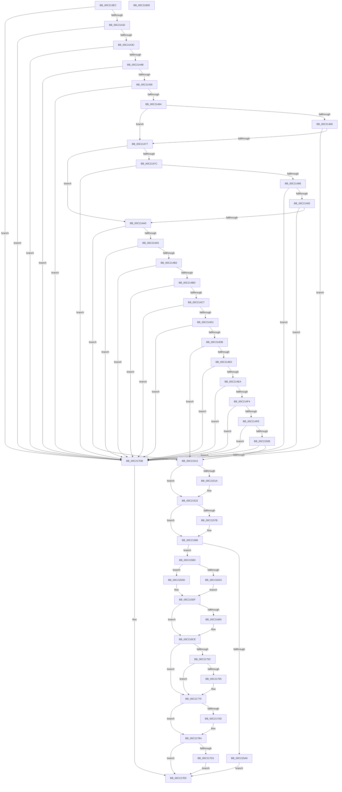

# ExtEnvRegisterIommu

- RVA: `0x00C213EC`–`0x00C2180E` (길이 `1,058` bytes)
- VA: `0x0000000140C213EC`
- 실행 섹션: `INIT`
- PDB 이름 있음: `예`; PDB Function 태그: `아니요`
- unwind 정보 RVA: `0x000C4438`
- 디코드: `256`개 명령, `1,058/1,058` bytes 표시
- 미해석 바이트: `0` (있으면 어셈블리에 `.byte`로 보존)

> 이 문서는 커널 이미지의 기계어와 PDB 기호를 분석해 생성했습니다. 4번과 5번은 함수 원형과 자료형을 바이너리 사용 방식에서 추정한 C 해석이며 원본 소스 복구 결과는 아닙니다.

## 1. Dependencies

- 직접 호출 지점: **7**; 고유 호출 대상: **7**
- 직접 호출자로 확인된 함수: **3**
- RIP 상대 이미지 참조: **5**

### Outgoing calls
- `0x00C21558` → [HalpExtBuildResourceIdString](../../text/54/HalpExtBuildResourceIdString_function_0054E494.md) (function, `0x0054E494`)
- `0x00C21567` → [RtlInitUnicodeString](../../text/42/RtlInitUnicodeString_function_0042A780.md) (function, `0x0042A780`)
- `0x00C2159C` → [HalpMmAllocateMemoryInternal](../../text/54/HalpMmAllocateMemoryInternal_function_00544990.md) (function, `0x00544990`)
- `0x00C215BB` → [memset](../../text/6C/memset_function_006C6C40.md) (function, `0x006C6C40`)
- `0x00C2176B` → [memcpy](../../text/6C/memcpy_function_006C6840.md) (function, `0x006C6840`)
- `0x00C21795` → [RtlCopyUnicodeString](../../text/3F/RtlCopyUnicodeString_function_003FEF30.md) (function, `0x003FEF30`)
- `0x00C217ED` → [_security_check_cookie](../../text/6A/_security_check_cookie_function_006AC640.md) (function, `0x006AC640`)

### Direct callers
- [HalpIommuProcessIvhdEntry](../../text/57/HalpIommuProcessIvhdEntry_function_00572F38.md) at `0x0057353D`
- [HalpIvtLegacyProcessDrhdEntry](../../text/57/HalpIvtLegacyProcessDrhdEntry_function_00578C58.md) at `0x0057926E`
- [HalpIvtProcessDrhdEntry](../../text/57/HalpIvtProcessDrhdEntry_function_005794B4.md) at `0x00579B52`

### Static image references
- `0x00C21403` → RVA `0x00E0A740` (`.data`; read)
- `0x00C2179A` → RVA `0x00FC1748` (`.data`; read)
- `0x00C217A1` → RVA `0x00FC1740` (`.data`; read)
- `0x00C217B4` → RVA `0x00FC1754` (`.data`; read/write)
- `0x00C217C5` → RVA `0x00FC1748` (`.data`; write)

## 2. Other-region calls and transfers

- 다른 실행 섹션으로 향하는 call: **7**
  - `0x00C21558` → [HalpExtBuildResourceIdString](../../text/54/HalpExtBuildResourceIdString_function_0054E494.md) (`INIT` → `.text`)
  - `0x00C21567` → [RtlInitUnicodeString](../../text/42/RtlInitUnicodeString_function_0042A780.md) (`INIT` → `.text`)
  - `0x00C2159C` → [HalpMmAllocateMemoryInternal](../../text/54/HalpMmAllocateMemoryInternal_function_00544990.md) (`INIT` → `.text`)
  - `0x00C215BB` → [memset](../../text/6C/memset_function_006C6C40.md) (`INIT` → `.text`)
  - `0x00C2176B` → [memcpy](../../text/6C/memcpy_function_006C6840.md) (`INIT` → `.text`)
  - `0x00C21795` → [RtlCopyUnicodeString](../../text/3F/RtlCopyUnicodeString_function_003FEF30.md) (`INIT` → `.text`)
  - `0x00C217ED` → [_security_check_cookie](../../text/6A/_security_check_cookie_function_006AC640.md) (`INIT` → `.text`)
- 별도 외부 분기/꼬리 이동을 확인하지 못했습니다.

## 3. Assembly (complete function range)

```asm
00C213EC  48 89 5C 24 10                  mov qword ptr [rsp + 0x10], rbx
00C213F1  55                              push rbp
00C213F2  56                              push rsi
00C213F3  57                              push rdi
00C213F4  41 54                           push r12
00C213F6  41 55                           push r13
00C213F8  41 56                           push r14
00C213FA  41 57                           push r15
00C213FC  48 81 EC 10 01 00 00            sub rsp, 0x110
00C21403  48 8B 05 36 93 1E 00            mov rax, qword ptr [rip + 0x1e9336]
00C2140A  48 33 C4                        xor rax, rsp
00C2140D  48 89 84 24 00 01 00 00         mov qword ptr [rsp + 0x100], rax
00C21415  41 BD 01 00 00 00               mov r13d, 1
00C2141B  0F 57 C0                        xorps xmm0, xmm0
00C2141E  4D 8B E0                        mov r12, r8
00C21421  48 8B F9                        mov rdi, rcx
00C21424  0F 11 44 24 50                  movups xmmword ptr [rsp + 0x50], xmm0
00C21429  44 39 29                        cmp dword ptr [rcx], r13d
00C2142C  0F 85 A9 03 00 00               jne 0x140c217db
00C21432  83 79 04 68                     cmp dword ptr [rcx + 4], 0x68
00C21436  0F 85 9F 03 00 00               jne 0x140c217db
00C2143C  8B 49 14                        mov ecx, dword ptr [rcx + 0x14]
00C2143F  F7 C1 00 00 00 F8               test ecx, 0xf8000000
00C21445  0F 85 90 03 00 00               jne 0x140c217db
00C2144B  33 DB                           xor ebx, ebx
00C2144D  39 5F 48                        cmp dword ptr [rdi + 0x48], ebx
00C21450  0F 84 85 03 00 00               je 0x140c217db
00C21456  48 8B 57 38                     mov rdx, qword ptr [rdi + 0x38]
00C2145A  48 39 5A 08                     cmp qword ptr [rdx + 8], rbx
00C2145E  0F 84 77 03 00 00               je 0x140c217db
00C21464  F6 C1 02                        test cl, 2
00C21467  74 0E                           je 0x140c21477
00C21469  48 8B 47 40                     mov rax, qword ptr [rdi + 0x40]
00C2146D  48 39 58 48                     cmp qword ptr [rax + 0x48], rbx
00C21471  0F 84 64 03 00 00               je 0x140c217db
00C21477  F6 C1 40                        test cl, 0x40
00C2147A  74 24                           je 0x140c214a0
00C2147C  48 39 5A 78                     cmp qword ptr [rdx + 0x78], rbx
00C21480  0F 84 55 03 00 00               je 0x140c217db
00C21486  48 39 9A 80 00 00 00            cmp qword ptr [rdx + 0x80], rbx
00C2148D  0F 84 48 03 00 00               je 0x140c217db
00C21493  48 39 9A 88 00 00 00            cmp qword ptr [rdx + 0x88], rbx
00C2149A  0F 84 3B 03 00 00               je 0x140c217db
00C214A0  F6 C1 A0                        test cl, 0xa0
00C214A3  74 6D                           je 0x140c21512
00C214A5  48 8B 47 40                     mov rax, qword ptr [rdi + 0x40]
00C214A9  48 39 58 08                     cmp qword ptr [rax + 8], rbx
00C214AD  0F 84 28 03 00 00               je 0x140c217db
00C214B3  48 39 58 10                     cmp qword ptr [rax + 0x10], rbx
00C214B7  0F 84 1E 03 00 00               je 0x140c217db
00C214BD  48 39 58 18                     cmp qword ptr [rax + 0x18], rbx
00C214C1  0F 84 14 03 00 00               je 0x140c217db
00C214C7  48 39 58 20                     cmp qword ptr [rax + 0x20], rbx
00C214CB  0F 84 0A 03 00 00               je 0x140c217db
00C214D1  48 39 58 28                     cmp qword ptr [rax + 0x28], rbx
00C214D5  0F 84 00 03 00 00               je 0x140c217db
00C214DB  F6 C1 20                        test cl, 0x20
00C214DE  74 32                           je 0x140c21512
00C214E0  48 39 58 38                     cmp qword ptr [rax + 0x38], rbx
00C214E4  0F 84 F1 02 00 00               je 0x140c217db
00C214EA  48 39 58 40                     cmp qword ptr [rax + 0x40], rbx
00C214EE  0F 84 E7 02 00 00               je 0x140c217db
00C214F4  48 39 58 50                     cmp qword ptr [rax + 0x50], rbx
00C214F8  0F 84 DD 02 00 00               je 0x140c217db
00C214FE  48 39 58 58                     cmp qword ptr [rax + 0x58], rbx
00C21502  0F 84 D3 02 00 00               je 0x140c217db
00C21508  48 39 58 60                     cmp qword ptr [rax + 0x60], rbx
00C2150C  0F 84 C9 02 00 00               je 0x140c217db
00C21512  0F B6 EB                        movzx ebp, bl
00C21515  39 5F 10                        cmp dword ptr [rdi + 0x10], ebx
00C21518  75 08                           jne 0x140c21522
00C2151A  48 39 5F 08                     cmp qword ptr [rdi + 8], rbx
00C2151E  41 0F 45 ED                     cmovne ebp, r13d
00C21522  44 0F B7 4F 48                  movzx r9d, word ptr [rdi + 0x48]
00C21527  48 8D 44 24 60                  lea rax, [rsp + 0x60]
00C2152C  48 89 44 24 40                  mov qword ptr [rsp + 0x40], rax
00C21531  41 B8 00 43 00 00               mov r8d, 0x4300
00C21537  8B 47 60                        mov eax, dword ptr [rdi + 0x60]
00C2153A  33 D2                           xor edx, edx
00C2153C  C7 44 24 38 4B 00 00 00         mov dword ptr [rsp + 0x38], 0x4b
00C21544  B9 4D 53 46 54                  mov ecx, 0x5446534d
00C21549  89 44 24 30                     mov dword ptr [rsp + 0x30], eax
00C2154D  66 89 5C 24 28                  mov word ptr [rsp + 0x28], bx
00C21552  66 44 89 6C 24 20               mov word ptr [rsp + 0x20], r13w
00C21558  E8 37 CF 92 FF                  call 0x14054e494
00C2155D  48 8D 54 24 60                  lea rdx, [rsp + 0x60]
00C21562  48 8D 4C 24 50                  lea rcx, [rsp + 0x50]
00C21567  E8 14 92 80 FF                  call 0x14042a780
00C2156C  B9 20 02 00 00                  mov ecx, 0x220
00C21571  BA F8 FF FF FF                  mov edx, 0xfffffff8
00C21576  40 84 ED                        test bpl, bpl
00C21579  75 0B                           jne 0x140c21586
00C2157B  8B 4F 10                        mov ecx, dword ptr [rdi + 0x10]
00C2157E  81 C1 27 02 00 00               add ecx, 0x227
00C21584  23 CA                           and ecx, edx
00C21586  44 0F B7 7C 24 50               movzx r15d, word ptr [rsp + 0x50]
00C2158C  45 8D 77 09                     lea r14d, [r15 + 9]
00C21590  44 03 F1                        add r14d, ecx
00C21593  44 23 F2                        and r14d, edx
00C21596  41 8B D5                        mov edx, r13d
00C21599  41 8B CE                        mov ecx, r14d
00C2159C  E8 EF 33 92 FF                  call 0x140544990
00C215A1  48 8B F0                        mov rsi, rax
00C215A4  48 85 C0                        test rax, rax
00C215A7  75 0A                           jne 0x140c215b3
00C215A9  BB 9A 00 00 C0                  mov ebx, 0xc000009a
00C215AE  E9 2D 02 00 00                  jmp 0x140c217e0
00C215B3  45 8B C6                        mov r8d, r14d
00C215B6  33 D2                           xor edx, edx
00C215B8  48 8B CE                        mov rcx, rsi
00C215BB  E8 80 56 AA FF                  call 0x1406c6c40
00C215C0  48 8D 8E 27 02 00 00            lea rcx, [rsi + 0x227]
00C215C7  48 83 E1 F8                     and rcx, 0xfffffffffffffff8
00C215CB  4C 8B C9                        mov r9, rcx
00C215CE  40 84 ED                        test bpl, bpl
00C215D1  74 0A                           je 0x140c215dd
00C215D3  4C 8B 4F 08                     mov r9, qword ptr [rdi + 8]
00C215D7  4C 89 4E 10                     mov qword ptr [rsi + 0x10], r9
00C215DB  EB 12                           jmp 0x140c215ef
00C215DD  48 89 4E 10                     mov qword ptr [rsi + 0x10], rcx
00C215E1  8B 47 10                        mov eax, dword ptr [rdi + 0x10]
00C215E4  48 83 C0 07                     add rax, 7
00C215E8  48 03 C8                        add rcx, rax
00C215EB  48 83 E1 F8                     and rcx, 0xfffffffffffffff8
00C215EF  48 89 8E 10 02 00 00            mov qword ptr [rsi + 0x210], rcx
00C215F6  BA 80 00 00 00                  mov edx, 0x80
00C215FB  C6 46 28 0C                     mov byte ptr [rsi + 0x28], 0xc
00C215FF  48 8B 47 38                     mov rax, qword ptr [rdi + 0x38]
00C21603  0F 10 00                        movups xmm0, xmmword ptr [rax]
00C21606  0F 11 46 38                     movups xmmword ptr [rsi + 0x38], xmm0
00C2160A  0F 10 48 10                     movups xmm1, xmmword ptr [rax + 0x10]
00C2160E  0F 11 4E 48                     movups xmmword ptr [rsi + 0x48], xmm1
00C21612  0F 10 40 20                     movups xmm0, xmmword ptr [rax + 0x20]
00C21616  0F 11 46 58                     movups xmmword ptr [rsi + 0x58], xmm0
00C2161A  0F 10 48 30                     movups xmm1, xmmword ptr [rax + 0x30]
00C2161E  0F 11 4E 68                     movups xmmword ptr [rsi + 0x68], xmm1
00C21622  0F 10 40 40                     movups xmm0, xmmword ptr [rax + 0x40]
00C21626  0F 11 46 78                     movups xmmword ptr [rsi + 0x78], xmm0
00C2162A  0F 10 48 50                     movups xmm1, xmmword ptr [rax + 0x50]
00C2162E  0F 11 8E 88 00 00 00            movups xmmword ptr [rsi + 0x88], xmm1
00C21635  0F 10 40 60                     movups xmm0, xmmword ptr [rax + 0x60]
00C21639  0F 11 86 98 00 00 00            movups xmmword ptr [rsi + 0x98], xmm0
00C21640  0F 10 40 70                     movups xmm0, xmmword ptr [rax + 0x70]
00C21644  0F 11 44 16 28                  movups xmmword ptr [rsi + rdx + 0x28], xmm0
00C21649  0F 10 0C 10                     movups xmm1, xmmword ptr [rax + rdx]
00C2164D  0F 11 4C 16 38                  movups xmmword ptr [rsi + rdx + 0x38], xmm1
00C21652  48 8B 44 10 10                  mov rax, qword ptr [rax + rdx + 0x10]
00C21657  48 89 44 16 48                  mov qword ptr [rsi + rdx + 0x48], rax
00C2165C  48 8B 47 40                     mov rax, qword ptr [rdi + 0x40]
00C21660  48 85 C0                        test rax, rax
00C21663  74 69                           je 0x140c216ce
00C21665  0F 10 00                        movups xmm0, xmmword ptr [rax]
00C21668  48 8D 8E D0 00 00 00            lea rcx, [rsi + 0xd0]
00C2166F  0F 11 01                        movups xmmword ptr [rcx], xmm0
00C21672  0F 10 48 10                     movups xmm1, xmmword ptr [rax + 0x10]
00C21676  0F 11 49 10                     movups xmmword ptr [rcx + 0x10], xmm1
00C2167A  0F 10 40 20                     movups xmm0, xmmword ptr [rax + 0x20]
00C2167E  0F 11 41 20                     movups xmmword ptr [rcx + 0x20], xmm0
00C21682  0F 10 48 30                     movups xmm1, xmmword ptr [rax + 0x30]
00C21686  0F 11 49 30                     movups xmmword ptr [rcx + 0x30], xmm1
00C2168A  0F 10 40 40                     movups xmm0, xmmword ptr [rax + 0x40]
00C2168E  0F 11 41 40                     movups xmmword ptr [rcx + 0x40], xmm0
00C21692  0F 10 48 50                     movups xmm1, xmmword ptr [rax + 0x50]
00C21696  0F 11 49 50                     movups xmmword ptr [rcx + 0x50], xmm1
00C2169A  0F 10 40 60                     movups xmm0, xmmword ptr [rax + 0x60]
00C2169E  0F 11 41 60                     movups xmmword ptr [rcx + 0x60], xmm0
00C216A2  48 03 CA                        add rcx, rdx
00C216A5  0F 10 48 70                     movups xmm1, xmmword ptr [rax + 0x70]
00C216A9  48 03 C2                        add rax, rdx
00C216AC  0F 11 49 F0                     movups xmmword ptr [rcx - 0x10], xmm1
00C216B0  0F 10 00                        movups xmm0, xmmword ptr [rax]
00C216B3  0F 11 01                        movups xmmword ptr [rcx], xmm0
00C216B6  0F 10 48 10                     movups xmm1, xmmword ptr [rax + 0x10]
00C216BA  0F 11 49 10                     movups xmmword ptr [rcx + 0x10], xmm1
00C216BE  0F 10 40 20                     movups xmm0, xmmword ptr [rax + 0x20]
00C216C2  0F 11 41 20                     movups xmmword ptr [rcx + 0x20], xmm0
00C216C6  48 8B 40 30                     mov rax, qword ptr [rax + 0x30]
00C216CA  48 89 41 30                     mov qword ptr [rcx + 0x30], rax
00C216CE  8B 47 10                        mov eax, dword ptr [rdi + 0x10]
00C216D1  89 46 18                        mov dword ptr [rsi + 0x18], eax
00C216D4  8B 47 14                        mov eax, dword ptr [rdi + 0x14]
00C216D7  89 86 D8 01 00 00               mov dword ptr [rsi + 0x1d8], eax
00C216DD  8B 47 28                        mov eax, dword ptr [rdi + 0x28]
00C216E0  89 46 2C                        mov dword ptr [rsi + 0x2c], eax
00C216E3  8B 47 30                        mov eax, dword ptr [rdi + 0x30]
00C216E6  89 46 34                        mov dword ptr [rsi + 0x34], eax
00C216E9  8B 47 2C                        mov eax, dword ptr [rdi + 0x2c]
00C216EC  89 46 30                        mov dword ptr [rsi + 0x30], eax
00C216EF  8B 47 48                        mov eax, dword ptr [rdi + 0x48]
00C216F2  89 86 DC 01 00 00               mov dword ptr [rsi + 0x1dc], eax
00C216F8  8B 47 4C                        mov eax, dword ptr [rdi + 0x4c]
00C216FB  89 86 E0 01 00 00               mov dword ptr [rsi + 0x1e0], eax
00C21701  8B 47 50                        mov eax, dword ptr [rdi + 0x50]
00C21704  89 86 E4 01 00 00               mov dword ptr [rsi + 0x1e4], eax
00C2170A  8B 47 54                        mov eax, dword ptr [rdi + 0x54]
00C2170D  89 86 E8 01 00 00               mov dword ptr [rsi + 0x1e8], eax
00C21713  8B 47 58                        mov eax, dword ptr [rdi + 0x58]
00C21716  89 86 00 02 00 00               mov dword ptr [rsi + 0x200], eax
00C2171C  8B 47 5C                        mov eax, dword ptr [rdi + 0x5c]
00C2171F  89 86 B8 01 00 00               mov dword ptr [rsi + 0x1b8], eax
00C21725  48 8B 86 10 01 00 00            mov rax, qword ptr [rsi + 0x110]
00C2172C  48 89 86 A8 01 00 00            mov qword ptr [rsi + 0x1a8], rax
00C21733  48 8B 86 08 01 00 00            mov rax, qword ptr [rsi + 0x108]
00C2173A  48 89 86 B0 01 00 00            mov qword ptr [rsi + 0x1b0], rax
00C21741  48 89 9E 98 01 00 00            mov qword ptr [rsi + 0x198], rbx
00C21748  48 89 9E 90 01 00 00            mov qword ptr [rsi + 0x190], rbx
00C2174F  89 9E A0 01 00 00               mov dword ptr [rsi + 0x1a0], ebx
00C21755  8B 47 10                        mov eax, dword ptr [rdi + 0x10]
00C21758  85 C0                           test eax, eax
00C2175A  74 14                           je 0x140c21770
00C2175C  48 8B 57 08                     mov rdx, qword ptr [rdi + 8]
00C21760  48 85 D2                        test rdx, rdx
00C21763  74 0B                           je 0x140c21770
00C21765  44 8B C0                        mov r8d, eax
00C21768  49 8B C9                        mov rcx, r9
00C2176B  E8 D0 50 AA FF                  call 0x1406c6840
00C21770  8B 47 60                        mov eax, dword ptr [rdi + 0x60]
00C21773  48 8D 8E 08 02 00 00            lea rcx, [rsi + 0x208]
00C2177A  66 41 83 C7 02                  add r15w, 2
00C2177F  66 89 19                        mov word ptr [rcx], bx
00C21782  48 8D 54 24 50                  lea rdx, [rsp + 0x50]
00C21787  66 44 89 BE 0A 02 00 00         mov word ptr [rsi + 0x20a], r15w
00C2178F  89 86 04 02 00 00               mov dword ptr [rsi + 0x204], eax
00C21795  E8 96 D7 7D FF                  call 0x1403fef30
00C2179A  48 8B 05 A7 FF 39 00            mov rax, qword ptr [rip + 0x39ffa7]
00C217A1  48 8D 0D 98 FF 39 00            lea rcx, [rip + 0x39ff98]
00C217A8  48 39 08                        cmp qword ptr [rax], rcx
00C217AB  74 07                           je 0x140c217b4
00C217AD  B9 03 00 00 00                  mov ecx, 3
00C217B2  CD 29                           int 0x29
00C217B4  44 01 2D 99 FF 39 00            add dword ptr [rip + 0x39ff99], r13d
00C217BB  48 89 0E                        mov qword ptr [rsi], rcx
00C217BE  48 89 46 08                     mov qword ptr [rsi + 8], rax
00C217C2  48 89 30                        mov qword ptr [rax], rsi
00C217C5  48 89 35 7C FF 39 00            mov qword ptr [rip + 0x39ff7c], rsi
00C217CC  4D 85 E4                        test r12, r12
00C217CF  74 0F                           je 0x140c217e0
00C217D1  48 8B 46 10                     mov rax, qword ptr [rsi + 0x10]
00C217D5  49 89 04 24                     mov qword ptr [r12], rax
00C217D9  EB 05                           jmp 0x140c217e0
00C217DB  BB 0D 00 00 C0                  mov ebx, 0xc000000d
00C217E0  8B C3                           mov eax, ebx
00C217E2  48 8B 8C 24 00 01 00 00         mov rcx, qword ptr [rsp + 0x100]
00C217EA  48 33 CC                        xor rcx, rsp
00C217ED  E8 4E AE A8 FF                  call 0x1406ac640
00C217F2  48 8B 9C 24 58 01 00 00         mov rbx, qword ptr [rsp + 0x158]
00C217FA  48 81 C4 10 01 00 00            add rsp, 0x110
00C21801  41 5F                           pop r15
00C21803  41 5E                           pop r14
00C21805  41 5D                           pop r13
00C21807  41 5C                           pop r12
00C21809  5F                              pop rdi
00C2180A  5E                              pop rsi
00C2180B  5D                              pop rbp
00C2180C  C3                              ret
00C2180D  CC                              int3
```

## 4. C-style interpretation (structured pseudocode)

```c
__int64 __fastcall ExtEnvRegisterIommu(__int64 a1, __int64 a2, __int64 a3)
{
    __int64 result;
    __int64 v_r14;
    __int64 v_r15;
    __int64 v_rbp;
    __int64 v_rbx;
    __int64 v_rsp;
    unsigned __int64 v_stack_m108;
    unsigned int v_stack_m110;
    unsigned int v_stack_m118;
    unsigned __int16 v_stack_m120;
    unsigned __int16 v_stack_m128;
    unsigned __int64 v_stack_m48;
    unsigned __int64 v_stack_mE8;
    unsigned __int64 v_stack_mF8;
    unsigned __int64 v_stack_p10;

    v_stack_p10 = v_rbx;
    v_rsp = (v_rsp) - (272);
    result = (*(unsigned __int64 *)(v_rip + 2003766)) ^ (v_rsp);
    v_stack_m48 = result;
    v_stack_mF8 = v_xmm0;
    if ((*(unsigned int *)(a1)) != 1) goto loc_00C217DB;
    if ((*(unsigned int *)(a1 + 4)) != 104) goto loc_00C217DB;
    if ((((unsigned int)((unsigned int)(*(unsigned int *)(a1 + 20)))) & (0xF8000000ULL)) != 0) goto loc_00C217DB;
    v_rbx = 0;
    if ((*(unsigned int *)(a1 + 72)) == 0) goto loc_00C217DB;
    if ((*(unsigned __int64 *)(*(unsigned __int64 *)(a1 + 56) + 8)) == 0) goto loc_00C217DB;
    if ((((unsigned __int8)((unsigned int)(*(unsigned int *)(a1 + 20)))) & (2)) == 0) goto loc_00C21477;
    if ((*(unsigned __int64 *)(*(unsigned __int64 *)(a1 + 64) + 72)) == 0) goto loc_00C217DB;
loc_00C21477:
    if ((((unsigned __int8)((unsigned int)(*(unsigned int *)(a1 + 20)))) & (64)) == 0) goto loc_00C214A0;
    if ((*(unsigned __int64 *)(*(unsigned __int64 *)(a1 + 56) + 120)) == 0) goto loc_00C217DB;
    if ((*(unsigned __int64 *)(*(unsigned __int64 *)(a1 + 56) + 128)) == 0) goto loc_00C217DB;
    if ((*(unsigned __int64 *)(*(unsigned __int64 *)(a1 + 56) + 136)) == 0) goto loc_00C217DB;
loc_00C214A0:
    if ((((unsigned __int8)((unsigned int)(*(unsigned int *)(a1 + 20)))) & (160)) == 0) goto loc_00C21512;
    if ((*(unsigned __int64 *)(*(unsigned __int64 *)(a1 + 64) + 8)) == 0) goto loc_00C217DB;
    if ((*(unsigned __int64 *)(*(unsigned __int64 *)(a1 + 64) + 16)) == 0) goto loc_00C217DB;
    if ((*(unsigned __int64 *)(*(unsigned __int64 *)(a1 + 64) + 24)) == 0) goto loc_00C217DB;
    if ((*(unsigned __int64 *)(*(unsigned __int64 *)(a1 + 64) + 32)) == 0) goto loc_00C217DB;
    if ((*(unsigned __int64 *)(*(unsigned __int64 *)(a1 + 64) + 40)) == 0) goto loc_00C217DB;
    if ((((unsigned __int8)((unsigned int)(*(unsigned int *)(a1 + 20)))) & (32)) == 0) goto loc_00C21512;
    if ((*(unsigned __int64 *)(*(unsigned __int64 *)(a1 + 64) + 56)) == 0) goto loc_00C217DB;
    if ((*(unsigned __int64 *)(*(unsigned __int64 *)(a1 + 64) + 64)) == 0) goto loc_00C217DB;
    if ((*(unsigned __int64 *)(*(unsigned __int64 *)(a1 + 64) + 80)) == 0) goto loc_00C217DB;
    if ((*(unsigned __int64 *)(*(unsigned __int64 *)(a1 + 64) + 88)) == 0) goto loc_00C217DB;
    if ((*(unsigned __int64 *)(*(unsigned __int64 *)(a1 + 64) + 96)) == 0) goto loc_00C217DB;
loc_00C21512:
    v_rbp = 0;
    if ((*(unsigned int *)(a1 + 16)) == 0) {
        v_rbp = 0;
        if ((*(unsigned __int64 *)(a1 + 8)) != 0) { v_rbp = 1; }
    }
    v_stack_m108 = v_stack_mE8;
    a2 = 0;
    v_stack_m110 = 75;
    v_stack_m118 = (unsigned int)((unsigned int)(*(unsigned int *)(a1 + 96)));
    v_stack_m120 = 0;
    v_stack_m128 = 1;
    result = HalpExtBuildResourceIdString((unsigned int)(0x5446534DULL), a2, (unsigned int)(0x4300ULL), *(unsigned __int16 *)(a1 + 72));
    result = RtlInitUnicodeString(v_stack_mF8, v_stack_mE8, (unsigned int)(0x4300ULL), *(unsigned __int16 *)(a1 + 72));
    if ((unsigned __int8)(v_rbp) == 0) {
        a1 = *(unsigned int *)(a1 + 16);
        a1 = (unsigned int)((a1) + (551));
        a1 = (unsigned int)((a1) & ((unsigned int)((unsigned int)(0xFFFFFFF8ULL))));
    }
    v_r14 = (unsigned int)((v_stack_mF8 + 9) + ((unsigned int)(a1)));
    v_r14 = (unsigned int)((v_r14) & ((unsigned int)((unsigned int)(0xFFFFFFF8ULL))));
    result = HalpMmAllocateMemoryInternal((unsigned int)((unsigned int)(v_r14)), 1, (unsigned int)(0x4300ULL), *(unsigned __int16 *)(a1 + 72));
    if (result != 0) goto loc_00C215B3;
    goto loc_00C217E0;
loc_00C215B3:
    a2 = 0;
    result = memset(result, a2, (unsigned int)((unsigned int)(v_r14)), *(unsigned __int16 *)(a1 + 72));
    a1 = (result + 551) & (-8);
    if ((unsigned __int8)(v_rbp) == 0) goto loc_00C215DD;
    *(unsigned __int64 *)(result + 16) = *(unsigned __int64 *)(a1 + 8);
    goto loc_00C215EF;
loc_00C215DD:
    *(unsigned __int64 *)(result + 16) = a1;
    result = ((unsigned int)(*(unsigned int *)(a1 + 16))) + (7);
    a1 = (a1) + (result);
    a1 = (a1) & (-8);
loc_00C215EF:
    *(unsigned __int64 *)(result + 528) = a1;
    *(unsigned __int8 *)(result + 40) = 12;
    *(unsigned __int64 *)(result + 56) = v_xmm0;
    *(unsigned __int64 *)(result + 72) = v_xmm1;
    *(unsigned __int64 *)(result + 88) = v_xmm0;
    *(unsigned __int64 *)(result + 104) = v_xmm1;
    *(unsigned __int64 *)(result + 120) = v_xmm0;
    *(unsigned __int64 *)(result + 136) = v_xmm1;
    *(unsigned __int64 *)(result + 152) = v_xmm0;
    *(unsigned __int64 *)(result + 128 * 1 + 40) = v_xmm0;
    *(unsigned __int64 *)(result + 128 * 1 + 56) = v_xmm1;
    *(unsigned __int64 *)(result + 128 * 1 + 72) = *(unsigned __int64 *)(*(unsigned __int64 *)(a1 + 56) + 128 * 1 + 16);
    result = *(unsigned __int64 *)(a1 + 64);
    if (*(unsigned __int64 *)(a1 + 64) != 0) {
        a1 = result + 208;
        *(unsigned __int64 *)(a1) = v_xmm0;
        *(unsigned __int64 *)(a1 + 16) = v_xmm1;
        *(unsigned __int64 *)(a1 + 32) = v_xmm0;
        *(unsigned __int64 *)(a1 + 48) = v_xmm1;
        *(unsigned __int64 *)(a1 + 64) = v_xmm0;
        *(unsigned __int64 *)(a1 + 80) = v_xmm1;
        *(unsigned __int64 *)(a1 + 96) = v_xmm0;
        a1 = (a1) + (128);
        result = (*(unsigned __int64 *)(a1 + 64)) + (128);
        *(unsigned __int64 *)(a1 - 16) = v_xmm1;
        *(unsigned __int64 *)(a1) = v_xmm0;
        *(unsigned __int64 *)(a1 + 16) = v_xmm1;
        *(unsigned __int64 *)(a1 + 32) = v_xmm0;
        result = *(unsigned __int64 *)(result + 48);
        *(unsigned __int64 *)(a1 + 48) = result;
    }
    *(unsigned int *)(result + 24) = (unsigned int)((unsigned int)(*(unsigned int *)(a1 + 16)));
    *(unsigned int *)(result + 472) = (unsigned int)((unsigned int)(*(unsigned int *)(a1 + 20)));
    *(unsigned int *)(result + 44) = (unsigned int)((unsigned int)(*(unsigned int *)(a1 + 40)));
    *(unsigned int *)(result + 52) = (unsigned int)((unsigned int)(*(unsigned int *)(a1 + 48)));
    *(unsigned int *)(result + 48) = (unsigned int)((unsigned int)(*(unsigned int *)(a1 + 44)));
    *(unsigned int *)(result + 476) = (unsigned int)((unsigned int)(*(unsigned int *)(a1 + 72)));
    *(unsigned int *)(result + 480) = (unsigned int)((unsigned int)(*(unsigned int *)(a1 + 76)));
    *(unsigned int *)(result + 484) = (unsigned int)((unsigned int)(*(unsigned int *)(a1 + 80)));
    *(unsigned int *)(result + 488) = (unsigned int)((unsigned int)(*(unsigned int *)(a1 + 84)));
    *(unsigned int *)(result + 512) = (unsigned int)((unsigned int)(*(unsigned int *)(a1 + 88)));
    *(unsigned int *)(result + 440) = (unsigned int)((unsigned int)(*(unsigned int *)(a1 + 92)));
    *(unsigned __int64 *)(result + 424) = *(unsigned __int64 *)(result + 272);
    *(unsigned __int64 *)(result + 432) = *(unsigned __int64 *)(result + 264);
    *(unsigned __int64 *)(result + 408) = (unsigned int)(0xC000009AULL);
    *(unsigned __int64 *)(result + 400) = (unsigned int)(0xC000009AULL);
    *(unsigned int *)(result + 416) = (unsigned int)((unsigned int)(0xC000009AULL));
    if ((unsigned int)((unsigned int)(*(unsigned int *)(a1 + 16))) == 0) goto loc_00C21770;
    result = (unsigned int)(*(unsigned int *)(a1 + 16));
    if (*(unsigned __int64 *)(a1 + 8) != 0) {
        a3 = (unsigned int)((unsigned int)(*(unsigned int *)(a1 + 16)));
        a1 = *(unsigned __int64 *)(a1 + 8);
        result = memcpy(a1, *(unsigned __int64 *)(a1 + 8), a3, *(unsigned __int64 *)(a1 + 8));
    }
    v_r15 = (unsigned __int16)((v_stack_mF8) + (2));
    *(unsigned __int16 *)(result + 520) = (unsigned __int16)((unsigned int)(0xC000009AULL));
    *(unsigned __int16 *)(result + 522) = (unsigned __int16)(v_r15);
    *(unsigned int *)(result + 516) = (unsigned int)((unsigned int)(*(unsigned int *)(a1 + 96)));
    result = RtlCopyUnicodeString(result + 520, v_stack_mF8, a3, *(unsigned __int64 *)(a1 + 8));
    if ((*(unsigned __int64 *)(*(unsigned __int64 *)(v_rip + 3800999))) != (v_rip + 3800984)) {
        a1 = 3;
    }
    *(unsigned __int64 *)(result) = a1;
    *(unsigned __int64 *)(result + 8) = *(unsigned __int64 *)(v_rip + 3800999);
    *(unsigned __int64 *)(*(unsigned __int64 *)(v_rip + 3800999)) = result;
    *(unsigned __int64 *)(v_rip + 3800956) = result;
    if (a3 == 0) goto loc_00C217E0;
    *(unsigned __int64 *)(a3) = *(unsigned __int64 *)(result + 16);
    goto loc_00C217E0;
loc_00C217DB:
loc_00C217E0:
    a1 = (v_stack_m48) ^ (v_rsp);
    result = _security_check_cookie(a1, v_stack_mF8, a3, *(unsigned __int64 *)(a1 + 8));
    v_rsp = (v_rsp) + (272);
    return result;
}
```

## 5. (Beta) C Style

```c
int64_t ExtEnvRegisterIommu(void *Arg1, int64_t Arg2, int64_t Arg3)
{
    uint8_t *arg1 = (uint8_t *)Arg1;

    int64_t result;
    int64_t local_r14;
    int64_t local_r15;
    int64_t local_rbp;
    int64_t local_rbx;
    int64_t local_rsp;
    uint64_t v_stack_m108;
    uint32_t v_stack_m110;
    uint32_t v_stack_m118;
    uint16_t v_stack_m120;
    uint16_t v_stack_m128;
    uint64_t v_stack_m48;
    uint64_t v_stack_mE8;
    uint64_t v_stack_mF8;
    uint64_t v_stack_p10;

    v_stack_p10 = local_rbx;
    local_rsp = (local_rsp) - (272);
    result = (*(uint64_t *)(v_rip + 0x1E9336)) ^ (local_rsp);
    v_stack_m48 = result;
    v_stack_mF8 = v_xmm0;
    if ((*(uint32_t *)(arg1)) != 1) goto loc_00C217DB;
    if ((*(uint32_t *)(arg1 + 0x4)) != 104) goto loc_00C217DB;
    if ((((uint32_t)((uint32_t)(*(uint32_t *)(arg1 + 0x14)))) & (0xF8000000ULL)) != 0) goto loc_00C217DB;
    local_rbx = 0;
    if ((*(uint32_t *)(arg1 + 0x48)) == 0) goto loc_00C217DB;
    if ((*(uint64_t *)(*(uint64_t *)(arg1 + 0x38) + 0x8)) == 0) goto loc_00C217DB;
    if ((((uint8_t)((uint32_t)(*(uint32_t *)(arg1 + 0x14)))) & (2)) == 0) goto loc_00C21477;
    if ((*(uint64_t *)(*(uint64_t *)(arg1 + 0x40) + 0x48)) == 0) goto loc_00C217DB;
loc_00C21477:
    if ((((uint8_t)((uint32_t)(*(uint32_t *)(arg1 + 0x14)))) & (64)) == 0) goto loc_00C214A0;
    if ((*(uint64_t *)(*(uint64_t *)(arg1 + 0x38) + 0x78)) == 0) goto loc_00C217DB;
    if ((*(uint64_t *)(*(uint64_t *)(arg1 + 0x38) + 0x80)) == 0) goto loc_00C217DB;
    if ((*(uint64_t *)(*(uint64_t *)(arg1 + 0x38) + 0x88)) == 0) goto loc_00C217DB;
loc_00C214A0:
    if ((((uint8_t)((uint32_t)(*(uint32_t *)(arg1 + 0x14)))) & (160)) == 0) goto loc_00C21512;
    if ((*(uint64_t *)(*(uint64_t *)(arg1 + 0x40) + 0x8)) == 0) goto loc_00C217DB;
    if ((*(uint64_t *)(*(uint64_t *)(arg1 + 0x40) + 0x10)) == 0) goto loc_00C217DB;
    if ((*(uint64_t *)(*(uint64_t *)(arg1 + 0x40) + 0x18)) == 0) goto loc_00C217DB;
    if ((*(uint64_t *)(*(uint64_t *)(arg1 + 0x40) + 0x20)) == 0) goto loc_00C217DB;
    if ((*(uint64_t *)(*(uint64_t *)(arg1 + 0x40) + 0x28)) == 0) goto loc_00C217DB;
    if ((((uint8_t)((uint32_t)(*(uint32_t *)(arg1 + 0x14)))) & (32)) == 0) goto loc_00C21512;
    if ((*(uint64_t *)(*(uint64_t *)(arg1 + 0x40) + 0x38)) == 0) goto loc_00C217DB;
    if ((*(uint64_t *)(*(uint64_t *)(arg1 + 0x40) + 0x40)) == 0) goto loc_00C217DB;
    if ((*(uint64_t *)(*(uint64_t *)(arg1 + 0x40) + 0x50)) == 0) goto loc_00C217DB;
    if ((*(uint64_t *)(*(uint64_t *)(arg1 + 0x40) + 0x58)) == 0) goto loc_00C217DB;
    if ((*(uint64_t *)(*(uint64_t *)(arg1 + 0x40) + 0x60)) == 0) goto loc_00C217DB;
loc_00C21512:
    local_rbp = 0;
    if ((*(uint32_t *)(arg1 + 0x10)) == 0) {
        local_rbp = 0;
        if ((*(uint64_t *)(arg1 + 0x8)) != 0) { local_rbp = 1; }
    }
    v_stack_m108 = v_stack_mE8;
    Arg2 = 0;
    v_stack_m110 = 75;
    v_stack_m118 = (uint32_t)((uint32_t)(*(uint32_t *)(arg1 + 0x60)));
    v_stack_m120 = 0;
    v_stack_m128 = 1;
    result = HalpExtBuildResourceIdString((uint32_t)(0x5446534DULL), Arg2, (uint32_t)(0x4300ULL), *(uint16_t *)(arg1 + 0x48));
    result = RtlInitUnicodeString(v_stack_mF8, v_stack_mE8, (uint32_t)(0x4300ULL), *(uint16_t *)(arg1 + 0x48));
    if ((uint8_t)(local_rbp) == 0) {
        Arg1 = *(uint32_t *)(arg1 + 0x10);
        Arg1 = (uint32_t)((Arg1) + (551));
        Arg1 = (uint32_t)((Arg1) & ((uint32_t)((uint32_t)(0xFFFFFFF8ULL))));
    }
    local_r14 = (uint32_t)((v_stack_mF8 + 9) + ((uint32_t)(Arg1)));
    local_r14 = (uint32_t)((local_r14) & ((uint32_t)((uint32_t)(0xFFFFFFF8ULL))));
    result = HalpMmAllocateMemoryInternal((uint32_t)((uint32_t)(local_r14)), 1, (uint32_t)(0x4300ULL), *(uint16_t *)(arg1 + 0x48));
    if (result != 0) goto loc_00C215B3;
    goto loc_00C217E0;
loc_00C215B3:
    Arg2 = 0;
    result = memset(result, Arg2, (uint32_t)((uint32_t)(local_r14)), *(uint16_t *)(arg1 + 0x48));
    Arg1 = (result + 551) & (-8);
    if ((uint8_t)(local_rbp) == 0) goto loc_00C215DD;
    *(uint64_t *)(result + 0x10) = *(uint64_t *)(arg1 + 0x8);
    goto loc_00C215EF;
loc_00C215DD:
    *(void **)(result + 0x10) = Arg1;
    result = ((uint32_t)(*(uint32_t *)(arg1 + 0x10))) + (7);
    Arg1 = (Arg1) + (result);
    Arg1 = (Arg1) & (-8);
loc_00C215EF:
    *(void **)(result + 0x210) = Arg1;
    *(uint8_t *)(result + 0x28) = 12;
    *(uint64_t *)(result + 0x38) = v_xmm0;
    *(uint64_t *)(result + 0x48) = v_xmm1;
    *(uint64_t *)(result + 0x58) = v_xmm0;
    *(uint64_t *)(result + 0x68) = v_xmm1;
    *(uint64_t *)(result + 0x78) = v_xmm0;
    *(uint64_t *)(result + 0x88) = v_xmm1;
    *(uint64_t *)(result + 0x98) = v_xmm0;
    *(uint64_t *)(result + 0x80 * 1 + 0x28) = v_xmm0;
    *(uint64_t *)(result + 0x80 * 1 + 0x38) = v_xmm1;
    *(uint64_t *)(result + 0x80 * 1 + 0x48) = *(uint64_t *)(*(uint64_t *)(arg1 + 0x38) + 0x80 * 1 + 0x10);
    result = *(uint64_t *)(arg1 + 0x40);
    if (*(uint64_t *)(arg1 + 0x40) != 0) {
        Arg1 = result + 208;
        *(uint64_t *)(arg1) = v_xmm0;
        *(uint64_t *)(arg1 + 0x10) = v_xmm1;
        *(uint64_t *)(arg1 + 0x20) = v_xmm0;
        *(uint64_t *)(arg1 + 0x30) = v_xmm1;
        *(uint64_t *)(arg1 + 0x40) = v_xmm0;
        *(uint64_t *)(arg1 + 0x50) = v_xmm1;
        *(uint64_t *)(arg1 + 0x60) = v_xmm0;
        Arg1 = (Arg1) + (128);
        result = (*(uint64_t *)(arg1 + 0x40)) + (128);
        *(uint64_t *)(arg1 - 0x10) = v_xmm1;
        *(uint64_t *)(arg1) = v_xmm0;
        *(uint64_t *)(arg1 + 0x10) = v_xmm1;
        *(uint64_t *)(arg1 + 0x20) = v_xmm0;
        result = *(uint64_t *)(result + 0x30);
        *(uint64_t *)(arg1 + 0x30) = result;
    }
    *(uint32_t *)(result + 0x18) = (uint32_t)((uint32_t)(*(uint32_t *)(arg1 + 0x10)));
    *(uint32_t *)(result + 0x1D8) = (uint32_t)((uint32_t)(*(uint32_t *)(arg1 + 0x14)));
    *(uint32_t *)(result + 0x2C) = (uint32_t)((uint32_t)(*(uint32_t *)(arg1 + 0x28)));
    *(uint32_t *)(result + 0x34) = (uint32_t)((uint32_t)(*(uint32_t *)(arg1 + 0x30)));
    *(uint32_t *)(result + 0x30) = (uint32_t)((uint32_t)(*(uint32_t *)(arg1 + 0x2C)));
    *(uint32_t *)(result + 0x1DC) = (uint32_t)((uint32_t)(*(uint32_t *)(arg1 + 0x48)));
    *(uint32_t *)(result + 0x1E0) = (uint32_t)((uint32_t)(*(uint32_t *)(arg1 + 0x4C)));
    *(uint32_t *)(result + 0x1E4) = (uint32_t)((uint32_t)(*(uint32_t *)(arg1 + 0x50)));
    *(uint32_t *)(result + 0x1E8) = (uint32_t)((uint32_t)(*(uint32_t *)(arg1 + 0x54)));
    *(uint32_t *)(result + 0x200) = (uint32_t)((uint32_t)(*(uint32_t *)(arg1 + 0x58)));
    *(uint32_t *)(result + 0x1B8) = (uint32_t)((uint32_t)(*(uint32_t *)(arg1 + 0x5C)));
    *(uint64_t *)(result + 0x1A8) = *(uint64_t *)(result + 0x110);
    *(uint64_t *)(result + 0x1B0) = *(uint64_t *)(result + 0x108);
    *(uint64_t *)(result + 0x198) = (uint32_t)(0xC000009AULL);
    *(uint64_t *)(result + 0x190) = (uint32_t)(0xC000009AULL);
    *(uint32_t *)(result + 0x1A0) = (uint32_t)((uint32_t)(0xC000009AULL));
    if ((uint32_t)((uint32_t)(*(uint32_t *)(arg1 + 0x10))) == 0) goto loc_00C21770;
    result = (uint32_t)(*(uint32_t *)(arg1 + 0x10));
    if (*(uint64_t *)(arg1 + 0x8) != 0) {
        Arg3 = (uint32_t)((uint32_t)(*(uint32_t *)(arg1 + 0x10)));
        Arg1 = *(uint64_t *)(arg1 + 0x8);
        result = memcpy(Arg1, *(uint64_t *)(arg1 + 0x8), Arg3, *(uint64_t *)(arg1 + 0x8));
    }
    local_r15 = (uint16_t)((v_stack_mF8) + (2));
    *(uint16_t *)(result + 0x208) = (uint16_t)((uint32_t)(0xC000009AULL));
    *(uint16_t *)(result + 0x20A) = (uint16_t)(local_r15);
    *(uint32_t *)(result + 0x204) = (uint32_t)((uint32_t)(*(uint32_t *)(arg1 + 0x60)));
    result = RtlCopyUnicodeString(result + 520, v_stack_mF8, Arg3, *(uint64_t *)(arg1 + 0x8));
    if ((*(uint64_t *)(*(uint64_t *)(v_rip + 0x39FFA7))) != (v_rip + 3800984)) {
        Arg1 = 3;
    }
    *(void **)(result) = Arg1;
    *(uint64_t *)(result + 0x8) = *(uint64_t *)(v_rip + 0x39FFA7);
    *(uint64_t *)(*(uint64_t *)(v_rip + 0x39FFA7)) = result;
    *(uint64_t *)(v_rip + 0x39FF7C) = result;
    if (Arg3 == 0) goto loc_00C217E0;
    *(uint64_t *)(Arg3) = *(uint64_t *)(result + 0x10);
    goto loc_00C217E0;
loc_00C217DB:
loc_00C217E0:
    Arg1 = (v_stack_m48) ^ (local_rsp);
    result = _security_check_cookie(Arg1, v_stack_mF8, Arg3, *(uint64_t *)(arg1 + 0x8));
    local_rsp = (local_rsp) + (272);
    return result;
}
```

### 관측된 메모리 오프셋

구조체 형식이 확인되지 않은 접근은 인자 기준의 오프셋으로만 기록했습니다.

| 기준 인자 | 오프셋 표현 | 폭 (bit) | 접근 |
|---|---:|---:|---|
| `Arg1` | `+ 0x0` | `32` | `R` |
| `Arg1` | `+ 0x4` | `32` | `R` |
| `Arg1` | `+ 0x8` | `64` | `R` |
| `Arg1` | `+ 0x10` | `32` | `R` |
| `Arg1` | `+ 0x14` | `32` | `R` |
| `Arg1` | `+ 0x28` | `32` | `R` |
| `Arg1` | `+ 0x2C` | `32` | `R` |
| `Arg1` | `+ 0x30` | `32` | `R` |
| `Arg1` | `+ 0x38` | `64` | `R` |
| `Arg1` | `+ 0x40` | `64` | `R` |
| `Arg1` | `+ 0x48` | `16` | `R` |
| `Arg1` | `+ 0x48` | `32` | `R` |
| `Arg1` | `+ 0x4C` | `32` | `R` |
| `Arg1` | `+ 0x50` | `32` | `R` |
| `Arg1` | `+ 0x54` | `32` | `R` |
| `Arg1` | `+ 0x58` | `32` | `R` |
| `Arg1` | `+ 0x5C` | `32` | `R` |
| `Arg1` | `+ 0x60` | `32` | `R` |

## 6. Execution-region graph

[열기: 2D/3D 그래프와 함수 탐색 컨트롤 패널](../../../control-panel.html?section=init&rva=0x00C213EC&view=graph)

- 2D 그래프는 위에서 아래로 흐르고, 3D 그래프는 빈 공간을 드래그해 회전합니다. Shift+드래그는 이동, 휠은 확대·축소, 함수 노드 선택은 대상 보고서 이동입니다.

### Static fallback


