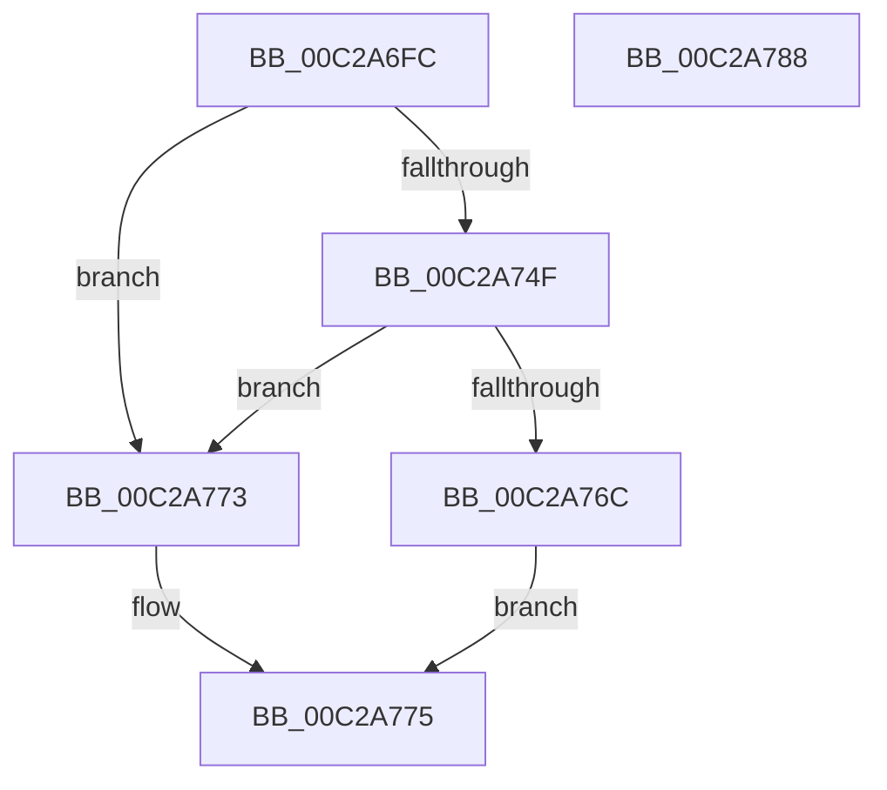

# FindBitmapResource

- RVA: `0x00C2A6FC`–`0x00C2A789` (길이 `141` bytes)
- VA: `0x0000000140C2A6FC`
- 실행 섹션: `INIT`
- PDB 이름 있음: `예`; PDB Function 태그: `아니요`
- unwind 정보 RVA: `0x000C6EF8`
- 디코드: `36`개 명령, `141/141` bytes 표시
- 미해석 바이트: `0` (있으면 어셈블리에 `.byte`로 보존)

> 이 문서는 커널 이미지의 기계어와 PDB 기호를 분석해 생성했습니다. 4번과 5번은 함수 원형과 자료형을 바이너리 사용 방식에서 추정한 C 해석이며 원본 소스 복구 결과는 아닙니다.

## 1. Dependencies

- 직접 호출 지점: **3**; 고유 호출 대상: **3**
- 직접 호출자로 확인된 함수: **1**
- RIP 상대 이미지 참조: **2**

### Outgoing calls
- `0x00C2A746` → [LdrFindResource_U](../../page/78/LdrFindResource_U_function_0078BD20.md) (function, `0x0078BD20`)
- `0x00C2A763` → [LdrAccessResource](../../page/78/LdrAccessResource_function_0078B9E0.md) (function, `0x0078B9E0`)
- `0x00C2A77D` → [_security_check_cookie](../../text/6A/_security_check_cookie_function_006AC640.md) (function, `0x006AC640`)

### Direct callers
- [BvgaDriverInitialize](BvgaDriverInitialize_function_00C2A500.md) at `0x00C2A5C7`

### Static image references
- `0x00C2A704` → RVA `0x00E0A740` (`.data`; read)
- `0x00C2A737` → RVA `0x00000000` (`image boundary/outside`; read)

## 2. Other-region calls and transfers

- 다른 실행 섹션으로 향하는 call: **3**
  - `0x00C2A746` → [LdrFindResource_U](../../page/78/LdrFindResource_U_function_0078BD20.md) (`INIT` → `PAGE`)
  - `0x00C2A763` → [LdrAccessResource](../../page/78/LdrAccessResource_function_0078B9E0.md) (`INIT` → `PAGE`)
  - `0x00C2A77D` → [_security_check_cookie](../../text/6A/_security_check_cookie_function_006AC640.md) (`INIT` → `.text`)
- 별도 외부 분기/꼬리 이동을 확인하지 못했습니다.

## 3. Assembly (complete function range)

```asm
00C2A6FC  4C 8B DC                        mov r11, rsp
00C2A6FF  53                              push rbx
00C2A700  48 83 EC 50                     sub rsp, 0x50
00C2A704  48 8B 05 35 00 1E 00            mov rax, qword ptr [rip + 0x1e0035]
00C2A70B  48 33 C4                        xor rax, rsp
00C2A70E  48 89 44 24 48                  mov qword ptr [rsp + 0x48], rax
00C2A713  49 83 63 C8 00                  and qword ptr [r11 - 0x38], 0
00C2A718  4D 8D 4B C8                     lea r9, [r11 - 0x38]
00C2A71C  49 83 63 D0 00                  and qword ptr [r11 - 0x30], 0
00C2A721  48 8B DA                        mov rbx, rdx
00C2A724  49 83 63 E8 00                  and qword ptr [r11 - 0x18], 0
00C2A729  49 8D 53 D8                     lea rdx, [r11 - 0x28]
00C2A72D  49 89 4B E0                     mov qword ptr [r11 - 0x20], rcx
00C2A731  41 B8 03 00 00 00               mov r8d, 3
00C2A737  48 8D 0D C2 58 3D FF            lea rcx, [rip - 0xc2a73e]
00C2A73E  49 C7 43 D8 02 00 00 00         mov qword ptr [r11 - 0x28], 2
00C2A746  E8 D5 15 B6 FF                  call 0x14078bd20
00C2A74B  85 C0                           test eax, eax
00C2A74D  78 24                           js 0x140c2a773
00C2A74F  48 8B 54 24 20                  mov rdx, qword ptr [rsp + 0x20]
00C2A754  4C 8D 44 24 28                  lea r8, [rsp + 0x28]
00C2A759  4C 8B CB                        mov r9, rbx
00C2A75C  48 8D 0D 9D 58 3D FF            lea rcx, [rip - 0xc2a763]
00C2A763  E8 78 12 B6 FF                  call 0x14078b9e0
00C2A768  85 C0                           test eax, eax
00C2A76A  78 07                           js 0x140c2a773
00C2A76C  48 8B 44 24 28                  mov rax, qword ptr [rsp + 0x28]
00C2A771  EB 02                           jmp 0x140c2a775
00C2A773  33 C0                           xor eax, eax
00C2A775  48 8B 4C 24 48                  mov rcx, qword ptr [rsp + 0x48]
00C2A77A  48 33 CC                        xor rcx, rsp
00C2A77D  E8 BE 1E A8 FF                  call 0x1406ac640
00C2A782  48 83 C4 50                     add rsp, 0x50
00C2A786  5B                              pop rbx
00C2A787  C3                              ret
00C2A788  CC                              int3
```

## 4. C-style interpretation (structured pseudocode)

```c
__int64 __fastcall FindBitmapResource(__int64 a1, __int64 a2)
{
    __int64 result;
    __int64 v_rsp;
    unsigned __int64 v_stack_m10;
    unsigned __int64 v_stack_m30;
    unsigned __int64 v_stack_m38;

    v_rsp = (v_rsp) - (80);
    result = (*(unsigned __int64 *)(v_rip + 1966133)) ^ (v_rsp);
    v_stack_m10 = result;
    *(unsigned __int64 *)(v_rsp - 32) = a1;
    *(unsigned __int64 *)(v_rsp - 40) = 2;
    result = LdrFindResource_U(v_rip - 12756798, v_rsp - 40, 3, v_rsp - 56);
    if (sign_flag) goto loc_00C2A773;
    result = LdrAccessResource(v_rip - 12756835, v_stack_m38, v_stack_m30, a2);
    if (sign_flag) goto loc_00C2A773;
    goto loc_00C2A775;
loc_00C2A773:
    result = 0;
loc_00C2A775:
    a1 = (v_stack_m10) ^ (v_rsp);
    result = _security_check_cookie(a1, v_stack_m38, v_stack_m30, a2);
    v_rsp = (v_rsp) + (80);
    return result;
}
```

## 5. (Beta) C Style

```c
int64_t FindBitmapResource(int64_t Arg1, int64_t Arg2)
{
    int64_t result;
    int64_t local_rsp;
    uint64_t v_stack_m10;
    uint64_t v_stack_m30;
    uint64_t v_stack_m38;

    local_rsp = (local_rsp) - (80);
    result = (*(uint64_t *)(v_rip + 0x1E0035)) ^ (local_rsp);
    v_stack_m10 = result;
    *(uint64_t *)(local_rsp - 0x20) = Arg1;
    *(uint64_t *)(local_rsp - 0x28) = 2;
    result = LdrFindResource_U(v_rip - 12756798, local_rsp - 40, 3, local_rsp - 56);
    if (sign_flag) goto loc_00C2A773;
    result = LdrAccessResource(v_rip - 12756835, v_stack_m38, v_stack_m30, Arg2);
    if (sign_flag) goto loc_00C2A773;
    goto loc_00C2A775;
loc_00C2A773:
    result = 0;
loc_00C2A775:
    Arg1 = (v_stack_m10) ^ (local_rsp);
    result = _security_check_cookie(Arg1, v_stack_m38, v_stack_m30, Arg2);
    local_rsp = (local_rsp) + (80);
    return result;
}
```

## 6. Execution-region graph

[열기: 2D/3D 그래프와 함수 탐색 컨트롤 패널](../../../control-panel.html?section=init&rva=0x00C2A6FC&view=graph)

- 2D 그래프는 위에서 아래로 흐르고, 3D 그래프는 빈 공간을 드래그해 회전합니다. Shift+드래그는 이동, 휠은 확대·축소, 함수 노드 선택은 대상 보고서 이동입니다.

### Static fallback


