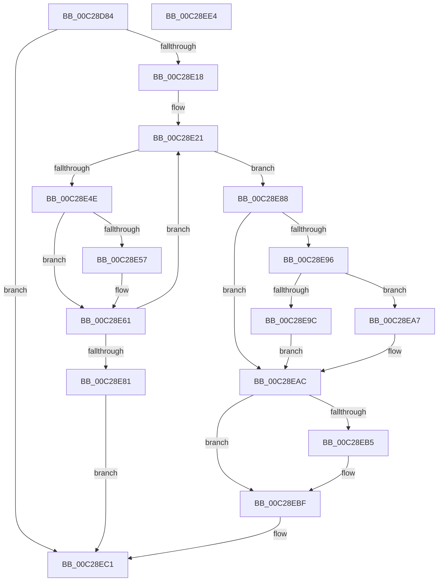

# FsRtlGetCompatibilityModeValue

- RVA: `0x00C28D84`–`0x00C28EE5` (길이 `353` bytes)
- VA: `0x0000000140C28D84`
- 실행 섹션: `INIT`
- PDB 이름 있음: `예`; PDB Function 태그: `아니요`
- unwind 정보 RVA: `0x000C5C6C`
- 디코드: `93`개 명령, `353/353` bytes 표시
- 미해석 바이트: `0` (있으면 어셈블리에 `.byte`로 보존)

> 이 문서는 커널 이미지의 기계어와 PDB 기호를 분석해 생성했습니다. 4번과 5번은 함수 원형과 자료형을 바이너리 사용 방식에서 추정한 C 해석이며 원본 소스 복구 결과는 아닙니다.

## 1. Dependencies

- 직접 호출 지점: **7**; 고유 호출 대상: **6**
- 직접 호출자로 확인된 함수: **1**
- RIP 상대 이미지 참조: **2**

### Outgoing calls
- `0x00C28E0B` → [ZwOpenKey](../../text/6A/ZwOpenKey_function_006AD310.md) (function, `0x006AD310`)
- `0x00C28E40` → [ZwQueryValueKey](../../text/6A/ZwQueryValueKey_function_006AD3B0.md) (function, `0x006AD3B0`)
- `0x00C28E5C` → [ExFreePoolWithTag](../../poolcode/B8/ExFreePoolWithTag_function_00B82870.md) (function, `0x00B82870`)
- `0x00C28E74` → [ExAllocatePool2](../../poolcode/B8/ExAllocatePool2_function_00B820F0.md) (function, `0x00B820F0`)
- `0x00C28E8D` → [ZwClose](../../text/6A/ZwClose_function_006AD2B0.md) (function, `0x006AD2B0`)
- `0x00C28EBA` → [ExFreePoolWithTag](../../poolcode/B8/ExFreePoolWithTag_function_00B82870.md) (function, `0x00B82870`)
- `0x00C28EC8` → [_security_check_cookie](../../text/6A/_security_check_cookie_function_006AC640.md) (function, `0x006AC640`)

### Direct callers
- [FsRtlInitSystem](FsRtlInitSystem_function_00C28EEC.md) at `0x00C28FCD`

### Static image references
- `0x00C28D9C` → RVA `0x00E0A740` (`.data`; read)
- `0x00C28DB0` → RVA `0x00C79790` (` ?? ::PBOPGDP::`string'`; read)

## 2. Other-region calls and transfers

- 다른 실행 섹션으로 향하는 call: **7**
  - `0x00C28E0B` → [ZwOpenKey](../../text/6A/ZwOpenKey_function_006AD310.md) (`INIT` → `.text`)
  - `0x00C28E40` → [ZwQueryValueKey](../../text/6A/ZwQueryValueKey_function_006AD3B0.md) (`INIT` → `.text`)
  - `0x00C28E5C` → [ExFreePoolWithTag](../../poolcode/B8/ExFreePoolWithTag_function_00B82870.md) (`INIT` → `POOLCODE`)
  - `0x00C28E74` → [ExAllocatePool2](../../poolcode/B8/ExAllocatePool2_function_00B820F0.md) (`INIT` → `POOLCODE`)
  - `0x00C28E8D` → [ZwClose](../../text/6A/ZwClose_function_006AD2B0.md) (`INIT` → `.text`)
  - `0x00C28EBA` → [ExFreePoolWithTag](../../poolcode/B8/ExFreePoolWithTag_function_00B82870.md) (`INIT` → `POOLCODE`)
  - `0x00C28EC8` → [_security_check_cookie](../../text/6A/_security_check_cookie_function_006AC640.md) (`INIT` → `.text`)
- 별도 외부 분기/꼬리 이동을 확인하지 못했습니다.

## 3. Assembly (complete function range)

```asm
00C28D84  48 89 5C 24 18                  mov qword ptr [rsp + 0x18], rbx
00C28D89  55                              push rbp
00C28D8A  56                              push rsi
00C28D8B  57                              push rdi
00C28D8C  41 56                           push r14
00C28D8E  41 57                           push r15
00C28D90  48 8D 6C 24 C9                  lea rbp, [rsp - 0x37]
00C28D95  48 81 EC F0 00 00 00            sub rsp, 0xf0
00C28D9C  48 8B 05 9D 19 1E 00            mov rax, qword ptr [rip + 0x1e199d]
00C28DA3  48 33 C4                        xor rax, rsp
00C28DA6  48 89 45 27                     mov qword ptr [rbp + 0x27], rax
00C28DAA  48 83 64 24 38 00               and qword ptr [rsp + 0x38], 0
00C28DB0  48 8D 05 D9 09 05 00            lea rax, [rip + 0x509d9]
00C28DB7  83 64 24 30 00                  and dword ptr [rsp + 0x30], 0
00C28DBC  4C 8D 45 97                     lea r8, [rbp - 0x69]
00C28DC0  83 65 8B 00                     and dword ptr [rbp - 0x75], 0
00C28DC4  4C 8B F2                        mov r14, rdx
00C28DC7  83 65 B3 00                     and dword ptr [rbp - 0x4d], 0
00C28DCB  4C 8B F9                        mov r15, rcx
00C28DCE  48 83 65 9F 00                  and qword ptr [rbp - 0x61], 0
00C28DD3  48 8D 4C 24 38                  lea rcx, [rsp + 0x38]
00C28DD8  48 89 45 8F                     mov qword ptr [rbp - 0x71], rax
00C28DDC  0F 57 C0                        xorps xmm0, xmm0
00C28DDF  48 8D 45 87                     lea rax, [rbp - 0x79]
00C28DE3  48 C7 45 97 30 00 00 00         mov qword ptr [rbp - 0x69], 0x30
00C28DEB  83 65 9B 00                     and dword ptr [rbp - 0x65], 0
00C28DEF  BA 19 00 02 00                  mov edx, 0x20019
00C28DF4  48 89 45 A7                     mov qword ptr [rbp - 0x59], rax
00C28DF8  C7 45 87 7A 00 7C 00            mov dword ptr [rbp - 0x79], 0x7c007a
00C28DFF  C7 45 AF 40 00 00 00            mov dword ptr [rbp - 0x51], 0x40
00C28E06  F3 0F 7F 45 B7                  movdqu xmmword ptr [rbp - 0x49], xmm0
00C28E0B  E8 00 45 A8 FF                  call 0x1406ad310
00C28E10  85 C0                           test eax, eax
00C28E12  0F 88 A9 00 00 00               js 0x140c28ec1
00C28E18  BE 5C 00 00 00                  mov esi, 0x5c
00C28E1D  48 8D 5D C7                     lea rbx, [rbp - 0x39]
00C28E21  48 8B 4C 24 38                  mov rcx, qword ptr [rsp + 0x38]
00C28E26  48 8D 44 24 30                  lea rax, [rsp + 0x30]
00C28E2B  48 89 44 24 28                  mov qword ptr [rsp + 0x28], rax
00C28E30  4C 8B CB                        mov r9, rbx
00C28E33  41 B8 01 00 00 00               mov r8d, 1
00C28E39  89 74 24 20                     mov dword ptr [rsp + 0x20], esi
00C28E3D  49 8B D7                        mov rdx, r15
00C28E40  E8 6B 45 A8 FF                  call 0x1406ad3b0
00C28E45  8B F8                           mov edi, eax
00C28E47  3D 05 00 00 80                  cmp eax, 0x80000005
00C28E4C  75 3A                           jne 0x140c28e88
00C28E4E  48 8D 45 C7                     lea rax, [rbp - 0x39]
00C28E52  48 3B D8                        cmp rbx, rax
00C28E55  74 0A                           je 0x140c28e61
00C28E57  33 D2                           xor edx, edx
00C28E59  48 8B CB                        mov rcx, rbx
00C28E5C  E8 0F 9A F5 FF                  call 0x140b82870
00C28E61  81 C6 00 01 00 00               add esi, 0x100
00C28E67  B9 00 01 00 00                  mov ecx, 0x100
00C28E6C  8B D6                           mov edx, esi
00C28E6E  41 B8 46 61 74 20               mov r8d, 0x20746146
00C28E74  E8 77 92 F5 FF                  call 0x140b820f0
00C28E79  48 8B D8                        mov rbx, rax
00C28E7C  48 85 C0                        test rax, rax
00C28E7F  75 A0                           jne 0x140c28e21
00C28E81  B8 17 00 00 C0                  mov eax, 0xc0000017
00C28E86  EB 39                           jmp 0x140c28ec1
00C28E88  48 8B 4C 24 38                  mov rcx, qword ptr [rsp + 0x38]
00C28E8D  E8 1E 44 A8 FF                  call 0x1406ad2b0
00C28E92  85 FF                           test edi, edi
00C28E94  78 16                           js 0x140c28eac
00C28E96  83 7B 0C 00                     cmp dword ptr [rbx + 0xc], 0
00C28E9A  74 0B                           je 0x140c28ea7
00C28E9C  8B 43 08                        mov eax, dword ptr [rbx + 8]
00C28E9F  8B 0C 18                        mov ecx, dword ptr [rax + rbx]
00C28EA2  41 89 0E                        mov dword ptr [r14], ecx
00C28EA5  EB 05                           jmp 0x140c28eac
00C28EA7  BF 34 00 00 C0                  mov edi, 0xc0000034
00C28EAC  48 8D 45 C7                     lea rax, [rbp - 0x39]
00C28EB0  48 3B D8                        cmp rbx, rax
00C28EB3  74 0A                           je 0x140c28ebf
00C28EB5  33 D2                           xor edx, edx
00C28EB7  48 8B CB                        mov rcx, rbx
00C28EBA  E8 B1 99 F5 FF                  call 0x140b82870
00C28EBF  8B C7                           mov eax, edi
00C28EC1  48 8B 4D 27                     mov rcx, qword ptr [rbp + 0x27]
00C28EC5  48 33 CC                        xor rcx, rsp
00C28EC8  E8 73 37 A8 FF                  call 0x1406ac640
00C28ECD  48 8B 9C 24 30 01 00 00         mov rbx, qword ptr [rsp + 0x130]
00C28ED5  48 81 C4 F0 00 00 00            add rsp, 0xf0
00C28EDC  41 5F                           pop r15
00C28EDE  41 5E                           pop r14
00C28EE0  5F                              pop rdi
00C28EE1  5E                              pop rsi
00C28EE2  5D                              pop rbp
00C28EE3  C3                              ret
00C28EE4  CC                              int3
```

## 4. C-style interpretation (structured pseudocode)

```c
__int64 __fastcall FsRtlGetCompatibilityModeValue(__int64 a1, __int64 a2)
{
    __int64 result;
    __int64 v_rsi;
    __int64 v_rsp;
    unsigned __int64 v_stack_m38;
    unsigned __int64 v_stack_m5F;
    unsigned __int64 v_stack_m98;
    unsigned __int64 v_stack_mA8;
    unsigned int v_stack_mAC;
    unsigned int v_stack_mB0;
    unsigned __int64 v_stack_mB8;
    unsigned __int64 v_stack_mC0;
    unsigned int v_stack_mC4;
    unsigned __int64 v_stack_mC8;
    unsigned __int64 v_stack_mD0;
    unsigned int v_stack_mD4;
    unsigned __int64 v_stack_mD8;
    unsigned __int64 v_stack_mE0;
    unsigned int v_stack_mE8;
    unsigned __int64 v_stack_mF0;
    unsigned int v_stack_mF8;
    unsigned __int64 v_stack_p18;

    v_stack_p18 = v_rbx;
    v_rsp = (v_rsp) - (240);
    result = (*(unsigned __int64 *)(v_rip + 1972637)) ^ (v_rsp);
    v_stack_m38 = result;
    v_stack_mD0 = v_rip + 330201;
    v_stack_mC8 = 48;
    v_stack_mB8 = v_stack_mD8;
    v_stack_mD8 = 0x7C007AULL;
    v_stack_mB0 = 64;
    v_stack_mA8 = v_xmm0;
    result = ZwOpenKey(v_stack_mE0, (unsigned int)(0x20019ULL), v_stack_mC8, a4);
    if (sign_flag) goto loc_00C28EC1;
loc_00C28E21:
    v_stack_mF0 = v_stack_mE8;
    v_stack_mF8 = 92;
    result = ZwQueryValueKey(v_stack_mE0, a1, 1, v_stack_m98);
    if (((unsigned int)(result)) != 0x80000005ULL) goto loc_00C28E88;
    result = v_stack_m98;
    if (v_stack_m98 != v_stack_m98) {
        a2 = 0;
        a1 = v_stack_m98;
        result = ExFreePoolWithTag(a1, a2, 1, v_stack_m98);
    }
    v_rsi = (unsigned int)((92) + (256));
    result = ExAllocatePool2(256, (unsigned int)((unsigned int)(v_rsi)), (unsigned int)(0x20746146ULL), v_stack_m98);
    if (result != 0) goto loc_00C28E21;
    goto loc_00C28EC1;
loc_00C28E88:
    result = ZwClose(v_stack_mE0, (unsigned int)((unsigned int)(v_rsi)), (unsigned int)(0x20746146ULL), v_stack_m98);
    if (sign_flag) goto loc_00C28EAC;
    if ((*(unsigned int *)(result + 12)) == 0) goto loc_00C28EA7;
    *(unsigned int *)(a2) = (unsigned int)((unsigned int)(*(unsigned int *)((unsigned int)(*(unsigned int *)(result + 8)) + result * 1)));
    goto loc_00C28EAC;
loc_00C28EA7:
loc_00C28EAC:
    result = v_stack_m98;
    if (result != v_stack_m98) {
        a2 = 0;
        a1 = result;
        result = ExFreePoolWithTag(a1, a2, (unsigned int)(0x20746146ULL), v_stack_m98);
    }
loc_00C28EC1:
    a1 = (v_stack_m38) ^ (v_rsp);
    result = _security_check_cookie(a1, a2, (unsigned int)(0x20746146ULL), v_stack_m98);
    v_rsp = (v_rsp) + (240);
    return result;
}
```

## 5. (Beta) C Style

```c
int64_t FsRtlGetCompatibilityModeValue(int64_t Arg1, void *Arg2)
{
    uint8_t *arg2 = (uint8_t *)Arg2;

    int64_t result;
    int64_t local_rsi;
    int64_t local_rsp;
    uint64_t v_stack_m38;
    uint64_t v_stack_m5F;
    uint64_t v_stack_m98;
    uint64_t v_stack_mA8;
    uint32_t v_stack_mAC;
    uint32_t v_stack_mB0;
    uint64_t v_stack_mB8;
    uint64_t v_stack_mC0;
    uint32_t v_stack_mC4;
    uint64_t v_stack_mC8;
    uint64_t v_stack_mD0;
    uint32_t v_stack_mD4;
    uint64_t v_stack_mD8;
    uint64_t v_stack_mE0;
    uint32_t v_stack_mE8;
    uint64_t v_stack_mF0;
    uint32_t v_stack_mF8;
    uint64_t v_stack_p18;

    v_stack_p18 = local_rbx;
    local_rsp = (local_rsp) - (240);
    result = (*(uint64_t *)(v_rip + 0x1E199D)) ^ (local_rsp);
    v_stack_m38 = result;
    v_stack_mD0 = v_rip + 330201;
    v_stack_mC8 = 48;
    v_stack_mB8 = v_stack_mD8;
    v_stack_mD8 = 0x7C007AULL;
    v_stack_mB0 = 64;
    v_stack_mA8 = v_xmm0;
    result = ZwOpenKey(v_stack_mE0, (uint32_t)(0x20019ULL), v_stack_mC8, a4);
    if (sign_flag) goto loc_00C28EC1;
loc_00C28E21:
    v_stack_mF0 = v_stack_mE8;
    v_stack_mF8 = 92;
    result = ZwQueryValueKey(v_stack_mE0, Arg1, 1, v_stack_m98);
    if (((uint32_t)(result)) != 0x80000005ULL) goto loc_00C28E88;
    result = v_stack_m98;
    if (v_stack_m98 != v_stack_m98) {
        Arg2 = 0;
        Arg1 = v_stack_m98;
        result = ExFreePoolWithTag(Arg1, Arg2, 1, v_stack_m98);
    }
    local_rsi = (uint32_t)((92) + (256));
    result = ExAllocatePool2(256, (uint32_t)((uint32_t)(local_rsi)), (uint32_t)(0x20746146ULL), v_stack_m98);
    if (result != 0) goto loc_00C28E21;
    goto loc_00C28EC1;
loc_00C28E88:
    result = ZwClose(v_stack_mE0, (uint32_t)((uint32_t)(local_rsi)), (uint32_t)(0x20746146ULL), v_stack_m98);
    if (sign_flag) goto loc_00C28EAC;
    if ((*(uint32_t *)(result + 0xC)) == 0) goto loc_00C28EA7;
    *(uint32_t *)(arg2) = (uint32_t)((uint32_t)(*(uint32_t *)((uint32_t)(*(uint32_t *)(result + 0x8)) + result * 1)));
    goto loc_00C28EAC;
loc_00C28EA7:
loc_00C28EAC:
    result = v_stack_m98;
    if (result != v_stack_m98) {
        Arg2 = 0;
        Arg1 = result;
        result = ExFreePoolWithTag(Arg1, Arg2, (uint32_t)(0x20746146ULL), v_stack_m98);
    }
loc_00C28EC1:
    Arg1 = (v_stack_m38) ^ (local_rsp);
    result = _security_check_cookie(Arg1, Arg2, (uint32_t)(0x20746146ULL), v_stack_m98);
    local_rsp = (local_rsp) + (240);
    return result;
}
```

### 관측된 메모리 오프셋

구조체 형식이 확인되지 않은 접근은 인자 기준의 오프셋으로만 기록했습니다.

| 기준 인자 | 오프셋 표현 | 폭 (bit) | 접근 |
|---|---:|---:|---|
| `Arg2` | `+ 0x0` | `32` | `W` |

## 6. Execution-region graph

[열기: 2D/3D 그래프와 함수 탐색 컨트롤 패널](../../../control-panel.html?section=init&rva=0x00C28D84&view=graph)

- 2D 그래프는 위에서 아래로 흐르고, 3D 그래프는 빈 공간을 드래그해 회전합니다. Shift+드래그는 이동, 휠은 확대·축소, 함수 노드 선택은 대상 보고서 이동입니다.

### Static fallback


