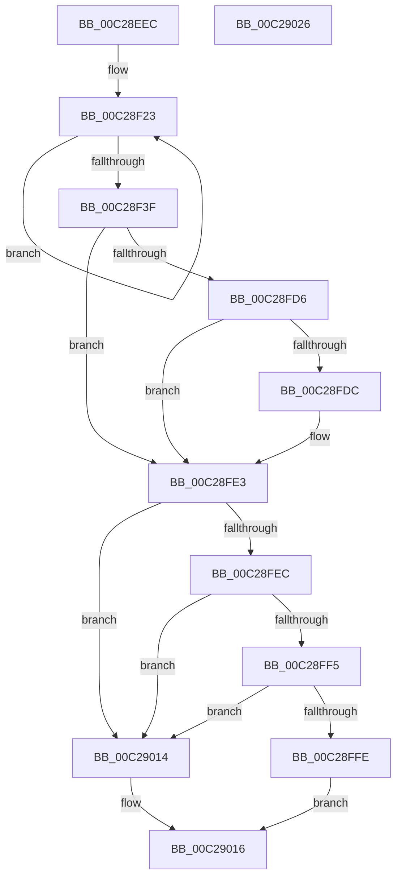

# FsRtlInitSystem

- RVA: `0x00C28EEC`–`0x00C29027` (길이 `315` bytes)
- VA: `0x0000000140C28EEC`
- 실행 섹션: `INIT`
- PDB 이름 있음: `예`; PDB Function 태그: `아니요`
- unwind 정보 RVA: `0x000C5C90`
- 디코드: `73`개 명령, `315/315` bytes 표시
- 미해석 바이트: `0` (있으면 어셈블리에 `.byte`로 보존)

> 이 문서는 커널 이미지의 기계어와 PDB 기호를 분석해 생성했습니다. 4번과 5번은 함수 원형과 자료형을 바이너리 사용 방식에서 추정한 C 해석이며 원본 소스 복구 결과는 아닙니다.

## 1. Dependencies

- 직접 호출 지점: **13**; 고유 호출 대상: **13**
- 직접 호출자로 확인된 함수: **1**
- RIP 상대 이미지 참조: **12**

### Outgoing calls
- `0x00C28F12` → [ExAllocatePoolWithTag](../../poolcode/B8/ExAllocatePoolWithTag_function_00B82010.md) (function, `0x00B82010`)
- `0x00C28F30` → [ExInitializeResourceLite2](../../text/41/ExInitializeResourceLite2_function_0041F710.md) (function, `0x0041F710`)
- `0x00C28F3F` → [FsRtlInitializeTunnels](FsRtlInitializeTunnels_function_00C291D0.md) (function, `0x00C291D0`)
- `0x00C28F44` → [FsRtlInitializeFileLocks](FsRtlInitializeFileLocks_function_00C292C0.md) (function, `0x00C292C0`)
- `0x00C28F49` → [FsRtlInitializeLargeMcbs](FsRtlInitializeLargeMcbs_function_00C29128.md) (function, `0x00C29128`)
- `0x00C28F73` → [ExInitializePagedLookasideList](../../page/AA/ExInitializePagedLookasideList_function_00AACC30.md) (function, `0x00AACC30`)
- `0x00C28FCD` → [FsRtlGetCompatibilityModeValue](FsRtlGetCompatibilityModeValue_function_00C28D84.md) (function, `0x00C28D84`)
- `0x00C28FE3` → [FsRtlInitializeWorkerThread](FsRtlInitializeWorkerThread_function_00C29624.md) (function, `0x00C29624`)
- `0x00C28FEC` → [FsFilterInit](../../text/58/FsFilterInit_function_00582B2C.md) (function, `0x00582B2C`)
- `0x00C28FF5` → [FsRtlInitializeSmssEvent](FsRtlInitializeSmssEvent_function_00C29030.md) (function, `0x00C29030`)
- `0x00C28FFE` → [FsRtlInitializeTieringHeat](../../page/71/FsRtlInitializeTieringHeat_function_00716938.md) (function, `0x00716938`)
- `0x00C29003` → [FsRtlInitializeDedupChange](../../page/71/FsRtlInitializeDedupChange_function_00715E00.md) (function, `0x00715E00`)
- `0x00C29008` → [FsRtlInitializeOplockPerf](FsRtlInitializeOplockPerf_function_00C29458.md) (function, `0x00C29458`)

### Direct callers
- [Phase1InitializationDiscard](../C1/Phase1InitializationDiscard_function_00C1C728.md) at `0x00C1D71E`

### Static image references
- `0x00C28F17` → RVA `0x00F8F0E8` (`.data`; write)
- `0x00C28F23` → RVA `0x00F8F0E8` (`.data`; read)
- `0x00C28F53` → RVA `0x00E11D00` (`.data`; read)
- `0x00C28F78` → RVA `0x00F8F088` (`.data`; read)
- `0x00C28F7F` → RVA `0x00F8F080` (`.data`; write)
- `0x00C28F86` → RVA `0x00F8F090` (`.data`; write)
- `0x00C28F92` → RVA `0x00F8F088` (`.data`; write)
- `0x00C28F9E` → RVA `0x00C79750` (` ?? ::PBOPGDP::`string'`; read)
- `0x00C28FA5` → RVA `0x00F8F082` (`.data`; write)
- `0x00C28FB1` → RVA `0x00F8F084` (`.data`; write)
- `0x00C28FBB` → RVA `0x00F8F098` (`.data`; write)
- `0x00C28FDC` → RVA `0x00FD803F` (`PAGEDATA`; write)

## 2. Other-region calls and transfers

- 다른 실행 섹션으로 향하는 call: **6**
  - `0x00C28F12` → [ExAllocatePoolWithTag](../../poolcode/B8/ExAllocatePoolWithTag_function_00B82010.md) (`INIT` → `POOLCODE`)
  - `0x00C28F30` → [ExInitializeResourceLite2](../../text/41/ExInitializeResourceLite2_function_0041F710.md) (`INIT` → `.text`)
  - `0x00C28F73` → [ExInitializePagedLookasideList](../../page/AA/ExInitializePagedLookasideList_function_00AACC30.md) (`INIT` → `PAGE`)
  - `0x00C28FEC` → [FsFilterInit](../../text/58/FsFilterInit_function_00582B2C.md) (`INIT` → `.text`)
  - `0x00C28FFE` → [FsRtlInitializeTieringHeat](../../page/71/FsRtlInitializeTieringHeat_function_00716938.md) (`INIT` → `PAGE`)
  - `0x00C29003` → [FsRtlInitializeDedupChange](../../page/71/FsRtlInitializeDedupChange_function_00715E00.md) (`INIT` → `PAGE`)
- 별도 외부 분기/꼬리 이동을 확인하지 못했습니다.

## 3. Assembly (complete function range)

```asm
00C28EEC  48 8B C4                        mov rax, rsp
00C28EEF  48 89 58 10                     mov qword ptr [rax + 0x10], rbx
00C28EF3  48 89 70 18                     mov qword ptr [rax + 0x18], rsi
00C28EF7  57                              push rdi
00C28EF8  48 83 EC 50                     sub rsp, 0x50
00C28EFC  33 F6                           xor esi, esi
00C28EFE  BA 80 06 00 00                  mov edx, 0x680
00C28F03  41 B8 46 53 72 74               mov r8d, 0x74725346
00C28F09  89 70 08                        mov dword ptr [rax + 8], esi
00C28F0C  89 70 EC                        mov dword ptr [rax - 0x14], esi
00C28F0F  8D 4A 90                        lea ecx, [rdx - 0x70]
00C28F12  E8 F9 90 F5 FF                  call 0x140b82010
00C28F17  48 89 05 CA 61 36 00            mov qword ptr [rip + 0x3661ca], rax
00C28F1E  8D 7E 10                        lea edi, [rsi + 0x10]
00C28F21  8B DE                           mov ebx, esi
00C28F23  48 8B 0D BE 61 36 00            mov rcx, qword ptr [rip + 0x3661be]
00C28F2A  83 CA FF                        or edx, 0xffffffff
00C28F2D  48 03 CB                        add rcx, rbx
00C28F30  E8 DB 67 7F FF                  call 0x14041f710
00C28F35  48 83 C3 68                     add rbx, 0x68
00C28F39  48 83 EF 01                     sub rdi, 1
00C28F3D  75 E4                           jne 0x140c28f23
00C28F3F  E8 8C 02 00 00                  call 0x140c291d0
00C28F44  E8 77 03 00 00                  call 0x140c292c0
00C28F49  E8 DA 01 00 00                  call 0x140c29128
00C28F4E  66 89 74 24 30                  mov word ptr [rsp + 0x30], si
00C28F53  48 8D 0D A6 8D 1E 00            lea rcx, [rip + 0x1e8da6]
00C28F5A  C7 44 24 28 46 53 65 6C         mov dword ptr [rsp + 0x28], 0x6c655346
00C28F62  45 33 C9                        xor r9d, r9d
00C28F65  45 33 C0                        xor r8d, r8d
00C28F68  48 C7 44 24 20 18 00 00 00      mov qword ptr [rsp + 0x20], 0x18
00C28F71  33 D2                           xor edx, edx
00C28F73  E8 B8 3C E8 FF                  call 0x140aacc30
00C28F78  48 8D 05 09 61 36 00            lea rax, [rip + 0x366109]
00C28F7F  C6 05 FA 60 36 00 05            mov byte ptr [rip + 0x3660fa], 5
00C28F86  48 89 05 03 61 36 00            mov qword ptr [rip + 0x366103], rax
00C28F8D  48 8D 54 24 60                  lea rdx, [rsp + 0x60]
00C28F92  48 89 05 EF 60 36 00            mov qword ptr [rip + 0x3660ef], rax
00C28F99  48 8D 4C 24 40                  lea rcx, [rsp + 0x40]
00C28F9E  48 8D 05 AB 07 05 00            lea rax, [rip + 0x507ab]
00C28FA5  C6 05 D6 60 36 00 08            mov byte ptr [rip + 0x3660d6], 8
00C28FAC  48 89 44 24 48                  mov qword ptr [rsp + 0x48], rax
00C28FB1  C7 05 C9 60 36 00 01 00 00 00   mov dword ptr [rip + 0x3660c9], 1
00C28FBB  C7 05 D3 60 36 00 FF FF FF 7F   mov dword ptr [rip + 0x3660d3], 0x7fffffff
00C28FC5  C7 44 24 40 30 00 32 00         mov dword ptr [rsp + 0x40], 0x320030
00C28FCD  E8 B2 FD FF FF                  call 0x140c28d84
00C28FD2  85 C0                           test eax, eax
00C28FD4  78 0D                           js 0x140c28fe3
00C28FD6  39 74 24 60                     cmp dword ptr [rsp + 0x60], esi
00C28FDA  74 07                           je 0x140c28fe3
00C28FDC  40 88 35 5C F0 3A 00            mov byte ptr [rip + 0x3af05c], sil
00C28FE3  E8 3C 06 00 00                  call 0x140c29624
00C28FE8  85 C0                           test eax, eax
00C28FEA  78 28                           js 0x140c29014
00C28FEC  E8 3B 9B 95 FF                  call 0x140582b2c
00C28FF1  85 C0                           test eax, eax
00C28FF3  78 1F                           js 0x140c29014
00C28FF5  E8 36 00 00 00                  call 0x140c29030
00C28FFA  85 C0                           test eax, eax
00C28FFC  78 16                           js 0x140c29014
00C28FFE  E8 35 D9 AE FF                  call 0x140716938
00C29003  E8 F8 CD AE FF                  call 0x140715e00
00C29008  E8 4B 04 00 00                  call 0x140c29458
00C2900D  85 C0                           test eax, eax
00C2900F  0F 99 C0                        setns al
00C29012  EB 02                           jmp 0x140c29016
00C29014  32 C0                           xor al, al
00C29016  48 8B 5C 24 68                  mov rbx, qword ptr [rsp + 0x68]
00C2901B  48 8B 74 24 70                  mov rsi, qword ptr [rsp + 0x70]
00C29020  48 83 C4 50                     add rsp, 0x50
00C29024  5F                              pop rdi
00C29025  C3                              ret
00C29026  CC                              int3
```

## 4. C-style interpretation (structured pseudocode)

```c
__int64 __fastcall FsRtlInitSystem(__int64 a1, __int64 a2, __int64 a3, int a4)
{
    __int64 result;
    __int64 v_rbx;
    __int64 v_rdi;
    __int64 v_rsi;
    __int64 v_rsp;
    unsigned __int64 v_stack_m10;
    unsigned __int64 v_stack_m18;
    unsigned __int16 v_stack_m28;
    unsigned int v_stack_m30;
    unsigned __int64 v_stack_m38;
    unsigned __int64 v_stack_p10;
    unsigned __int64 v_stack_p18;
    unsigned __int64 v_stack_p8;

    *(unsigned __int64 *)(v_rsp + 16) = v_rbx;
    *(unsigned __int64 *)(v_rsp + 24) = v_rsi;
    v_rsp = (v_rsp) - (80);
    v_rsi = 0;
    *(unsigned int *)(v_rsp + 8) = 0;
    *(unsigned int *)(v_rsp - 20) = 0;
    result = ExAllocatePoolWithTag((unsigned int)(0x680ULL) - 112, (unsigned int)(0x680ULL), (unsigned int)(0x74725346ULL), a4);
    *(unsigned __int64 *)(v_rip + 3563978) = result;
loc_00C28F23:
    a2 = (unsigned int)(((unsigned int)(0x680ULL)) | (0xFFFFFFFFULL));
    a1 = (*(unsigned __int64 *)(v_rip + 3563966)) + (0);
    result = ExInitializeResourceLite2(a1, a2, (unsigned int)(0x74725346ULL), a4);
    v_rbx = (0) + (104);
    v_rdi = (v_rsi + 16) - (1);
    if (condition_is_not_equal) goto loc_00C28F23;
    result = FsRtlInitializeTunnels(a1, a2, (unsigned int)(0x74725346ULL), a4);
    result = FsRtlInitializeFileLocks(a1, a2, (unsigned int)(0x74725346ULL), a4);
    result = FsRtlInitializeLargeMcbs(a1, a2, (unsigned int)(0x74725346ULL), a4);
    v_stack_m28 = 0;
    v_stack_m30 = 0x6C655346ULL;
    a4 = 0;
    a3 = 0;
    v_stack_m38 = 24;
    a2 = 0;
    result = ExInitializePagedLookasideList(v_rip + 2002342, a2, a3, a4);
    *(unsigned __int8 *)(v_rip + 3563770) = 5;
    *(unsigned __int64 *)(v_rip + 3563779) = v_rip + 3563785;
    *(unsigned __int64 *)(v_rip + 3563759) = v_rip + 3563785;
    *(unsigned __int8 *)(v_rip + 3563734) = 8;
    v_stack_m10 = v_rip + 329643;
    *(unsigned int *)(v_rip + 3563721) = 1;
    *(unsigned int *)(v_rip + 3563731) = 0x7FFFFFFFULL;
    v_stack_m18 = 0x320030ULL;
    result = FsRtlGetCompatibilityModeValue(v_stack_m18, v_stack_p8, a3, a4);
    if (sign_flag) goto loc_00C28FE3;
    if (v_stack_p8 != 0) {
        *(unsigned __int8 *)(v_rip + 3862620) = 0;
    }
    result = FsRtlInitializeWorkerThread(v_stack_m18, v_stack_p8, a3, a4);
    if (sign_flag) goto loc_00C29014;
    result = FsFilterInit(v_stack_m18, v_stack_p8, a3, a4);
    if (sign_flag) goto loc_00C29014;
    result = FsRtlInitializeSmssEvent(v_stack_m18, v_stack_p8, a3, a4);
    if (sign_flag) goto loc_00C29014;
    result = FsRtlInitializeTieringHeat(v_stack_m18, v_stack_p8, a3, a4);
    result = FsRtlInitializeDedupChange(v_stack_m18, v_stack_p8, a3, a4);
    result = FsRtlInitializeOplockPerf(v_stack_m18, v_stack_p8, a3, a4);
    result = (!sign_flag) ? 1 : 0;
    goto loc_00C29016;
loc_00C29014:
    result = 0;
loc_00C29016:
    v_rsp = (v_rsp) + (80);
    return result;
}
```

## 5. (Beta) C Style

```c
int64_t FsRtlInitSystem(int64_t Arg1, int64_t Arg2, int64_t Arg3, int32_t Arg4)
{
    int64_t result;
    int64_t local_rbx;
    int64_t local_rdi;
    int64_t local_rsi;
    int64_t local_rsp;
    uint64_t v_stack_m10;
    uint64_t v_stack_m18;
    uint16_t v_stack_m28;
    uint32_t v_stack_m30;
    uint64_t v_stack_m38;
    uint64_t v_stack_p10;
    uint64_t v_stack_p18;
    uint64_t v_stack_p8;

    *(uint64_t *)(local_rsp + 0x10) = local_rbx;
    *(uint64_t *)(local_rsp + 0x18) = local_rsi;
    local_rsp = (local_rsp) - (80);
    local_rsi = 0;
    *(uint32_t *)(local_rsp + 0x8) = 0;
    *(uint32_t *)(local_rsp - 0x14) = 0;
    result = ExAllocatePoolWithTag((uint32_t)(0x680ULL) - 112, (uint32_t)(0x680ULL), (uint32_t)(0x74725346ULL), Arg4);
    *(uint64_t *)(v_rip + 0x3661CA) = result;
loc_00C28F23:
    Arg2 = (uint32_t)(((uint32_t)(0x680ULL)) | (0xFFFFFFFFULL));
    Arg1 = (*(uint64_t *)(v_rip + 0x3661BE)) + (0);
    result = ExInitializeResourceLite2(Arg1, Arg2, (uint32_t)(0x74725346ULL), Arg4);
    local_rbx = (0) + (104);
    local_rdi = (local_rsi + 16) - (1);
    if (condition_is_not_equal) goto loc_00C28F23;
    result = FsRtlInitializeTunnels(Arg1, Arg2, (uint32_t)(0x74725346ULL), Arg4);
    result = FsRtlInitializeFileLocks(Arg1, Arg2, (uint32_t)(0x74725346ULL), Arg4);
    result = FsRtlInitializeLargeMcbs(Arg1, Arg2, (uint32_t)(0x74725346ULL), Arg4);
    v_stack_m28 = 0;
    v_stack_m30 = 0x6C655346ULL;
    Arg4 = 0;
    Arg3 = 0;
    v_stack_m38 = 24;
    Arg2 = 0;
    result = ExInitializePagedLookasideList(v_rip + 2002342, Arg2, Arg3, Arg4);
    *(uint8_t *)(v_rip + 0x3660FA) = 5;
    *(uint64_t *)(v_rip + 0x366103) = v_rip + 3563785;
    *(uint64_t *)(v_rip + 0x3660EF) = v_rip + 3563785;
    *(uint8_t *)(v_rip + 0x3660D6) = 8;
    v_stack_m10 = v_rip + 329643;
    *(uint32_t *)(v_rip + 0x3660C9) = 1;
    *(uint32_t *)(v_rip + 0x3660D3) = 0x7FFFFFFFULL;
    v_stack_m18 = 0x320030ULL;
    result = FsRtlGetCompatibilityModeValue(v_stack_m18, v_stack_p8, Arg3, Arg4);
    if (sign_flag) goto loc_00C28FE3;
    if (v_stack_p8 != 0) {
        *(uint8_t *)(v_rip + 0x3AF05C) = 0;
    }
    result = FsRtlInitializeWorkerThread(v_stack_m18, v_stack_p8, Arg3, Arg4);
    if (sign_flag) goto loc_00C29014;
    result = FsFilterInit(v_stack_m18, v_stack_p8, Arg3, Arg4);
    if (sign_flag) goto loc_00C29014;
    result = FsRtlInitializeSmssEvent(v_stack_m18, v_stack_p8, Arg3, Arg4);
    if (sign_flag) goto loc_00C29014;
    result = FsRtlInitializeTieringHeat(v_stack_m18, v_stack_p8, Arg3, Arg4);
    result = FsRtlInitializeDedupChange(v_stack_m18, v_stack_p8, Arg3, Arg4);
    result = FsRtlInitializeOplockPerf(v_stack_m18, v_stack_p8, Arg3, Arg4);
    result = (!sign_flag) ? 1 : 0;
    goto loc_00C29016;
loc_00C29014:
    result = 0;
loc_00C29016:
    local_rsp = (local_rsp) + (80);
    return result;
}
```

## 6. Execution-region graph

[열기: 2D/3D 그래프와 함수 탐색 컨트롤 패널](../../../control-panel.html?section=init&rva=0x00C28EEC&view=graph)

- 2D 그래프는 위에서 아래로 흐르고, 3D 그래프는 빈 공간을 드래그해 회전합니다. Shift+드래그는 이동, 휠은 확대·축소, 함수 노드 선택은 대상 보고서 이동입니다.

### Static fallback


