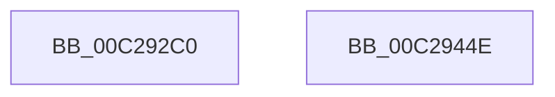

# FsRtlInitializeFileLocks

- RVA: `0x00C292C0`–`0x00C2944F` (길이 `399` bytes)
- VA: `0x0000000140C292C0`
- 실행 섹션: `INIT`
- PDB 이름 있음: `예`; PDB Function 태그: `아니요`
- unwind 정보 RVA: `0x000718AC`
- 디코드: `79`개 명령, `399/399` bytes 표시
- 미해석 바이트: `0` (있으면 어셈블리에 `.byte`로 보존)

> 이 문서는 커널 이미지의 기계어와 PDB 기호를 분석해 생성했습니다. 4번과 5번은 함수 원형과 자료형을 바이너리 사용 방식에서 추정한 C 해석이며 원본 소스 복구 결과는 아닙니다.

## 1. Dependencies

- 직접 호출 지점: **6**; 고유 호출 대상: **2**
- 직접 호출자로 확인된 함수: **1**
- RIP 상대 이미지 참조: **17**

### Outgoing calls
- `0x00C292FF` → [ExInitializeNPagedLookasideListInternal](../../text/46/ExInitializeNPagedLookasideListInternal_function_00468720.md) (function, `0x00468720`)
- `0x00C2932E` → [ExInitializeNPagedLookasideListInternal](../../text/46/ExInitializeNPagedLookasideListInternal_function_00468720.md) (function, `0x00468720`)
- `0x00C2935D` → [ExInitializeNPagedLookasideListInternal](../../text/46/ExInitializeNPagedLookasideListInternal_function_00468720.md) (function, `0x00468720`)
- `0x00C29388` → [ExInitializeNPagedLookasideListInternal](../../text/46/ExInitializeNPagedLookasideListInternal_function_00468720.md) (function, `0x00468720`)
- `0x00C293BA` → [ExInitializeNPagedLookasideListInternal](../../text/46/ExInitializeNPagedLookasideListInternal_function_00468720.md) (function, `0x00468720`)
- `0x00C293E4` → [ExInitializePagedLookasideList](../../page/AA/ExInitializePagedLookasideList_function_00AACC30.md) (function, `0x00AACC30`)

### Direct callers
- [FsRtlInitSystem](FsRtlInitSystem_function_00C28EEC.md) at `0x00C28F44`

### Static image references
- `0x00C292D4` → RVA `0x00E12200` (`.data`; read)
- `0x00C29309` → RVA `0x00E12180` (`.data`; read)
- `0x00C29338` → RVA `0x00E12000` (`.data`; read)
- `0x00C29367` → RVA `0x00E11F80` (`.data`; read)
- `0x00C2939A` → RVA `0x00E12100` (`.data`; read)
- `0x00C293C4` → RVA `0x00E12080` (`.data`; read)
- `0x00C293E9` → RVA `0x00F8F0A8` (`.data`; read/write)
- `0x00C293F1` → RVA `0x00F8F0C0` (`.data`; read)
- `0x00C293F8` → RVA `0x00F8F0B0` (`.data`; read/write)
- `0x00C293FF` → RVA `0x00F8F0BC` (`.data`; read/write)
- `0x00C29406` → RVA `0x00F8F0D8` (`.data`; read/write)
- `0x00C2940E` → RVA `0x00F8F0E0` (`.data`; read/write)
- `0x00C29420` → RVA `0x00F8F0C8` (`.data`; write)
- `0x00C29427` → RVA `0x00F8F0C0` (`.data`; write)
- `0x00C2942E` → RVA `0x00F8F0A0` (`.data`; write)
- `0x00C29438` → RVA `0x00F8F0B8` (`.data`; write)
- `0x00C29441` → RVA `0x00F8F0BA` (`.data`; write)

## 2. Other-region calls and transfers

- 다른 실행 섹션으로 향하는 call: **6**
  - `0x00C292FF` → [ExInitializeNPagedLookasideListInternal](../../text/46/ExInitializeNPagedLookasideListInternal_function_00468720.md) (`INIT` → `.text`)
  - `0x00C2932E` → [ExInitializeNPagedLookasideListInternal](../../text/46/ExInitializeNPagedLookasideListInternal_function_00468720.md) (`INIT` → `.text`)
  - `0x00C2935D` → [ExInitializeNPagedLookasideListInternal](../../text/46/ExInitializeNPagedLookasideListInternal_function_00468720.md) (`INIT` → `.text`)
  - `0x00C29388` → [ExInitializeNPagedLookasideListInternal](../../text/46/ExInitializeNPagedLookasideListInternal_function_00468720.md) (`INIT` → `.text`)
  - `0x00C293BA` → [ExInitializeNPagedLookasideListInternal](../../text/46/ExInitializeNPagedLookasideListInternal_function_00468720.md) (`INIT` → `.text`)
  - `0x00C293E4` → [ExInitializePagedLookasideList](../../page/AA/ExInitializePagedLookasideList_function_00AACC30.md) (`INIT` → `PAGE`)
- 별도 외부 분기/꼬리 이동을 확인하지 못했습니다.

## 3. Assembly (complete function range)

```asm
00C292C0  48 8B C4                        mov rax, rsp
00C292C3  48 89 58 08                     mov qword ptr [rax + 8], rbx
00C292C7  48 89 70 10                     mov qword ptr [rax + 0x10], rsi
00C292CB  57                              push rdi
00C292CC  48 83 EC 40                     sub rsp, 0x40
00C292D0  83 60 F0 00                     and dword ptr [rax - 0x10], 0
00C292D4  48 8D 0D 25 8F 1E 00            lea rcx, [rip + 0x1e8f25]
00C292DB  BF 10 00 00 00                  mov edi, 0x10
00C292E0  BE 00 02 00 00                  mov esi, 0x200
00C292E5  66 89 78 E8                     mov word ptr [rax - 0x18], di
00C292E9  44 8B CE                        mov r9d, esi
00C292EC  C7 40 E0 46 4C 73 68            mov dword ptr [rax - 0x20], 0x68734c46
00C292F3  45 33 C0                        xor r8d, r8d
00C292F6  33 D2                           xor edx, edx
00C292F8  8D 5F 28                        lea ebx, [rdi + 0x28]
00C292FB  48 89 58 D8                     mov qword ptr [rax - 0x28], rbx
00C292FF  E8 1C F4 83 FF                  call 0x140468720
00C29304  83 64 24 38 00                  and dword ptr [rsp + 0x38], 0
00C29309  48 8D 0D 70 8E 1E 00            lea rcx, [rip + 0x1e8e70]
00C29310  66 89 7C 24 30                  mov word ptr [rsp + 0x30], di
00C29315  44 8B CE                        mov r9d, esi
00C29318  C7 44 24 28 46 4C 65 78         mov dword ptr [rsp + 0x28], 0x78654c46
00C29320  45 33 C0                        xor r8d, r8d
00C29323  33 D2                           xor edx, edx
00C29325  48 C7 44 24 20 48 00 00 00      mov qword ptr [rsp + 0x20], 0x48
00C2932E  E8 ED F3 83 FF                  call 0x140468720
00C29333  83 64 24 38 00                  and dword ptr [rsp + 0x38], 0
00C29338  48 8D 0D C1 8C 1E 00            lea rcx, [rip + 0x1e8cc1]
00C2933F  66 89 7C 24 30                  mov word ptr [rsp + 0x30], di
00C29344  44 8B CE                        mov r9d, esi
00C29347  C7 44 24 28 46 4C 77 6C         mov dword ptr [rsp + 0x28], 0x6c774c46
00C2934F  45 33 C0                        xor r8d, r8d
00C29352  33 D2                           xor edx, edx
00C29354  48 C7 44 24 20 20 00 00 00      mov qword ptr [rsp + 0x20], 0x20
00C2935D  E8 BE F3 83 FF                  call 0x140468720
00C29362  83 64 24 38 00                  and dword ptr [rsp + 0x38], 0
00C29367  48 8D 0D 12 8C 1E 00            lea rcx, [rip + 0x1e8c12]
00C2936E  66 89 7C 24 30                  mov word ptr [rsp + 0x30], di
00C29373  44 8B CE                        mov r9d, esi
00C29376  C7 44 24 28 46 4C 6C 6E         mov dword ptr [rsp + 0x28], 0x6e6c4c46
00C2937E  45 33 C0                        xor r8d, r8d
00C29381  33 D2                           xor edx, edx
00C29383  48 89 5C 24 20                  mov qword ptr [rsp + 0x20], rbx
00C29388  E8 93 F3 83 FF                  call 0x140468720
00C2938D  83 64 24 38 00                  and dword ptr [rsp + 0x38], 0
00C29392  8D 5F F8                        lea ebx, [rdi - 8]
00C29395  66 89 5C 24 30                  mov word ptr [rsp + 0x30], bx
00C2939A  48 8D 0D 5F 8D 1E 00            lea rcx, [rip + 0x1e8d5f]
00C293A1  C7 44 24 28 46 4C 6C 69         mov dword ptr [rsp + 0x28], 0x696c4c46
00C293A9  44 8B CE                        mov r9d, esi
00C293AC  45 33 C0                        xor r8d, r8d
00C293AF  48 C7 44 24 20 40 00 00 00      mov qword ptr [rsp + 0x20], 0x40
00C293B8  33 D2                           xor edx, edx
00C293BA  E8 61 F3 83 FF                  call 0x140468720
00C293BF  66 89 5C 24 30                  mov word ptr [rsp + 0x30], bx
00C293C4  48 8D 0D B5 8C 1E 00            lea rcx, [rip + 0x1e8cb5]
00C293CB  C7 44 24 28 46 4C 66 6C         mov dword ptr [rsp + 0x28], 0x6c664c46
00C293D3  45 33 C9                        xor r9d, r9d
00C293D6  45 33 C0                        xor r8d, r8d
00C293D9  48 C7 44 24 20 60 00 00 00      mov qword ptr [rsp + 0x20], 0x60
00C293E2  33 D2                           xor edx, edx
00C293E4  E8 47 38 E8 FF                  call 0x140aacc30
00C293E9  48 83 25 B7 5C 36 00 00         and qword ptr [rip + 0x365cb7], 0
00C293F1  48 8D 05 C8 5C 36 00            lea rax, [rip + 0x365cc8]
00C293F8  83 25 B1 5C 36 00 00            and dword ptr [rip + 0x365cb1], 0
00C293FF  83 25 B6 5C 36 00 00            and dword ptr [rip + 0x365cb6], 0
00C29406  48 83 25 CA 5C 36 00 00         and qword ptr [rip + 0x365cca], 0
00C2940E  48 83 25 CA 5C 36 00 00         and qword ptr [rip + 0x365cca], 0
00C29416  48 8B 5C 24 50                  mov rbx, qword ptr [rsp + 0x50]
00C2941B  48 8B 74 24 58                  mov rsi, qword ptr [rsp + 0x58]
00C29420  48 89 05 A1 5C 36 00            mov qword ptr [rip + 0x365ca1], rax
00C29427  48 89 05 92 5C 36 00            mov qword ptr [rip + 0x365c92], rax
00C2942E  C7 05 68 5C 36 00 01 00 00 00   mov dword ptr [rip + 0x365c68], 1
00C29438  66 C7 05 77 5C 36 00 01 00      mov word ptr [rip + 0x365c77], 1
00C29441  C6 05 72 5C 36 00 06            mov byte ptr [rip + 0x365c72], 6
00C29448  48 83 C4 40                     add rsp, 0x40
00C2944C  5F                              pop rdi
00C2944D  C3                              ret
00C2944E  CC                              int3
```

## 4. C-style interpretation (structured pseudocode)

```c
__int64 __fastcall FsRtlInitializeFileLocks(__int64 a1, int a2, int a3)
{
    __int64 result;
    __int64 v_rsp;
    unsigned int v_stack_m10;
    unsigned __int16 v_stack_m18;
    unsigned int v_stack_m20;
    unsigned __int64 v_stack_m28;
    unsigned __int64 v_stack_p10;
    unsigned __int64 v_stack_p8;

    *(unsigned __int64 *)(v_rsp + 8) = v_rbx;
    *(unsigned __int64 *)(v_rsp + 16) = v_rsi;
    v_rsp = (v_rsp) - (64);
    *(unsigned __int16 *)(v_rsp - 24) = 16;
    *(unsigned int *)(v_rsp - 32) = 0x68734C46ULL;
    a3 = 0;
    a2 = 0;
    *(unsigned __int64 *)(v_rsp - 40) = 16 + 40;
    result = ExInitializeNPagedLookasideListInternal(v_rip + 2002725, a2, a3, 512);
    v_stack_m18 = 16;
    v_stack_m20 = 0x78654C46ULL;
    a3 = 0;
    a2 = 0;
    v_stack_m28 = 72;
    result = ExInitializeNPagedLookasideListInternal(v_rip + 2002544, a2, a3, 512);
    v_stack_m18 = 16;
    v_stack_m20 = 0x6C774C46ULL;
    a3 = 0;
    a2 = 0;
    v_stack_m28 = 32;
    result = ExInitializeNPagedLookasideListInternal(v_rip + 2002113, a2, a3, 512);
    v_stack_m18 = 16;
    v_stack_m20 = 0x6E6C4C46ULL;
    a3 = 0;
    a2 = 0;
    v_stack_m28 = 16 + 40;
    result = ExInitializeNPagedLookasideListInternal(v_rip + 2001938, a2, a3, 512);
    v_stack_m18 = (unsigned __int16)(16 - 8);
    v_stack_m20 = 0x696C4C46ULL;
    a3 = 0;
    v_stack_m28 = 64;
    a2 = 0;
    result = ExInitializeNPagedLookasideListInternal(v_rip + 2002271, a2, a3, 512);
    v_stack_m18 = (unsigned __int16)(16 - 8);
    v_stack_m20 = 0x6C664C46ULL;
    a4 = 0;
    a3 = 0;
    v_stack_m28 = 96;
    a2 = 0;
    result = ExInitializePagedLookasideList(v_rip + 2002101, a2, a3, a4);
    *(unsigned __int64 *)(v_rip + 3562657) = v_rip + 3562696;
    *(unsigned __int64 *)(v_rip + 3562642) = v_rip + 3562696;
    *(unsigned int *)(v_rip + 3562600) = 1;
    *(unsigned __int16 *)(v_rip + 3562615) = 1;
    *(unsigned __int8 *)(v_rip + 3562610) = 6;
    v_rsp = (v_rsp) + (64);
    return v_rip + 3562696;
}
```

## 5. (Beta) C Style

```c
int64_t FsRtlInitializeFileLocks(int64_t Arg1, int32_t Arg2, int32_t Arg3)
{
    int64_t result;
    int64_t local_rsp;
    uint32_t v_stack_m10;
    uint16_t v_stack_m18;
    uint32_t v_stack_m20;
    uint64_t v_stack_m28;
    uint64_t v_stack_p10;
    uint64_t v_stack_p8;

    *(uint64_t *)(local_rsp + 0x8) = local_rbx;
    *(uint64_t *)(local_rsp + 0x10) = local_rsi;
    local_rsp = (local_rsp) - (64);
    *(uint16_t *)(local_rsp - 0x18) = 16;
    *(uint32_t *)(local_rsp - 0x20) = 0x68734C46ULL;
    Arg3 = 0;
    Arg2 = 0;
    *(uint64_t *)(local_rsp - 0x28) = 16 + 40;
    result = ExInitializeNPagedLookasideListInternal(v_rip + 2002725, Arg2, Arg3, 512);
    v_stack_m18 = 16;
    v_stack_m20 = 0x78654C46ULL;
    Arg3 = 0;
    Arg2 = 0;
    v_stack_m28 = 72;
    result = ExInitializeNPagedLookasideListInternal(v_rip + 2002544, Arg2, Arg3, 512);
    v_stack_m18 = 16;
    v_stack_m20 = 0x6C774C46ULL;
    Arg3 = 0;
    Arg2 = 0;
    v_stack_m28 = 32;
    result = ExInitializeNPagedLookasideListInternal(v_rip + 2002113, Arg2, Arg3, 512);
    v_stack_m18 = 16;
    v_stack_m20 = 0x6E6C4C46ULL;
    Arg3 = 0;
    Arg2 = 0;
    v_stack_m28 = 16 + 40;
    result = ExInitializeNPagedLookasideListInternal(v_rip + 2001938, Arg2, Arg3, 512);
    v_stack_m18 = (uint16_t)(16 - 8);
    v_stack_m20 = 0x696C4C46ULL;
    Arg3 = 0;
    v_stack_m28 = 64;
    Arg2 = 0;
    result = ExInitializeNPagedLookasideListInternal(v_rip + 2002271, Arg2, Arg3, 512);
    v_stack_m18 = (uint16_t)(16 - 8);
    v_stack_m20 = 0x6C664C46ULL;
    a4 = 0;
    Arg3 = 0;
    v_stack_m28 = 96;
    Arg2 = 0;
    result = ExInitializePagedLookasideList(v_rip + 2002101, Arg2, Arg3, a4);
    *(uint64_t *)(v_rip + 0x365CA1) = v_rip + 3562696;
    *(uint64_t *)(v_rip + 0x365C92) = v_rip + 3562696;
    *(uint32_t *)(v_rip + 0x365C68) = 1;
    *(uint16_t *)(v_rip + 0x365C77) = 1;
    *(uint8_t *)(v_rip + 0x365C72) = 6;
    local_rsp = (local_rsp) + (64);
    return v_rip + 3562696;
}
```

## 6. Execution-region graph

[열기: 2D/3D 그래프와 함수 탐색 컨트롤 패널](../../../control-panel.html?section=init&rva=0x00C292C0&view=graph)

- 2D 그래프는 위에서 아래로 흐르고, 3D 그래프는 빈 공간을 드래그해 회전합니다. Shift+드래그는 이동, 휠은 확대·축소, 함수 노드 선택은 대상 보고서 이동입니다.

### Static fallback


