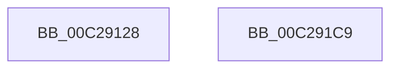

# FsRtlInitializeLargeMcbs

- RVA: `0x00C29128`–`0x00C291CA` (길이 `162` bytes)
- VA: `0x0000000140C29128`
- 실행 섹션: `INIT`
- PDB 이름 있음: `예`; PDB Function 태그: `아니요`
- unwind 정보 RVA: `0x000C5D90`
- 디코드: `33`개 명령, `162/162` bytes 표시
- 미해석 바이트: `0` (있으면 어셈블리에 `.byte`로 보존)

> 이 문서는 커널 이미지의 기계어와 PDB 기호를 분석해 생성했습니다. 4번과 5번은 함수 원형과 자료형을 바이너리 사용 방식에서 추정한 C 해석이며 원본 소스 복구 결과는 아닙니다.

## 1. Dependencies

- 직접 호출 지점: **3**; 고유 호출 대상: **2**
- 직접 호출자로 확인된 함수: **1**
- RIP 상대 이미지 참조: **3**

### Outgoing calls
- `0x00C29158` → [ExInitializePagedLookasideList](../../page/AA/ExInitializePagedLookasideList_function_00AACC30.md) (function, `0x00AACC30`)
- `0x00C2918A` → [ExInitializeNPagedLookasideListInternal](../../text/46/ExInitializeNPagedLookasideListInternal_function_00468720.md) (function, `0x00468720`)
- `0x00C291BE` → [ExInitializeNPagedLookasideListInternal](../../text/46/ExInitializeNPagedLookasideListInternal_function_00468720.md) (function, `0x00468720`)

### Direct callers
- [FsRtlInitSystem](FsRtlInitSystem_function_00C28EEC.md) at `0x00C28F49`

### Static image references
- `0x00C29133` → RVA `0x00E11E00` (`.data`; read)
- `0x00C29162` → RVA `0x00E11D80` (`.data`; read)
- `0x00C29194` → RVA `0x00E11E80` (`.data`; read)

## 2. Other-region calls and transfers

- 다른 실행 섹션으로 향하는 call: **3**
  - `0x00C29158` → [ExInitializePagedLookasideList](../../page/AA/ExInitializePagedLookasideList_function_00AACC30.md) (`INIT` → `PAGE`)
  - `0x00C2918A` → [ExInitializeNPagedLookasideListInternal](../../text/46/ExInitializeNPagedLookasideListInternal_function_00468720.md) (`INIT` → `.text`)
  - `0x00C291BE` → [ExInitializeNPagedLookasideListInternal](../../text/46/ExInitializeNPagedLookasideListInternal_function_00468720.md) (`INIT` → `.text`)
- 별도 외부 분기/꼬리 이동을 확인하지 못했습니다.

## 3. Assembly (complete function range)

```asm
00C29128  40 56                           push rsi
00C2912A  48 83 EC 40                     sub rsp, 0x40
00C2912E  BE 04 00 00 00                  mov esi, 4
00C29133  48 8D 0D C6 8C 1E 00            lea rcx, [rip + 0x1e8cc6]
00C2913A  66 89 74 24 30                  mov word ptr [rsp + 0x30], si
00C2913F  45 33 C9                        xor r9d, r9d
00C29142  C7 44 24 28 46 53 69 6D         mov dword ptr [rsp + 0x28], 0x6d695346
00C2914A  45 33 C0                        xor r8d, r8d
00C2914D  33 D2                           xor edx, edx
00C2914F  48 C7 44 24 20 78 00 00 00      mov qword ptr [rsp + 0x20], 0x78
00C29158  E8 D3 3A E8 FF                  call 0x140aacc30
00C2915D  83 64 24 38 00                  and dword ptr [rsp + 0x38], 0
00C29162  48 8D 0D 17 8C 1E 00            lea rcx, [rip + 0x1e8c17]
00C29169  66 89 74 24 30                  mov word ptr [rsp + 0x30], si
00C2916E  41 B9 00 02 00 00               mov r9d, 0x200
00C29174  C7 44 24 28 46 53 69 6D         mov dword ptr [rsp + 0x28], 0x6d695346
00C2917C  45 33 C0                        xor r8d, r8d
00C2917F  33 D2                           xor edx, edx
00C29181  48 C7 44 24 20 78 00 00 00      mov qword ptr [rsp + 0x20], 0x78
00C2918A  E8 91 F5 83 FF                  call 0x140468720
00C2918F  83 64 24 38 00                  and dword ptr [rsp + 0x38], 0
00C29194  48 8D 0D E5 8C 1E 00            lea rcx, [rip + 0x1e8ce5]
00C2919B  66 C7 44 24 30 20 00            mov word ptr [rsp + 0x30], 0x20
00C291A2  41 B9 00 02 00 00               mov r9d, 0x200
00C291A8  C7 44 24 28 46 53 66 6D         mov dword ptr [rsp + 0x28], 0x6d665346
00C291B0  45 33 C0                        xor r8d, r8d
00C291B3  33 D2                           xor edx, edx
00C291B5  48 C7 44 24 20 38 00 00 00      mov qword ptr [rsp + 0x20], 0x38
00C291BE  E8 5D F5 83 FF                  call 0x140468720
00C291C3  48 83 C4 40                     add rsp, 0x40
00C291C7  5E                              pop rsi
00C291C8  C3                              ret
00C291C9  CC                              int3
```

## 4. C-style interpretation (structured pseudocode)

```c
__int64 __fastcall FsRtlInitializeLargeMcbs(__int64 a1, int a2, int a3, int a4)
{
    __int64 result;
    __int64 v_rsp;
    unsigned int v_stack_m10;
    unsigned __int16 v_stack_m18;
    unsigned int v_stack_m20;
    unsigned __int64 v_stack_m28;

    v_rsp = (v_rsp) - (64);
    v_stack_m18 = 4;
    a4 = 0;
    v_stack_m20 = 0x6D695346ULL;
    a3 = 0;
    a2 = 0;
    v_stack_m28 = 120;
    result = ExInitializePagedLookasideList(v_rip + 2002118, a2, a3, a4);
    v_stack_m18 = 4;
    v_stack_m20 = 0x6D695346ULL;
    a3 = 0;
    a2 = 0;
    v_stack_m28 = 120;
    result = ExInitializeNPagedLookasideListInternal(v_rip + 2001943, a2, a3, 512);
    v_stack_m18 = 32;
    v_stack_m20 = 0x6D665346ULL;
    a3 = 0;
    a2 = 0;
    v_stack_m28 = 56;
    result = ExInitializeNPagedLookasideListInternal(v_rip + 2002149, a2, a3, 512);
    v_rsp = (v_rsp) + (64);
    return result;
}
```

## 5. (Beta) C Style

```c
int64_t FsRtlInitializeLargeMcbs(int64_t Arg1, int32_t Arg2, int32_t Arg3, int32_t Arg4)
{
    int64_t result;
    int64_t local_rsp;
    uint32_t v_stack_m10;
    uint16_t v_stack_m18;
    uint32_t v_stack_m20;
    uint64_t v_stack_m28;

    local_rsp = (local_rsp) - (64);
    v_stack_m18 = 4;
    Arg4 = 0;
    v_stack_m20 = 0x6D695346ULL;
    Arg3 = 0;
    Arg2 = 0;
    v_stack_m28 = 120;
    result = ExInitializePagedLookasideList(v_rip + 2002118, Arg2, Arg3, Arg4);
    v_stack_m18 = 4;
    v_stack_m20 = 0x6D695346ULL;
    Arg3 = 0;
    Arg2 = 0;
    v_stack_m28 = 120;
    result = ExInitializeNPagedLookasideListInternal(v_rip + 2001943, Arg2, Arg3, 512);
    v_stack_m18 = 32;
    v_stack_m20 = 0x6D665346ULL;
    Arg3 = 0;
    Arg2 = 0;
    v_stack_m28 = 56;
    result = ExInitializeNPagedLookasideListInternal(v_rip + 2002149, Arg2, Arg3, 512);
    local_rsp = (local_rsp) + (64);
    return result;
}
```

## 6. Execution-region graph

[열기: 2D/3D 그래프와 함수 탐색 컨트롤 패널](../../../control-panel.html?section=init&rva=0x00C29128&view=graph)

- 2D 그래프는 위에서 아래로 흐르고, 3D 그래프는 빈 공간을 드래그해 회전합니다. Shift+드래그는 이동, 휠은 확대·축소, 함수 노드 선택은 대상 보고서 이동입니다.

### Static fallback


