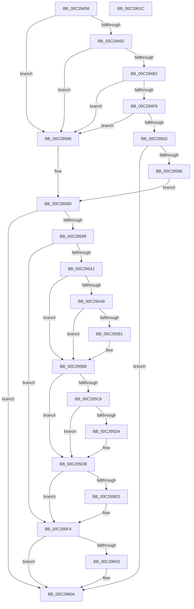

# FsRtlInitializeOplockPerf

- RVA: `0x00C29458`–`0x00C2961D` (길이 `453` bytes)
- VA: `0x0000000140C29458`
- 실행 섹션: `INIT`
- PDB 이름 있음: `예`; PDB Function 태그: `아니요`
- unwind 정보 RVA: `0x00086C28`
- 디코드: `114`개 명령, `453/453` bytes 표시
- 미해석 바이트: `0` (있으면 어셈블리에 `.byte`로 보존)

> 이 문서는 커널 이미지의 기계어와 PDB 기호를 분석해 생성했습니다. 4번과 5번은 함수 원형과 자료형을 바이너리 사용 방식에서 추정한 C 해석이며 원본 소스 복구 결과는 아닙니다.

## 1. Dependencies

- 직접 호출 지점: **13**; 고유 호출 대상: **7**
- 직접 호출자로 확인된 함수: **1**
- RIP 상대 이미지 참조: **7**

### Outgoing calls
- `0x00C2947B` → [ExAllocatePool2](../../poolcode/B8/ExAllocatePool2_function_00B820F0.md) (function, `0x00B820F0`)
- `0x00C2949A` → [ExAllocatePool2](../../poolcode/B8/ExAllocatePool2_function_00B820F0.md) (function, `0x00B820F0`)
- `0x00C294B9` → [ExAllocatePool2](../../poolcode/B8/ExAllocatePool2_function_00B820F0.md) (function, `0x00B820F0`)
- `0x00C294D2` → [ExAllocatePool2](../../poolcode/B8/ExAllocatePool2_function_00B820F0.md) (function, `0x00B820F0`)
- `0x00C29502` → [FsRtlpOplockPerfInitializeLatencyInfo](../../page/71/FsRtlpOplockPerfInitializeLatencyInfo_function_0071525C.md) (function, `0x0071525C`)
- `0x00C29529` → [KiQueryUnbiasedInterruptTime](../../text/42/KiQueryUnbiasedInterruptTime_function_0042D180.md) (function, `0x0042D180`)
- `0x00C2953B` → [Feature_697728313__private_IsEnabledDeviceUsageNoInline](../../text/58/Feature_697728313__private_IsEnabledDeviceUsageNoInline_function_00581D84.md) (function, `0x00581D84`)
- `0x00C29572` → [ExInitializeNPagedLookasideListInternal](../../text/46/ExInitializeNPagedLookasideListInternal_function_00468720.md) (function, `0x00468720`)
- `0x00C29577` → [FsRtlpOplockGetAckTimeoutOverride](../../page/71/FsRtlpOplockGetAckTimeoutOverride_function_00714F54.md) (function, `0x00714F54`)
- `0x00C295B3` → [ExFreePoolWithTag](../../poolcode/B8/ExFreePoolWithTag_function_00B82870.md) (function, `0x00B82870`)
- `0x00C295D6` → [ExFreePoolWithTag](../../poolcode/B8/ExFreePoolWithTag_function_00B82870.md) (function, `0x00B82870`)
- `0x00C295EF` → [ExFreePoolWithTag](../../poolcode/B8/ExFreePoolWithTag_function_00B82870.md) (function, `0x00B82870`)
- `0x00C29605` → [ExFreePoolWithTag](../../poolcode/B8/ExFreePoolWithTag_function_00B82870.md) (function, `0x00B82870`)

### Direct callers
- [FsRtlInitSystem](FsRtlInitSystem_function_00C28EEC.md) at `0x00C29008`

### Static image references
- `0x00C29482` → RVA `0x00E65C08` (`.data`; write)
- `0x00C2949F` → RVA `0x00E65C08` (`.data`; read)
- `0x00C29513` → RVA `0x00E65C40` (`.data`; write)
- `0x00C2952E` → RVA `0x00E65C48` (`.data`; write)
- `0x00C29535` → RVA `0x00E65C21` (`.data`; write)
- `0x00C29544` → RVA `0x00E12280` (`.data`; read)
- `0x00C295F7` → RVA `0x00E65C08` (`.data`; read/write)

## 2. Other-region calls and transfers

- 다른 실행 섹션으로 향하는 call: **13**
  - `0x00C2947B` → [ExAllocatePool2](../../poolcode/B8/ExAllocatePool2_function_00B820F0.md) (`INIT` → `POOLCODE`)
  - `0x00C2949A` → [ExAllocatePool2](../../poolcode/B8/ExAllocatePool2_function_00B820F0.md) (`INIT` → `POOLCODE`)
  - `0x00C294B9` → [ExAllocatePool2](../../poolcode/B8/ExAllocatePool2_function_00B820F0.md) (`INIT` → `POOLCODE`)
  - `0x00C294D2` → [ExAllocatePool2](../../poolcode/B8/ExAllocatePool2_function_00B820F0.md) (`INIT` → `POOLCODE`)
  - `0x00C29502` → [FsRtlpOplockPerfInitializeLatencyInfo](../../page/71/FsRtlpOplockPerfInitializeLatencyInfo_function_0071525C.md) (`INIT` → `PAGE`)
  - `0x00C29529` → [KiQueryUnbiasedInterruptTime](../../text/42/KiQueryUnbiasedInterruptTime_function_0042D180.md) (`INIT` → `.text`)
  - `0x00C2953B` → [Feature_697728313__private_IsEnabledDeviceUsageNoInline](../../text/58/Feature_697728313__private_IsEnabledDeviceUsageNoInline_function_00581D84.md) (`INIT` → `.text`)
  - `0x00C29572` → [ExInitializeNPagedLookasideListInternal](../../text/46/ExInitializeNPagedLookasideListInternal_function_00468720.md) (`INIT` → `.text`)
  - `0x00C29577` → [FsRtlpOplockGetAckTimeoutOverride](../../page/71/FsRtlpOplockGetAckTimeoutOverride_function_00714F54.md) (`INIT` → `PAGE`)
  - `0x00C295B3` → [ExFreePoolWithTag](../../poolcode/B8/ExFreePoolWithTag_function_00B82870.md) (`INIT` → `POOLCODE`)
  - `0x00C295D6` → [ExFreePoolWithTag](../../poolcode/B8/ExFreePoolWithTag_function_00B82870.md) (`INIT` → `POOLCODE`)
  - `0x00C295EF` → [ExFreePoolWithTag](../../poolcode/B8/ExFreePoolWithTag_function_00B82870.md) (`INIT` → `POOLCODE`)
  - `0x00C29605` → [ExFreePoolWithTag](../../poolcode/B8/ExFreePoolWithTag_function_00B82870.md) (`INIT` → `POOLCODE`)
- 별도 외부 분기/꼬리 이동을 확인하지 못했습니다.

## 3. Assembly (complete function range)

```asm
00C29458  48 89 5C 24 08                  mov qword ptr [rsp + 8], rbx
00C2945D  48 89 74 24 10                  mov qword ptr [rsp + 0x10], rsi
00C29462  57                              push rdi
00C29463  48 83 EC 40                     sub rsp, 0x40
00C29467  BE 46 53 72 6F                  mov esi, 0x6f725346
00C2946C  BB 00 01 00 00                  mov ebx, 0x100
00C29471  44 8B C6                        mov r8d, esi
00C29474  8B CB                           mov ecx, ebx
00C29476  BA 28 00 00 00                  mov edx, 0x28
00C2947B  E8 70 8C F5 FF                  call 0x140b820f0
00C29480  33 FF                           xor edi, edi
00C29482  48 89 05 7F C7 23 00            mov qword ptr [rip + 0x23c77f], rax
00C29489  48 85 C0                        test rax, rax
00C2948C  0F 84 F6 00 00 00               je 0x140c29588
00C29492  44 8B C6                        mov r8d, esi
00C29495  8D 57 18                        lea edx, [rdi + 0x18]
00C29498  8B CB                           mov ecx, ebx
00C2949A  E8 51 8C F5 FF                  call 0x140b820f0
00C2949F  48 8B 0D 62 C7 23 00            mov rcx, qword ptr [rip + 0x23c762]
00C294A6  48 89 01                        mov qword ptr [rcx], rax
00C294A9  48 85 C0                        test rax, rax
00C294AC  0F 84 D6 00 00 00               je 0x140c29588
00C294B2  44 8B C6                        mov r8d, esi
00C294B5  8B D3                           mov edx, ebx
00C294B7  8B CB                           mov ecx, ebx
00C294B9  E8 32 8C F5 FF                  call 0x140b820f0
00C294BE  48 8B 15 43 C7 23 00            mov rdx, qword ptr [rip + 0x23c743]
00C294C5  8B CB                           mov ecx, ebx
00C294C7  4C 8B 02                        mov r8, qword ptr [rdx]
00C294CA  8B D3                           mov edx, ebx
00C294CC  49 89 00                        mov qword ptr [r8], rax
00C294CF  44 8B C6                        mov r8d, esi
00C294D2  E8 19 8C F5 FF                  call 0x140b820f0
00C294D7  48 8B 0D 2A C7 23 00            mov rcx, qword ptr [rip + 0x23c72a]
00C294DE  48 8B 11                        mov rdx, qword ptr [rcx]
00C294E1  48 89 42 08                     mov qword ptr [rdx + 8], rax
00C294E5  48 8B 05 1C C7 23 00            mov rax, qword ptr [rip + 0x23c71c]
00C294EC  48 8B 08                        mov rcx, qword ptr [rax]
00C294EF  48 39 39                        cmp qword ptr [rcx], rdi
00C294F2  0F 84 90 00 00 00               je 0x140c29588
00C294F8  48 39 79 08                     cmp qword ptr [rcx + 8], rdi
00C294FC  0F 84 86 00 00 00               je 0x140c29588
00C29502  E8 55 BD AE FF                  call 0x14071525c
00C29507  48 B8 00 68 C4 61 08 00 00 00   movabs rax, 0x861c46800
00C29511  B1 01                           mov cl, 1
00C29513  48 89 05 26 C7 23 00            mov qword ptr [rip + 0x23c726], rax
00C2951A  48 8B 05 E7 C6 23 00            mov rax, qword ptr [rip + 0x23c6e7]
00C29521  48 C7 40 18 0A 00 00 00         mov qword ptr [rax + 0x18], 0xa
00C29529  E8 52 3C 80 FF                  call 0x14042d180
00C2952E  48 89 05 13 C7 23 00            mov qword ptr [rip + 0x23c713], rax
00C29535  88 0D E6 C6 23 00               mov byte ptr [rip + 0x23c6e6], cl
00C2953B  E8 44 88 95 FF                  call 0x140581d84
00C29540  89 7C 24 38                     mov dword ptr [rsp + 0x38], edi
00C29544  48 8D 0D 35 8D 1E 00            lea rcx, [rip + 0x1e8d35]
00C2954B  F7 D8                           neg eax
00C2954D  66 89 7C 24 30                  mov word ptr [rsp + 0x30], di
00C29552  89 74 24 28                     mov dword ptr [rsp + 0x28], esi
00C29556  45 1B C9                        sbb r9d, r9d
00C29559  48 C7 44 24 20 B8 00 00 00      mov qword ptr [rsp + 0x20], 0xb8
00C29562  41 83 E1 F0                     and r9d, 0xfffffff0
00C29566  45 33 C0                        xor r8d, r8d
00C29569  41 81 C1 10 02 00 00            add r9d, 0x210
00C29570  33 D2                           xor edx, edx
00C29572  E8 A9 F1 83 FF                  call 0x140468720
00C29577  E8 D8 B9 AE FF                  call 0x140714f54
00C2957C  8B D8                           mov ebx, eax
00C2957E  85 C0                           test eax, eax
00C29580  0F 89 84 00 00 00               jns 0x140c2960a
00C29586  EB 05                           jmp 0x140c2958d
00C29588  BB 9A 00 00 C0                  mov ebx, 0xc000009a
00C2958D  48 8B 05 74 C6 23 00            mov rax, qword ptr [rip + 0x23c674]
00C29594  48 85 C0                        test rax, rax
00C29597  74 71                           je 0x140c2960a
00C29599  48 8B 00                        mov rax, qword ptr [rax]
00C2959C  48 85 C0                        test rax, rax
00C2959F  74 53                           je 0x140c295f4
00C295A1  48 39 38                        cmp qword ptr [rax], rdi
00C295A4  74 12                           je 0x140c295b8
00C295A6  48 8B CF                        mov rcx, rdi
00C295A9  48 87 08                        xchg qword ptr [rax], rcx
00C295AC  48 85 C9                        test rcx, rcx
00C295AF  74 07                           je 0x140c295b8
00C295B1  33 D2                           xor edx, edx
00C295B3  E8 B8 92 F5 FF                  call 0x140b82870
00C295B8  48 8B 05 49 C6 23 00            mov rax, qword ptr [rip + 0x23c649]
00C295BF  48 8B 10                        mov rdx, qword ptr [rax]
00C295C2  48 39 7A 08                     cmp qword ptr [rdx + 8], rdi
00C295C6  74 13                           je 0x140c295db
00C295C8  48 8B CF                        mov rcx, rdi
00C295CB  48 87 4A 08                     xchg qword ptr [rdx + 8], rcx
00C295CF  48 85 C9                        test rcx, rcx
00C295D2  74 07                           je 0x140c295db
00C295D4  33 D2                           xor edx, edx
00C295D6  E8 95 92 F5 FF                  call 0x140b82870
00C295DB  48 8B 05 26 C6 23 00            mov rax, qword ptr [rip + 0x23c626]
00C295E2  48 8B CF                        mov rcx, rdi
00C295E5  48 87 08                        xchg qword ptr [rax], rcx
00C295E8  48 85 C9                        test rcx, rcx
00C295EB  74 07                           je 0x140c295f4
00C295ED  33 D2                           xor edx, edx
00C295EF  E8 7C 92 F5 FF                  call 0x140b82870
00C295F4  48 8B CF                        mov rcx, rdi
00C295F7  48 87 0D 0A C6 23 00            xchg qword ptr [rip + 0x23c60a], rcx
00C295FE  48 85 C9                        test rcx, rcx
00C29601  74 07                           je 0x140c2960a
00C29603  33 D2                           xor edx, edx
00C29605  E8 66 92 F5 FF                  call 0x140b82870
00C2960A  48 8B 74 24 58                  mov rsi, qword ptr [rsp + 0x58]
00C2960F  8B C3                           mov eax, ebx
00C29611  48 8B 5C 24 50                  mov rbx, qword ptr [rsp + 0x50]
00C29616  48 83 C4 40                     add rsp, 0x40
00C2961A  5F                              pop rdi
00C2961B  C3                              ret
00C2961C  CC                              int3
```

## 4. C-style interpretation (structured pseudocode)

```c
__int64 __fastcall FsRtlInitializeOplockPerf(__int64 a1, __int64 a2, __int64 a3, int a4)
{
    __int64 result;
    __int64 v_rdi;
    __int64 v_rsp;
    unsigned int v_stack_m10;
    unsigned __int16 v_stack_m18;
    unsigned int v_stack_m20;
    unsigned __int64 v_stack_m28;
    unsigned __int64 v_stack_p10;
    unsigned __int64 v_stack_p8;

    v_stack_p8 = v_rbx;
    v_stack_p10 = v_rsi;
    v_rsp = (v_rsp) - (64);
    result = ExAllocatePool2(256, 40, (unsigned int)((unsigned int)((unsigned int)(0x6F725346ULL))), a4);
    v_rdi = 0;
    *(unsigned __int64 *)(v_rip + 2344831) = result;
    if (result == 0) goto loc_00C29588;
    result = ExAllocatePool2(256, v_rdi + 24, (unsigned int)((unsigned int)((unsigned int)(0x6F725346ULL))), a4);
    *(unsigned __int64 *)(*(unsigned __int64 *)(v_rip + 2344802)) = result;
    if (result == 0) goto loc_00C29588;
    result = ExAllocatePool2(256, 256, (unsigned int)((unsigned int)((unsigned int)(0x6F725346ULL))), a4);
    *(unsigned __int64 *)(*(unsigned __int64 *)(*(unsigned __int64 *)(v_rip + 2344771))) = result;
    result = ExAllocatePool2(256, 256, (unsigned int)((unsigned int)((unsigned int)(0x6F725346ULL))), a4);
    *(unsigned __int64 *)(*(unsigned __int64 *)(*(unsigned __int64 *)(v_rip + 2344746)) + 8) = result;
    if ((*(unsigned __int64 *)(*(unsigned __int64 *)(*(unsigned __int64 *)(v_rip + 2344732)))) == 0) goto loc_00C29588;
    if ((*(unsigned __int64 *)(*(unsigned __int64 *)(*(unsigned __int64 *)(v_rip + 2344732)) + 8)) == 0) goto loc_00C29588;
    result = FsRtlpOplockPerfInitializeLatencyInfo(*(unsigned __int64 *)(*(unsigned __int64 *)(v_rip + 2344732)), *(unsigned __int64 *)(*(unsigned __int64 *)(v_rip + 2344746)), (unsigned int)((unsigned int)((unsigned int)(0x6F725346ULL))), a4);
    *(unsigned __int64 *)(v_rip + 2344742) = result;
    *(unsigned __int64 *)(*(unsigned __int64 *)(v_rip + 2344679) + 24) = 10;
    result = KiQueryUnbiasedInterruptTime(1, *(unsigned __int64 *)(*(unsigned __int64 *)(v_rip + 2344746)), (unsigned int)((unsigned int)((unsigned int)(0x6F725346ULL))), a4);
    *(unsigned __int64 *)(v_rip + 2344723) = result;
    *(unsigned __int8 *)(v_rip + 2344678) = 1;
    result = Feature_697728313__private_IsEnabledDeviceUsageNoInline(1, *(unsigned __int64 *)(*(unsigned __int64 *)(v_rip + 2344746)), (unsigned int)((unsigned int)((unsigned int)(0x6F725346ULL))), a4);
    v_stack_m10 = 0;
    result = (unsigned int)(-(result));
    v_stack_m18 = 0;
    v_stack_m20 = (unsigned int)((unsigned int)(0x6F725346ULL));
    v_stack_m28 = 184;
    a4 = (unsigned int)((a4) & (0xFFFFFFF0ULL));
    a3 = 0;
    a4 = (unsigned int)((a4) + (528));
    a2 = 0;
    result = ExInitializeNPagedLookasideListInternal(v_rip + 2002229, a2, a3, a4);
    result = FsRtlpOplockGetAckTimeoutOverride(v_rip + 2002229, a2, a3, a4);
    if (!sign_flag) goto loc_00C2960A;
    goto loc_00C2958D;
loc_00C29588:
loc_00C2958D:
    if (*(unsigned __int64 *)(v_rip + 2344564) == 0) goto loc_00C2960A;
    if (*(unsigned __int64 *)(*(unsigned __int64 *)(v_rip + 2344564)) == 0) goto loc_00C295F4;
    if ((*(unsigned __int64 *)(*(unsigned __int64 *)(*(unsigned __int64 *)(v_rip + 2344564)))) == 0) goto loc_00C295B8;
    result = *(unsigned __int64 *)(*(unsigned __int64 *)(v_rip + 2344564));
    if (0 != 0) {
        a2 = 0;
        result = ExFreePoolWithTag(0, a2, a3, a4);
    }
    if ((*(unsigned __int64 *)(*(unsigned __int64 *)(*(unsigned __int64 *)(v_rip + 2344521)) + 8)) == 0) goto loc_00C295DB;
    result = *(unsigned __int64 *)(v_rip + 2344521);
    if (0 != 0) {
        a2 = 0;
        result = ExFreePoolWithTag(0, a2, a3, a4);
    }
    result = *(unsigned __int64 *)(v_rip + 2344486);
    if (0 != 0) {
        a2 = 0;
        result = ExFreePoolWithTag(0, a2, a3, a4);
    }
    if (0 != 0) {
        a2 = 0;
        result = ExFreePoolWithTag(0, a2, a3, a4);
    }
    v_rsp = (v_rsp) + (64);
    return (unsigned int)((unsigned int)((unsigned int)(0xC000009AULL)));
}
```

## 5. (Beta) C Style

```c
int64_t FsRtlInitializeOplockPerf(int64_t Arg1, int64_t Arg2, int64_t Arg3, int32_t Arg4)
{
    int64_t result;
    int64_t local_rdi;
    int64_t local_rsp;
    uint32_t v_stack_m10;
    uint16_t v_stack_m18;
    uint32_t v_stack_m20;
    uint64_t v_stack_m28;
    uint64_t v_stack_p10;
    uint64_t v_stack_p8;

    v_stack_p8 = local_rbx;
    v_stack_p10 = local_rsi;
    local_rsp = (local_rsp) - (64);
    result = ExAllocatePool2(256, 40, (uint32_t)((uint32_t)((uint32_t)(0x6F725346ULL))), Arg4);
    local_rdi = 0;
    *(uint64_t *)(v_rip + 0x23C77F) = result;
    if (result == 0) goto loc_00C29588;
    result = ExAllocatePool2(256, local_rdi + 24, (uint32_t)((uint32_t)((uint32_t)(0x6F725346ULL))), Arg4);
    *(uint64_t *)(*(uint64_t *)(v_rip + 0x23C762)) = result;
    if (result == 0) goto loc_00C29588;
    result = ExAllocatePool2(256, 256, (uint32_t)((uint32_t)((uint32_t)(0x6F725346ULL))), Arg4);
    *(uint64_t *)(*(uint64_t *)(*(uint64_t *)(v_rip + 0x23C743))) = result;
    result = ExAllocatePool2(256, 256, (uint32_t)((uint32_t)((uint32_t)(0x6F725346ULL))), Arg4);
    *(uint64_t *)(*(uint64_t *)(*(uint64_t *)(v_rip + 0x23C72A)) + 0x8) = result;
    if ((*(uint64_t *)(*(uint64_t *)(*(uint64_t *)(v_rip + 0x23C71C)))) == 0) goto loc_00C29588;
    if ((*(uint64_t *)(*(uint64_t *)(*(uint64_t *)(v_rip + 0x23C71C)) + 0x8)) == 0) goto loc_00C29588;
    result = FsRtlpOplockPerfInitializeLatencyInfo(*(uint64_t *)(*(uint64_t *)(v_rip + 0x23C71C)), *(uint64_t *)(*(uint64_t *)(v_rip + 0x23C72A)), (uint32_t)((uint32_t)((uint32_t)(0x6F725346ULL))), Arg4);
    *(uint64_t *)(v_rip + 0x23C726) = result;
    *(uint64_t *)(*(uint64_t *)(v_rip + 0x23C6E7) + 0x18) = 10;
    result = KiQueryUnbiasedInterruptTime(1, *(uint64_t *)(*(uint64_t *)(v_rip + 0x23C72A)), (uint32_t)((uint32_t)((uint32_t)(0x6F725346ULL))), Arg4);
    *(uint64_t *)(v_rip + 0x23C713) = result;
    *(uint8_t *)(v_rip + 0x23C6E6) = 1;
    result = Feature_697728313__private_IsEnabledDeviceUsageNoInline(1, *(uint64_t *)(*(uint64_t *)(v_rip + 0x23C72A)), (uint32_t)((uint32_t)((uint32_t)(0x6F725346ULL))), Arg4);
    v_stack_m10 = 0;
    result = (uint32_t)(-(result));
    v_stack_m18 = 0;
    v_stack_m20 = (uint32_t)((uint32_t)(0x6F725346ULL));
    v_stack_m28 = 184;
    Arg4 = (uint32_t)((Arg4) & (0xFFFFFFF0ULL));
    Arg3 = 0;
    Arg4 = (uint32_t)((Arg4) + (528));
    Arg2 = 0;
    result = ExInitializeNPagedLookasideListInternal(v_rip + 2002229, Arg2, Arg3, Arg4);
    result = FsRtlpOplockGetAckTimeoutOverride(v_rip + 2002229, Arg2, Arg3, Arg4);
    if (!sign_flag) goto loc_00C2960A;
    goto loc_00C2958D;
loc_00C29588:
loc_00C2958D:
    if (*(uint64_t *)(v_rip + 0x23C674) == 0) goto loc_00C2960A;
    if (*(uint64_t *)(*(uint64_t *)(v_rip + 0x23C674)) == 0) goto loc_00C295F4;
    if ((*(uint64_t *)(*(uint64_t *)(*(uint64_t *)(v_rip + 0x23C674)))) == 0) goto loc_00C295B8;
    result = *(uint64_t *)(*(uint64_t *)(v_rip + 0x23C674));
    if (0 != 0) {
        Arg2 = 0;
        result = ExFreePoolWithTag(0, Arg2, Arg3, Arg4);
    }
    if ((*(uint64_t *)(*(uint64_t *)(*(uint64_t *)(v_rip + 0x23C649)) + 0x8)) == 0) goto loc_00C295DB;
    result = *(uint64_t *)(v_rip + 0x23C649);
    if (0 != 0) {
        Arg2 = 0;
        result = ExFreePoolWithTag(0, Arg2, Arg3, Arg4);
    }
    result = *(uint64_t *)(v_rip + 0x23C626);
    if (0 != 0) {
        Arg2 = 0;
        result = ExFreePoolWithTag(0, Arg2, Arg3, Arg4);
    }
    if (0 != 0) {
        Arg2 = 0;
        result = ExFreePoolWithTag(0, Arg2, Arg3, Arg4);
    }
    local_rsp = (local_rsp) + (64);
    return (uint32_t)((uint32_t)((uint32_t)(0xC000009AULL)));
}
```

## 6. Execution-region graph

[열기: 2D/3D 그래프와 함수 탐색 컨트롤 패널](../../../control-panel.html?section=init&rva=0x00C29458&view=graph)

- 2D 그래프는 위에서 아래로 흐르고, 3D 그래프는 빈 공간을 드래그해 회전합니다. Shift+드래그는 이동, 휠은 확대·축소, 함수 노드 선택은 대상 보고서 이동입니다.

### Static fallback


