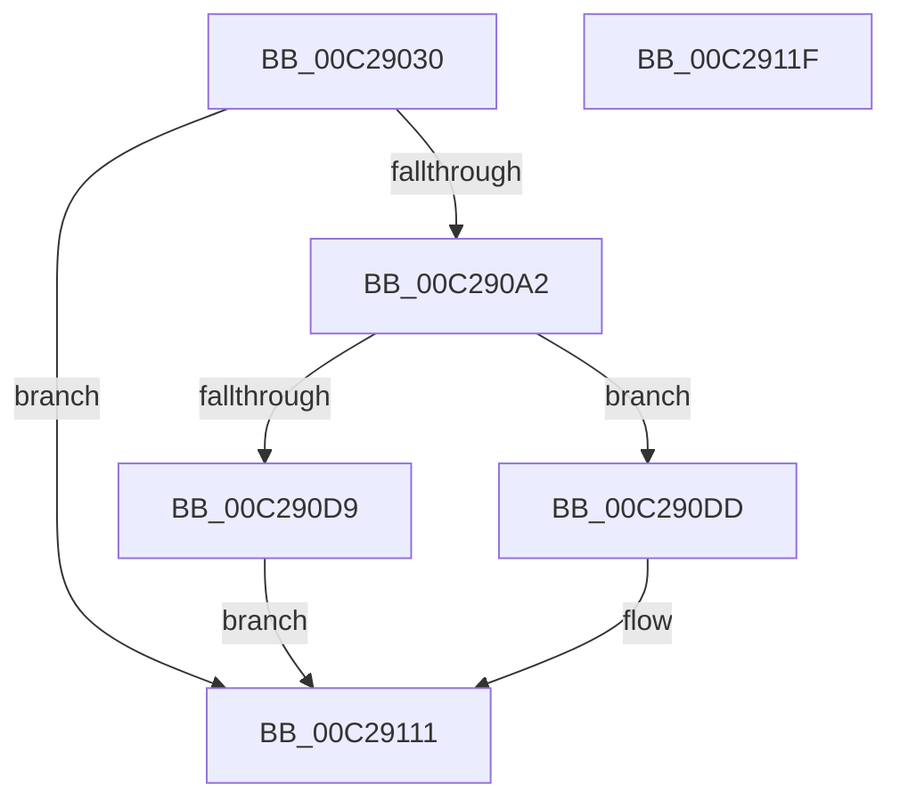

# FsRtlInitializeSmssEvent

- RVA: `0x00C29030`–`0x00C29120` (길이 `240` bytes)
- VA: `0x0000000140C29030`
- 실행 섹션: `INIT`
- PDB 이름 있음: `예`; PDB Function 태그: `아니요`
- unwind 정보 RVA: `0x000C5C5C`
- 디코드: `56`개 명령, `240/240` bytes 표시
- 미해석 바이트: `0` (있으면 어셈블리에 `.byte`로 보존)

> 이 문서는 커널 이미지의 기계어와 PDB 기호를 분석해 생성했습니다. 4번과 5번은 함수 원형과 자료형을 바이너리 사용 방식에서 추정한 C 해석이며 원본 소스 복구 결과는 아닙니다.

## 1. Dependencies

- 직접 호출 지점: **4**; 고유 호출 대상: **4**
- 직접 호출자로 확인된 함수: **1**
- RIP 상대 이미지 참조: **6**

### Outgoing calls
- `0x00C29099` → [NtCreateEvent](../../page/8B/NtCreateEvent_function_008B9140.md) (function, `0x008B9140`)
- `0x00C290C5` → [ObReferenceObjectByHandle](../../page/86/ObReferenceObjectByHandle_function_00868DB0.md) (function, `0x00868DB0`)
- `0x00C290D0` → [NtClose](../../page/86/NtClose_function_00868870.md) (function, `0x00868870`)
- `0x00C2910A` → [ExQueueWorkItem](../../text/2F/ExQueueWorkItem_function_002F9520.md) (function, `0x002F9520`)

### Direct callers
- [FsRtlInitSystem](FsRtlInitSystem_function_00C28EEC.md) at `0x00C28FF5`

### Static image references
- `0x00C29042` → RVA `0x00C79810` (` ?? ::PBOPGDP::`string'`; read)
- `0x00C290DD` → RVA `0x00F8F100` (`.data`; read/write)
- `0x00C290E5` → RVA `0x007138A0` (`FsRtlWaitForSmssEvent`; read)
- `0x00C290EC` → RVA `0x00F8F110` (`.data`; write)
- `0x00C290F3` → RVA `0x00F8F100` (`.data`; read)
- `0x00C29103` → RVA `0x00F8F118` (`.data`; write)

## 2. Other-region calls and transfers

- 다른 실행 섹션으로 향하는 call: **4**
  - `0x00C29099` → [NtCreateEvent](../../page/8B/NtCreateEvent_function_008B9140.md) (`INIT` → `PAGE`)
  - `0x00C290C5` → [ObReferenceObjectByHandle](../../page/86/ObReferenceObjectByHandle_function_00868DB0.md) (`INIT` → `PAGE`)
  - `0x00C290D0` → [NtClose](../../page/86/NtClose_function_00868870.md) (`INIT` → `PAGE`)
  - `0x00C2910A` → [ExQueueWorkItem](../../text/2F/ExQueueWorkItem_function_002F9520.md) (`INIT` → `.text`)
- 별도 외부 분기/꼬리 이동을 확인하지 못했습니다.

## 3. Assembly (complete function range)

```asm
00C29030  48 89 5C 24 18                  mov qword ptr [rsp + 0x18], rbx
00C29035  55                              push rbp
00C29036  48 8B EC                        mov rbp, rsp
00C29039  48 83 EC 70                     sub rsp, 0x70
00C2903D  48 83 65 10 00                  and qword ptr [rbp + 0x10], 0
00C29042  48 8D 05 C7 07 05 00            lea rax, [rip + 0x507c7]
00C29049  83 65 C4 00                     and dword ptr [rbp - 0x3c], 0
00C2904D  4C 8D 45 D0                     lea r8, [rbp - 0x30]
00C29051  83 65 EC 00                     and dword ptr [rbp - 0x14], 0
00C29055  48 8D 4D 10                     lea rcx, [rbp + 0x10]
00C29059  48 83 65 D8 00                  and qword ptr [rbp - 0x28], 0
00C2905E  0F 57 C0                        xorps xmm0, xmm0
00C29061  48 89 45 C8                     mov qword ptr [rbp - 0x38], rax
00C29065  45 33 C9                        xor r9d, r9d
00C29068  48 8D 45 C0                     lea rax, [rbp - 0x40]
00C2906C  48 C7 45 D0 30 00 00 00         mov qword ptr [rbp - 0x30], 0x30
00C29074  83 65 D4 00                     and dword ptr [rbp - 0x2c], 0
00C29078  BA 03 00 1F 00                  mov edx, 0x1f0003
00C2907D  48 89 45 E0                     mov qword ptr [rbp - 0x20], rax
00C29081  C7 45 C0 42 00 44 00            mov dword ptr [rbp - 0x40], 0x440042
00C29088  C7 45 E8 50 02 00 00            mov dword ptr [rbp - 0x18], 0x250
00C2908F  F3 0F 7F 45 F0                  movdqu xmmword ptr [rbp - 0x10], xmm0
00C29094  C6 44 24 20 00                  mov byte ptr [rsp + 0x20], 0
00C29099  E8 A2 00 C9 FF                  call 0x1408b9140
00C2909E  85 C0                           test eax, eax
00C290A0  78 6F                           js 0x140c29111
00C290A2  48 83 64 24 28 00               and qword ptr [rsp + 0x28], 0
00C290A8  48 8D 45 18                     lea rax, [rbp + 0x18]
00C290AC  48 8B 4D 10                     mov rcx, qword ptr [rbp + 0x10]
00C290B0  45 33 C9                        xor r9d, r9d
00C290B3  48 83 65 18 00                  and qword ptr [rbp + 0x18], 0
00C290B8  45 33 C0                        xor r8d, r8d
00C290BB  BA 00 00 10 00                  mov edx, 0x100000
00C290C0  48 89 44 24 20                  mov qword ptr [rsp + 0x20], rax
00C290C5  E8 E6 FC C3 FF                  call 0x140868db0
00C290CA  48 8B 4D 10                     mov rcx, qword ptr [rbp + 0x10]
00C290CE  8B D8                           mov ebx, eax
00C290D0  E8 9B F7 C3 FF                  call 0x140868870
00C290D5  85 DB                           test ebx, ebx
00C290D7  79 04                           jns 0x140c290dd
00C290D9  8B C3                           mov eax, ebx
00C290DB  EB 34                           jmp 0x140c29111
00C290DD  48 83 25 1B 60 36 00 00         and qword ptr [rip + 0x36601b], 0
00C290E5  48 8D 05 B4 A7 AE FF            lea rax, [rip - 0x51584c]
00C290EC  48 89 05 1D 60 36 00            mov qword ptr [rip + 0x36601d], rax
00C290F3  48 8D 0D 06 60 36 00            lea rcx, [rip + 0x366006]
00C290FA  48 8B 45 18                     mov rax, qword ptr [rbp + 0x18]
00C290FE  BA 01 00 00 00                  mov edx, 1
00C29103  48 89 05 0E 60 36 00            mov qword ptr [rip + 0x36600e], rax
00C2910A  E8 11 04 6D FF                  call 0x1402f9520
00C2910F  33 C0                           xor eax, eax
00C29111  48 8B 9C 24 90 00 00 00         mov rbx, qword ptr [rsp + 0x90]
00C29119  48 83 C4 70                     add rsp, 0x70
00C2911D  5D                              pop rbp
00C2911E  C3                              ret
00C2911F  CC                              int3
```

## 4. C-style interpretation (structured pseudocode)

```c
__int64 __fastcall FsRtlInitializeSmssEvent(__int64 a1, __int64 a2, __int64 a3, int a4)
{
    __int64 result;
    __int64 v_rsp;
    unsigned __int64 v_stack_m18;
    unsigned int v_stack_m1C;
    unsigned int v_stack_m20;
    unsigned __int64 v_stack_m28;
    unsigned __int64 v_stack_m30;
    unsigned int v_stack_m34;
    unsigned __int64 v_stack_m38;
    unsigned __int64 v_stack_m40;
    unsigned int v_stack_m44;
    unsigned __int64 v_stack_m48;
    unsigned __int64 v_stack_m50;
    unsigned __int8 v_stack_m58;
    unsigned __int64 v_stack_p10;
    unsigned __int64 v_stack_p18;
    unsigned __int64 v_stack_p8;

    v_stack_p18 = v_rbx;
    v_rsp = (v_rsp) - (112);
    v_stack_m40 = v_rip + 329671;
    a4 = 0;
    v_stack_m38 = 48;
    v_stack_m28 = v_stack_m48;
    v_stack_m48 = 0x440042ULL;
    v_stack_m20 = 592;
    v_stack_m18 = v_xmm0;
    v_stack_m58 = 0;
    result = NtCreateEvent(v_stack_p8, (unsigned int)(0x1F0003ULL), v_stack_m38, a4);
    if (sign_flag) goto loc_00C29111;
    a4 = 0;
    a3 = 0;
    v_stack_m58 = v_stack_p10;
    result = ObReferenceObjectByHandle(v_stack_p8, (unsigned int)(0x100000ULL), a3, a4);
    result = NtClose(v_stack_p8, (unsigned int)(0x100000ULL), a3, a4);
    if (!sign_flag) goto loc_00C290DD;
    goto loc_00C29111;
loc_00C290DD:
    *(unsigned __int64 *)(v_rip + 3563549) = v_rip - 5331020;
    *(unsigned __int64 *)(v_rip + 3563534) = v_stack_p10;
    result = ExQueueWorkItem(v_rip + 3563526, 1, a3, a4);
    result = 0;
loc_00C29111:
    v_rsp = (v_rsp) + (112);
    return result;
}
```

## 5. (Beta) C Style

```c
int64_t FsRtlInitializeSmssEvent(int64_t Arg1, int64_t Arg2, int64_t Arg3, int32_t Arg4)
{
    int64_t result;
    int64_t local_rsp;
    uint64_t v_stack_m18;
    uint32_t v_stack_m1C;
    uint32_t v_stack_m20;
    uint64_t v_stack_m28;
    uint64_t v_stack_m30;
    uint32_t v_stack_m34;
    uint64_t v_stack_m38;
    uint64_t v_stack_m40;
    uint32_t v_stack_m44;
    uint64_t v_stack_m48;
    uint64_t v_stack_m50;
    uint8_t v_stack_m58;
    uint64_t v_stack_p10;
    uint64_t v_stack_p18;
    uint64_t v_stack_p8;

    v_stack_p18 = local_rbx;
    local_rsp = (local_rsp) - (112);
    v_stack_m40 = v_rip + 329671;
    Arg4 = 0;
    v_stack_m38 = 48;
    v_stack_m28 = v_stack_m48;
    v_stack_m48 = 0x440042ULL;
    v_stack_m20 = 592;
    v_stack_m18 = v_xmm0;
    v_stack_m58 = 0;
    result = NtCreateEvent(v_stack_p8, (uint32_t)(0x1F0003ULL), v_stack_m38, Arg4);
    if (sign_flag) goto loc_00C29111;
    Arg4 = 0;
    Arg3 = 0;
    v_stack_m58 = v_stack_p10;
    result = ObReferenceObjectByHandle(v_stack_p8, (uint32_t)(0x100000ULL), Arg3, Arg4);
    result = NtClose(v_stack_p8, (uint32_t)(0x100000ULL), Arg3, Arg4);
    if (!sign_flag) goto loc_00C290DD;
    goto loc_00C29111;
loc_00C290DD:
    *(uint64_t *)(v_rip + 0x36601D) = v_rip - 5331020;
    *(uint64_t *)(v_rip + 0x36600E) = v_stack_p10;
    result = ExQueueWorkItem(v_rip + 3563526, 1, Arg3, Arg4);
    result = 0;
loc_00C29111:
    local_rsp = (local_rsp) + (112);
    return result;
}
```

## 6. Execution-region graph

[열기: 2D/3D 그래프와 함수 탐색 컨트롤 패널](../../../control-panel.html?section=init&rva=0x00C29030&view=graph)

- 2D 그래프는 위에서 아래로 흐르고, 3D 그래프는 빈 공간을 드래그해 회전합니다. Shift+드래그는 이동, 휠은 확대·축소, 함수 노드 선택은 대상 보고서 이동입니다.

### Static fallback


