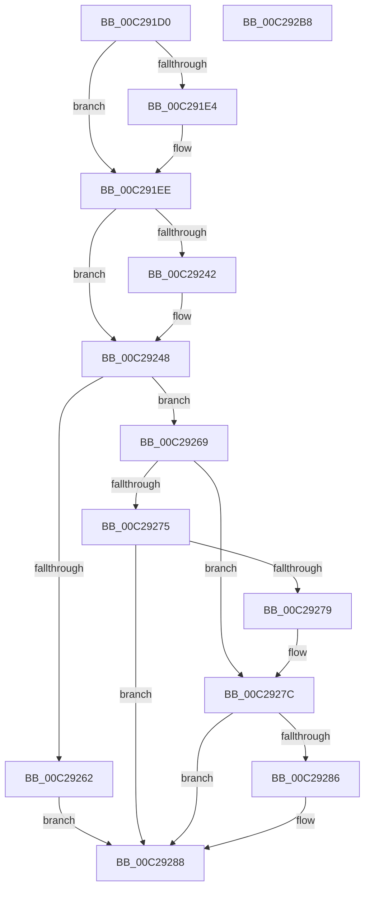

# FsRtlInitializeTunnels

- RVA: `0x00C291D0`–`0x00C292B9` (길이 `233` bytes)
- VA: `0x0000000140C291D0`
- 실행 섹션: `INIT`
- PDB 이름 있음: `예`; PDB Function 태그: `아니요`
- unwind 정보 RVA: `0x00071A74`
- 디코드: `53`개 명령, `233/233` bytes 표시
- 미해석 바이트: `0` (있으면 어셈블리에 `.byte`로 보존)

> 이 문서는 커널 이미지의 기계어와 PDB 기호를 분석해 생성했습니다. 4번과 5번은 함수 원형과 자료형을 바이너리 사용 방식에서 추정한 C 해석이며 원본 소스 복구 결과는 아닙니다.

## 1. Dependencies

- 직접 호출 지점: **3**; 고유 호출 대상: **2**
- 직접 호출자로 확인된 함수: **1**
- RIP 상대 이미지 참조: **8**

### Outgoing calls
- `0x00C2920E` → [FsRtlGetTunnelParameterValue](../../page/71/FsRtlGetTunnelParameterValue_function_00713FA8.md) (function, `0x00713FA8`)
- `0x00C29233` → [FsRtlGetTunnelParameterValue](../../page/71/FsRtlGetTunnelParameterValue_function_00713FA8.md) (function, `0x00713FA8`)
- `0x00C292AD` → [ExInitializePagedLookasideList](../../page/AA/ExInitializePagedLookasideList_function_00AACC30.md) (function, `0x00AACC30`)

### Direct callers
- [FsRtlInitSystem](FsRtlInitSystem_function_00C28EEC.md) at `0x00C28F3F`

### Static image references
- `0x00C291D8` → RVA `0x00FC521C` (`ALMOSTRO`; read)
- `0x00C291E4` → RVA `0x00FD8034` (`PAGEDATA`; write)
- `0x00C291EE` → RVA `0x00C79860` (` ?? ::PBOPGDP::`string'`; read)
- `0x00C291FD` → RVA `0x00FD8034` (`PAGEDATA`; read)
- `0x00C29213` → RVA `0x00C79890` (` ?? ::PBOPGDP::`string'`; read)
- `0x00C29222` → RVA `0x00FD80DC` (`PAGEDATA`; read)
- `0x00C29254` → RVA `0x00FD80DC` (`PAGEDATA`; write)
- `0x00C2928D` → RVA `0x00E11F00` (`.data`; read)

## 2. Other-region calls and transfers

- 다른 실행 섹션으로 향하는 call: **3**
  - `0x00C2920E` → [FsRtlGetTunnelParameterValue](../../page/71/FsRtlGetTunnelParameterValue_function_00713FA8.md) (`INIT` → `PAGE`)
  - `0x00C29233` → [FsRtlGetTunnelParameterValue](../../page/71/FsRtlGetTunnelParameterValue_function_00713FA8.md) (`INIT` → `PAGE`)
  - `0x00C292AD` → [ExInitializePagedLookasideList](../../page/AA/ExInitializePagedLookasideList_function_00AACC30.md) (`INIT` → `PAGE`)
- 별도 외부 분기/꼬리 이동을 확인하지 못했습니다.

## 3. Assembly (complete function range)

```asm
00C291D0  40 53                           push rbx
00C291D2  48 83 EC 50                     sub rsp, 0x50
00C291D6  33 DB                           xor ebx, ebx
00C291D8  38 1D 3E C0 39 00               cmp byte ptr [rip + 0x39c03e], bl
00C291DE  89 5C 24 44                     mov dword ptr [rsp + 0x44], ebx
00C291E2  74 0A                           je 0x140c291ee
00C291E4  C7 05 46 EE 3A 00 00 04 00 00   mov dword ptr [rip + 0x3aee46], 0x400
00C291EE  48 8D 05 6B 06 05 00            lea rax, [rip + 0x5066b]
00C291F5  C7 44 24 40 28 00 2A 00         mov dword ptr [rsp + 0x40], 0x2a0028
00C291FD  48 8D 15 30 EE 3A 00            lea rdx, [rip + 0x3aee30]
00C29204  48 89 44 24 48                  mov qword ptr [rsp + 0x48], rax
00C29209  48 8D 4C 24 40                  lea rcx, [rsp + 0x40]
00C2920E  E8 95 AD AE FF                  call 0x140713fa8
00C29213  48 8D 05 76 06 05 00            lea rax, [rip + 0x50676]
00C2921A  C7 44 24 40 3C 00 3E 00         mov dword ptr [rsp + 0x40], 0x3e003c
00C29222  48 8D 15 B3 EE 3A 00            lea rdx, [rip + 0x3aeeb3]
00C29229  48 89 44 24 48                  mov qword ptr [rsp + 0x48], rax
00C2922E  48 8D 4C 24 40                  lea rcx, [rsp + 0x40]
00C29233  E8 70 AD AE FF                  call 0x140713fa8
00C29238  8B 05 9E EE 3A 00               mov eax, dword ptr [rip + 0x3aee9e]
00C2923E  85 C0                           test eax, eax
00C29240  75 06                           jne 0x140c29248
00C29242  89 1D EC ED 3A 00               mov dword ptr [rip + 0x3aedec], ebx
00C29248  8B 0D E6 ED 3A 00               mov ecx, dword ptr [rip + 0x3aede6]
00C2924E  69 C0 80 96 98 00               imul eax, eax, 0x989680
00C29254  89 05 82 EE 3A 00               mov dword ptr [rip + 0x3aee82], eax
00C2925A  81 F9 FF FF 00 00               cmp ecx, 0xffff
00C29260  76 07                           jbe 0x140c29269
00C29262  B8 00 01 00 00                  mov eax, 0x100
00C29267  EB 1F                           jmp 0x140c29288
00C29269  0F B7 C1                        movzx eax, cx
00C2926C  66 C1 E8 04                     shr ax, 4
00C29270  66 85 C0                        test ax, ax
00C29273  75 07                           jne 0x140c2927c
00C29275  85 C9                           test ecx, ecx
00C29277  74 0F                           je 0x140c29288
00C29279  8D 41 01                        lea eax, [rcx + 1]
00C2927C  B9 00 01 00 00                  mov ecx, 0x100
00C29281  66 3B C1                        cmp ax, cx
00C29284  76 02                           jbe 0x140c29288
00C29286  8B C1                           mov eax, ecx
00C29288  66 89 44 24 30                  mov word ptr [rsp + 0x30], ax
00C2928D  48 8D 0D 6C 8C 1E 00            lea rcx, [rip + 0x1e8c6c]
00C29294  C7 44 24 28 54 75 6E 4C         mov dword ptr [rsp + 0x28], 0x4c6e7554
00C2929C  45 33 C9                        xor r9d, r9d
00C2929F  45 33 C0                        xor r8d, r8d
00C292A2  48 C7 44 24 20 B0 00 00 00      mov qword ptr [rsp + 0x20], 0xb0
00C292AB  33 D2                           xor edx, edx
00C292AD  E8 7E 39 E8 FF                  call 0x140aacc30
00C292B2  48 83 C4 50                     add rsp, 0x50
00C292B6  5B                              pop rbx
00C292B7  C3                              ret
00C292B8  CC                              int3
```

## 4. C-style interpretation (structured pseudocode)

```c
__int64 __fastcall FsRtlInitializeTunnels(__int64 a1, __int64 a2, int a3, int a4)
{
    __int64 result;
    __int64 v_rbx;
    __int64 v_rsp;
    unsigned __int64 v_stack_m10;
    unsigned int v_stack_m14;
    unsigned int v_stack_m18;
    unsigned __int16 v_stack_m28;
    unsigned int v_stack_m30;
    unsigned __int64 v_stack_m38;

    v_rsp = (v_rsp) - (80);
    v_rbx = 0;
    v_stack_m14 = 0;
    if ((*(unsigned __int8 *)(v_rip + 3784766)) != 0) {
        *(unsigned int *)(v_rip + 3862086) = 0x400ULL;
    }
    v_stack_m18 = 0x2A0028ULL;
    v_stack_m10 = v_rip + 329323;
    result = FsRtlGetTunnelParameterValue(v_stack_m18, v_rip + 3862064, a3, a4);
    v_stack_m18 = 0x3E003CULL;
    v_stack_m10 = v_rip + 329334;
    result = FsRtlGetTunnelParameterValue(v_stack_m18, v_rip + 3862195, a3, a4);
    if ((unsigned int)((unsigned int)(*(unsigned int *)(v_rip + 3862174))) == 0) {
        *(unsigned int *)(v_rip + 3861996) = 0;
    }
    result = (unsigned int)(((unsigned int)(*(unsigned int *)(v_rip + 3862174))) * ((unsigned int)((unsigned int)(*(unsigned int *)(v_rip + 3862174)))));
    *(unsigned int *)(v_rip + 3862146) = (unsigned int)(result);
    if (((unsigned int)((unsigned int)(*(unsigned int *)(v_rip + 3861990)))) <= 0xFFFFULL) goto loc_00C29269;
    goto loc_00C29288;
loc_00C29269:
    result = (unsigned __int16)(((unsigned __int16)((unsigned int)(*(unsigned int *)(v_rip + 3861990)))) >> (4));
    if ((unsigned __int16)(result) != 0) goto loc_00C2927C;
    if ((unsigned int)((unsigned int)(*(unsigned int *)(v_rip + 3861990))) == 0) goto loc_00C29288;
loc_00C2927C:
    result = (unsigned int)(*(unsigned int *)(v_rip + 3861990)) + 1;
    if (((unsigned __int16)((unsigned int)(*(unsigned int *)(v_rip + 3861990)) + 1)) >= = 256) {
        result = 256;
    }
    v_stack_m28 = (unsigned __int16)(result);
    v_stack_m30 = 0x4C6E7554ULL;
    a4 = 0;
    a3 = 0;
    v_stack_m38 = 176;
    a2 = 0;
    result = ExInitializePagedLookasideList(v_rip + 2002028, a2, a3, a4);
    v_rsp = (v_rsp) + (80);
    return result;
}
```

## 5. (Beta) C Style

```c
int64_t FsRtlInitializeTunnels(int64_t Arg1, int64_t Arg2, int32_t Arg3, int32_t Arg4)
{
    int64_t result;
    int64_t local_rbx;
    int64_t local_rsp;
    uint64_t v_stack_m10;
    uint32_t v_stack_m14;
    uint32_t v_stack_m18;
    uint16_t v_stack_m28;
    uint32_t v_stack_m30;
    uint64_t v_stack_m38;

    local_rsp = (local_rsp) - (80);
    local_rbx = 0;
    v_stack_m14 = 0;
    if ((*(uint8_t *)(v_rip + 0x39C03E)) != 0) {
        *(uint32_t *)(v_rip + 0x3AEE46) = 0x400ULL;
    }
    v_stack_m18 = 0x2A0028ULL;
    v_stack_m10 = v_rip + 329323;
    result = FsRtlGetTunnelParameterValue(v_stack_m18, v_rip + 3862064, Arg3, Arg4);
    v_stack_m18 = 0x3E003CULL;
    v_stack_m10 = v_rip + 329334;
    result = FsRtlGetTunnelParameterValue(v_stack_m18, v_rip + 3862195, Arg3, Arg4);
    if ((uint32_t)((uint32_t)(*(uint32_t *)(v_rip + 0x3AEE9E))) == 0) {
        *(uint32_t *)(v_rip + 0x3AEDEC) = 0;
    }
    result = (uint32_t)(((uint32_t)(*(uint32_t *)(v_rip + 0x3AEE9E))) * ((uint32_t)((uint32_t)(*(uint32_t *)(v_rip + 0x3AEE9E)))));
    *(uint32_t *)(v_rip + 0x3AEE82) = (uint32_t)(result);
    if (((uint32_t)((uint32_t)(*(uint32_t *)(v_rip + 0x3AEDE6)))) <= 0xFFFFULL) goto loc_00C29269;
    goto loc_00C29288;
loc_00C29269:
    result = (uint16_t)(((uint16_t)((uint32_t)(*(uint32_t *)(v_rip + 0x3AEDE6)))) >> (4));
    if ((uint16_t)(result) != 0) goto loc_00C2927C;
    if ((uint32_t)((uint32_t)(*(uint32_t *)(v_rip + 0x3AEDE6))) == 0) goto loc_00C29288;
loc_00C2927C:
    result = (uint32_t)(*(uint32_t *)(v_rip + 0x3AEDE6)) + 1;
    if (((uint16_t)((uint32_t)(*(uint32_t *)(v_rip + 0x3AEDE6)) + 1)) >= = 256) {
        result = 256;
    }
    v_stack_m28 = (uint16_t)(result);
    v_stack_m30 = 0x4C6E7554ULL;
    Arg4 = 0;
    Arg3 = 0;
    v_stack_m38 = 176;
    Arg2 = 0;
    result = ExInitializePagedLookasideList(v_rip + 2002028, Arg2, Arg3, Arg4);
    local_rsp = (local_rsp) + (80);
    return result;
}
```

## 6. Execution-region graph

[열기: 2D/3D 그래프와 함수 탐색 컨트롤 패널](../../../control-panel.html?section=init&rva=0x00C291D0&view=graph)

- 2D 그래프는 위에서 아래로 흐르고, 3D 그래프는 빈 공간을 드래그해 회전합니다. Shift+드래그는 이동, 휠은 확대·축소, 함수 노드 선택은 대상 보고서 이동입니다.

### Static fallback


