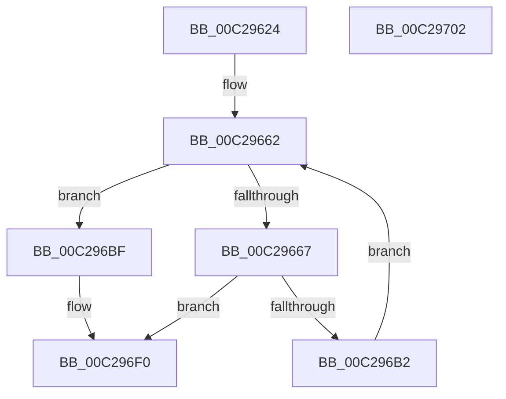

# FsRtlInitializeWorkerThread

- RVA: `0x00C29624`–`0x00C29703` (길이 `223` bytes)
- VA: `0x0000000140C29624`
- 실행 섹션: `INIT`
- PDB 이름 있음: `예`; PDB Function 태그: `아니요`
- unwind 정보 RVA: `0x000C62DC`
- 디코드: `55`개 명령, `223/223` bytes 표시
- 미해석 바이트: `0` (있으면 어셈블리에 `.byte`로 보존)

> 이 문서는 커널 이미지의 기계어와 PDB 기호를 분석해 생성했습니다. 4번과 5번은 함수 원형과 자료형을 바이너리 사용 방식에서 추정한 C 해석이며 원본 소스 복구 결과는 아닙니다.

## 1. Dependencies

- 직접 호출 지점: **3**; 고유 호출 대상: **3**
- 직접 호출자로 확인된 함수: **1**
- RIP 상대 이미지 참조: **8**

### Outgoing calls
- `0x00C2967B` → [KeInitializeQueue](../../text/48/KeInitializeQueue_function_00480C90.md) (function, `0x00480C90`)
- `0x00C296A7` → [PsCreateSystemThread](../../page/9E/PsCreateSystemThread_function_009ED0D0.md) (function, `0x009ED0D0`)
- `0x00C296B6` → [ZwClose](../../text/6A/ZwClose_function_006AD2B0.md) (function, `0x006AD2B0`)

### Direct callers
- [FsRtlInitSystem](FsRtlInitSystem_function_00C28EEC.md) at `0x00C28FE3`

### Static image references
- `0x00C29667` → RVA `0x00F8EE40` (`.data`; read)
- `0x00C29680` → RVA `0x00583480` (`FsRtlWorkerThread`; read)
- `0x00C296BF` → RVA `0x00F8EEC8` (`.data`; read)
- `0x00C296C6` → RVA `0x00F8EEC0` (`.data`; write)
- `0x00C296CF` → RVA `0x00F8EED0` (`.data`; write)
- `0x00C296D6` → RVA `0x00F8EEC8` (`.data`; write)
- `0x00C296DF` → RVA `0x00F8EEC2` (`.data`; write)
- `0x00C296E6` → RVA `0x00F8EEC4` (`.data`; write)

## 2. Other-region calls and transfers

- 다른 실행 섹션으로 향하는 call: **3**
  - `0x00C2967B` → [KeInitializeQueue](../../text/48/KeInitializeQueue_function_00480C90.md) (`INIT` → `.text`)
  - `0x00C296A7` → [PsCreateSystemThread](../../page/9E/PsCreateSystemThread_function_009ED0D0.md) (`INIT` → `PAGE`)
  - `0x00C296B6` → [ZwClose](../../text/6A/ZwClose_function_006AD2B0.md) (`INIT` → `.text`)
- 별도 외부 분기/꼬리 이동을 확인하지 못했습니다.

## 3. Assembly (complete function range)

```asm
00C29624  48 89 5C 24 10                  mov qword ptr [rsp + 0x10], rbx
00C29629  48 89 7C 24 18                  mov qword ptr [rsp + 0x18], rdi
00C2962E  55                              push rbp
00C2962F  48 8B EC                        mov rbp, rsp
00C29632  48 83 EC 70                     sub rsp, 0x70
00C29636  83 65 EC 00                     and dword ptr [rbp - 0x14], 0
00C2963A  33 DB                           xor ebx, ebx
00C2963C  48 21 5D D8                     and qword ptr [rbp - 0x28], rbx
00C29640  0F 57 C0                        xorps xmm0, xmm0
00C29643  21 5D E8                        and dword ptr [rbp - 0x18], ebx
00C29646  48 21 5D E0                     and qword ptr [rbp - 0x20], rbx
00C2964A  48 83 65 10 00                  and qword ptr [rbp + 0x10], 0
00C2964F  48 C7 45 D0 30 00 00 00         mov qword ptr [rbp - 0x30], 0x30
00C29657  83 65 D4 00                     and dword ptr [rbp - 0x2c], 0
00C2965B  33 FF                           xor edi, edi
00C2965D  F3 0F 7F 45 F0                  movdqu xmmword ptr [rbp - 0x10], xmm0
00C29662  83 FF 02                        cmp edi, 2
00C29665  73 58                           jae 0x140c296bf
00C29667  48 8D 05 D2 57 36 00            lea rax, [rip + 0x3657d2]
00C2966E  8B CF                           mov ecx, edi
00C29670  48 C1 E1 06                     shl rcx, 6
00C29674  33 D2                           xor edx, edx
00C29676  48 03 C8                        add rcx, rax
00C29679  8B DF                           mov ebx, edi
00C2967B  E8 10 76 85 FF                  call 0x140480c90
00C29680  48 8D 05 F9 9D 95 FF            lea rax, [rip - 0x6a6207]
00C29687  48 89 5C 24 30                  mov qword ptr [rsp + 0x30], rbx
00C2968C  48 89 44 24 28                  mov qword ptr [rsp + 0x28], rax
00C29691  4C 8D 45 D0                     lea r8, [rbp - 0x30]
00C29695  48 83 64 24 20 00               and qword ptr [rsp + 0x20], 0
00C2969B  48 8D 4D 10                     lea rcx, [rbp + 0x10]
00C2969F  45 33 C9                        xor r9d, r9d
00C296A2  BA FF FF 1F 00                  mov edx, 0x1fffff
00C296A7  E8 24 3A DC FF                  call 0x1409ed0d0
00C296AC  8B D8                           mov ebx, eax
00C296AE  85 C0                           test eax, eax
00C296B0  78 3E                           js 0x140c296f0
00C296B2  48 8B 4D 10                     mov rcx, qword ptr [rbp + 0x10]
00C296B6  E8 F5 3B A8 FF                  call 0x1406ad2b0
00C296BB  FF C7                           inc edi
00C296BD  EB A3                           jmp 0x140c29662
00C296BF  48 8D 05 02 58 36 00            lea rax, [rip + 0x365802]
00C296C6  66 C7 05 F1 57 36 00 01 00      mov word ptr [rip + 0x3657f1], 1
00C296CF  48 89 05 FA 57 36 00            mov qword ptr [rip + 0x3657fa], rax
00C296D6  48 89 05 EB 57 36 00            mov qword ptr [rip + 0x3657eb], rax
00C296DD  8B C3                           mov eax, ebx
00C296DF  C6 05 DC 57 36 00 06            mov byte ptr [rip + 0x3657dc], 6
00C296E6  C7 05 D4 57 36 00 01 00 00 00   mov dword ptr [rip + 0x3657d4], 1
00C296F0  4C 8D 5C 24 70                  lea r11, [rsp + 0x70]
00C296F5  49 8B 5B 18                     mov rbx, qword ptr [r11 + 0x18]
00C296F9  49 8B 7B 20                     mov rdi, qword ptr [r11 + 0x20]
00C296FD  49 8B E3                        mov rsp, r11
00C29700  5D                              pop rbp
00C29701  C3                              ret
00C29702  CC                              int3
```

## 4. C-style interpretation (structured pseudocode)

```c
__int64 __fastcall FsRtlInitializeWorkerThread(__int64 a1, int a2, __int64 a3, int a4)
{
    __int64 result;
    __int64 v_rbx;
    __int64 v_rdi;
    __int64 v_rsp;
    unsigned __int64 v_stack_m18;
    unsigned int v_stack_m1C;
    unsigned int v_stack_m20;
    unsigned __int64 v_stack_m28;
    unsigned __int64 v_stack_m30;
    unsigned int v_stack_m34;
    unsigned __int64 v_stack_m38;
    unsigned __int64 v_stack_m48;
    unsigned __int64 v_stack_m50;
    unsigned __int64 v_stack_m58;
    unsigned __int64 v_stack_m8;
    unsigned __int64 v_stack_p10;
    unsigned __int64 v_stack_p18;
    unsigned __int64 v_stack_p8;

    v_stack_p10 = v_rbx;
    v_stack_p18 = v_rdi;
    v_rsp = (v_rsp) - (112);
    v_rbx = 0;
    v_stack_m38 = 48;
    v_rdi = 0;
    v_stack_m18 = v_xmm0;
loc_00C29662:
    if (0 >= 2) goto loc_00C296BF;
    a1 = (0) << (6);
    a2 = 0;
    a1 = (a1) + (v_rip + 3561426);
    result = KeInitializeQueue(a1, a2, a3, a4);
    v_stack_m48 = 0;
    v_stack_m50 = v_rip - 6971911;
    a4 = 0;
    result = PsCreateSystemThread(v_stack_p8, (unsigned int)(0x1FFFFFULL), v_stack_m38, a4);
    if (sign_flag) goto loc_00C296F0;
    result = ZwClose(v_stack_p8, (unsigned int)(0x1FFFFFULL), v_stack_m38, a4);
    v_rdi = (unsigned int)((v_rdi) + 1);
    goto loc_00C29662;
loc_00C296BF:
    *(unsigned __int16 *)(v_rip + 3561457) = 1;
    *(unsigned __int64 *)(v_rip + 3561466) = v_rip + 3561474;
    *(unsigned __int64 *)(v_rip + 3561451) = v_rip + 3561474;
    *(unsigned __int8 *)(v_rip + 3561436) = 6;
    *(unsigned int *)(v_rip + 3561428) = 1;
loc_00C296F0:
    return (unsigned int)((unsigned int)((unsigned int)((unsigned int)(result))));
}
```

## 5. (Beta) C Style

```c
int64_t FsRtlInitializeWorkerThread(int64_t Arg1, int32_t Arg2, int64_t Arg3, int32_t Arg4)
{
    int64_t result;
    int64_t local_rbx;
    int64_t local_rdi;
    int64_t local_rsp;
    uint64_t v_stack_m18;
    uint32_t v_stack_m1C;
    uint32_t v_stack_m20;
    uint64_t v_stack_m28;
    uint64_t v_stack_m30;
    uint32_t v_stack_m34;
    uint64_t v_stack_m38;
    uint64_t v_stack_m48;
    uint64_t v_stack_m50;
    uint64_t v_stack_m58;
    uint64_t v_stack_m8;
    uint64_t v_stack_p10;
    uint64_t v_stack_p18;
    uint64_t v_stack_p8;

    v_stack_p10 = local_rbx;
    v_stack_p18 = local_rdi;
    local_rsp = (local_rsp) - (112);
    local_rbx = 0;
    v_stack_m38 = 48;
    local_rdi = 0;
    v_stack_m18 = v_xmm0;
loc_00C29662:
    if (0 >= 2) goto loc_00C296BF;
    Arg1 = (0) << (6);
    Arg2 = 0;
    Arg1 = (Arg1) + (v_rip + 3561426);
    result = KeInitializeQueue(Arg1, Arg2, Arg3, Arg4);
    v_stack_m48 = 0;
    v_stack_m50 = v_rip - 6971911;
    Arg4 = 0;
    result = PsCreateSystemThread(v_stack_p8, (uint32_t)(0x1FFFFFULL), v_stack_m38, Arg4);
    if (sign_flag) goto loc_00C296F0;
    result = ZwClose(v_stack_p8, (uint32_t)(0x1FFFFFULL), v_stack_m38, Arg4);
    local_rdi = (uint32_t)((local_rdi) + 1);
    goto loc_00C29662;
loc_00C296BF:
    *(uint16_t *)(v_rip + 0x3657F1) = 1;
    *(uint64_t *)(v_rip + 0x3657FA) = v_rip + 3561474;
    *(uint64_t *)(v_rip + 0x3657EB) = v_rip + 3561474;
    *(uint8_t *)(v_rip + 0x3657DC) = 6;
    *(uint32_t *)(v_rip + 0x3657D4) = 1;
loc_00C296F0:
    return (uint32_t)((uint32_t)((uint32_t)((uint32_t)(result))));
}
```

## 6. Execution-region graph

[열기: 2D/3D 그래프와 함수 탐색 컨트롤 패널](../../../control-panel.html?section=init&rva=0x00C29624&view=graph)

- 2D 그래프는 위에서 아래로 흐르고, 3D 그래프는 빈 공간을 드래그해 회전합니다. Shift+드래그는 이동, 휠은 확대·축소, 함수 노드 선택은 대상 보고서 이동입니다.

### Static fallback


