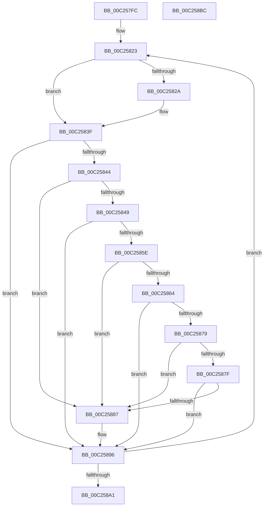

# HalpAcpiDetectMachineSpecificActions

- RVA: `0x00C257FC`–`0x00C258BD` (길이 `193` bytes)
- VA: `0x0000000140C257FC`
- 실행 섹션: `INIT`
- PDB 이름 있음: `예`; PDB Function 태그: `아니요`
- unwind 정보 RVA: `0x0005E6B4`
- 디코드: `59`개 명령, `193/193` bytes 표시
- 미해석 바이트: `0` (있으면 어셈블리에 `.byte`로 보존)

> 이 문서는 커널 이미지의 기계어와 PDB 기호를 분석해 생성했습니다. 4번과 5번은 함수 원형과 자료형을 바이너리 사용 방식에서 추정한 C 해석이며 원본 소스 복구 결과는 아닙니다.

## 1. Dependencies

- 직접 호출 지점: **4**; 고유 호출 대상: **3**
- 직접 호출자로 확인된 함수: **1**
- RIP 상대 이미지 참조: **1**

### Outgoing calls
- `0x00C25835` → [HalpAcpiGetTable](../../text/3F/HalpAcpiGetTable_function_003F6BF8.md) (function, `0x003F6BF8`)
- `0x00C25855` → [memcmp](../../text/6C/memcmp_function_006C6B10.md) (function, `0x006C6B10`)
- `0x00C25870` → [memcmp](../../text/6C/memcmp_function_006C6B10.md) (function, `0x006C6B10`)
- `0x00C25891` → [guard_dispatch_icall](../../text/6B/guard_dispatch_icall_function_006BAAD0.md) (function, `0x006BAAD0`)

### Direct callers
- [HalpSetupAcpiPhase0](HalpSetupAcpiPhase0_function_00C23EDC.md) at `0x00C23FF4`

### Static image references
- `0x00C25817` → RVA `0x00C82F7C` (`INIT`; read)

## 2. Other-region calls and transfers

- 다른 실행 섹션으로 향하는 call: **4**
  - `0x00C25835` → [HalpAcpiGetTable](../../text/3F/HalpAcpiGetTable_function_003F6BF8.md) (`INIT` → `.text`)
  - `0x00C25855` → [memcmp](../../text/6C/memcmp_function_006C6B10.md) (`INIT` → `.text`)
  - `0x00C25870` → [memcmp](../../text/6C/memcmp_function_006C6B10.md) (`INIT` → `.text`)
  - `0x00C25891` → [guard_dispatch_icall](../../text/6B/guard_dispatch_icall_function_006BAAD0.md) (`INIT` → `.text`)
- 별도 외부 분기/꼬리 이동을 확인하지 못했습니다.

## 3. Assembly (complete function range)

```asm
00C257FC  48 8B C4                        mov rax, rsp
00C257FF  48 89 58 08                     mov qword ptr [rax + 8], rbx
00C25803  48 89 68 10                     mov qword ptr [rax + 0x10], rbp
00C25807  48 89 70 18                     mov qword ptr [rax + 0x18], rsi
00C2580B  48 89 78 20                     mov qword ptr [rax + 0x20], rdi
00C2580F  41 56                           push r14
00C25811  48 83 EC 20                     sub rsp, 0x20
00C25815  33 ED                           xor ebp, ebp
00C25817  48 8D 1D 5E D7 05 00            lea rbx, [rip + 0x5d75e]
00C2581E  33 FF                           xor edi, edi
00C25820  4C 8B F1                        mov r14, rcx
00C25823  8B 73 FC                        mov esi, dword ptr [rbx - 4]
00C25826  3B F5                           cmp esi, ebp
00C25828  74 15                           je 0x140c2583f
00C2582A  45 33 C9                        xor r9d, r9d
00C2582D  45 33 C0                        xor r8d, r8d
00C25830  8B D6                           mov edx, esi
00C25832  49 8B CE                        mov rcx, r14
00C25835  E8 BE 13 7D FF                  call 0x1403f6bf8
00C2583A  48 8B F8                        mov rdi, rax
00C2583D  8B EE                           mov ebp, esi
00C2583F  48 85 FF                        test rdi, rdi
00C25842  74 52                           je 0x140c25896
00C25844  80 3B 01                        cmp byte ptr [rbx], 1
00C25847  75 3E                           jne 0x140c25887
00C25849  44 8B 43 0C                     mov r8d, dword ptr [rbx + 0xc]
00C2584D  48 8D 4F 0A                     lea rcx, [rdi + 0xa]
00C25851  48 8B 53 04                     mov rdx, qword ptr [rbx + 4]
00C25855  E8 B6 12 AA FF                  call 0x1406c6b10
00C2585A  85 C0                           test eax, eax
00C2585C  75 38                           jne 0x140c25896
00C2585E  80 7B 10 01                     cmp byte ptr [rbx + 0x10], 1
00C25862  75 23                           jne 0x140c25887
00C25864  44 8B 43 1C                     mov r8d, dword ptr [rbx + 0x1c]
00C25868  48 8D 4F 10                     lea rcx, [rdi + 0x10]
00C2586C  48 8B 53 14                     mov rdx, qword ptr [rbx + 0x14]
00C25870  E8 9B 12 AA FF                  call 0x1406c6b10
00C25875  85 C0                           test eax, eax
00C25877  75 1D                           jne 0x140c25896
00C25879  80 7B 20 01                     cmp byte ptr [rbx + 0x20], 1
00C2587D  75 08                           jne 0x140c25887
00C2587F  8B 43 24                        mov eax, dword ptr [rbx + 0x24]
00C25882  39 47 18                        cmp dword ptr [rdi + 0x18], eax
00C25885  75 0F                           jne 0x140c25896
00C25887  48 8D 4B F4                     lea rcx, [rbx - 0xc]
00C2588B  48 8B D7                        mov rdx, rdi
00C2588E  48 8B 01                        mov rax, qword ptr [rcx]
00C25891  E8 3A 52 A9 FF                  call 0x1406baad0
00C25896  48 83 C3 38                     add rbx, 0x38
00C2589A  48 83 7B F4 00                  cmp qword ptr [rbx - 0xc], 0
00C2589F  75 82                           jne 0x140c25823
00C258A1  48 8B 5C 24 30                  mov rbx, qword ptr [rsp + 0x30]
00C258A6  48 8B 6C 24 38                  mov rbp, qword ptr [rsp + 0x38]
00C258AB  48 8B 74 24 40                  mov rsi, qword ptr [rsp + 0x40]
00C258B0  48 8B 7C 24 48                  mov rdi, qword ptr [rsp + 0x48]
00C258B5  48 83 C4 20                     add rsp, 0x20
00C258B9  41 5E                           pop r14
00C258BB  C3                              ret
00C258BC  CC                              int3
```

## 4. C-style interpretation (structured pseudocode)

```c
__int64 __fastcall HalpAcpiDetectMachineSpecificActions(__int64 a1, __int64 a2, int a3, int a4)
{
    __int64 result;
    __int64 v_rbp;
    __int64 v_rbx;
    __int64 v_rdi;
    __int64 v_rsp;
    unsigned __int64 v_stack_p10;
    unsigned __int64 v_stack_p18;
    unsigned __int64 v_stack_p20;
    unsigned __int64 v_stack_p8;

    *(unsigned __int64 *)(v_rsp + 8) = v_rbx;
    *(unsigned __int64 *)(v_rsp + 16) = v_rbp;
    *(unsigned __int64 *)(v_rsp + 24) = v_rsi;
    *(unsigned __int64 *)(v_rsp + 32) = v_rdi;
    v_rsp = (v_rsp) - (32);
    v_rbp = 0;
    v_rdi = 0;
loc_00C25823:
    result = v_rsp;
    if (((unsigned int)((unsigned int)(*(unsigned int *)(v_rip + 382814 - 4)))) != 0) {
        a4 = 0;
        a3 = 0;
        a2 = (unsigned int)((unsigned int)(*(unsigned int *)(v_rip + 382814 - 4)));
        a1 = a1;
        result = HalpAcpiGetTable(a1, a2, a3, a4);
        v_rdi = result;
        v_rbp = (unsigned int)((unsigned int)(*(unsigned int *)(v_rip + 382814 - 4)));
    }
    if (v_rdi == 0) goto loc_00C25896;
    if ((*(unsigned __int8 *)(v_rip + 382814)) != 1) goto loc_00C25887;
    result = memcmp(v_rdi + 10, *(unsigned __int64 *)(v_rip + 382814 + 4), (unsigned int)(*(unsigned int *)(v_rip + 382814 + 12)), a4);
    if ((unsigned int)(result) != 0) goto loc_00C25896;
    if ((*(unsigned __int8 *)(v_rip + 382814 + 16)) != 1) goto loc_00C25887;
    result = memcmp(v_rdi + 16, *(unsigned __int64 *)(v_rip + 382814 + 20), (unsigned int)(*(unsigned int *)(v_rip + 382814 + 28)), a4);
    if ((unsigned int)(result) != 0) goto loc_00C25896;
    if ((*(unsigned __int8 *)(v_rip + 382814 + 32)) != 1) goto loc_00C25887;
    result = (unsigned int)(*(unsigned int *)(v_rip + 382814 + 36));
    if ((*(unsigned int *)(v_rdi + 24)) == ((unsigned int)((unsigned int)(*(unsigned int *)(v_rip + 382814 + 36))))) {
        a1 = v_rip + 382814 - 12;
        a2 = v_rdi;
        result = *(unsigned __int64 *)(a1);
        result = guard_dispatch_icall(a1, a2, (unsigned int)(*(unsigned int *)(v_rip + 382814 + 28)), a4);
    }
    v_rbx = (v_rip + 382814) + (56);
    if ((*(unsigned __int64 *)(v_rbx - 12)) != 0) goto loc_00C25823;
    v_rsp = (v_rsp) + (32);
    return result;
}
```

## 5. (Beta) C Style

```c
int64_t HalpAcpiDetectMachineSpecificActions(int64_t Arg1, int64_t Arg2, int32_t Arg3, int32_t Arg4)
{
    int64_t result;
    int64_t local_rbp;
    int64_t local_rbx;
    int64_t local_rdi;
    int64_t local_rsp;
    uint64_t v_stack_p10;
    uint64_t v_stack_p18;
    uint64_t v_stack_p20;
    uint64_t v_stack_p8;

    *(uint64_t *)(local_rsp + 0x8) = local_rbx;
    *(uint64_t *)(local_rsp + 0x10) = local_rbp;
    *(uint64_t *)(local_rsp + 0x18) = local_rsi;
    *(uint64_t *)(local_rsp + 0x20) = local_rdi;
    local_rsp = (local_rsp) - (32);
    local_rbp = 0;
    local_rdi = 0;
loc_00C25823:
    result = local_rsp;
    if (((uint32_t)((uint32_t)(*(uint32_t *)(v_rip + 0x5D75E - 0x4)))) != 0) {
        Arg4 = 0;
        Arg3 = 0;
        Arg2 = (uint32_t)((uint32_t)(*(uint32_t *)(v_rip + 0x5D75E - 0x4)));
        Arg1 = Arg1;
        result = HalpAcpiGetTable(Arg1, Arg2, Arg3, Arg4);
        local_rdi = result;
        local_rbp = (uint32_t)((uint32_t)(*(uint32_t *)(v_rip + 0x5D75E - 0x4)));
    }
    if (local_rdi == 0) goto loc_00C25896;
    if ((*(uint8_t *)(v_rip + 0x5D75E)) != 1) goto loc_00C25887;
    result = memcmp(local_rdi + 10, *(uint64_t *)(v_rip + 0x5D75E + 0x4), (uint32_t)(*(uint32_t *)(v_rip + 0x5D75E + 0xC)), Arg4);
    if ((uint32_t)(result) != 0) goto loc_00C25896;
    if ((*(uint8_t *)(v_rip + 0x5D75E + 0x10)) != 1) goto loc_00C25887;
    result = memcmp(local_rdi + 16, *(uint64_t *)(v_rip + 0x5D75E + 0x14), (uint32_t)(*(uint32_t *)(v_rip + 0x5D75E + 0x1C)), Arg4);
    if ((uint32_t)(result) != 0) goto loc_00C25896;
    if ((*(uint8_t *)(v_rip + 0x5D75E + 0x20)) != 1) goto loc_00C25887;
    result = (uint32_t)(*(uint32_t *)(v_rip + 0x5D75E + 0x24));
    if ((*(uint32_t *)(local_rdi + 0x18)) == ((uint32_t)((uint32_t)(*(uint32_t *)(v_rip + 0x5D75E + 0x24))))) {
        Arg1 = v_rip + 382814 - 12;
        Arg2 = local_rdi;
        result = *(uint64_t *)(Arg1);
        result = guard_dispatch_icall(Arg1, Arg2, (uint32_t)(*(uint32_t *)(v_rip + 0x5D75E + 0x1C)), Arg4);
    }
    local_rbx = (v_rip + 382814) + (56);
    if ((*(uint64_t *)(local_rbx - 0xC)) != 0) goto loc_00C25823;
    local_rsp = (local_rsp) + (32);
    return result;
}
```

## 6. Execution-region graph

[열기: 2D/3D 그래프와 함수 탐색 컨트롤 패널](../../../control-panel.html?section=init&rva=0x00C257FC&view=graph)

- 2D 그래프는 위에서 아래로 흐르고, 3D 그래프는 빈 공간을 드래그해 회전합니다. Shift+드래그는 이동, 휠은 확대·축소, 함수 노드 선택은 대상 보고서 이동입니다.

### Static fallback


